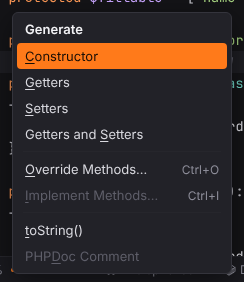
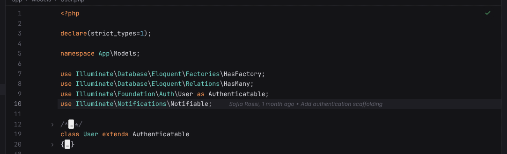

# Shortcuts: Editing

Typing, selecting, moving and commenting code, completion, generation, formatting and folding. Windows/Linux shortcuts first, macOS second; both are PHPStorm's defaults and can be changed in Settings | Keymap.

| Action | Windows / Linux | macOS |
| --- | --- | --- |
| [Basic Completion](#basic-completion) | `Ctrl+Space`, `Shift+Space` | `Ctrl+Space`, `Shift+Space` |
| [Cyclic Expand Word](#cyclic-expand-word) | `Alt+/` | `Alt+/` |
| [Cyclic Expand Word (Backward)](#cyclic-expand-word-backward) | `Alt+Shift+/` | `Alt+Shift+/` |
| [Complete Current Statement](#complete-current-statement) | `Ctrl+Shift+Enter` | `Cmd+Shift+Enter` |
| [Parameter Info](#parameter-info) | `Ctrl+P` | `Cmd+P` |
| [Generate…](#generate) | `Alt+Insert` | `Cmd+N` |
| [Undo](#undo) | `Ctrl+Z`, `Alt+Backspace` | `Cmd+Z` |
| [Redo](#redo) | `Ctrl+Shift+Z`, `Alt+Shift+Backspace` | `Cmd+Shift+Z` |
| [Cut](#cut) | `Ctrl+X`, `Shift+Delete` | `Cmd+X` |
| [Copy](#copy) | `Ctrl+C`, `Ctrl+Insert` | `Cmd+C` |
| [Paste](#paste) | `Ctrl+V`, `Shift+Insert` | `Cmd+V` |
| [Paste as Plain Text](#paste-as-plain-text) | `Ctrl+Alt+Shift+V` | `Cmd+Alt+Shift+V` |
| [Select All](#select-all) | `Ctrl+A` | `Cmd+A` |
| [Duplicate Line or Selection](#duplicate-line-or-selection) | `Ctrl+D` | `Cmd+D` |
| [Delete Line](#delete-line) | `Ctrl+Y` | `Cmd+Backspace` |
| [Comment with Line Comment](#comment-with-line-comment) | `Ctrl+/`, `Ctrl+NumPad/` | `Cmd+/`, `Cmd+NumPad/` |
| [Comment with Block Comment](#comment-with-block-comment) | `Ctrl+Shift+/`, `Ctrl+Shift+NumPad/` | `Cmd+Alt+/`, `Cmd+Alt+NumPad/` |
| [Move Line Up](#move-line-up) | `Alt+Shift+Up` | `Alt+Shift+Up` |
| [Move Line Down](#move-line-down) | `Alt+Shift+Down` | `Alt+Shift+Down` |
| [Move Statement Up](#move-statement-up) | `Ctrl+Shift+Up` | `Cmd+Shift+Up` |
| [Move Statement Down](#move-statement-down) | `Ctrl+Shift+Down` | `Cmd+Shift+Down` |
| [Extend Selection](#extend-selection) | `Ctrl+W` | `Alt+Up` |
| [Shrink Selection](#shrink-selection) | `Ctrl+Shift+W` | `Alt+Down` |
| [Add Selection for Next Occurrence](#add-selection-for-next-occurrence) | `Alt+J` | `Ctrl+G` |
| [Unselect Occurrence](#unselect-occurrence) | `Alt+Shift+J` | `Ctrl+Shift+G` |
| [Select All Occurrences](#select-all-occurrences) | `Ctrl+Alt+Shift+J` | `Ctrl+Cmd+G` |
| [Join Lines](#join-lines) | `Ctrl+Shift+J` | `Ctrl+Shift+J` |
| [Toggle Case](#toggle-case) | `Ctrl+Shift+U` | `Cmd+Shift+U` |
| [Split Line](#split-line) | `Ctrl+Enter` | `Cmd+Enter` |
| [Start New Line](#start-new-line) | `Shift+Enter` | `Shift+Enter` |
| [Start New Line Before Current](#start-new-line-before-current) | `Ctrl+Alt+Enter` | `Cmd+Alt+Enter` |
| [Auto-Indent Lines](#auto-indent-lines) | `Ctrl+Alt+I` | `Ctrl+Alt+I` |
| [Reformat Code](#reformat-code) | `Ctrl+Alt+L` | `Cmd+Alt+L` |
| [Copy Absolute Path](#copy-absolute-path) | `Ctrl+Shift+C` | `Cmd+Shift+C` |
| [Copy Reference](#copy-reference) | `Ctrl+Alt+Shift+C` | `Cmd+Alt+Shift+C` |
| [Expand](#expand) | `Ctrl+=`, `Ctrl+NumPad+` | `Cmd+=`, `Cmd+NumPad+` |
| [Collapse](#collapse) | `Ctrl+-`, `Ctrl+NumPad-` | `Cmd+-`, `Cmd+NumPad-` |
| [Expand Recursively](#expand-recursively) | `Ctrl+Alt+=`, `Ctrl+Alt+NumPad+` | `Cmd+Alt+=`, `Cmd+Alt+NumPad+` |
| [Collapse Recursively](#collapse-recursively) | `Ctrl+Alt+-`, `Ctrl+Alt+NumPad-` | `Cmd+Alt+-`, `Cmd+Alt+NumPad-` |
| [Expand All](#expand-all) | `Ctrl+Shift+=`, `Ctrl+Shift+NumPad+` | `Cmd+Shift+=`, `Cmd+Shift+NumPad+` |
| [Collapse All](#collapse-all) | `Ctrl+Shift+-`, `Ctrl+Shift+NumPad-` | `Cmd+Shift+-`, `Cmd+Shift+NumPad-` |
| [Scroll Up](#scroll-up) | `Ctrl+Up` | — |
| [Scroll Down](#scroll-down) | `Ctrl+Down` | — |

## Basic Completion

**Shortcut:** `Ctrl+Space`, `Shift+Space` · macOS `Ctrl+Space`, `Shift+Space` · action id `CodeCompletion`

Opens code completion at the caret; also offers words from the document.

**Menu:** Code | Code Completion | Basic Completion

More: [Editor](../../user/editor.md#code-completion)

## Cyclic Expand Word

**Shortcut:** `Alt+/` · macOS `Alt+/` · action id `HippieCompletion`

Completes the word at the caret with the nearest word of the file that starts with it (above the caret first, then below, then the other open files); press again to cycle.

**Menu:** Code | Code Completion | Cyclic Expand Word

More: [Editor](../../user/editor.md#cyclic-expand-word)

## Cyclic Expand Word (Backward)

**Shortcut:** `Alt+Shift+/` · macOS `Alt+Shift+/` · action id `HippieBackwardCompletion`

Like Cyclic Expand Word, but looks below the caret first and cycles the other way.

**Menu:** Code | Code Completion | Cyclic Expand Word (Backward)

More: [Editor](../../user/editor.md#cyclic-expand-word)

## Complete Current Statement

**Shortcut:** `Ctrl+Shift+Enter` · macOS `Cmd+Shift+Enter` · action id `EditorCompleteStatement`

Closes open brackets, adds the missing `;` (PHP, JavaScript, TypeScript) or `then … end` (Lua), opens the block of control statements and moves the caret on.

More: [Editor](../../user/editor.md#complete-current-statement)

## Parameter Info

**Shortcut:** `Ctrl+P` · macOS `Cmd+P` · action id `ParameterInfo`

Shows the parameters of the call at the caret, the current one in bold.

**Menu:** View | Parameter Info

More: [Editor](../../user/editor.md#parameter-info)

## Generate

**Shortcut:** `Alt+Insert` · macOS `Cmd+N` · action id `Generate`

In PHP files: generates a constructor, getters, setters, overrides, `__toString()` or a PHPDoc block.

**Menu:** Code | Generate…

More: [PHP](../../user/php.md#generate)

## Undo

**Shortcut:** `Ctrl+Z`, `Alt+Backspace` · macOS `Cmd+Z` · action id `$Undo`

Undoes the last edit in the editor.

**Menu:** Edit | Undo

More: [Editor](../../user/editor.md#editing-actions)

## Redo

**Shortcut:** `Ctrl+Shift+Z`, `Alt+Shift+Backspace` · macOS `Cmd+Shift+Z` · action id `$Redo`

Redoes the last undone edit.

**Menu:** Edit | Redo

More: [Editor](../../user/editor.md#editing-actions)

## Cut

**Shortcut:** `Ctrl+X`, `Shift+Delete` · macOS `Cmd+X` · action id `$Cut`

Cuts the selection, or the whole line when nothing is selected.

**Menu:** Edit | Cut

More: [Editor](../../user/editor.md#editing-actions)

## Copy

**Shortcut:** `Ctrl+C`, `Ctrl+Insert` · macOS `Cmd+C` · action id `$Copy`

Copies the selection, or the whole line when nothing is selected.

**Menu:** Edit | Copy

More: [Editor](../../user/editor.md#editing-actions)

## Paste

**Shortcut:** `Ctrl+V`, `Shift+Insert` · macOS `Cmd+V` · action id `$Paste`

Pastes from the clipboard.

**Menu:** Edit | Paste

More: [Editor](../../user/editor.md#editing-actions)

## Paste as Plain Text

**Shortcut:** `Ctrl+Alt+Shift+V` · macOS `Cmd+Alt+Shift+V` · action id `PasteSimple`

Pastes the clipboard as plain text.

**Menu:** Edit | Paste Special | Paste as Plain Text

More: [Editor](../../user/editor.md#editing-actions)

## Select All

**Shortcut:** `Ctrl+A` · macOS `Cmd+A` · action id `$SelectAll`

Selects the whole document.

**Menu:** Edit | Select All

More: [Editor](../../user/editor.md#editing-actions)

## Duplicate Line or Selection

**Shortcut:** `Ctrl+D` · macOS `Cmd+D` · action id `EditorDuplicate`

Duplicates the current line or the selection.

**Menu:** Edit | Duplicate Line or Selection

More: [Editor](../../user/editor.md#editing-actions)

## Delete Line

**Shortcut:** `Ctrl+Y` · macOS `Cmd+Backspace` · action id `EditorDeleteLine`

Deletes the current line.

More: [Editor](../../user/editor.md#editing-actions)

## Comment with Line Comment

**Shortcut:** `Ctrl+/`, `Ctrl+NumPad/` · macOS `Cmd+/`, `Cmd+NumPad/` · action id `CommentByLineComment`

Comments or uncomments the current line or the selected lines.

**Menu:** Code | Comment with Line Comment

More: [Editor](../../user/editor.md#editing-actions)

## Comment with Block Comment

**Shortcut:** `Ctrl+Shift+/`, `Ctrl+Shift+NumPad/` · macOS `Cmd+Alt+/`, `Cmd+Alt+NumPad/` · action id `CommentByBlockComment`

Wraps the selection in a block comment, or removes it.

**Menu:** Code | Comment with Block Comment

More: [Editor](../../user/editor.md#editing-actions)

## Move Line Up

**Shortcut:** `Alt+Shift+Up` · macOS `Alt+Shift+Up` · action id `MoveLineUp`

Moves the current line or selection up.

**Menu:** Code | Move Line Up

More: [Editor](../../user/editor.md#editing-actions)

## Move Line Down

**Shortcut:** `Alt+Shift+Down` · macOS `Alt+Shift+Down` · action id `MoveLineDown`

Moves the current line or selection down.

**Menu:** Code | Move Line Down

More: [Editor](../../user/editor.md#editing-actions)

## Move Statement Up

**Shortcut:** `Ctrl+Shift+Up` · macOS `Cmd+Shift+Up` · action id `MoveStatementUp`

Moves the current line or selection up.

**Menu:** Code | Move Statement Up

More: [Editor](../../user/editor.md#editing-actions)

## Move Statement Down

**Shortcut:** `Ctrl+Shift+Down` · macOS `Cmd+Shift+Down` · action id `MoveStatementDown`

Moves the current line or selection down.

**Menu:** Code | Move Statement Down

More: [Editor](../../user/editor.md#editing-actions)

## Extend Selection

**Shortcut:** `Ctrl+W` · macOS `Alt+Up` · action id `EditorSelectWord`

Extends the selection to the next larger syntactic unit (word, expression, statement, block).

**Menu:** Edit | Extend Selection

More: [Editor](../../user/editor.md#editing-actions)

## Shrink Selection

**Shortcut:** `Ctrl+Shift+W` · macOS `Alt+Down` · action id `EditorUnSelectWord`

Shrinks the selection back.

**Menu:** Edit | Shrink Selection

More: [Editor](../../user/editor.md#editing-actions)

## Add Selection for Next Occurrence

**Shortcut:** `Alt+J` · macOS `Ctrl+G` · action id `SelectNextOccurrence`

Adds the next occurrence of the selected text as another selection (multiple carets).

**Menu:** Edit | Find | Add Selection for Next Occurrence

More: [Editor](../../user/editor.md#editing-actions)

## Unselect Occurrence

**Shortcut:** `Alt+Shift+J` · macOS `Ctrl+Shift+G` · action id `UnselectPreviousOccurrence`

Removes the occurrence added last.

**Menu:** Edit | Find | Unselect Occurrence

More: [Editor](../../user/editor.md#editing-actions)

## Select All Occurrences

**Shortcut:** `Ctrl+Alt+Shift+J` · macOS `Ctrl+Cmd+G` · action id `SelectAllOccurrences`

Selects every occurrence of the selected text.

**Menu:** Edit | Find | Select All Occurrences

More: [Editor](../../user/editor.md#editing-actions)

## Join Lines

**Shortcut:** `Ctrl+Shift+J` · macOS `Ctrl+Shift+J` · action id `EditorJoinLines`

Joins the selected lines (or the next line) into one.

**Menu:** Edit | Join Lines

More: [Editor](../../user/editor.md#editing-actions)

## Toggle Case

**Shortcut:** `Ctrl+Shift+U` · macOS `Cmd+Shift+U` · action id `EditorToggleCase`

Switches the selection between upper and lower case.

**Menu:** Edit | Toggle Case

More: [Editor](../../user/editor.md#editing-actions)

## Split Line

**Shortcut:** `Ctrl+Enter` · macOS `Cmd+Enter` · action id `EditorSplitLine`

Breaks the line at the caret without moving the caret.

More: [Editor](../../user/editor.md#editing-actions)

## Start New Line

**Shortcut:** `Shift+Enter` · macOS `Shift+Enter` · action id `EditorStartNewLine`

Starts a new line below the current one, wherever the caret is.

More: [Editor](../../user/editor.md#editing-actions)

## Start New Line Before Current

**Shortcut:** `Ctrl+Alt+Enter` · macOS `Cmd+Alt+Enter` · action id `EditorStartNewLineBefore`

Starts a new line above the current one.

More: [Editor](../../user/editor.md#editing-actions)

## Auto-Indent Lines

**Shortcut:** `Ctrl+Alt+I` · macOS `Ctrl+Alt+I` · action id `AutoIndentLines`

Re-indents the current line or the selection.

**Menu:** Code | Auto-Indent Lines

More: [Editor](../../user/editor.md#editing-actions)

## Reformat Code

**Shortcut:** `Ctrl+Alt+L` · macOS `Cmd+Alt+L` · action id `ReformatCode`

Formats the file with the language server's formatter (StyLua for Lua).

**Menu:** Code | Reformat Code

More: [Editor](../../user/editor.md#reformat-code)

## Copy Absolute Path

**Shortcut:** `Ctrl+Shift+C` · macOS `Cmd+Shift+C` · action id `CopyPaths`

Copies the absolute path of the current file.

**Menu:** Edit | Copy Path/Reference | Absolute Path

More: [Editor](../../user/editor.md#editing-actions)

## Copy Reference

**Shortcut:** `Ctrl+Alt+Shift+C` · macOS `Cmd+Alt+Shift+C` · action id `CopyReference`

Copies a reference to the caret position (`path:line`).

**Menu:** Edit | Copy Path/Reference | Reference

More: [Editor](../../user/editor.md#editing-actions)

## Expand

**Shortcut:** `Ctrl+=`, `Ctrl+NumPad+` · macOS `Cmd+=`, `Cmd+NumPad+` · action id `ExpandRegion`

Unfolds the folded region at the caret.

**Menu:** Code | Folding | Expand

More: [Editor](../../user/editor.md#folding)

## Collapse

**Shortcut:** `Ctrl+-`, `Ctrl+NumPad-` · macOS `Cmd+-`, `Cmd+NumPad-` · action id `CollapseRegion`

Folds the region at the caret.

**Menu:** Code | Folding | Collapse

More: [Editor](../../user/editor.md#folding)

## Expand Recursively

**Shortcut:** `Ctrl+Alt+=`, `Ctrl+Alt+NumPad+` · macOS `Cmd+Alt+=`, `Cmd+Alt+NumPad+` · action id `ExpandRegionRecursively`

Unfolds the region at the caret.

**Menu:** Code | Folding | Expand Recursively

More: [Editor](../../user/editor.md#folding)

## Collapse Recursively

**Shortcut:** `Ctrl+Alt+-`, `Ctrl+Alt+NumPad-` · macOS `Cmd+Alt+-`, `Cmd+Alt+NumPad-` · action id `CollapseRegionRecursively`

Folds the region at the caret.

**Menu:** Code | Folding | Collapse Recursively

More: [Editor](../../user/editor.md#folding)

## Expand All

**Shortcut:** `Ctrl+Shift+=`, `Ctrl+Shift+NumPad+` · macOS `Cmd+Shift+=`, `Cmd+Shift+NumPad+` · action id `ExpandAllRegions`

Unfolds every region of the file.

**Menu:** Code | Folding | Expand All

More: [Editor](../../user/editor.md#folding)

## Collapse All

**Shortcut:** `Ctrl+Shift+-`, `Ctrl+Shift+NumPad-` · macOS `Cmd+Shift+-`, `Cmd+Shift+NumPad-` · action id `CollapseAllRegions`

Folds every region of the file.

**Menu:** Code | Folding | Collapse All

More: [Editor](../../user/editor.md#folding)

## Scroll Up

**Shortcut:** `Ctrl+Up` · macOS — · action id `EditorScrollUp`

Scrolls the editor one line up without moving the caret.

More: [Editor](../../user/editor.md#editing-actions)

## Scroll Down

**Shortcut:** `Ctrl+Down` · macOS — · action id `EditorScrollDown`

Scrolls the editor one line down without moving the caret.

More: [Editor](../../user/editor.md#editing-actions)
