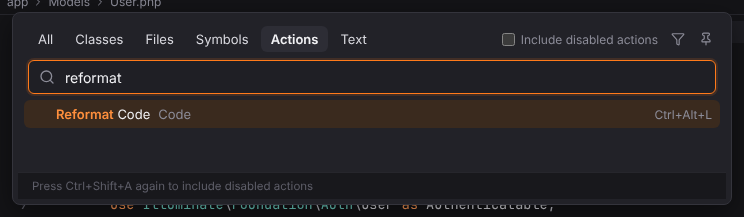
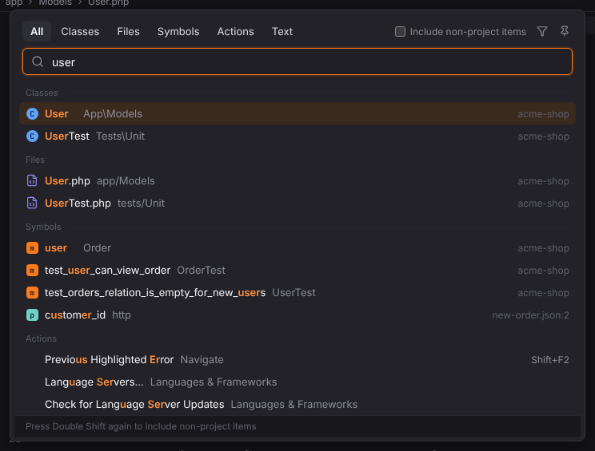
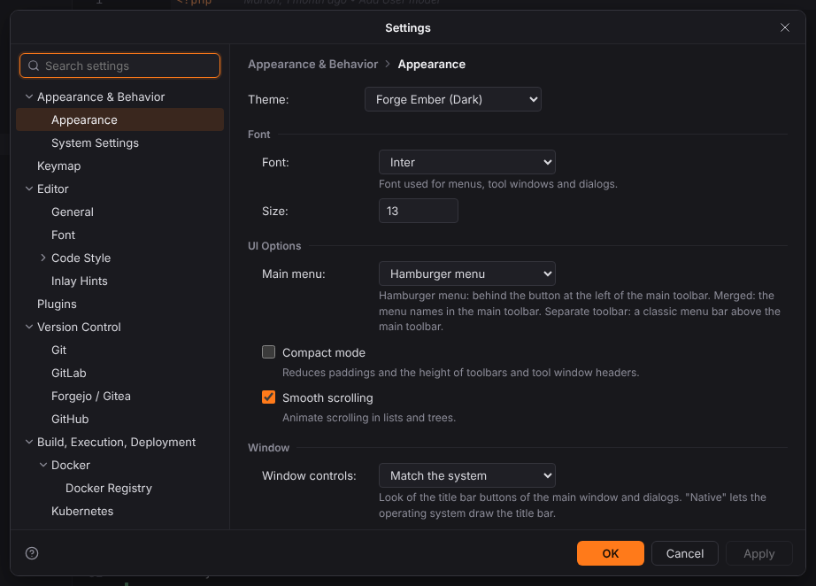
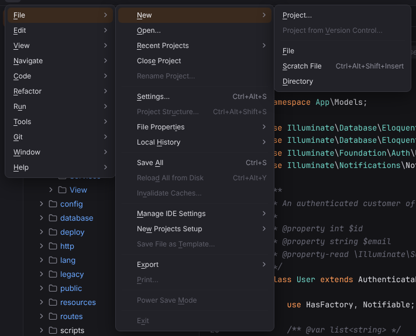
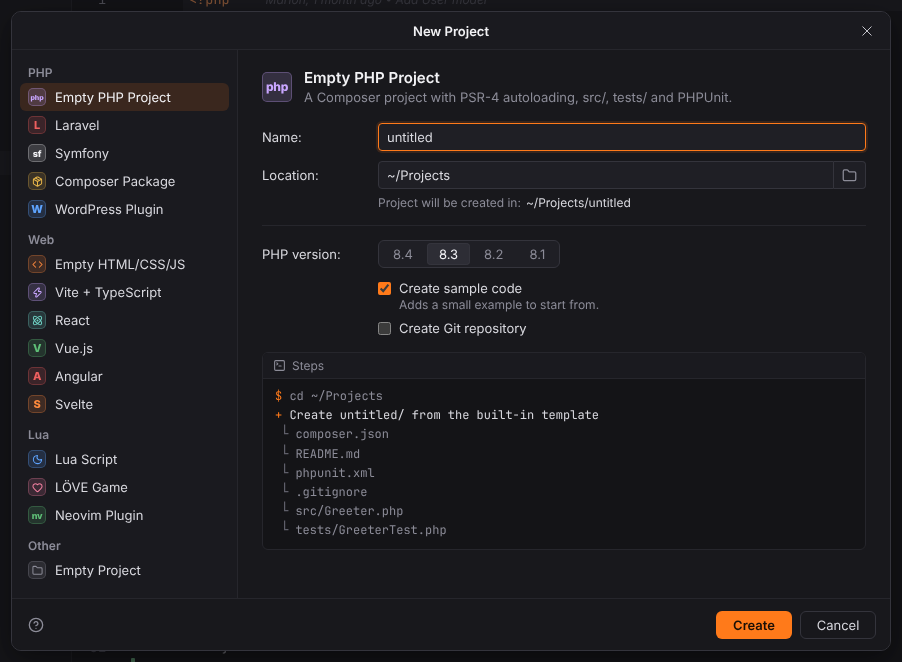
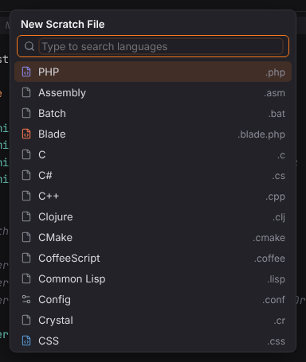
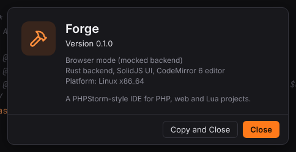

# Shortcuts: General

Actions that work everywhere: Find Action, Settings, the main menu, projects, themes and scratches. Windows/Linux shortcuts first, macOS second; both are PHPStorm's defaults and can be changed in Settings | Keymap.

| Action | Windows / Linux | macOS |
| --- | --- | --- |
| [Find Action](#find-action) | `Ctrl+Shift+A` | `Cmd+Shift+A` |
| [Search Everywhere](#search-everywhere) | `Double Shift` | `Double Shift` |
| [Settings](#settings) | `Ctrl+Alt+S` | `Cmd+,` |
| [Main Menu](#main-menu) | `Alt+\` | — |
| [Show Context Menu](#show-context-menu) | `ContextMenu` | — |
| [New Project…](#new-project) | — | — |
| [Open](#open) | — | — |
| [Close Project](#close-project) | — | — |
| [File](#file) | — | — |
| [Directory](#directory) | — | — |
| [New Scratch File](#new-scratch-file) | `Ctrl+Alt+Shift+Insert` | `Cmd+Shift+N` |
| [New Scratch Buffer](#new-scratch-buffer) | — | — |
| [Save All](#save-all) | `Ctrl+S` | `Cmd+S` |
| [Quick Switch Scheme…](#quick-switch-scheme) | `` Ctrl+` `` | `` Ctrl+` `` |
| [Theme: Toggle Dark/Light](#theme-toggle-darklight) | — | — |
| [Compact Mode](#compact-mode) | — | — |
| [Show Main Menu in Separate Toolbar](#show-main-menu-in-separate-toolbar) | — | — |
| [Tool Window Bars](#tool-window-bars) | — | — |
| [Enter Presentation Mode](#enter-presentation-mode) | — | — |
| [Enter Distraction-Free Mode](#enter-distraction-free-mode) | — | — |
| [Enter Zen Mode](#enter-zen-mode) | — | — |
| [Enter Full Screen](#enter-full-screen) | — | `Ctrl+Cmd+F` |
| [Zoom IDE In](#zoom-ide-in) | `Ctrl+Alt+Shift+=` | `Ctrl+Alt+Shift+=` |
| [Zoom IDE Out](#zoom-ide-out) | `Ctrl+Alt+Shift+-` | `Ctrl+Alt+Shift+-` |
| [Reset IDE Zoom](#reset-ide-zoom) | `Ctrl+Alt+Shift+0` | `Ctrl+Alt+Shift+0` |
| [Next Project Window](#next-project-window) | `Ctrl+Alt+]` | `` Cmd+` `` |
| [Previous Project Window](#previous-project-window) | `Ctrl+Alt+[` | `` Cmd+Shift+` `` |
| [Keymap Reference](#keymap-reference) | — | — |
| [About](#about) | — | — |
| [Exit](#exit) | — | `Cmd+Q` |

## Find Action

**Shortcut:** `Ctrl+Shift+A` · macOS `Cmd+Shift+A` · action id `GotoAction`

Finds any action by name and runs it (Find Action).

**Menu:** Navigate | Action…; Help | Find Action…

More: [Search Everywhere and Find Action](../../user/search-everywhere.md#find-action)

## Search Everywhere

**Shortcut:** `Double Shift` · macOS `Double Shift` · action id `SearchEverywhere`

Searches classes, files, symbols, actions and text in one popup.

**Menu:** Navigate | Search Everywhere

More: [Search Everywhere and Find Action](../../user/search-everywhere.md)

## Settings

**Shortcut:** `Ctrl+Alt+S` · macOS `Cmd+,` · action id `ShowSettings`

Opens the Settings dialog.

**Menu:** File | Settings…

More: [Settings and themes](../../user/settings-and-themes.md#the-settings-dialog)

## Main Menu

**Shortcut:** `Alt+\` · macOS — · action id `MainMenuButton.ShowMenu`

Opens the main menu from the keyboard; type an underlined letter to pick an entry.

More: [Workbench and tool windows](../../user/workbench.md#main-menu)

## Show Context Menu

**Shortcut:** `ContextMenu` · macOS — · action id `ShowPopupMenu`

Opens the editor context menu at the caret.

More: [Editor](../../user/editor.md#context-menu)

## New Project

**Shortcut:** — · macOS — · action id `NewProject`

Opens the New Project wizard with generators for PHP, Laravel, Symfony, web frameworks and Lua.

**Menu:** File | New | Project…

More: [Opening and creating projects](../../getting-started/projects.md#create-a-new-project)

## Open

**Shortcut:** — · macOS — · action id `OpenFile`

Opens a folder as the project (native folder picker in the desktop app).

**Menu:** File | Open…

More: [Opening and creating projects](../../getting-started/projects.md#open-an-existing-project)

## Close Project

**Shortcut:** — · macOS — · action id `CloseProject`

Closes the project and returns to the Welcome screen.

**Menu:** File | Close Project

More: [Opening and creating projects](../../getting-started/projects.md#open-an-existing-project)

## File

**Shortcut:** — · macOS — · action id `NewFile`

Creates a file in the folder selected in the Project view (or the project root) and opens it.

**Menu:** File | New | File

More: [Workbench and tool windows](../../user/workbench.md#context-menu)

## Directory

**Shortcut:** — · macOS — · action id `NewDir`

Creates a folder in the folder selected in the Project view (or the project root).

**Menu:** File | New | Directory

More: [Workbench and tool windows](../../user/workbench.md#context-menu)

## New Scratch File

**Shortcut:** `Ctrl+Alt+Shift+Insert` · macOS `Cmd+Shift+N` · action id `NewScratchFile`

Asks for a language and creates a new scratch file in Forge's global scratch folder.

**Menu:** File | New | Scratch File

More: [Scratches, consoles and HTTP client](../../user/scratches-and-http.md#creating-scratches)

## New Scratch Buffer

**Shortcut:** — · macOS — · action id `NewScratchBuffer`

Creates a plain text scratch buffer (`buffer1.txt` … `buffer5.txt`).

More: [Scratches, consoles and HTTP client](../../user/scratches-and-http.md#creating-scratches)

## Save All

**Shortcut:** `Ctrl+S` · macOS `Cmd+S` · action id `SaveAll`

Saves all modified files.

**Menu:** File | Save All

More: [Workbench and tool windows](../../user/workbench.md#editor-tabs)

## Quick Switch Scheme

**Shortcut:** `` Ctrl+` `` · macOS `` Ctrl+` `` · action id `QuickChangeScheme`

Switches between the dark and the light theme.

**Menu:** View | Quick Switch Scheme…

More: [Settings and themes](../../user/settings-and-themes.md#themes)

## Theme: Toggle Dark/Light

**Shortcut:** — · macOS — · action id `ChangeLaf`

Switches between the dark and the light theme.

More: [Settings and themes](../../user/settings-and-themes.md#themes)

## Compact Mode

**Shortcut:** — · macOS — · action id `ToggleCompactMode`

Turns compact mode (smaller toolbars and tool window headers) on or off.

**Menu:** View | Appearance | Compact Mode

More: [Settings and themes](../../user/settings-and-themes.md#appearance-options)

## Show Main Menu in Separate Toolbar

**Shortcut:** — · macOS — · action id `ToggleMainMenuInSeparateToolbar`

Shows the main menu as a menu bar above the main toolbar, or back behind ☰.

**Menu:** View | Appearance | Show Main Menu in Separate Toolbar

More: [Workbench and tool windows](../../user/workbench.md#main-menu)

## Tool Window Bars

**Shortcut:** — · macOS — · action id `ViewToolButtons`

Shows or hides the tool window stripes along the window edges.

**Menu:** View | Appearance | Tool Window Bars

More: [Workbench and tool windows](../../user/workbench.md#managing-tool-windows)

## Enter Presentation Mode

**Shortcut:** — · macOS — · action id `TogglePresentationMode`

Full screen without tool windows and bars, with a large editor font; run again to leave it.

**Menu:** View | Appearance | Enter Presentation Mode

More: [Windows, modes and layouts](../../user/windows-and-layouts.md#presentation-distraction-free-zen-and-full-screen)

## Enter Distraction-Free Mode

**Shortcut:** — · macOS — · action id `ToggleDistractionFreeMode`

Only the centered text; leaving it restores the tool windows.

**Menu:** View | Appearance | Enter Distraction-Free Mode

More: [Windows, modes and layouts](../../user/windows-and-layouts.md#presentation-distraction-free-zen-and-full-screen)

## Enter Zen Mode

**Shortcut:** — · macOS — · action id `ToggleZenMode`

Distraction-Free Mode in full screen.

**Menu:** View | Appearance | Enter Zen Mode

More: [Windows, modes and layouts](../../user/windows-and-layouts.md#presentation-distraction-free-zen-and-full-screen)

## Enter Full Screen

**Shortcut:** — · macOS `Ctrl+Cmd+F` · action id `ToggleFullScreen`

The window covers the screen; run again to leave full screen.

**Menu:** View | Appearance | Enter Full Screen

More: [Windows, modes and layouts](../../user/windows-and-layouts.md#presentation-distraction-free-zen-and-full-screen)

## Zoom IDE In

**Shortcut:** `Ctrl+Alt+Shift+=` · macOS `Ctrl+Alt+Shift+=` · action id `ZoomInIdeAction`

Scales the whole IDE up one step.

**Menu:** View | Appearance | Zoom IDE | Zoom In

More: [Windows, modes and layouts](../../user/windows-and-layouts.md#zoom-ide)

## Zoom IDE Out

**Shortcut:** `Ctrl+Alt+Shift+-` · macOS `Ctrl+Alt+Shift+-` · action id `ZoomOutIdeAction`

Scales the whole IDE down one step.

**Menu:** View | Appearance | Zoom IDE | Zoom Out

More: [Windows, modes and layouts](../../user/windows-and-layouts.md#zoom-ide)

## Reset IDE Zoom

**Shortcut:** `Ctrl+Alt+Shift+0` · macOS `Ctrl+Alt+Shift+0` · action id `ResetIdeScaleAction`

Back to 100 %.

**Menu:** View | Appearance | Zoom IDE | Reset

More: [Windows, modes and layouts](../../user/windows-and-layouts.md#zoom-ide)

## Next Project Window

**Shortcut:** `Ctrl+Alt+]` · macOS `` Cmd+` `` · action id `NextProjectWindow`

Brings the next project window to the front.

**Menu:** Window | Next Project Window

More: [Windows, modes and layouts](../../user/windows-and-layouts.md#several-project-windows)

## Previous Project Window

**Shortcut:** `Ctrl+Alt+[` · macOS `` Cmd+Shift+` `` · action id `PreviousProjectWindow`

Brings the previous project window to the front.

**Menu:** Window | Previous Project Window

More: [Windows, modes and layouts](../../user/windows-and-layouts.md#several-project-windows)

## Keymap Reference

**Shortcut:** — · macOS — · action id `Help.KeymapReference`

Opens Settings | Keymap.

**Menu:** Help | Keymap Reference

More: [Keymap](../../user/keymap.md)

## About

**Shortcut:** — · macOS — · action id `About`

Shows the version, platform and build information.

**Menu:** Help | About

## Exit

**Shortcut:** — · macOS `Cmd+Q` · action id `Exit`

Closes the Forge window (desktop app only).

**Menu:** File | Exit

> **Note:** only in the desktop app; in browser mode the entry is disabled.
