# Shortcuts: Navigation

Jumping to declarations, implementations, super methods, lines, problems, recent files and between editor tabs. Windows/Linux shortcuts first, macOS second; both are PHPStorm's defaults and can be changed in Settings | Keymap.

| Action | Windows / Linux | macOS |
| --- | --- | --- |
| [Go to Declaration or Usages](#go-to-declaration-or-usages) | `Ctrl+B` | `Cmd+B` |
| [Go to Implementation(s)](#go-to-implementations) | `Ctrl+Alt+B` | `Cmd+Alt+B` |
| [Go to Type Declaration](#go-to-type-declaration) | `Ctrl+Shift+B` | `Cmd+Shift+B` |
| [Go to Super Method](#go-to-super-method) | `Ctrl+U` | `Cmd+U` |
| [Type Hierarchy](#type-hierarchy) | `Ctrl+H` | `Ctrl+H` |
| [Method Hierarchy](#method-hierarchy) | `Ctrl+Shift+H` | `Cmd+Shift+H` |
| [Call Hierarchy](#call-hierarchy) | `Ctrl+Alt+H` | `Ctrl+Alt+H` |
| [Back](#back) | `Ctrl+Alt+Left` | `Cmd+[`, `Cmd+Alt+Left` |
| [Forward](#forward) | `Ctrl+Alt+Right` | `Cmd+]`, `Cmd+Alt+Right` |
| [Last Edit Location](#last-edit-location) | `Ctrl+Shift+Backspace` | `Cmd+Shift+Backspace` |
| [Next Edit Location](#next-edit-location) | — | — |
| [Select In](#select-in) | `Alt+F1` | `Alt+F1` |
| [Next Method](#next-method) | `Alt+Down` | `Ctrl+Down` |
| [Previous Method](#previous-method) | `Alt+Up` | `Ctrl+Up` |
| [Next Change](#next-change) | `Ctrl+Alt+Shift+Down` | `Ctrl+Alt+Shift+Down` |
| [Previous Change](#previous-change) | `Ctrl+Alt+Shift+Up` | `Ctrl+Alt+Shift+Up` |
| [Go to Line/Column](#go-to-linecolumn) | `Ctrl+G` | `Cmd+L` |
| [Move Caret to Matching Brace](#move-caret-to-matching-brace) | `Ctrl+Shift+M` | `Ctrl+M` |
| [Next Highlighted Error](#next-highlighted-error) | `F2` | `F2` |
| [Previous Highlighted Error](#previous-highlighted-error) | `Shift+F2` | `Shift+F2` |
| [Recent Files](#recent-files) | `Ctrl+E` | `Cmd+E` |
| [Recently Changed Files](#recently-changed-files) | — | — |
| [Switcher](#switcher) | `Ctrl+Tab`, `Ctrl+Shift+Tab` | `Ctrl+Tab`, `Ctrl+Shift+Tab` |
| [Select Next Tab](#select-next-tab) | `Alt+Right` | `Ctrl+Right`, `Cmd+Shift+]` |
| [Select Previous Tab](#select-previous-tab) | `Alt+Left` | `Ctrl+Left`, `Cmd+Shift+[` |
| [Close Tab](#close-tab) | `Ctrl+F4` | `Cmd+W`, `Ctrl+F4` |
| [Close All Tabs](#close-all-tabs) | — | — |
| [Close Other Tabs](#close-other-tabs) | — | `Cmd+Alt+W` |
| [Close Unmodified Tabs](#close-unmodified-tabs) | — | — |
| [Reopen Closed Tab](#reopen-closed-tab) | — | — |
| [Recent Locations](#recent-locations) | `Ctrl+Shift+E` | `Cmd+Shift+E` |
| [File Structure](#file-structure) | `Ctrl+F12` | `Cmd+F12` |
| [Jump to Navigation Bar](#jump-to-navigation-bar) | `Alt+Home` | `Cmd+Up` |
| [Related Symbol](#related-symbol) | `Ctrl+Alt+Home` | `Ctrl+Cmd+Up` |
| [Test](#test) | `Ctrl+Shift+T` | `Cmd+Shift+T` |
| [Next Occurrence](#next-occurrence) | `Ctrl+Alt+Down` | `Cmd+Alt+Down` |
| [Previous Occurrence](#previous-occurrence) | `Ctrl+Alt+Up` | `Cmd+Alt+Up` |
| [Toggle Bookmark](#toggle-bookmark) | `F11` | `F3` |
| [Toggle Bookmark with Mnemonic](#toggle-bookmark-with-mnemonic) | `Ctrl+F11` | `Alt+F3` |
| [Toggle Bookmark 0-9](#toggle-bookmark-0-9) | `Ctrl+Shift+0` … `Ctrl+Shift+9` | `Ctrl+Shift+0` … `Ctrl+Shift+9` |
| [Go to Bookmark 0-9](#go-to-bookmark-0-9) | `Ctrl+0` … `Ctrl+9` | `Ctrl+0` … `Ctrl+9` |
| [Show All Bookmarks](#show-all-bookmarks) | `Shift+F11` | `Cmd+F3` |
| [Pin Tab](#pin-tab) | — | — |
| [Open in New Window](#open-in-new-window) | `Shift+F4` | `Shift+F4` |
| [Split Right](#split-right) | — | — |
| [Split Down](#split-down) | — | — |
| [Move to Opposite Group](#move-to-opposite-group) | — | — |
| [Unsplit](#unsplit) | — | — |
| [Goto Next Splitter](#goto-next-splitter) | — | `Alt+Tab` |
| [Close Tabs to the Left](#close-tabs-to-the-left) | — | — |
| [Close Tabs to the Right](#close-tabs-to-the-right) | — | — |

## Go to Declaration or Usages

**Shortcut:** `Ctrl+B` · macOS `Cmd+B` · action id `GotoDeclaration`

Jumps to the declaration of the symbol at the caret (also `Ctrl+Click` and middle click); on a declaration it shows its usages; several targets open the Choose Declaration popup. PHP's own classes and functions open read-only in the PHP stubs.

**Menu:** Navigate | Declaration or Usages

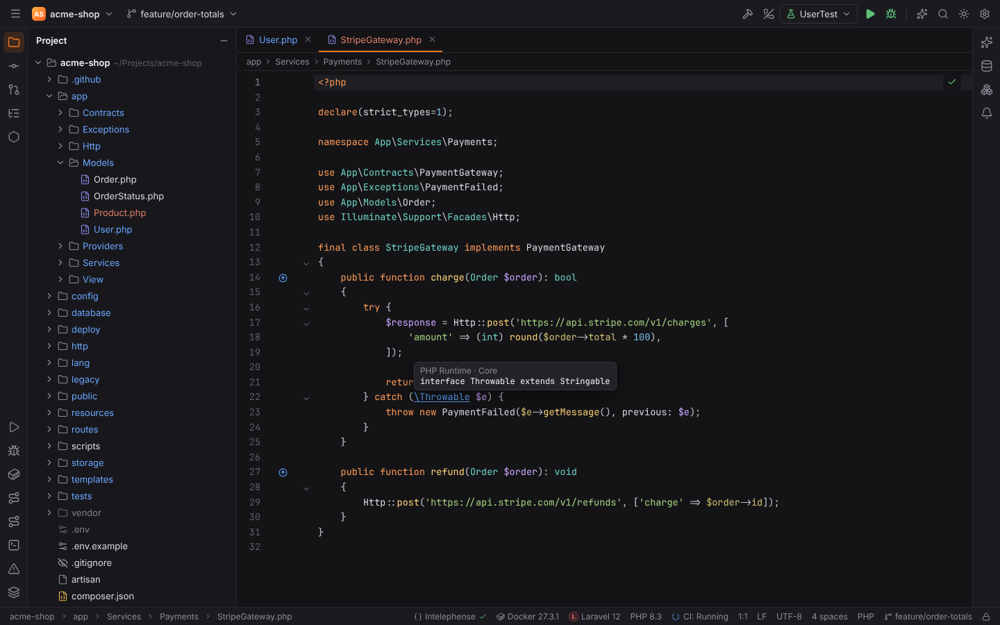

More: [Editor](../../user/editor.md#go-to-declaration), [PHP navigation](../../user/php.md#navigation)

## Go to Implementation(s)

**Shortcut:** `Ctrl+Alt+B` · macOS `Cmd+Alt+B` · action id `GotoImplementation`

Lists the classes implementing or extending the class or interface at the caret, or the methods overriding the method (also `Ctrl+Alt+Click`).

**Menu:** Navigate | Implementation(s)

More: [Editor](../../user/editor.md#implementation-type-declaration-super-method)

## Go to Type Declaration

**Shortcut:** `Ctrl+Shift+B` · macOS `Cmd+Shift+B` · action id `GotoTypeDeclaration`

Jumps to the class of the variable, property or method return type at the caret.

**Menu:** Navigate | Type Declaration

More: [Editor](../../user/editor.md#implementation-type-declaration-super-method)

## Go to Super Method

**Shortcut:** `Ctrl+U` · macOS `Cmd+U` · action id `GotoSuperMethod`

Jumps to the method the current method overrides or implements; on a class, to its parent class and interfaces.

**Menu:** Navigate | Super Method

More: [Editor](../../user/editor.md#implementation-type-declaration-super-method)

## Type Hierarchy

**Shortcut:** `Ctrl+H` · macOS `Ctrl+H` · action id `TypeHierarchy`

Shows the class at the caret in the Hierarchy tool window: its parent classes and subtypes (Class Hierarchy), its supertypes or its subtypes.

**Menu:** Navigate | Type Hierarchy

More: [Type, Method and Call Hierarchy](../../user/hierarchies.md#type-hierarchy)

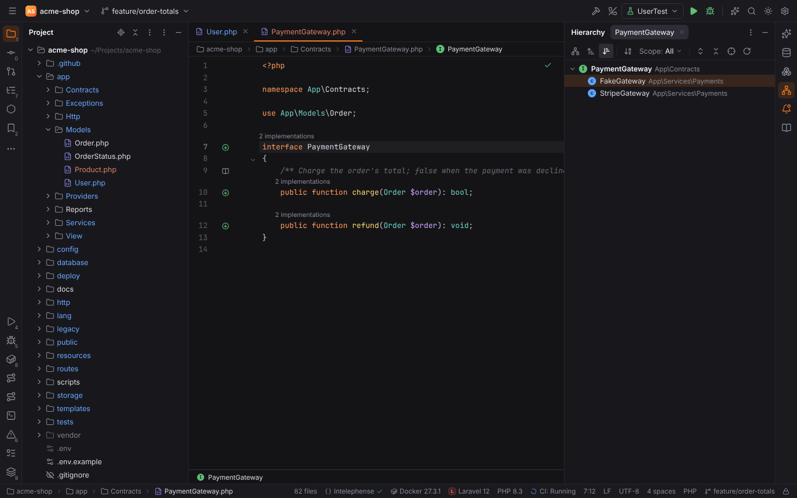

## Method Hierarchy

**Shortcut:** `Ctrl+Shift+H` · macOS `Cmd+Shift+H` · action id `MethodHierarchy`

Shows which classes define the method at the caret, which inherit it and which should define it.

**Menu:** Navigate | Method Hierarchy

More: [Type, Method and Call Hierarchy](../../user/hierarchies.md#method-hierarchy)

## Call Hierarchy

**Shortcut:** `Ctrl+Alt+H` · macOS `Ctrl+Alt+H` · action id `CallHierarchy`

Shows the callers (or callees) of the method or function at the caret, one level per expanded node, with the call sites.

**Menu:** Navigate | Call Hierarchy

More: [Type, Method and Call Hierarchy](../../user/hierarchies.md#call-hierarchy)

## Back

**Shortcut:** `Ctrl+Alt+Left` · macOS `Cmd+[`, `Cmd+Alt+Left` · action id `Back`

Goes back to the previous caret location in your navigation history.

**Menu:** Navigate | Back

More: [Editor](../../user/editor.md#go-to-declaration)

## Forward

**Shortcut:** `Ctrl+Alt+Right` · macOS `Cmd+]`, `Cmd+Alt+Right` · action id `Forward`

Goes forward in the navigation history.

**Menu:** Navigate | Forward

More: [Editor](../../user/editor.md#go-to-declaration)

## Last Edit Location

**Shortcut:** `Ctrl+Shift+Backspace` · macOS `Cmd+Shift+Backspace` · action id `JumpToLastChange`

Goes back to the previous place where you changed text, across files. This edit history is separate from Back/Forward: edits a line or two apart count as one place, places follow later edits, renames and deletions, and the place the caret is already at is skipped. Recent Locations' **Show changed only** lists the same places.

**Menu:** Navigate | Last Edit Location

More: [Workbench](../../user/workbench.md#recent-files-and-switcher)

## Next Edit Location

**Shortcut:** none by default · action id `JumpToNextChange`

Goes forward again through the edit history after Last Edit Location. A new edit starts over at the newest place.

**Menu:** Navigate | Next Edit Location

More: [Workbench](../../user/workbench.md#recent-files-and-switcher)

## Select In

**Shortcut:** `Alt+F1` · macOS `Alt+F1` · action id `SelectIn`

Shows the current file somewhere else. Pick a target with its number, the arrow keys and `Enter`, or a click:

| Target | What it does |
| --- | --- |
| Project View | Opens the Project tool window and selects the file. |
| Commit | Selects the file in the Commit tool window (only when it has local changes). |
| Structure | Opens the Structure tool window with the member at the caret selected. |
| File Structure | Opens the File Structure popup (`Ctrl+F12`). |
| Navigation Bar | Focuses the navigation bar (`Alt+Home`). |
| Git Log | Opens the Git log filtered to the file's history (Git projects). |
| Explorer / Finder / File Manager | Shows the file selected in the system file manager (local projects). |
| Terminal | Opens a terminal tab in the file's folder. |

From the Project view (with the focus in the tree) the targets apply to the selected file and Project View is left out.

**Menu:** Navigate | Select In...

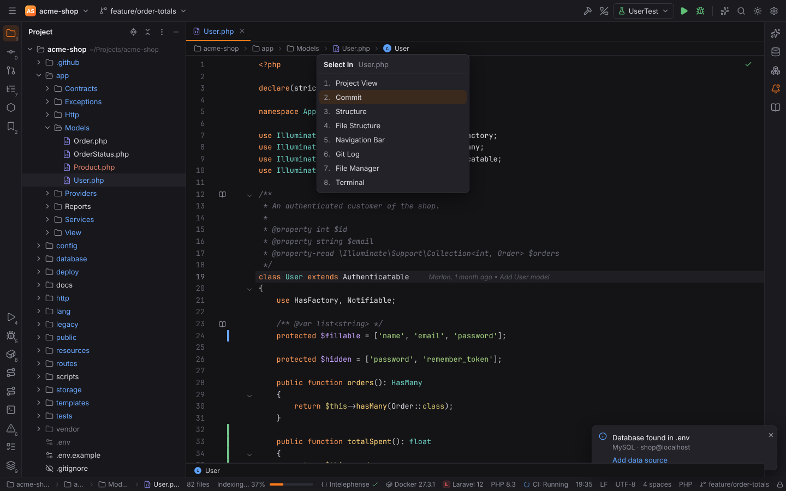

More: [Project view](../../user/workbench.md#project-view)

## Next Method

**Shortcut:** `Alt+Down` · macOS `Ctrl+Down` · action id `MethodDown`

Moves the caret to the name of the next class, interface, trait, enum, function or method, or to the closing brace of a class. Works in every language with Sticky Lines: PHP, JavaScript/TypeScript (also in Vue and HTML scripts), CSS/SCSS/Less rules, Lua and other brace languages.

**Menu:** Navigate | Next Method

More: [Code structure](../../user/code-structure.md)

## Previous Method

**Shortcut:** `Alt+Up` · macOS `Ctrl+Up` · action id `MethodUp`

Moves the caret to the previous class, function, method or CSS rule.

**Menu:** Navigate | Previous Method

More: [Code structure](../../user/code-structure.md)

## Next Change

**Shortcut:** `Ctrl+Alt+Shift+Down` · macOS `Ctrl+Alt+Shift+Down` · action id `VcsShowNextChangeMarker`

Moves the caret to the next block that differs from Git `HEAD` (the gutter change markers), wrapping around at the end of the file, and shows its popup with the old text, **Rollback** and **Show Diff**, like a click on the marker.

**Menu:** Navigate | Next Change

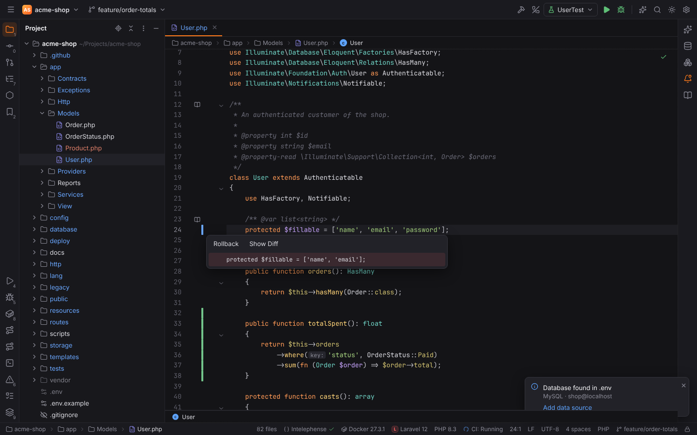

More: [Git change markers](../../user/git.md#change-markers)

## Previous Change

**Shortcut:** `Ctrl+Alt+Shift+Up` · macOS `Ctrl+Alt+Shift+Up` · action id `VcsShowPrevChangeMarker`

Moves the caret to the previous changed block and shows its popup.

**Menu:** Navigate | Previous Change

More: [Git change markers](../../user/git.md#change-markers)

## Go to Line/Column

**Shortcut:** `Ctrl+G` · macOS `Cmd+L` · action id `GotoLine`

Moves the caret to a line (and column) of the current file.

**Menu:** Navigate | Line/Column…

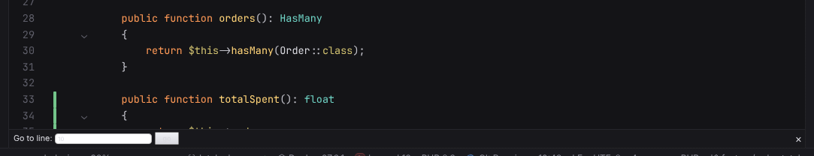

More: [Editor](../../user/editor.md#editing-actions)

## Move Caret to Matching Brace

**Shortcut:** `Ctrl+Shift+M` · macOS `Ctrl+M` · action id `EditorMatchBrace`

Moves the caret to the matching bracket.

More: [Editor](../../user/editor.md#editing-actions)

## Next Highlighted Error

**Shortcut:** `F2` · macOS `F2` · action id `GotoNextError`

Moves the caret to the next problem in the file.

**Menu:** Navigate | Next Highlighted Error

More: [Editor](../../user/editor.md#problems)

## Previous Highlighted Error

**Shortcut:** `Shift+F2` · macOS `Shift+F2` · action id `GotoPreviousError`

Moves the caret to the previous problem in the file.

**Menu:** Navigate | Previous Highlighted Error

More: [Editor](../../user/editor.md#problems)

## Recent Files

**Shortcut:** `Ctrl+E` · macOS `Cmd+E` · action id `RecentFiles`

Lists recently opened files and the tool windows; press again for recently edited files only.

**Menu:** View | Recent Files

More: [Workbench and tool windows](../../user/workbench.md#recent-files-and-switcher)

## Recently Changed Files

**Shortcut:** — · macOS — · action id `RecentChangedFiles`

Lists recently edited files.

**Menu:** View | Recently Changed Files

More: [Workbench and tool windows](../../user/workbench.md#recent-files-and-switcher)

## Switcher

**Shortcut:** `Ctrl+Tab`, `Ctrl+Shift+Tab` · macOS `Ctrl+Tab`, `Ctrl+Shift+Tab` · action id `Switcher`

Switches between open files and tool windows while `Ctrl` is held.

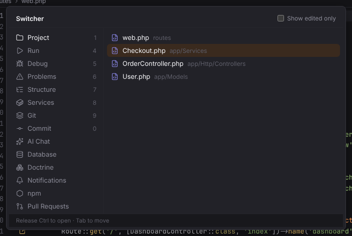

More: [Workbench and tool windows](../../user/workbench.md#recent-files-and-switcher)

## Select Next Tab

**Shortcut:** `Alt+Right` · macOS `Ctrl+Right`, `Cmd+Shift+]` · action id `NextTab`

Selects the next editor tab.

**Menu:** Window | Editor Tabs | Select Next Tab

More: [Workbench and tool windows](../../user/workbench.md#editor-tabs)

## Select Previous Tab

**Shortcut:** `Alt+Left` · macOS `Ctrl+Left`, `Cmd+Shift+[` · action id `PreviousTab`

Selects the previous editor tab.

**Menu:** Window | Editor Tabs | Select Previous Tab

More: [Workbench and tool windows](../../user/workbench.md#editor-tabs)

## Close Tab

**Shortcut:** `Ctrl+F4` · macOS `Cmd+W`, `Ctrl+F4` · action id `CloseContent`

Closes the current editor tab. Without an open tab it closes the window; in Settings or a detached editor window it closes that window. Popups close with `Esc`.

**Menu:** Window | Editor Tabs | Close Tab

More: [Workbench and tool windows](../../user/workbench.md#editor-tabs)

## Close All Tabs

**Shortcut:** — · macOS — · action id `CloseAllEditors`

Closes all editor tabs.

**Menu:** Window | Editor Tabs | Close All Tabs

More: [Workbench and tool windows](../../user/workbench.md#editor-tabs)

## Close Other Tabs

**Shortcut:** — · macOS `Cmd+Alt+W` · action id `CloseAllEditorsButActive`

Closes all editor tabs except the current one.

**Menu:** Window | Editor Tabs | Close Other Tabs

More: [Workbench and tool windows](../../user/workbench.md#editor-tabs)

## Close Unmodified Tabs

**Shortcut:** — · macOS — · action id `CloseAllUnmodifiedEditors`

Closes the editor tabs without unsaved changes.

**Menu:** Window | Editor Tabs | Close Unmodified Tabs

More: [Workbench and tool windows](../../user/workbench.md#editor-tabs)

## Reopen Closed Tab

**Shortcut:** — · macOS — · action id `ReopenClosedTab`

Reopens the editor tab closed last.

**Menu:** Window | Editor Tabs | Reopen Closed Tab

More: [Workbench and tool windows](../../user/workbench.md#editor-tabs)

## Recent Locations

**Shortcut:** `Ctrl+Shift+E` · macOS `Cmd+Shift+E` · action id `RecentLocations`

Lists recently visited and edited places with a few lines of code each; press again for changed places only.

**Menu:** View | Recent Locations

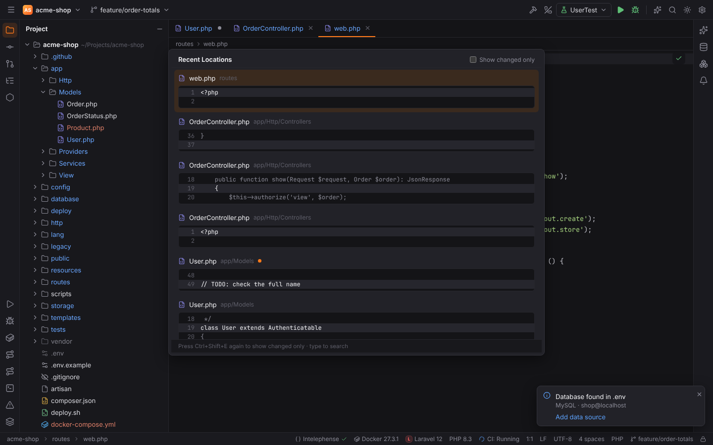

More: [Workbench and tool windows](../../user/workbench.md#recent-locations)

## File Structure

**Shortcut:** `Ctrl+F12` · macOS `Cmd+F12` · action id `FileStructurePopup`

Shows the structure of the current file in a popup with the member at the caret selected; type to filter, `Enter` jumps. Press the shortcut again to show inherited members (PHP).

**Menu:** Navigate | File Structure

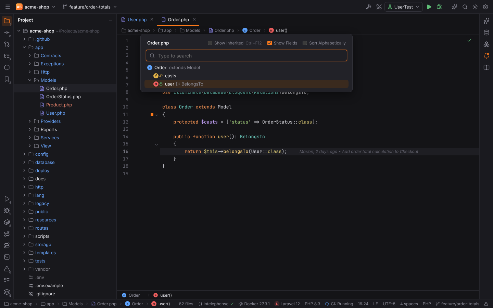

More: [File Structure, Navigation Bar and Related Symbol](../../user/navigation-bar-and-file-structure.md#file-structure-popup)

## Jump to Navigation Bar

**Shortcut:** `Alt+Home` · macOS `Cmd+Up` · action id `ShowNavBar`

Focuses the navigation bar with the file's folder open; `Left` / `Right` move between the segments, `Down` opens a dropdown, `Enter` opens a file, `Escape` returns to the editor. While the bar is hidden it opens as a popup.

**Menu:** Navigate | Navigation Bar

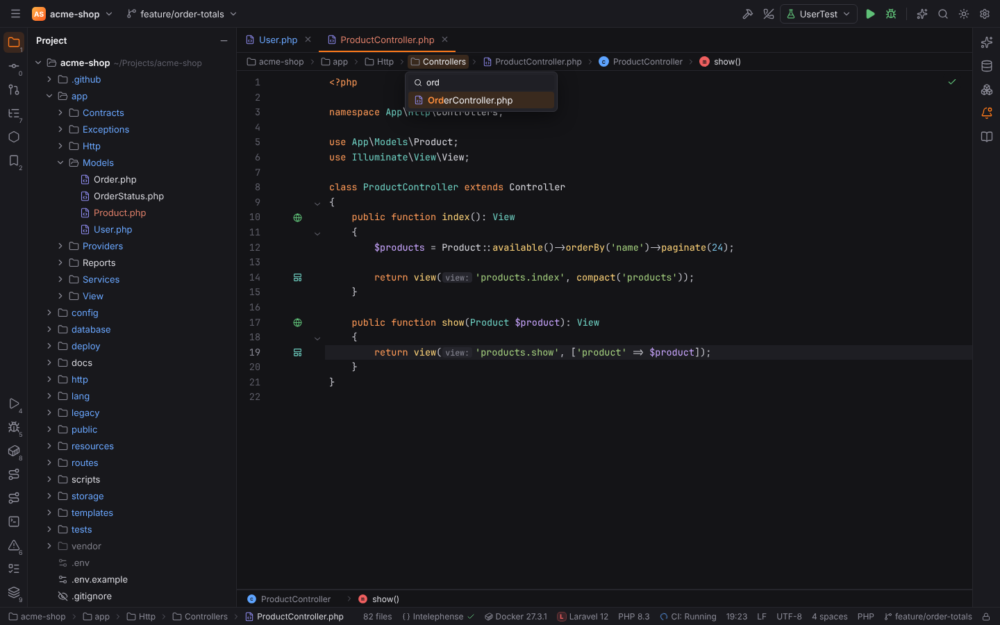

More: [File Structure, Navigation Bar and Related Symbol](../../user/navigation-bar-and-file-structure.md#navigation-bar)

## Related Symbol

**Shortcut:** `Ctrl+Alt+Home` · macOS `Ctrl+Cmd+Up` · action id `GotoRelated`

Jumps to the files that belong to the current one: a class's tests, a controller's views and routes, a view's controllers, a model's migrations, factory and policy, a component's tests, stories and styles. Several results open the Choose Target popup.

**Menu:** Navigate | Related Symbol...

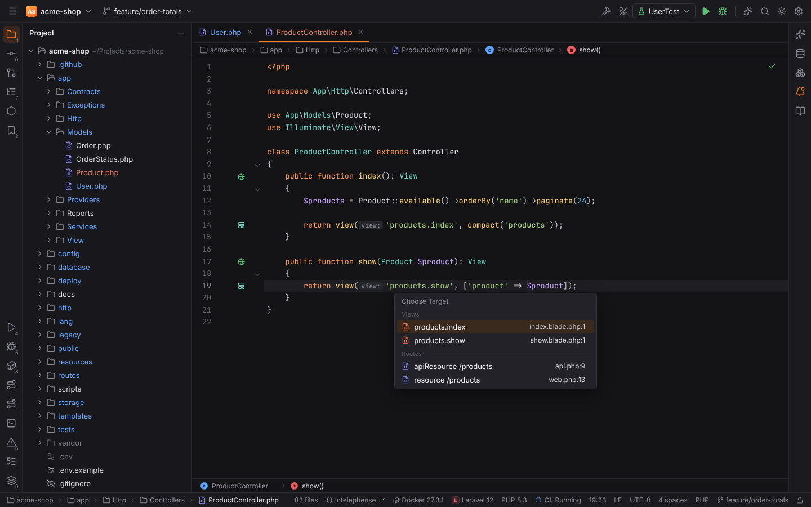

More: [File Structure, Navigation Bar and Related Symbol](../../user/navigation-bar-and-file-structure.md#related-symbol)

## Test

**Shortcut:** `Ctrl+Shift+T` · macOS `Cmd+Shift+T` · action id `GotoTest`

Jumps from a class, component or module to its tests and from a test to its subject. One result opens directly; several open the Choose Test popup. **Create New Test...** at the top of the popup opens the Create New PHP Test / Create New Test dialog (PHPUnit, Pest, Vitest, Jest).

**Menu:** Navigate | Test

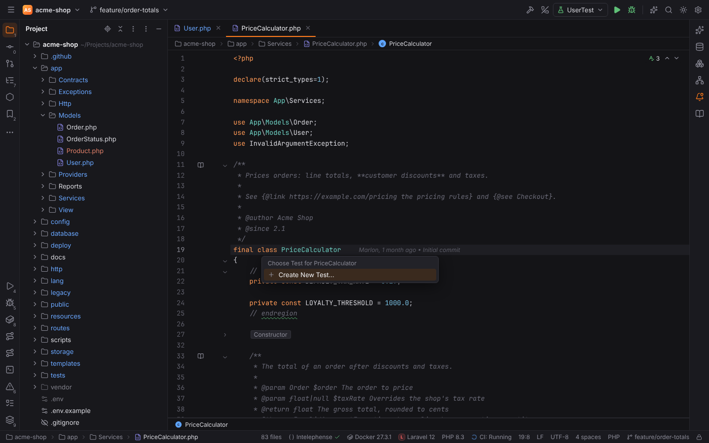

More: [Go to Test and Create Test](../../user/go-to-test.md)

## Next Occurrence

**Shortcut:** `Ctrl+Alt+Down` · macOS `Cmd+Alt+Down` · action id `NextOccurence`

Opens the next result of the active tab of the Find tool window (usages or Find in Files results).

**Menu:** Navigate | Next Occurrence

More: [Workbench and tool windows](../../user/workbench.md#find-tool-window)

## Previous Occurrence

**Shortcut:** `Ctrl+Alt+Up` · macOS `Cmd+Alt+Up` · action id `PreviousOccurence`

Opens the previous result of the active tab of the Find tool window.

**Menu:** Navigate | Previous Occurrence

More: [Workbench and tool windows](../../user/workbench.md#find-tool-window)

## Toggle Bookmark

**Shortcut:** `F11` · macOS `F3` · action id `ToggleBookmark`

Adds or removes a bookmark on the caret line.

**Menu:** Navigate | Bookmarks | Toggle Bookmark

More: [Workbench and tool windows](../../user/workbench.md#bookmarks)

## Toggle Bookmark with Mnemonic

**Shortcut:** `Ctrl+F11` · macOS `Alt+F3` · action id `ToggleBookmarkWithMnemonic`

Adds a bookmark with a digit or letter picked in a popup, or changes or removes it.

**Menu:** Navigate | Bookmarks | Toggle Bookmark with Mnemonic

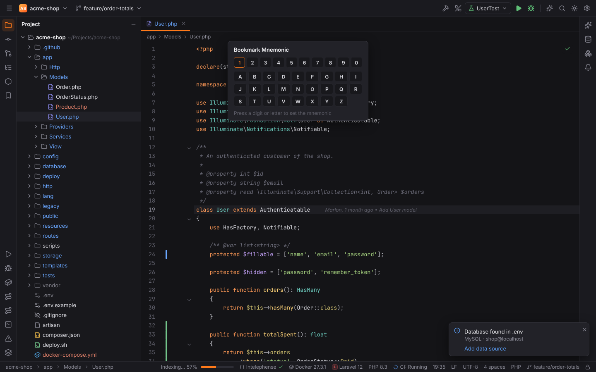

More: [Workbench and tool windows](../../user/workbench.md#bookmarks)

## Toggle Bookmark 0-9

**Shortcut:** `Ctrl+Shift+0` … `Ctrl+Shift+9` · macOS `Ctrl+Shift+0` … `Ctrl+Shift+9` · action id `ToggleBookmark0`

Sets the numbered bookmark on the caret line (action ids `ToggleBookmark0` … `ToggleBookmark9`).

More: [Workbench and tool windows](../../user/workbench.md#bookmarks)

## Go to Bookmark 0-9

**Shortcut:** `Ctrl+0` … `Ctrl+9` · macOS `Ctrl+0` … `Ctrl+9` · action id `GotoBookmark0`

Jumps to the numbered bookmark (action ids `GotoBookmark0` … `GotoBookmark9`).

More: [Workbench and tool windows](../../user/workbench.md#bookmarks)

## Show All Bookmarks

**Shortcut:** `Shift+F11` · macOS `Cmd+F3` · action id `ShowBookmarks`

Opens the Bookmarks tool window.

**Menu:** Navigate | Bookmarks | Show All Bookmarks

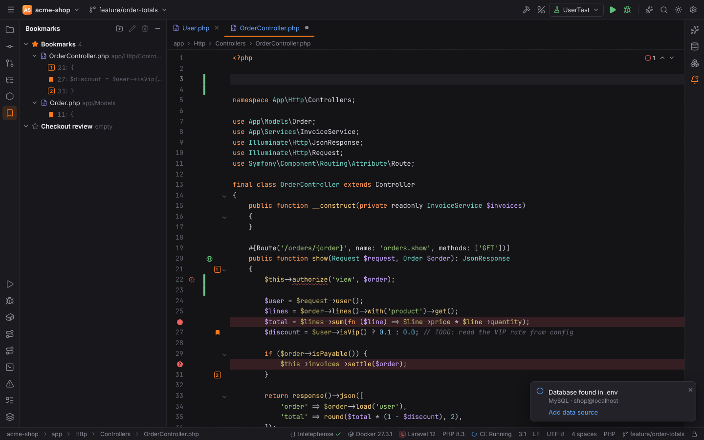

More: [Workbench and tool windows](../../user/workbench.md#bookmarks)

## Open in New Window

**Shortcut:** `Shift+F4` · macOS `Shift+F4` · action id `EditSourceInNewWindow`

Moves the current editor tab into a window of its own (also: drag the tab out of the IDE window); closing that window docks the tab back.

**Menu:** Window | Editor Tabs | Open in New Window

More: [Windows, modes and layouts](../../user/windows-and-layouts.md#editor-tabs-in-their-own-window)

## Pin Tab

**Shortcut:** — · macOS — · action id `PinActiveEditorTab`

Pins or unpins the current tab; pinned tabs stay on Close Other Tabs and Close All Tabs.

**Menu:** Window | Editor Tabs | Pin Tab

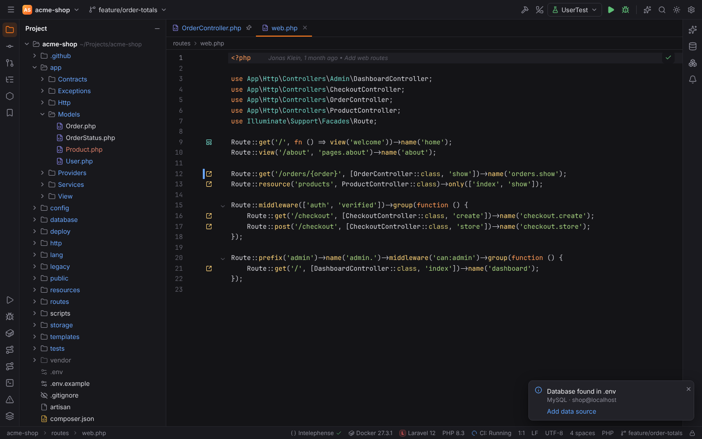

More: [Workbench and tool windows](../../user/workbench.md#pinned-tabs)

## Split Right

**Shortcut:** — · macOS — · action id `SplitVertically`

Opens the current file in a new editor group on the right; both groups edit the same document.

**Menu:** Window | Editor Tabs | Split Right

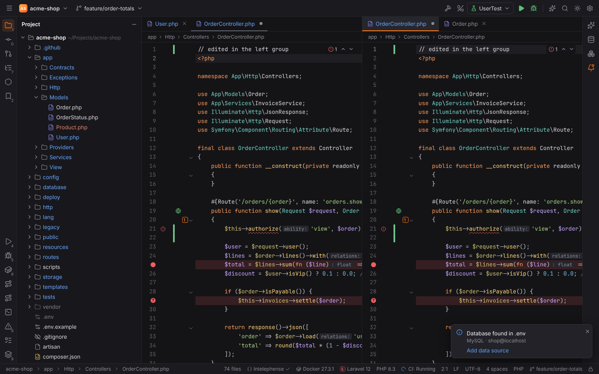

More: [Workbench and tool windows](../../user/workbench.md#split-editors)

## Split Down

**Shortcut:** — · macOS — · action id `SplitHorizontally`

Opens the current file in a new editor group below.

**Menu:** Window | Editor Tabs | Split Down

More: [Workbench and tool windows](../../user/workbench.md#split-editors)

## Move to Opposite Group

**Shortcut:** — · macOS — · action id `MoveEditorToOppositeTabGroup`

Moves the current tab to the neighbouring editor group.

**Menu:** Window | Editor Tabs | Move to Opposite Group

More: [Workbench and tool windows](../../user/workbench.md#split-editors)

## Unsplit

**Shortcut:** — · macOS — · action id `Unsplit`

Merges the current editor group into its neighbour (Unsplit All merges every group).

**Menu:** Window | Editor Tabs | Unsplit

More: [Workbench and tool windows](../../user/workbench.md#split-editors)

## Goto Next Splitter

**Shortcut:** — · macOS `Alt+Tab` · action id `NextSplitter`

Moves the focus to the next editor group.

**Menu:** Window | Editor Tabs | Goto Next Splitter

More: [Workbench and tool windows](../../user/workbench.md#split-editors)

## Close Tabs to the Left

**Shortcut:** — · macOS — · action id `CloseAllToTheLeft`

Closes the unpinned tabs left of the current one.

**Menu:** Window | Editor Tabs | Close Tabs to the Left

More: [Workbench and tool windows](../../user/workbench.md#tab-context-menu)

## Close Tabs to the Right

**Shortcut:** — · macOS — · action id `CloseAllToTheRight`

Closes the unpinned tabs right of the current one.

**Menu:** Window | Editor Tabs | Close Tabs to the Right

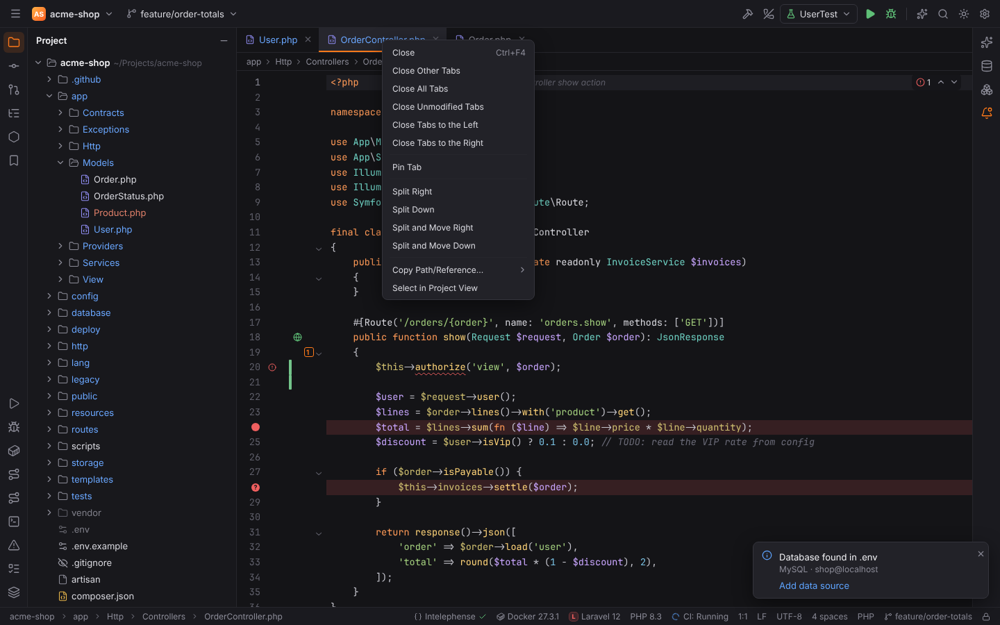

More: [Workbench and tool windows](../../user/workbench.md#tab-context-menu)
