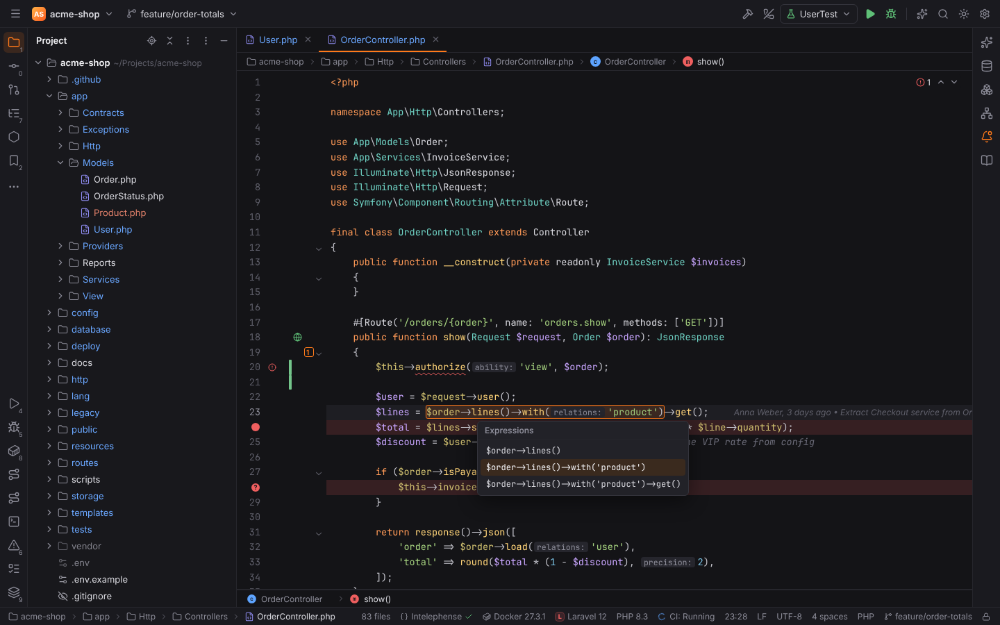
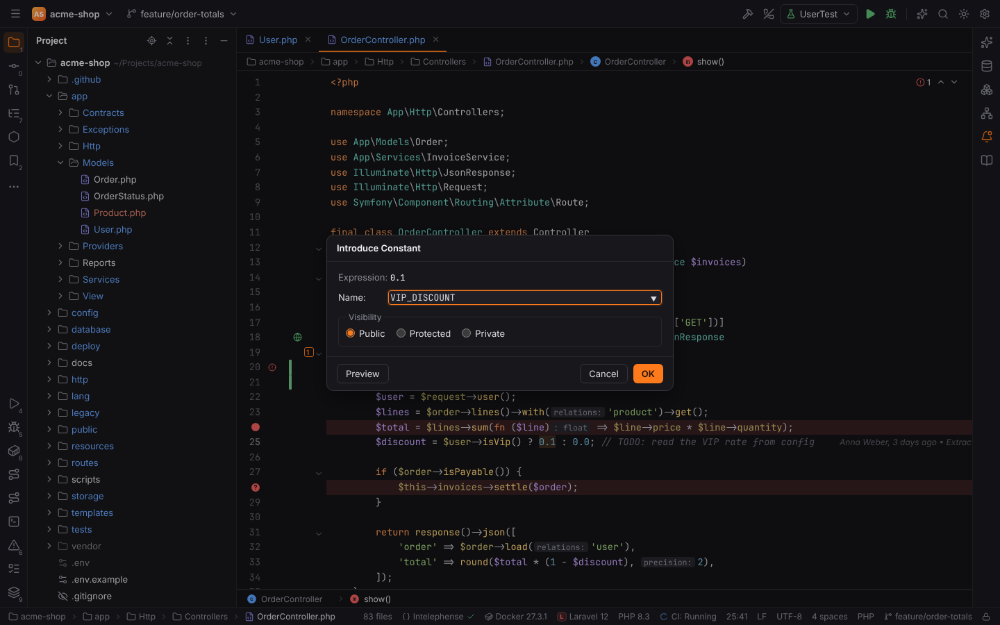
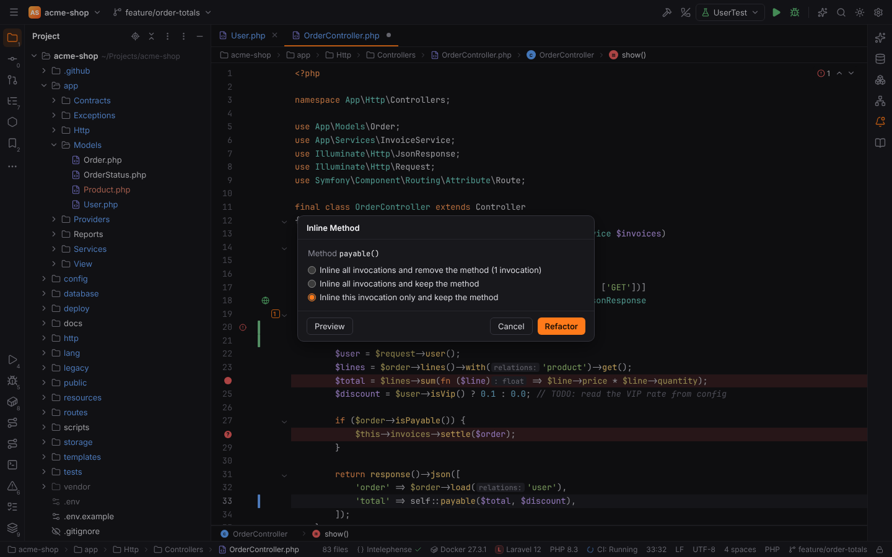

# Shortcuts: Refactoring

Refactorings and code generation. Windows/Linux shortcuts first, macOS second; both are PHPStorm's defaults and can be changed in Settings | Keymap.

> **Note:** the other refactorings of PHPStorm's Refactor menu (Change Signature `Ctrl+F6`,
> Move, Copy File, Safe Delete, Extract Interface / Superclass, Pull Members Up / Push Members
> Down) are not implemented yet. Their shortcuts stay reserved and show "*Action* is not
> available yet"; see the [Refactor menu](../../reference/main-menu/refactor.md). The actions
> below are the refactorings and code transformations Forge has today.

| Action | Windows / Linux | macOS |
| --- | --- | --- |
| [Refactor This…](#refactor-this) | `Ctrl+Alt+Shift+T` | `Ctrl+T` |
| [Rename…](#rename) | `Shift+F6` | `Shift+F6` |
| [Introduce Variable…](#introduce-variable) | `Ctrl+Alt+V` | `Cmd+Alt+V` |
| [Introduce Constant…](#introduce-constant) | `Ctrl+Alt+C` | `Cmd+Alt+C` |
| [Introduce Field…](#introduce-field) | `Ctrl+Alt+F` | `Cmd+Alt+F` |
| [Introduce Parameter…](#introduce-parameter) | `Ctrl+Alt+P` | `Cmd+Alt+P` |
| [Extract Method…](#extract-method) | `Ctrl+Alt+M` | `Cmd+Alt+M` |
| [Inline…](#inline) | `Ctrl+Alt+N` | `Cmd+Alt+N` |
| [Show Context Actions](#show-context-actions) | `Alt+Enter` | `Alt+Enter` |
| [Generate…](#generate) | `Alt+Insert` | `Cmd+N` |
| [Reformat Code](#reformat-code) | `Ctrl+Alt+L` | `Cmd+Alt+L` |

## Rename

**Shortcut:** `Shift+F6` · macOS `Shift+F6` · action id `RenameElement`

In the editor: renames the symbol at the caret in place, in every file of the project; `Enter`
applies, `Escape` cancels, `Shift+F6` again opens the Rename dialog. In the Project view:
renames the selected file or folder. One undo step (`Ctrl+Z`) undoes the whole rename.

**Menu:** Refactor | Rename…

More: [Editor](../../user/editor.md#rename), [PHP](../../user/php.md#rename)

## Refactor This

**Shortcut:** `Ctrl+Alt+Shift+T` · macOS `Ctrl+T` · action id `Refactorings.QuickListPopupAction`

A popup with the refactorings Forge has (Rename, Introduce Variable / Constant / Field /
Parameter, Extract Method, Inline) and their shortcuts. Pick one with the arrow keys and
`Enter`, a click or its number.

**Menu:** Refactor | Refactor This…

## Introduce Variable

**Shortcut:** `Ctrl+Alt+V` · macOS `Cmd+Alt+V` · action id `IntroduceVariable`

Puts the selected expression (or the one picked in the **Expressions** popup when nothing is
selected) into a new local variable. With several occurrences it asks whether to replace this
one or all of them. The name is then edited in place: `Up` / `Down` choose another suggested
name, `Enter` finishes. In the editor this shortcut wins over the Vim toggle.

**Menu:** Refactor | Extract/Introduce | Variable…

More: [PHP](../../user/php.md#extract-introduce-and-inline)

## Introduce Constant

**Shortcut:** `Ctrl+Alt+C` · macOS `Cmd+Alt+C` · action id `IntroduceConstant`

Turns a constant expression into a class constant (`self::NAME`), or a global `const` outside
classes. The dialog asks for the name, the visibility and whether to replace all occurrences.

**Menu:** Refactor | Extract/Introduce | Constant…

## Introduce Field

**Shortcut:** `Ctrl+Alt+F` · macOS `Cmd+Alt+F` · action id `IntroduceField`

Moves an expression of a method into a new property (`$this->name`), initialized in the current
method, the field declaration or the constructor.

**Menu:** Refactor | Extract/Introduce | Field…

## Introduce Parameter

**Shortcut:** `Ctrl+Alt+P` · macOS `Cmd+Alt+P` · action id `IntroduceParameter`

Adds a parameter for an expression to the enclosing function or method and passes the
expression at every call (or makes it the parameter's default value).

**Menu:** Refactor | Extract/Introduce | Parameter…

## Extract Method

**Shortcut:** `Ctrl+Alt+M` · macOS `Cmd+Alt+M` · action id `ExtractMethod`

Moves the selected statements or expression into a new method (a function outside classes).
The dialog shows the parameters (reorder and rename them), what is returned, the visibility,
**Declare static** and a signature preview, and offers to replace duplicate fragments.

**Menu:** Refactor | Extract/Introduce | Method…

## Inline

**Shortcut:** `Ctrl+Alt+N` · macOS `Cmd+Alt+N` · action id `Inline`

Replaces a local variable by its value, a method or function call by the body, or a constant by
its value: every reference (removing or keeping the declaration) or only the one at the caret.

**Menu:** Refactor | Inline…

## Show Context Actions

**Shortcut:** `Alt+Enter` · macOS `Alt+Enter` · action id `ShowIntentionActions`

Opens the intention popup at the caret: quick fixes, intentions and refactorings of the
language servers and Forge's PHP intentions. `Right` opens an entry's sub-menu.

**Menu:** Code | Show Context Actions

More: [Editor](../../user/editor.md#show-context-actions)

## Generate

**Shortcut:** `Alt+Insert` · macOS `Cmd+N` · action id `Generate`

In PHP files: generates a constructor, getters, setters, overrides, `__toString()` or a PHPDoc block.

**Menu:** Code | Generate…

More: [PHP](../../user/php.md#generate)

## Reformat Code

**Shortcut:** `Ctrl+Alt+L` · macOS `Cmd+Alt+L` · action id `ReformatCode`

Formats the file with the language server's formatter (StyLua for Lua).

**Menu:** Code | Reformat Code

More: [Editor](../../user/editor.md#reformat-code)
