# Shortcuts: Refactoring

Refactorings and code generation. Windows/Linux shortcuts first, macOS second; both are PHPStorm's defaults and can be changed in Settings | Keymap.

| Action | Windows / Linux | macOS |
| --- | --- | --- |
| [Refactor This…](#refactor-this) | `Ctrl+Alt+Shift+T` | `Ctrl+T` |
| [Rename…](#rename) | `Shift+F6` | `Shift+F6` |
| [Introduce Variable…](#introduce-variable) | `Ctrl+Alt+V` | `Cmd+Alt+V` |
| [Introduce Constant…](#introduce-constant) | `Ctrl+Alt+C` | `Cmd+Alt+C` |
| [Introduce Field…](#introduce-field) | `Ctrl+Alt+F` | `Cmd+Alt+F` |
| [Introduce Parameter…](#introduce-parameter) | `Ctrl+Alt+P` | `Cmd+Alt+P` |
| [Extract Method…](#extract-method) | `Ctrl+Alt+M` | `Cmd+Alt+M` |
| [Inline…](#inline) | `Ctrl+Alt+N` | `Cmd+Alt+N` |
| [Change Signature…](#change-signature) | `Ctrl+F6` | `Cmd+F6` |
| [Move…](#move) | `F6` | `F6` |
| [Copy…](#copy) | `F5` | `F5` |
| [Safe Delete…](#safe-delete) | `Alt+Delete` | `Cmd+Delete` |
| [Extract Interface…](#extract-interface) | — | — |
| [Extract Superclass…](#extract-superclass) | — | — |
| [Pull Members Up…](#pull-members-up) | — | — |
| [Push Members Down…](#push-members-down) | — | — |
| [Make Static…](#make-static) | — | — |
| [Show Context Actions](#show-context-actions) | `Alt+Enter` | `Alt+Enter` |
| [Generate…](#generate) | `Alt+Insert` | `Cmd+N` |
| [Reformat Code](#reformat-code) | `Ctrl+Alt+L` | `Cmd+Alt+L` |

## Rename

**Shortcut:** `Shift+F6` · macOS `Shift+F6` · action id `RenameElement`

In the editor: renames the symbol at the caret in place, in every file of the project; `Enter`
applies, `Escape` cancels, `Shift+F6` again opens the Rename dialog. In the Project view:
renames the selected file or folder. One undo step (`Ctrl+Z`) undoes the whole rename.

**Menu:** Refactor | Rename…

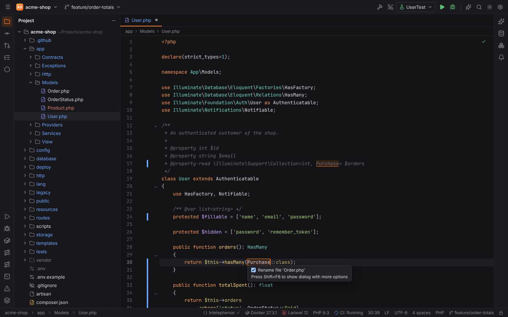

More: [Editor](../../user/editor.md#rename), [PHP](../../user/php.md#rename)

## Refactor This

**Shortcut:** `Ctrl+Alt+Shift+T` · macOS `Ctrl+T` · action id `Refactorings.QuickListPopupAction`

A popup with only the refactorings that apply at the caret or to the selection, with their
shortcuts: on a PHP class Rename, Move, Copy, Safe Delete, Extract Interface / Superclass and Pull
Members Up / Push Members Down; on a method Rename, Change Signature, Move, Safe Delete, Inline,
Pull Up / Push Down and Make Static; on an expression or a selection Introduce Variable /
Constant / Field / Parameter and Extract Method. In JavaScript and TypeScript files it adds the
language server's refactorings. Pick one with its number (`1`-`9`, `0`), the arrow keys and
`Enter`, or a click; typing filters the list (speed search), `Escape` clears the filter.

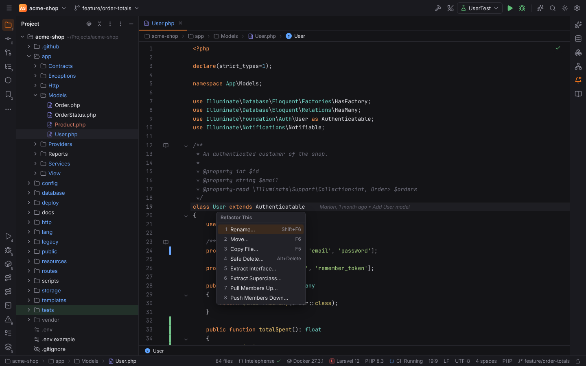

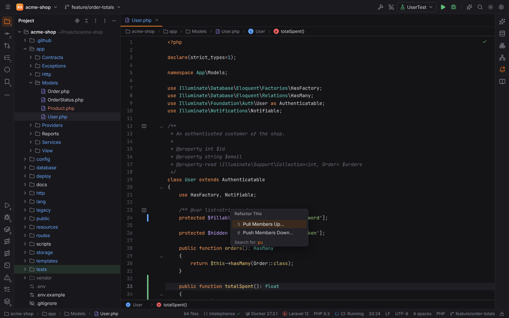

**Menu:** Refactor | Refactor This…

## Introduce Variable

**Shortcut:** `Ctrl+Alt+V` · macOS `Cmd+Alt+V` · action id `IntroduceVariable`

Puts the selected expression (or the one picked in the **Expressions** popup when nothing is
selected) into a new local variable. With several occurrences it asks whether to replace this
one or all of them. The name is then edited in place: `Up` / `Down` choose another suggested
name, `Enter` finishes. In the editor this shortcut wins over the Vim toggle.

**Menu:** Refactor | Extract/Introduce | Variable…

More: [PHP](../../user/php.md#extract-introduce-and-inline)

## Introduce Constant

**Shortcut:** `Ctrl+Alt+C` · macOS `Cmd+Alt+C` · action id `IntroduceConstant`

Turns a constant expression into a class constant (`self::NAME`), or a global `const` outside
classes. The dialog asks for the name, the visibility and whether to replace all occurrences.

**Menu:** Refactor | Extract/Introduce | Constant…

## Introduce Field

**Shortcut:** `Ctrl+Alt+F` · macOS `Cmd+Alt+F` · action id `IntroduceField`

Moves an expression of a method into a new property (`$this->name`), initialized in the current
method, the field declaration or the constructor.

**Menu:** Refactor | Extract/Introduce | Field…

## Introduce Parameter

**Shortcut:** `Ctrl+Alt+P` · macOS `Cmd+Alt+P` · action id `IntroduceParameter`

Adds a parameter for an expression to the enclosing function or method and passes the
expression at every call (or makes it the parameter's default value).

**Menu:** Refactor | Extract/Introduce | Parameter…

## Extract Method

**Shortcut:** `Ctrl+Alt+M` · macOS `Cmd+Alt+M` · action id `ExtractMethod`

Moves the selected statements or expression into a new method (a function outside classes).
The dialog shows the parameters (reorder and rename them), what is returned, the visibility,
**Declare static** and a signature preview, and offers to replace duplicate fragments.

**Menu:** Refactor | Extract/Introduce | Method…

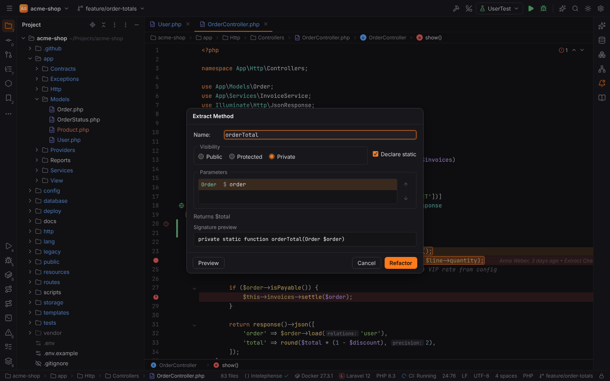

## Inline

**Shortcut:** `Ctrl+Alt+N` · macOS `Cmd+Alt+N` · action id `Inline`

Replaces a local variable by its value, a method or function call by the body, or a constant by
its value: every reference (removing or keeping the declaration) or only the one at the caret.

**Menu:** Refactor | Inline…

## Change Signature

**Shortcut:** `Ctrl+F6` · macOS `Cmd+F6` · action id `ChangeSignature`

Changes the name, visibility, return type and parameters of a PHP method or function (add,
remove, reorder; type, name, default value and the value new parameters get at call sites) and
updates the overriding methods and every call.

**Menu:** Refactor | Change Signature…

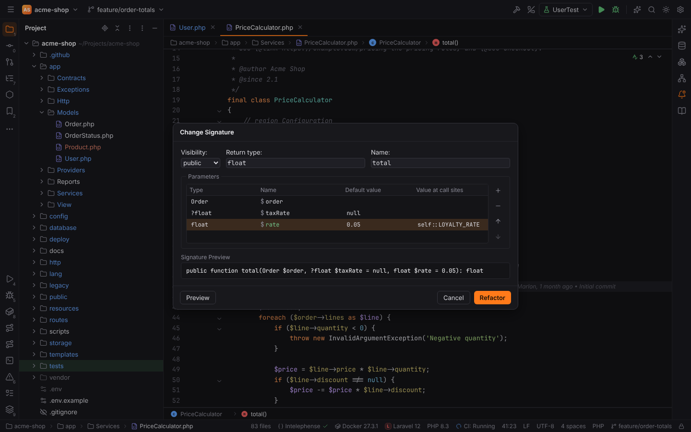

More: [PHP](../../user/php.md#move-copy-safe-delete-change-signature-and-make-static)

## Move

**Shortcut:** `F6` · macOS `F6` · action id `Move`

In the editor: moves the PHP class at the caret to another namespace and directory (Move
Class), static members to another class (Move Members) or a function to another file. In the
Project view: moves the selected files and folders (also by drag and drop), updating namespaces
and references of PHP classes.

**Menu:** Refactor | Move…

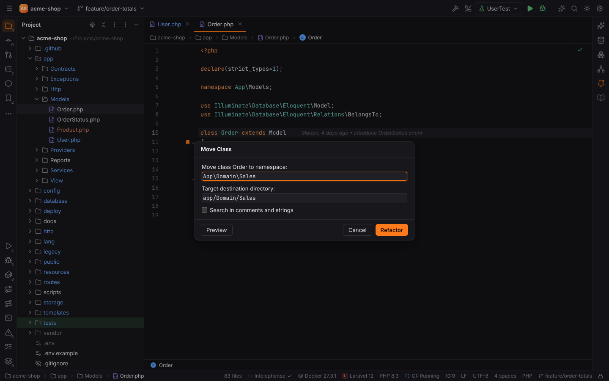

## Copy

**Shortcut:** `F5` · macOS `F5` · action id `CopyElement`

Copies the PHP class at the caret under a new name (Copy Class), or the selected file or folder
in the Project view.

**Menu:** Refactor | Copy File…

## Safe Delete

**Shortcut:** `Alt+Delete` · macOS `Cmd+Delete` · action id `SafeDelete`

Deletes the element at the caret (or the selected files in the Project view) after checking
that nothing uses it; **Usages Detected** offers View Usages and Delete Anyway.

**Menu:** Refactor | Safe Delete…

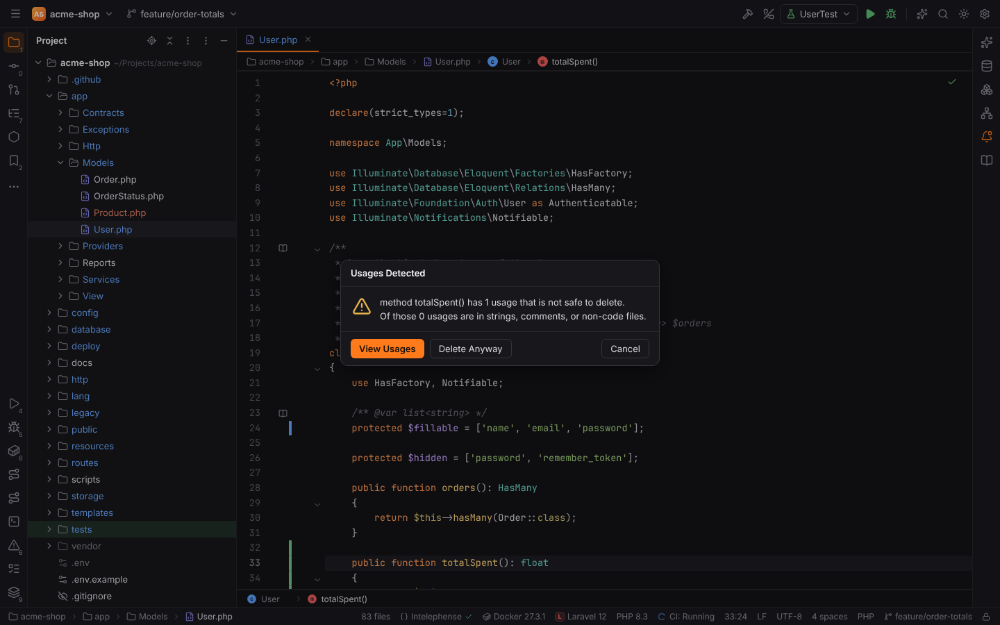

## Extract Interface

**Shortcut:** none by default · action id `ExtractInterface`

In a PHP class or enum: creates an interface (name, namespace, directory) from the PHP Interface
file template that declares the chosen public methods with their PHPDoc and holds the chosen
constants; the class implements it. **Replace class references with interface where possible**
changes parameter types that only need the interface's methods.

**Menu:** Refactor | Extract/Introduce | Interface…

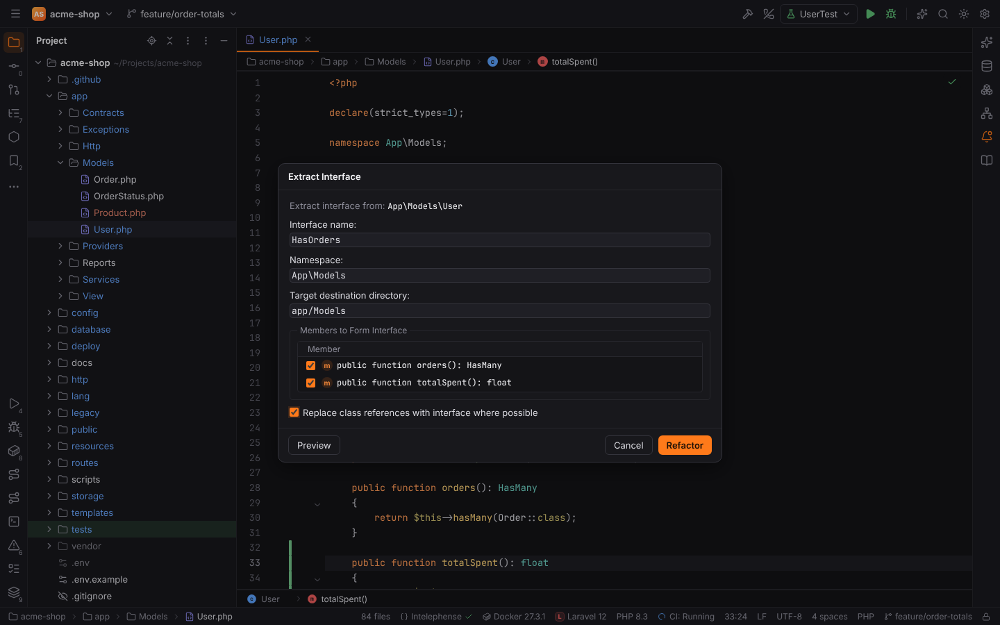

## Extract Superclass

**Shortcut:** none by default · action id `ExtractSuperclass`

Moves the chosen members of a PHP class into a new class that the class extends (between it
and its old parent); **Make abstract** keeps a method in the class and declares it abstract in
the superclass.

**Menu:** Refactor | Extract/Introduce | Superclass…

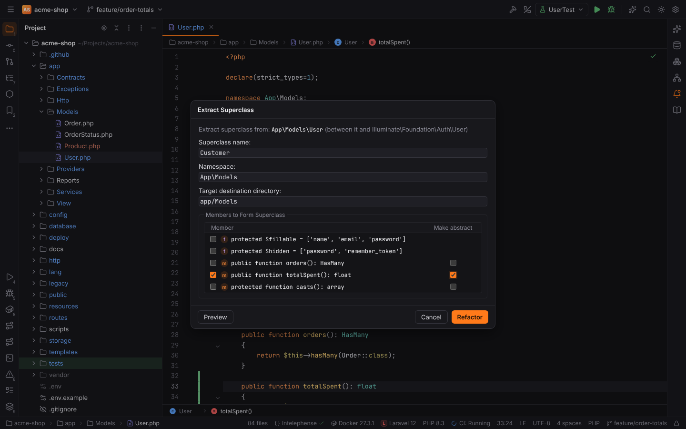

## Pull Members Up

**Shortcut:** none by default · action id `MembersPullUp`

Moves members into a superclass or interface of the class (interfaces get declarations), with
**Make abstract**; members a chosen one uses are highlighted, problems are listed before the
change.

**Menu:** Refactor | Pull Members Up…

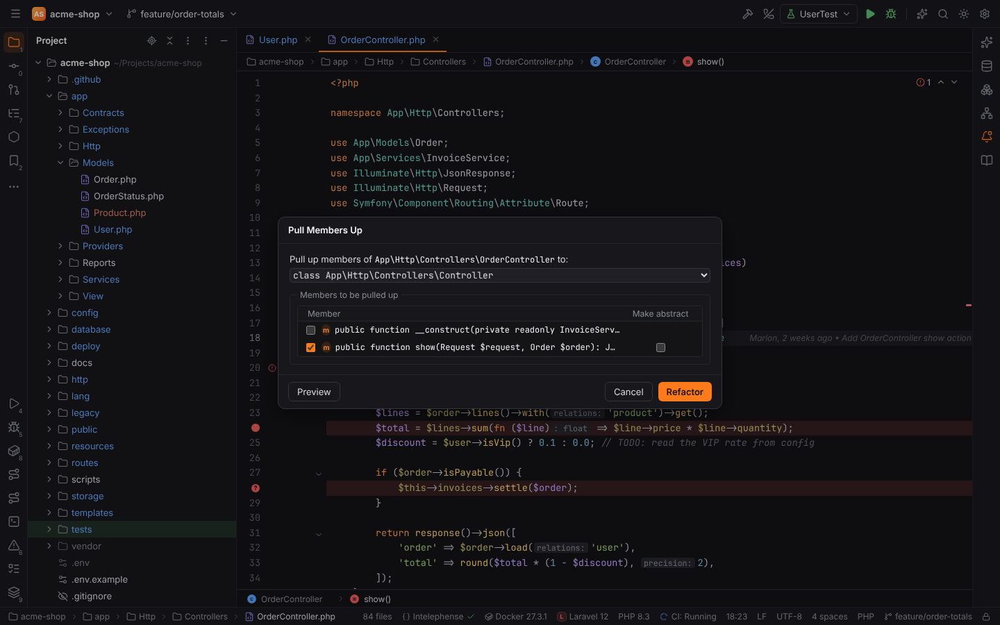

## Push Members Down

**Shortcut:** none by default · action id `MemberPushDown`

Copies members into every direct subclass and removes them from the class (**Keep abstract**
leaves an abstract declaration).

**Menu:** Refactor | Push Members Down…

## Make Static

**Shortcut:** none by default · action id `MakeStatic`

Makes a PHP instance method static, passing the object or the fields it reads as parameters,
and updates its calls.

**Menu:** Refactor | Make Static…

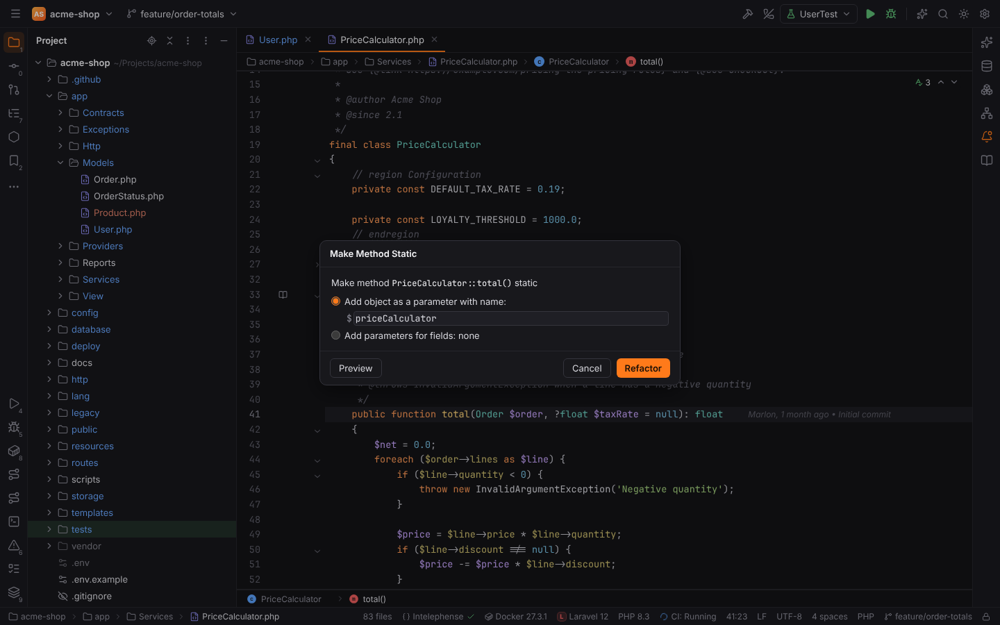

## Show Context Actions

**Shortcut:** `Alt+Enter` · macOS `Alt+Enter` · action id `ShowIntentionActions`

Opens the intention popup at the caret: quick fixes, intentions and refactorings of the
language servers and Forge's PHP intentions. `Right` opens an entry's sub-menu.

**Menu:** Code | Show Context Actions

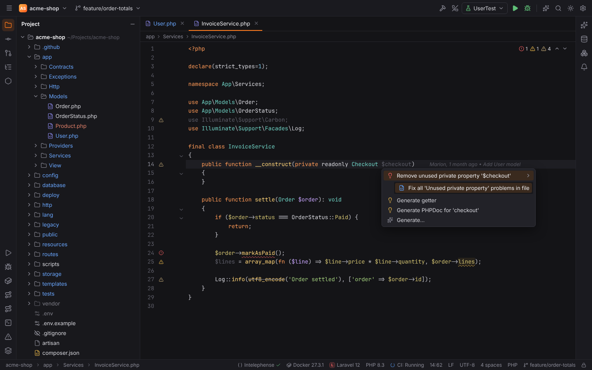

More: [Editor](../../user/editor.md#show-context-actions)

## Generate

**Shortcut:** `Alt+Insert` · macOS `Cmd+N` · action id `Generate`

In PHP files: generates a constructor, getters, setters, overrides, `__toString()` or a PHPDoc block.

**Menu:** Code | Generate…

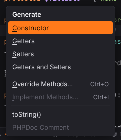

More: [PHP](../../user/php.md#generate)

## Reformat Code

**Shortcut:** `Ctrl+Alt+L` · macOS `Cmd+Alt+L` · action id `ReformatCode`

Formats the file with the language server's formatter (StyLua for Lua).

**Menu:** Code | Reformat Code

More: [Editor](../../user/editor.md#reformat-code)
