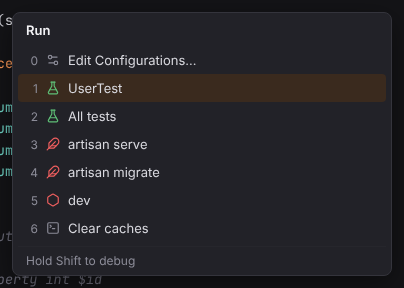
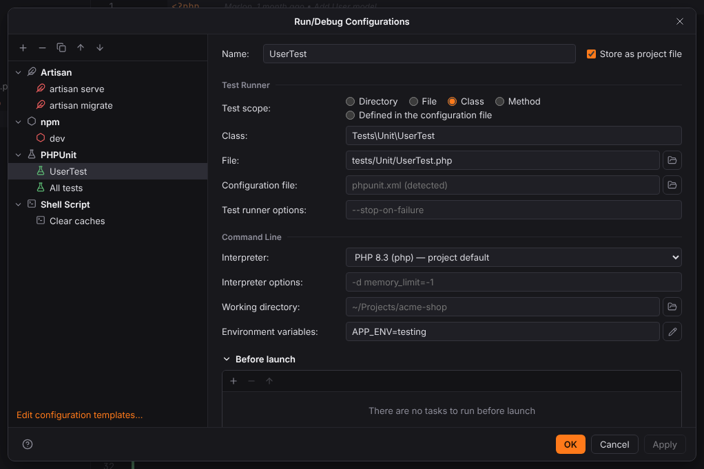
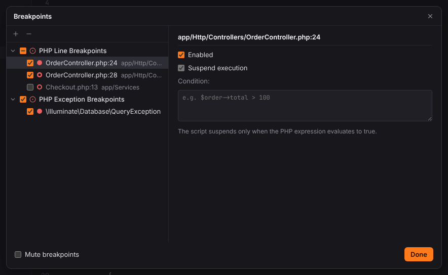
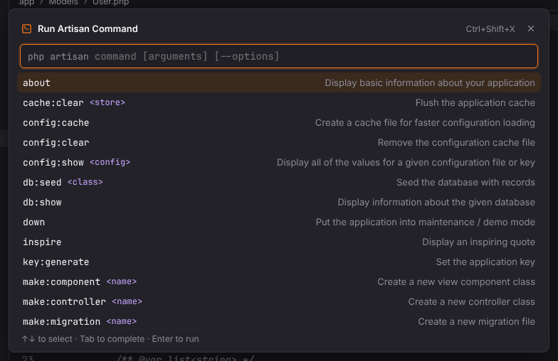

# Shortcuts: Run and debug

Running configurations, breakpoints and stepping through PHP code with Xdebug. Windows/Linux shortcuts first, macOS second; both are PHPStorm's defaults and can be changed in Settings | Keymap.

| Action | Windows / Linux | macOS |
| --- | --- | --- |
| [Run](#run) | `Shift+F10` | `Ctrl+R` |
| [Debug](#debug) | `Shift+F9` | `Ctrl+D` |
| [Run… (choose configuration)](#run-choose-configuration) | `Alt+Shift+F10` | `Ctrl+Alt+R` |
| [Debug… (choose configuration)](#debug-choose-configuration) | `Alt+Shift+F9` | `Ctrl+Alt+D` |
| [Run Context Configuration](#run-context-configuration) | `Ctrl+Shift+F10` | `Ctrl+Shift+R` |
| [Debug Context Configuration](#debug-context-configuration) | `Ctrl+Shift+F9` | `Ctrl+Shift+D` |
| [Edit Configurations](#edit-configurations) | — | — |
| [Stop](#stop) | `Ctrl+F2` | `Cmd+F2` |
| [Rerun](#rerun) | `Ctrl+F5` | `Cmd+R` |
| [Start Listening for PHP Debug Connections](#start-listening-for-php-debug-connections) | — | — |
| [Web Server Debug Validation](#web-server-debug-validation) | — | — |
| [Toggle Line Breakpoint](#toggle-line-breakpoint) | `Ctrl+F8` | `Cmd+F8` |
| [Toggle Temporary Line Breakpoint](#toggle-temporary-line-breakpoint) | `Ctrl+Alt+Shift+F8` | `Cmd+Alt+Shift+F8` |
| [View Breakpoints…](#view-breakpoints) | `Ctrl+Shift+F8` | `Cmd+Shift+F8` |
| [Mute Breakpoints](#mute-breakpoints) | — | — |
| [Resume Program](#resume-program) | `F9` | `Cmd+Alt+R` |
| [Pause Program](#pause-program) | — | — |
| [Step Over](#step-over) | `F8` | `F8` |
| [Step Into](#step-into) | `F7` | `F7` |
| [Smart Step Into](#smart-step-into) | `Shift+F7` | `Shift+F7` |
| [Force Step Into](#force-step-into) | `Alt+Shift+F7` | `Alt+Shift+F7` |
| [Step Out](#step-out) | `Shift+F8` | `Shift+F8` |
| [Run to Cursor](#run-to-cursor) | `Alt+F9` | `Alt+F9` |
| [Force Run to Cursor](#force-run-to-cursor) | `Ctrl+Alt+F9` | `Cmd+Alt+F9` |
| [Evaluate Expression…](#evaluate-expression) | `Alt+F8` | `Alt+F8` |
| [Quick Evaluate Expression](#quick-evaluate-expression) | `Ctrl+Alt+F8` | `Cmd+Alt+F8` |
| [Show Execution Point](#show-execution-point) | `Alt+F10` | `Alt+F10` |
| [Add to Watches](#add-to-watches) | — | — |
| [Set Value](#set-value) | `F2` | `F2` |
| [Run Artisan Command…](#run-artisan-command) | `Ctrl+Shift+X` | `Cmd+Shift+X` |
| [Run Console Command…](#run-console-command) | — | — |
| [Execute](#execute) | `Ctrl+Enter` | `Cmd+Enter` |

## Run

**Shortcut:** `Shift+F10` · macOS `Ctrl+R` · action id `Run`

Runs the configuration selected in the run widget.

**Menu:** Run | Run

More: [Run/Debug configurations](../../user/run-debug.md)

## Debug

**Shortcut:** `Shift+F9` · macOS `Ctrl+D` · action id `Debug`

Debugs the selected configuration (Xdebug for PHP, `--inspect` for npm).

**Menu:** Run | Debug

More: [Run/Debug configurations](../../user/run-debug.md#debugging)

## Run (choose configuration)

**Shortcut:** `Alt+Shift+F10` · macOS `Ctrl+Alt+R` · action id `ChooseRunConfiguration`

Lists the run configurations to run one; hold `Shift` to debug instead.

**Menu:** Run | Run…

More: [Run/Debug configurations](../../user/run-debug.md#run-widget)

## Debug (choose configuration)

**Shortcut:** `Alt+Shift+F9` · macOS `Ctrl+Alt+D` · action id `ChooseDebugConfiguration`

Lists the run configurations to debug one.

**Menu:** Run | Debug…

More: [Run/Debug configurations](../../user/run-debug.md#run-widget)

## Run Context Configuration

**Shortcut:** `Ctrl+Shift+F10` · macOS `Ctrl+Shift+R` · action id `RunClass`

Runs what is at the caret: the PHPUnit test or class, the scratch, the Lua main chunk.

More: [Run/Debug configurations](../../user/run-debug.md#temporary-configurations)

## Debug Context Configuration

**Shortcut:** `Ctrl+Shift+F9` · macOS `Ctrl+Shift+D` · action id `DebugClass`

Debugs what is at the caret.

More: [Run/Debug configurations](../../user/run-debug.md#temporary-configurations)

## Edit Configurations

**Shortcut:** — · macOS — · action id `editRunConfigurations`

Opens the Run/Debug Configurations dialog.

**Menu:** Run | Edit Configurations…

More: [Run/Debug configurations](../../user/run-debug.md#rundebug-configurations-dialog)

## Stop

**Shortcut:** `Ctrl+F2` · macOS `Cmd+F2` · action id `Stop`

Stops the running process or debug session.

**Menu:** Run | Stop

More: [Run/Debug configurations](../../user/run-debug.md#run-tool-window)

## Rerun

**Shortcut:** `Ctrl+F5` · macOS `Cmd+R` · action id `Rerun`

Runs the last run again.

More: [Run/Debug configurations](../../user/run-debug.md#run-tool-window)

## Start Listening for PHP Debug Connections

**Shortcut:** — · macOS — · action id `PhpListenDebugAction`

Starts or stops listening for incoming Xdebug connections on port 9003.

**Menu:** Run | Start Listening for PHP Debug Connections

More: [Xdebug debugging](../../user/debugging.md#listening-for-connections)

## Web Server Debug Validation

**Shortcut:** — · macOS — · action id `WebServerDebugValidation`

Checks the Xdebug configuration of a web server or a CLI interpreter (mode, client host and
port, start with request) and explains what to change.

**Menu:** Run | Web Server Debug Validation…

More: [Xdebug debugging](../../user/debugging.md#web-server-debug-validation)

## Toggle Line Breakpoint

**Shortcut:** `Ctrl+F8` · macOS `Cmd+F8` · action id `ToggleLineBreakpoint`

Adds or removes a line breakpoint at the caret.

**Menu:** Run | Toggle Breakpoint | Line Breakpoint

More: [Xdebug debugging](../../user/debugging.md#breakpoints)

## Toggle Temporary Line Breakpoint

**Shortcut:** `Ctrl+Alt+Shift+F8` · macOS `Cmd+Alt+Shift+F8` · action id `ToggleTemporaryLineBreakpoint`

Adds a breakpoint that is removed once it is hit, or removes the breakpoint at the caret.

**Menu:** Run | Toggle Breakpoint | Temporary Line Breakpoint

More: [Xdebug debugging](../../user/debugging.md#breakpoint-properties-logpoints-and-temporary-breakpoints)

## View Breakpoints

**Shortcut:** `Ctrl+Shift+F8` · macOS `Cmd+Shift+F8` · action id `ViewBreakpoints`

Lists all breakpoints, with conditions and exception breakpoints.

**Menu:** Run | View Breakpoints…

More: [Xdebug debugging](../../user/debugging.md#breakpoints)

## Mute Breakpoints

**Shortcut:** — · macOS — · action id `XDebugger.MuteBreakpoints`

Turns all breakpoints off temporarily, or on again.

**Menu:** Run | Mute Breakpoints

More: [Xdebug debugging](../../user/debugging.md#breakpoints)

## Resume Program

**Shortcut:** `F9` · macOS `Cmd+Alt+R` · action id `Resume`

Continues until the next breakpoint.

**Menu:** Run | Debugging Actions | Resume Program

More: [Xdebug debugging](../../user/debugging.md#the-debug-tool-window)

## Pause Program

**Shortcut:** — · macOS — · action id `Pause`

Asks the debugger to pause the script (if the engine supports it).

**Menu:** Run | Debugging Actions | Pause Program

More: [Xdebug debugging](../../user/debugging.md#the-debug-tool-window)

## Step Over

**Shortcut:** `F8` · macOS `F8` · action id `StepOver`

Executes the current line and stops at the next one.

**Menu:** Run | Debugging Actions | Step Over

More: [Xdebug debugging](../../user/debugging.md#the-debug-tool-window)

## Step Into

**Shortcut:** `F7` · macOS `F7` · action id `StepInto`

Steps into the function called on the current line.

**Menu:** Run | Debugging Actions | Step Into

More: [Xdebug debugging](../../user/debugging.md#the-debug-tool-window)

## Smart Step Into

**Shortcut:** `Shift+F7` · macOS `Shift+F7` · action id `SmartStepInto`

Steps into the call on the current line (currently like Step Into).

**Menu:** Run | Debugging Actions | Smart Step Into

More: [Xdebug debugging](../../user/debugging.md#the-debug-tool-window)

## Force Step Into

**Shortcut:** `Alt+Shift+F7` · macOS `Alt+Shift+F7` · action id `ForceStepInto`

Steps into the call even in code that is normally skipped.

**Menu:** Run | Debugging Actions | Force Step Into

More: [Xdebug debugging](../../user/debugging.md#the-debug-tool-window)

## Step Out

**Shortcut:** `Shift+F8` · macOS `Shift+F8` · action id `StepOut`

Runs to the end of the current function and stops in the caller.

**Menu:** Run | Debugging Actions | Step Out

More: [Xdebug debugging](../../user/debugging.md#the-debug-tool-window)

## Run to Cursor

**Shortcut:** `Alt+F9` · macOS `Alt+F9` · action id `RunToCursor`

Continues until the line with the caret.

**Menu:** Run | Debugging Actions | Run to Cursor

More: [Xdebug debugging](../../user/debugging.md#the-debug-tool-window)

## Force Run to Cursor

**Shortcut:** `Ctrl+Alt+F9` · macOS `Cmd+Alt+F9` · action id `ForceRunToCursor`

Continues until the caret line, ignoring breakpoints on the way.

**Menu:** Run | Debugging Actions | Force Run to Cursor

More: [Xdebug debugging](../../user/debugging.md#the-debug-tool-window)

## Evaluate Expression

**Shortcut:** `Alt+F8` · macOS `Alt+F8` · action id `EvaluateExpression`

Evaluates a PHP expression in the current frame.

**Menu:** Run | Debugging Actions | Evaluate Expression…

More: [Xdebug debugging](../../user/debugging.md#the-debug-tool-window)

## Quick Evaluate Expression

**Shortcut:** `Ctrl+Alt+F8` · macOS `Cmd+Alt+F8` · action id `QuickEvaluateExpression`

Evaluates the selection or the expression at the caret.

**Menu:** Run | Debugging Actions | Quick Evaluate Expression

More: [Xdebug debugging](../../user/debugging.md#the-debug-tool-window)

## Show Execution Point

**Shortcut:** `Alt+F10` · macOS `Alt+F10` · action id `ShowExecutionPoint`

Shows the line where the debugger is paused.

**Menu:** Run | Debugging Actions | Show Execution Point

More: [Xdebug debugging](../../user/debugging.md#the-debug-tool-window)

## Add to Watches

**Shortcut:** — · macOS — · action id `Debugger.AddToWatch`

Adds the selected expression to the watches.

More: [Xdebug debugging](../../user/debugging.md#the-debug-tool-window)

## Set Value

**Shortcut:** `F2` · macOS `F2` · action id `XDebugger.SetValue`

Edits the value of the variable selected in the Debug tool window: type a PHP expression and
press `Enter`.

More: [Xdebug debugging](../../user/debugging.md#variables-set-value-and-copy-value)

## Run Artisan Command

**Shortcut:** `Ctrl+Shift+X` · macOS `Cmd+Shift+X` · action id `Laravel.RunArtisan`

Runs an artisan command of the Laravel project.

**Menu:** Tools | Laravel | Run Artisan Command…

More: [Laravel](../../user/laravel.md#run-artisan-command)

## Run Console Command

**Shortcut:** — · macOS — · action id `Symfony.RunConsoleCommand`

Runs a `bin/console` command of the Symfony project.

**Menu:** Tools | Symfony | Run Console Command…

More: [Symfony](../../user/symfony.md#run-console-command)

## Execute

**Shortcut:** `Ctrl+Enter` · macOS `Cmd+Enter` · action id `Console.Jdbc.Execute`

Executes the SQL statement at the caret (or the selection) in a query console.

More: [Database tools and SQL console](../../user/database.md#query-console)
