# Shortcuts: Search

Search Everywhere, Go to Class/File/Symbol, find in the current file, Find in Files, Find / Show Usages, Find Usages in File, Highlight Usages in File and the Find Usages settings. Windows/Linux shortcuts first, macOS second; both are PHPStorm's defaults and can be changed in Settings | Keymap.

| Action | Windows / Linux | macOS |
| --- | --- | --- |
| [Search Everywhere](#search-everywhere) | `Double Shift` | `Double Shift` |
| [Go to Class](#go-to-class) | `Ctrl+N` | `Cmd+O` |
| [Go to File](#go-to-file) | `Ctrl+Shift+N` | `Cmd+Shift+O` |
| [Go to Symbol](#go-to-symbol) | `Ctrl+Alt+Shift+N` | `Cmd+Alt+O` |
| [Find Action](#find-action) | `Ctrl+Shift+A` | `Cmd+Shift+A` |
| [Find in File](#find-in-file) | `Ctrl+F` | `Cmd+F` |
| [Replace in File](#replace-in-file) | `Ctrl+R` | `Cmd+R` |
| [Find Next / Move to Next Occurrence](#find-next--move-to-next-occurrence) | `F3` | `Cmd+G` |
| [Find Previous / Move to Previous Occurrence](#find-previous--move-to-previous-occurrence) | `Shift+F3` | `Cmd+Shift+G` |
| [Find in Files…](#find-in-files) | `Ctrl+Shift+F` | `Cmd+Shift+F` |
| [Find Usages](#find-usages) | `Alt+F7` | `Alt+F7` |
| [Show Usages](#show-usages) | `Ctrl+Alt+F7` | `Cmd+Alt+F7` |
| [Find Usages in File](#find-usages-in-file) | `Ctrl+F7` | `Cmd+F7` |
| [Highlight Usages in File](#highlight-usages-in-file) | `Ctrl+Shift+F7` | `Cmd+Shift+F7` |
| [Find Usages Settings…](#find-usages-settings) | `Ctrl+Alt+Shift+F7` | `Cmd+Alt+Shift+F7` |

## Search Everywhere

**Shortcut:** `Double Shift` · macOS `Double Shift` · action id `SearchEverywhere`

Searches classes, files, symbols, actions and text in one popup.

**Menu:** Navigate | Search Everywhere

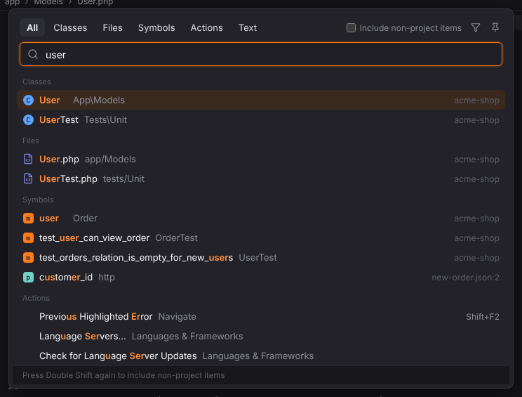

More: [Search Everywhere and Find Action](../../user/search-everywhere.md)

## Go to Class

**Shortcut:** `Ctrl+N` · macOS `Cmd+O` · action id `GotoClass`

Finds a class, interface, trait or enum by name (camel humps work).

**Menu:** Navigate | Class…

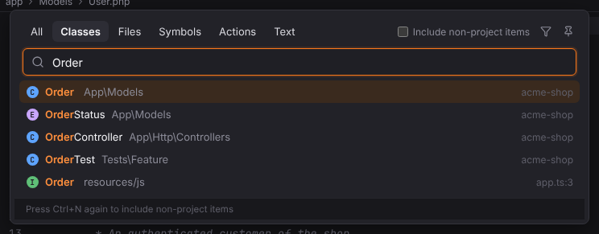

More: [Search Everywhere and Find Action](../../user/search-everywhere.md)

## Go to File

**Shortcut:** `Ctrl+Shift+N` · macOS `Cmd+Shift+O` · action id `GotoFile`

Finds a project file by name or path.

**Menu:** Navigate | File…

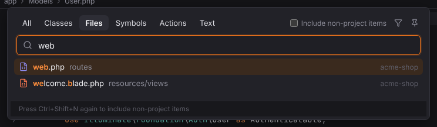

More: [Search Everywhere and Find Action](../../user/search-everywhere.md)

## Go to Symbol

**Shortcut:** `Ctrl+Alt+Shift+N` · macOS `Cmd+Alt+O` · action id `GotoSymbol`

Finds a function, method, property or constant by name.

**Menu:** Navigate | Symbol…

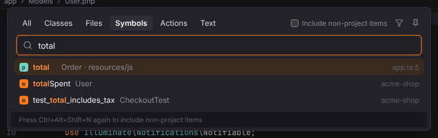

More: [Search Everywhere and Find Action](../../user/search-everywhere.md)

## Find Action

**Shortcut:** `Ctrl+Shift+A` · macOS `Cmd+Shift+A` · action id `GotoAction`

Finds any action by name and runs it (Find Action).

**Menu:** Navigate | Action…; Help | Find Action…

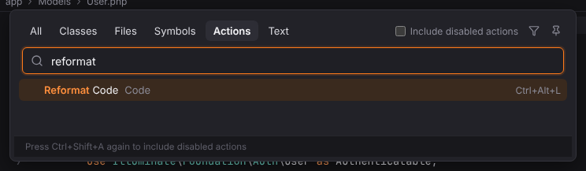

More: [Search Everywhere and Find Action](../../user/search-everywhere.md#find-action)

## Find in File

**Shortcut:** `Ctrl+F` · macOS `Cmd+F` · action id `Find`

Opens the Find bar at the top of the editor for the current file, prefilled with the selection or the word at the caret.

**Menu:** Edit | Find | Find…

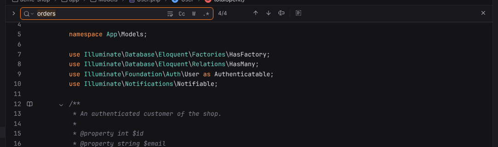

More: [Editor](../../user/editor.md#find-and-replace-in-a-file)

## Replace in File

**Shortcut:** `Ctrl+R` · macOS `Cmd+R` · action id `Replace`

Opens the Find bar with the replace row expanded.

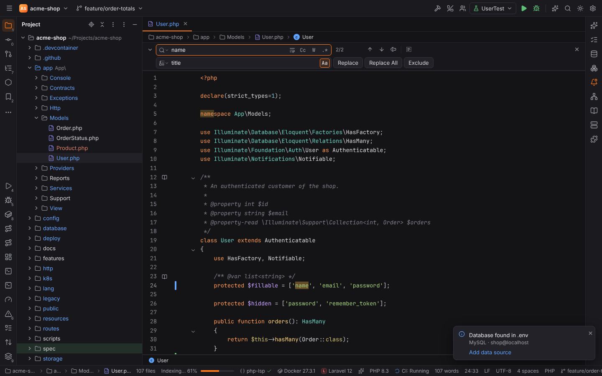

**Menu:** Edit | Find | Replace…

More: [Editor](../../user/editor.md#find-and-replace-in-a-file)

## Find Next / Move to Next Occurrence

**Shortcut:** `F3` · macOS `Cmd+G` · action id `FindNext`

Moves to the next match of the current search.

**Menu:** Edit | Find | Find Next / Move to Next Occurrence

More: [Editor](../../user/editor.md#find-and-replace-in-a-file)

## Find Previous / Move to Previous Occurrence

**Shortcut:** `Shift+F3` · macOS `Cmd+Shift+G` · action id `FindPrevious`

Moves to the previous match.

**Menu:** Edit | Find | Find Previous / Move to Previous Occurrence

More: [Editor](../../user/editor.md#find-and-replace-in-a-file)

## Find in Files

**Shortcut:** `Ctrl+Shift+F` · macOS `Cmd+Shift+F` · action id `FindInPath`

Searches the text of all project files, with match case, whole words, regular expressions, file masks and a folder scope.

**Menu:** Edit | Find | Find in Files…

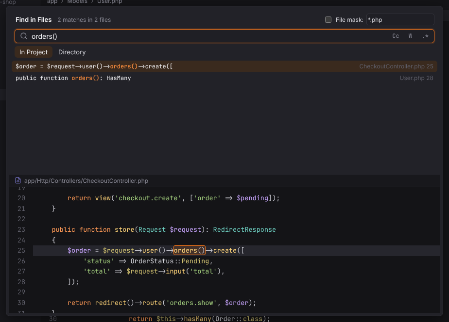

More: [Search Everywhere and Find Action](../../user/search-everywhere.md#find-in-files)

## Find Usages

**Shortcut:** `Alt+F7` · macOS `Alt+F7` · action id `FindUsages`

Finds the usages of the symbol at the caret and shows them in the Find tool window, grouped by usage type and file.

**Menu:** Edit | Find Usages | Find Usages

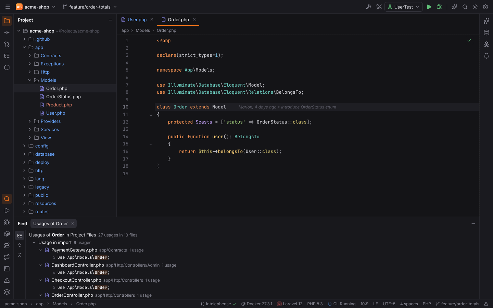

More: [Editor](../../user/editor.md#find-usages-and-show-usages)

## Show Usages

**Shortcut:** `Ctrl+Alt+F7` · macOS `Cmd+Alt+F7` · action id `ShowUsages`

Shows the usages of the symbol at the caret in a popup; `Enter` opens one, the pin button keeps them in the Find tool window. `Ctrl+Click` on a declaration does the same.

**Menu:** Edit | Find Usages | Show Usages

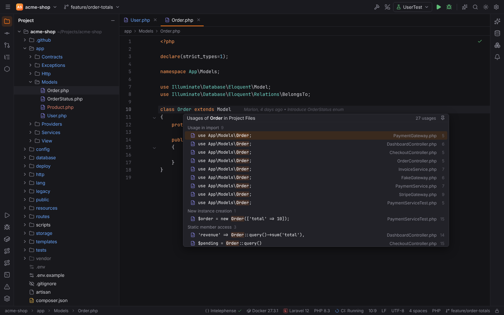

More: [Editor](../../user/editor.md#find-usages-and-show-usages)

## Find Usages in File

**Shortcut:** `Ctrl+F7` · macOS `Cmd+F7` · action id `FindUsagesInFile`

Finds the usages of the symbol at the caret in the current file and shows them in the Find tool window.

**Menu:** Edit | Find Usages | Find Usages in File

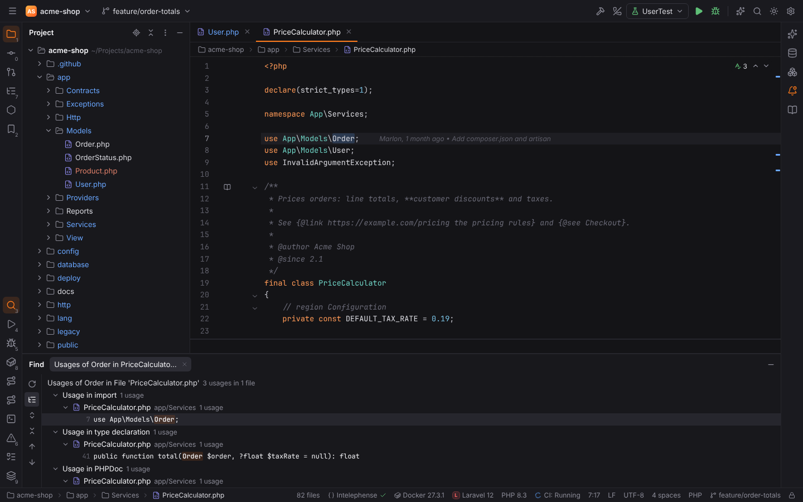

More: [Editor](../../user/editor.md#find-usages-in-file)

## Highlight Usages in File

**Shortcut:** `Ctrl+Shift+F7` · macOS `Cmd+Shift+F7` · action id `HighlightUsagesInFile`

Highlights the usages of the symbol at the caret in the file (reads and writes in different colors) until `Escape`; `F3` / `Shift+F3` jump between them. On `return` / `throw` it highlights the exit points, on `implements` / `extends` the implementing / overriding methods.

**Menu:** Edit | Find Usages | Highlight Usages in File

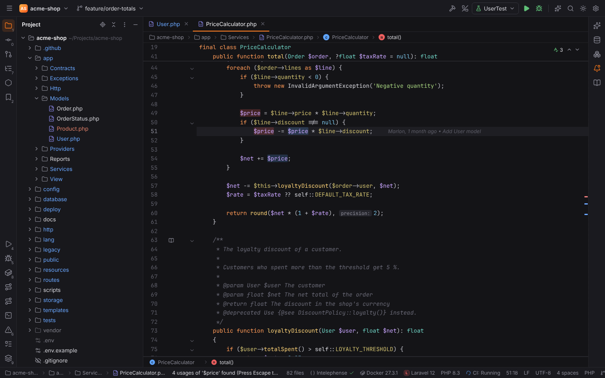

More: [Editor](../../user/editor.md#highlight-usages)

## Find Usages Settings…

**Shortcut:** `Ctrl+Alt+Shift+F7` · macOS `Cmd+Alt+Shift+F7` · action id `ShowSettingsAndFindUsages`

Opens the Find Usages dialog for the symbol at the caret (what to find, options, scope, Open in new tab), saves the choices for later searches and runs Find Usages.

**Menu:** Edit | Find Usages | Find Usages Settings…

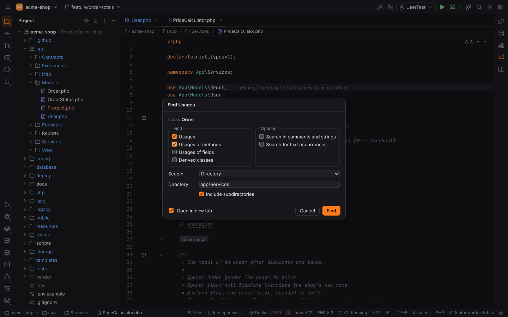

More: [Editor](../../user/editor.md#find-usages-settings)
