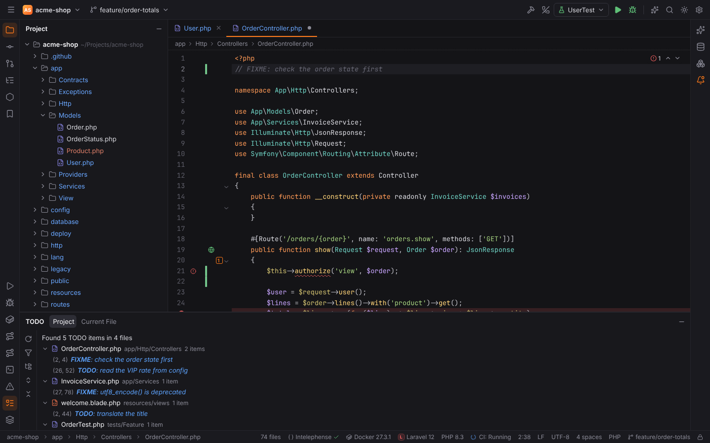
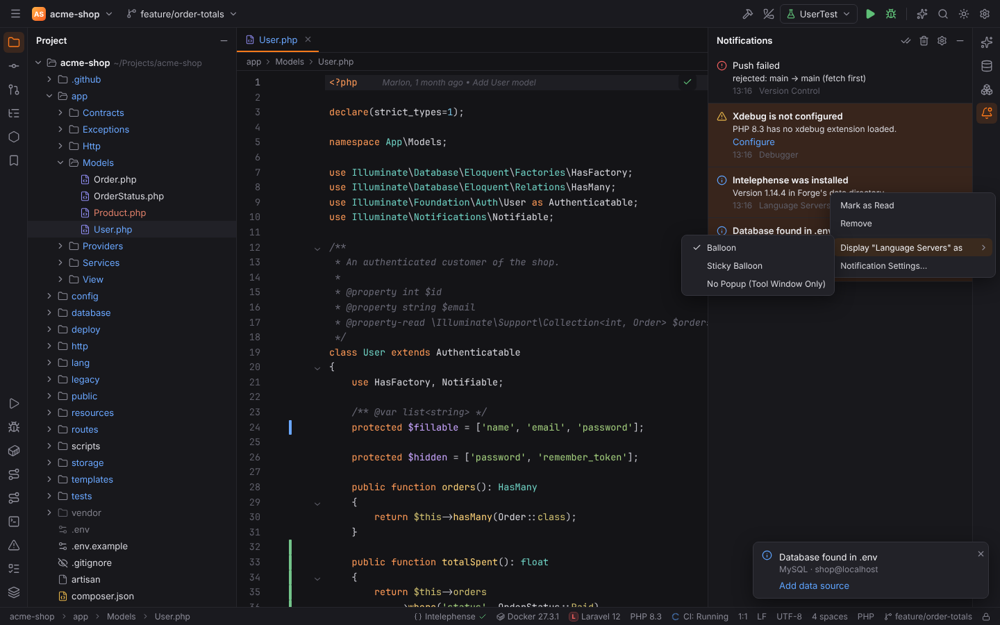
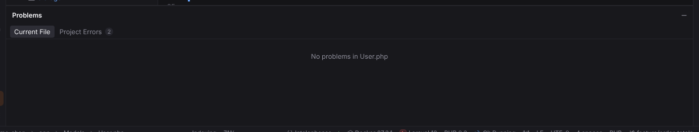
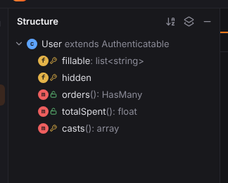
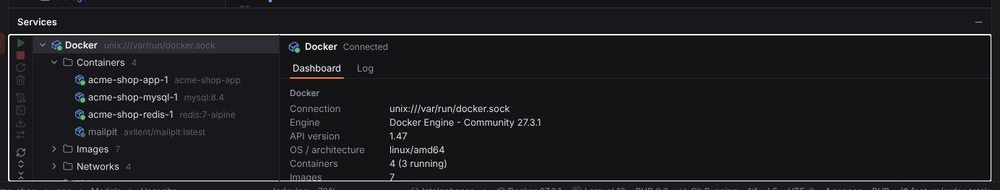
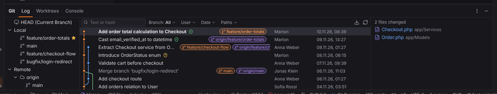
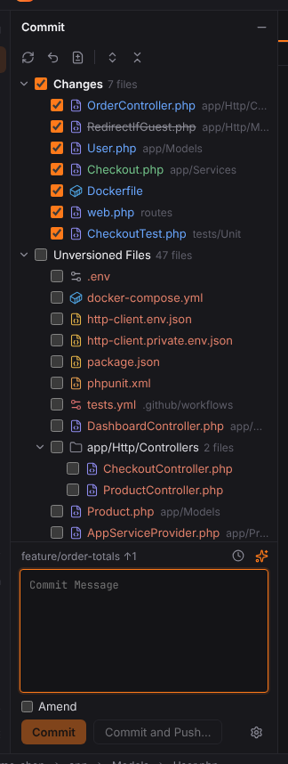
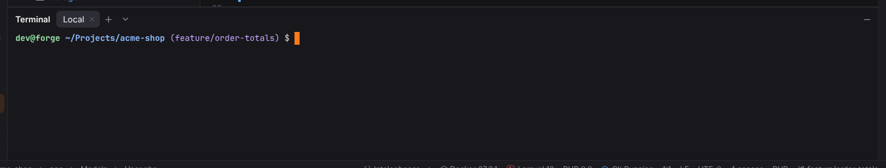
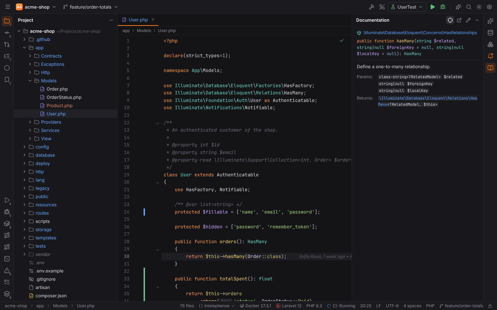

# Shortcuts: Tool windows

Opening, hiding, resizing and switching tool windows. Windows/Linux shortcuts first, macOS second; both are PHPStorm's defaults and can be changed in Settings | Keymap.

| Action | Windows / Linux | macOS |
| --- | --- | --- |
| [Project tool window](#project-tool-window) | `Alt+1` | `Cmd+1` |
| [Bookmarks tool window](#bookmarks-tool-window) | `Alt+2` | `Cmd+2` |
| [TODO tool window](#todo-tool-window) | — | — |
| [Notifications tool window](#notifications-tool-window) | — | — |
| [Find tool window](#find-tool-window) | `Alt+3` | `Cmd+3` |
| [Run tool window](#run-tool-window) | `Alt+4` | `Cmd+4` |
| [Debug tool window](#debug-tool-window) | `Alt+5` | `Cmd+5` |
| [Problems tool window](#problems-tool-window) | `Alt+6` | `Cmd+6` |
| [Structure tool window](#structure-tool-window) | `Alt+7` | `Cmd+7` |
| [Services tool window](#services-tool-window) | `Alt+8` | `Cmd+8` |
| [Git tool window](#git-tool-window) | `Alt+9` | `Cmd+9` |
| [Commit tool window](#commit-tool-window) | `Alt+0` | `Cmd+0` |
| [Terminal tool window](#terminal-tool-window) | `Alt+F12` | `Alt+F12` |
| [Database tool window](#database-tool-window) | — | — |
| [AI Chat tool window](#ai-chat-tool-window) | — | — |
| [Documentation tool window](#documentation-tool-window) | — | — |
| [Pull Requests tool window](#pull-requests-tool-window) | — | — |
| [npm tool window](#npm-tool-window) | — | — |
| [Doctrine tool window](#doctrine-tool-window) | — | — |
| [Laravel Routes tool window](#laravel-routes-tool-window) | — | — |
| [Symfony tool window](#symfony-tool-window) | — | — |
| [Hide Active Tool Window](#hide-active-tool-window) | `Shift+Escape` | `Shift+Escape` |
| [Hide All Tool Windows](#hide-all-tool-windows) | `Ctrl+Shift+F12` | `Cmd+Shift+F12` |
| [Hide Side Tool Windows](#hide-side-tool-windows) | — | — |
| [Restore Default Layout](#restore-default-layout) | `Shift+F12` | `Shift+F12` |
| [Store Current Layout as Default](#store-current-layout-as-default) | — | — |
| [Jump to Last Tool Window](#jump-to-last-tool-window) | `F12` | `F12` |
| [Stretch to Left](#stretch-to-left) | `Ctrl+Shift+Left` | `Ctrl+Alt+Shift+Left` |
| [Stretch to Right](#stretch-to-right) | `Ctrl+Shift+Right` | `Ctrl+Alt+Shift+Right` |
| [Stretch to Top](#stretch-to-top) | `Ctrl+Shift+Up` | `Ctrl+Alt+Shift+Up` |
| [Stretch to Bottom](#stretch-to-bottom) | `Ctrl+Shift+Down` | `Ctrl+Alt+Shift+Down` |
| [Close Active Tool Window Tab](#close-active-tool-window-tab) | `Ctrl+Shift+F4` | `Cmd+Shift+F4` |
| [New Terminal Tab](#new-terminal-tab) | `Ctrl+Shift+T` | `Cmd+T` |
| [Close Terminal Tab](#close-terminal-tab) | — | — |

## Project tool window

**Shortcut:** `Alt+1` · macOS `Cmd+1` · action id `ActivateProjectToolWindow`

Shows or hides the Project tool window.

**Menu:** View | Tool Windows | Project

More: [Workbench and tool windows](../../user/workbench.md#project-view)

## Bookmarks tool window

**Shortcut:** `Alt+2` · macOS `Cmd+2` · action id `ActivateBookmarksToolWindow`

Shows or hides the Bookmarks tool window.

**Menu:** View | Tool Windows | Bookmarks

More: [Workbench and tool windows](../../user/workbench.md#bookmarks)

## TODO tool window

**Shortcut:** — · macOS — · action id `ActivateTODOToolWindow`

Shows or hides the TODO tool window with the TODO and FIXME comments of the project.

**Menu:** View | Tool Windows | TODO

More: [Workbench and tool windows](../../user/workbench.md#todo)

## Notifications tool window

**Shortcut:** — · macOS — · action id `ActivateNotificationsToolWindow`

Shows or hides the Notifications tool window with the history of balloons.

**Menu:** View | Tool Windows | Notifications

More: [Workbench and tool windows](../../user/workbench.md#notifications)

## Find tool window

**Shortcut:** `Alt+3` · macOS `Cmd+3` · action id `ActivateFindToolWindow`

Shows or hides the Find tool window with the results of Find Usages and of Find in Files (Open in Find Window).

**Menu:** View | Tool Windows | Find

More: [Editor](../../user/editor.md#find-usages-and-show-usages)

## Run tool window

**Shortcut:** `Alt+4` · macOS `Cmd+4` · action id `ActivateRunToolWindow`

Shows or hides the Run tool window.

**Menu:** View | Tool Windows | Run

More: [Run/Debug configurations](../../user/run-debug.md#run-tool-window)

## Debug tool window

**Shortcut:** `Alt+5` · macOS `Cmd+5` · action id `ActivateDebugToolWindow`

Shows or hides the Debug tool window.

**Menu:** View | Tool Windows | Debug

More: [Xdebug debugging](../../user/debugging.md#the-debug-tool-window)

## Problems tool window

**Shortcut:** `Alt+6` · macOS `Cmd+6` · action id `ActivateProblemsViewToolWindow`

Shows or hides the Problems tool window.

**Menu:** View | Tool Windows | Problems

More: [Editor](../../user/editor.md#problems)

## Structure tool window

**Shortcut:** `Alt+7` · macOS `Cmd+7` · action id `ActivateStructureToolWindow`

Shows or hides the Structure tool window of the current file.

**Menu:** View | Tool Windows | Structure

More: [PHP](../../user/php.md#structure)

## Services tool window

**Shortcut:** `Alt+8` · macOS `Cmd+8` · action id `ActivateServicesToolWindow`

Shows or hides the Services tool window (Docker, Compose, Kubernetes).

**Menu:** View | Tool Windows | Services

More: [Services](../../user/services.md)

## Git tool window

**Shortcut:** `Alt+9` · macOS `Cmd+9` · action id `ActivateVersionControlToolWindow`

Shows or hides the Git tool window (log and console).

**Menu:** View | Tool Windows | Git

More: [Git](../../user/git.md#log)

## Commit tool window

**Shortcut:** `Alt+0` · macOS `Cmd+0` · action id `ActivateCommitToolWindow`

Shows or hides the Commit tool window.

**Menu:** View | Tool Windows | Commit

More: [Git](../../user/git.md#commit-tool-window)

## Terminal tool window

**Shortcut:** `Alt+F12` · macOS `Alt+F12` · action id `ActivateTerminalToolWindow`

Shows or hides the Terminal tool window.

**Menu:** View | Tool Windows | Terminal

More: [Terminal](../../user/terminal.md)

## Database tool window

**Shortcut:** — · macOS — · action id `ActivateDatabaseToolWindow`

Shows or hides the Database tool window.

**Menu:** View | Tool Windows | Database

More: [Database tools and SQL console](../../user/database.md)

## AI Chat tool window

**Shortcut:** — · macOS — · action id `ActivateAIChatToolWindow`

Shows or hides the AI Chat tool window.

**Menu:** View | Tool Windows | AI Chat

More: [AI](../../user/ai.md#ai-chat)

## Documentation tool window

**Shortcut:** — · macOS — · action id `ActivateDocumentationToolWindow`

Shows or hides the Documentation tool window, which keeps the documentation of the symbol at
the caret open (Quick Documentation, `Ctrl+Q`, pinned).

**Menu:** View | Tool Windows | Documentation

More: [Editor](../../user/editor.md#documentation-tool-window)

## Pull Requests tool window

**Shortcut:** — · macOS — · action id `ActivatePullRequestsToolWindow`

Shows or hides the Pull Requests tool window.

**Menu:** View | Tool Windows | Pull Requests

More: [Code hosts](../../user/code-hosts.md)

## npm tool window

**Shortcut:** — · macOS — · action id `ActivatenpmToolWindow`

Shows or hides the npm tool window.

More: [WebForge](../../user/webforge.md#npm-tool-window)

## Doctrine tool window

**Shortcut:** — · macOS — · action id `Doctrine.ShowEntities`

Shows the Doctrine tool window.

More: [Doctrine and DQL](../../user/doctrine.md#doctrine-tool-window)

## Laravel Routes tool window

**Shortcut:** — · macOS — · action id `Laravel.ShowRoutes`

Shows the Laravel Routes tool window.

**Menu:** Tools | Laravel | Show Routes

More: [Laravel](../../user/laravel.md#routes-tool-window)

## Symfony tool window

**Shortcut:** — · macOS — · action id `Symfony.ShowRoutes`

Shows the Symfony tool window.

**Menu:** Tools | Symfony | Show Routes

More: [Symfony](../../user/symfony.md#symfony-tool-window)

## Hide Active Tool Window

**Shortcut:** `Shift+Escape` · macOS `Shift+Escape` · action id `HideActiveWindow`

Hides the tool window that has the focus and returns to the editor.

**Menu:** Window | Active Tool Window | Hide Active Tool Window

More: [Workbench and tool windows](../../user/workbench.md#managing-tool-windows)

## Hide All Tool Windows

**Shortcut:** `Ctrl+Shift+F12` · macOS `Cmd+Shift+F12` · action id `HideAllWindows`

Hides all tool windows; press again to bring them back.

**Menu:** Window | Hide All Tool Windows

More: [Workbench and tool windows](../../user/workbench.md#managing-tool-windows)

## Hide Side Tool Windows

**Shortcut:** — · macOS — · action id `HideSideWindows`

Hides the left and right tool windows.

**Menu:** Window | Active Tool Window | Hide Side Tool Windows

More: [Workbench and tool windows](../../user/workbench.md#managing-tool-windows)

## Restore Default Layout

**Shortcut:** `Shift+F12` · macOS `Shift+F12` · action id `RestoreDefaultLayout`

Puts every tool window back where the default layout has it (the one stored with Store Current Layout as Default, else Forge's own) and opens the tool windows it had open.

**Menu:** Window | Layouts | Restore Default Layout

More: [Workbench and tool windows](../../user/workbench.md#moving-and-hiding-tool-windows)

## Store Current Layout as Default

**Shortcut:** — · macOS — · action id `StoreDefaultLayout`

Stores where the tool windows sit, which are open and their sizes as the default layout for all projects.

**Menu:** Window | Layouts | Store Current Layout as Default

More: [Workbench and tool windows](../../user/workbench.md#moving-and-hiding-tool-windows)

## Jump to Last Tool Window

**Shortcut:** `F12` · macOS `F12` · action id `JumpToLastWindow`

Shows and focuses the tool window used last.

**Menu:** Window | Active Tool Window | Jump to Last Tool Window

More: [Workbench and tool windows](../../user/workbench.md#managing-tool-windows)

## Stretch to Left

**Shortcut:** `Ctrl+Shift+Left` · macOS `Ctrl+Alt+Shift+Left` · action id `ResizeToolWindowLeft`

Makes the focused tool window wider or narrower towards the left.

**Menu:** Window | Active Tool Window | Stretch to Left

More: [Workbench and tool windows](../../user/workbench.md#managing-tool-windows)

## Stretch to Right

**Shortcut:** `Ctrl+Shift+Right` · macOS `Ctrl+Alt+Shift+Right` · action id `ResizeToolWindowRight`

Makes the focused tool window wider or narrower towards the right.

**Menu:** Window | Active Tool Window | Stretch to Right

More: [Workbench and tool windows](../../user/workbench.md#managing-tool-windows)

## Stretch to Top

**Shortcut:** `Ctrl+Shift+Up` · macOS `Ctrl+Alt+Shift+Up` · action id `ResizeToolWindowUp`

Makes the focused bottom tool window taller.

**Menu:** Window | Active Tool Window | Stretch to Top

More: [Workbench and tool windows](../../user/workbench.md#managing-tool-windows)

## Stretch to Bottom

**Shortcut:** `Ctrl+Shift+Down` · macOS `Ctrl+Alt+Shift+Down` · action id `ResizeToolWindowDown`

Makes the focused bottom tool window lower.

**Menu:** Window | Active Tool Window | Stretch to Bottom

More: [Workbench and tool windows](../../user/workbench.md#managing-tool-windows)

## Close Active Tool Window Tab

**Shortcut:** `Ctrl+Shift+F4` · macOS `Cmd+Shift+F4` · action id `CloseActiveTab`

Closes the active tab of the focused tool window (Run, Terminal).

**Menu:** Window | Active Tool Window | Close Active Tab

More: [Workbench and tool windows](../../user/workbench.md#managing-tool-windows)

## New Terminal Tab

**Shortcut:** `Ctrl+Shift+T` · macOS `Cmd+T` · action id `Terminal.NewTab`

Opens a new terminal tab (Tools | Open in Terminal).

**Menu:** Tools | Open in Terminal

More: [Terminal](../../user/terminal.md#tabs)

## Close Terminal Tab

**Shortcut:** — · macOS — · action id `Terminal.CloseTab`

Closes the current terminal tab.

More: [Terminal](../../user/terminal.md#tabs)
