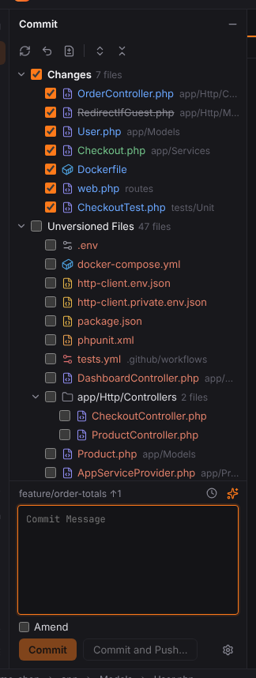
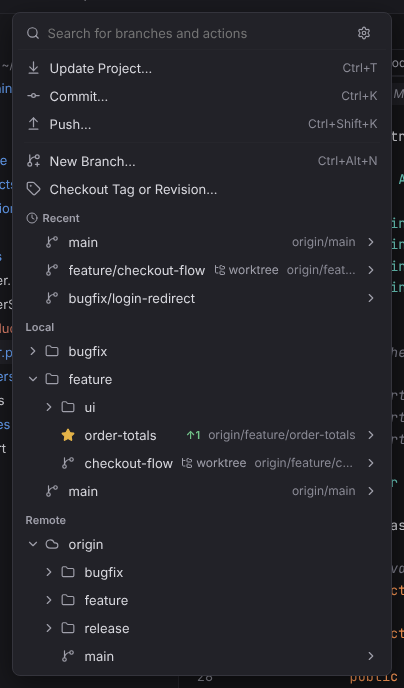
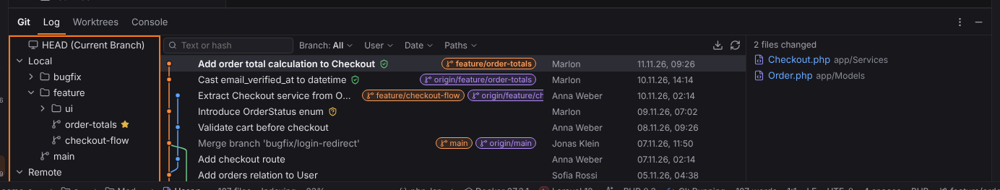
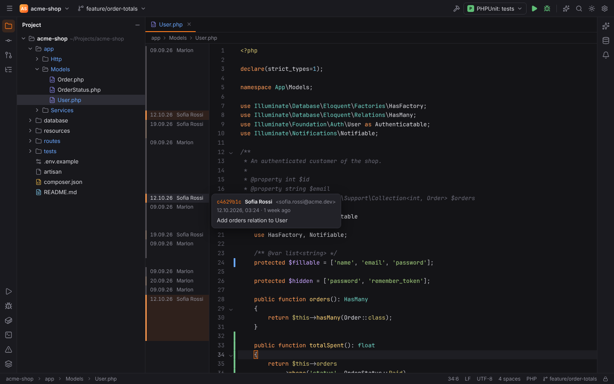
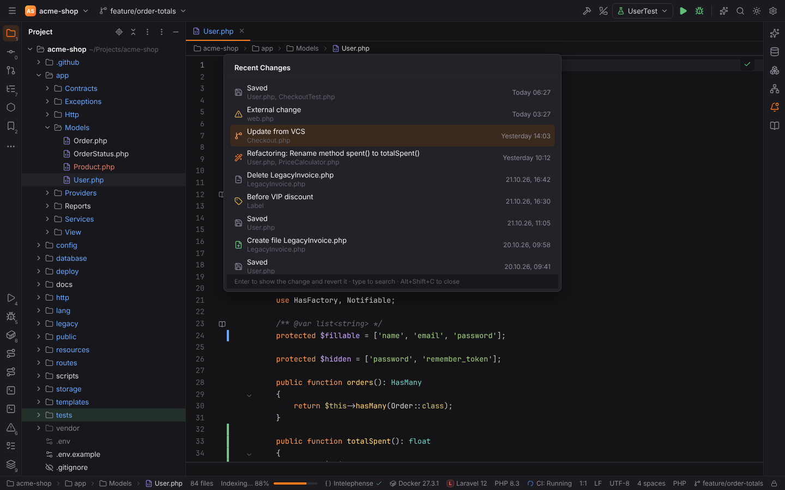

# Shortcuts: Version control (Git)

Commit, push, update, branches, the log and blame. Windows/Linux shortcuts first, macOS second; both are PHPStorm's defaults and can be changed in Settings | Keymap.

| Action | Windows / Linux | macOS |
| --- | --- | --- |
| [Commit](#commit) | `Ctrl+K` | `Cmd+K` |
| [Push](#push) | `Ctrl+Shift+K` | `Cmd+Shift+K` |
| [Update Project](#update-project) | `Ctrl+T` | `Cmd+T` |
| [Fetch](#fetch) | — | — |
| [Branches](#branches) | — | — |
| [New Branch](#new-branch) | — | — |
| [Show Git Log](#show-git-log) | — | — |
| [Annotate with Git Blame](#annotate-with-git-blame) | — | — |
| [Recent Changes](#recent-changes) | `Alt+Shift+C` | `Alt+Shift+C` |

## Commit

**Shortcut:** `Ctrl+K` · macOS `Cmd+K` · action id `CheckinProject`

Opens the Commit tool window to commit the selected changes.

**Menu:** Git | Commit…

More: [Git](../../user/git.md#commit-tool-window)

## Push

**Shortcut:** `Ctrl+Shift+K` · macOS `Cmd+Shift+K` · action id `Vcs.Push`

Pushes the current branch.

**Menu:** Git | Push…

More: [Git](../../user/git.md#push-update-and-fetch)

## Update Project

**Shortcut:** `Ctrl+T` · macOS `Cmd+T` · action id `Vcs.UpdateProject`

Pulls the current branch.

**Menu:** Git | Update Project…

More: [Git](../../user/git.md#push-update-and-fetch)

## Fetch

**Shortcut:** — · macOS — · action id `Git.Fetch`

Fetches all remotes.

**Menu:** Git | Fetch

More: [Git](../../user/git.md#push-update-and-fetch)

## Branches

**Shortcut:** — · macOS — · action id `Git.Branches`

Opens the Git Branches popup: checkout, new branch, merge, rebase, push, delete.

**Menu:** Git | Branches…

More: [Git](../../user/git.md#branches)

## New Branch

**Shortcut:** — · macOS — · action id `Git.CreateNewBranch`

Creates a branch from the current one and optionally checks it out.

**Menu:** Git | New Branch…

More: [Git](../../user/git.md#branches)

## Show Git Log

**Shortcut:** — · macOS — · action id `Vcs.Show.Log`

Opens the Log tab of the Git tool window.

**Menu:** Git | Show Git Log

More: [Git](../../user/git.md#log)

## Annotate with Git Blame

**Shortcut:** — · macOS — · action id `Annotate`

Shows Git blame (author and date per line) in the editor gutter.

**Menu:** Git | Current File | Annotate with Git Blame

More: [Git](../../user/git.md#blame)

## Recent Changes

**Shortcut:** `Alt+Shift+C` · macOS `Alt+Shift+C` · action id `RecentChanges`

Lists the latest Local History changes of the project (refactorings, external changes, VCS
operations, labels, saves); `Enter` opens one with its diff and Revert.

**Menu:** View | Recent Changes

More: [Local History](../../user/local-history.md#recent-changes)
