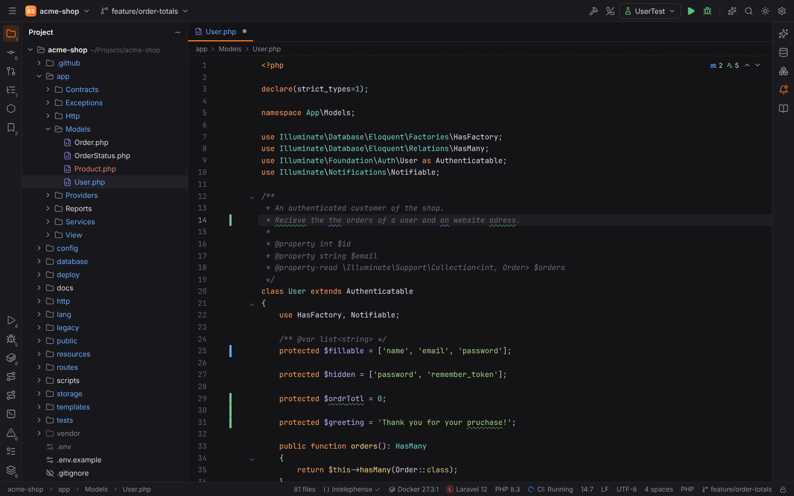
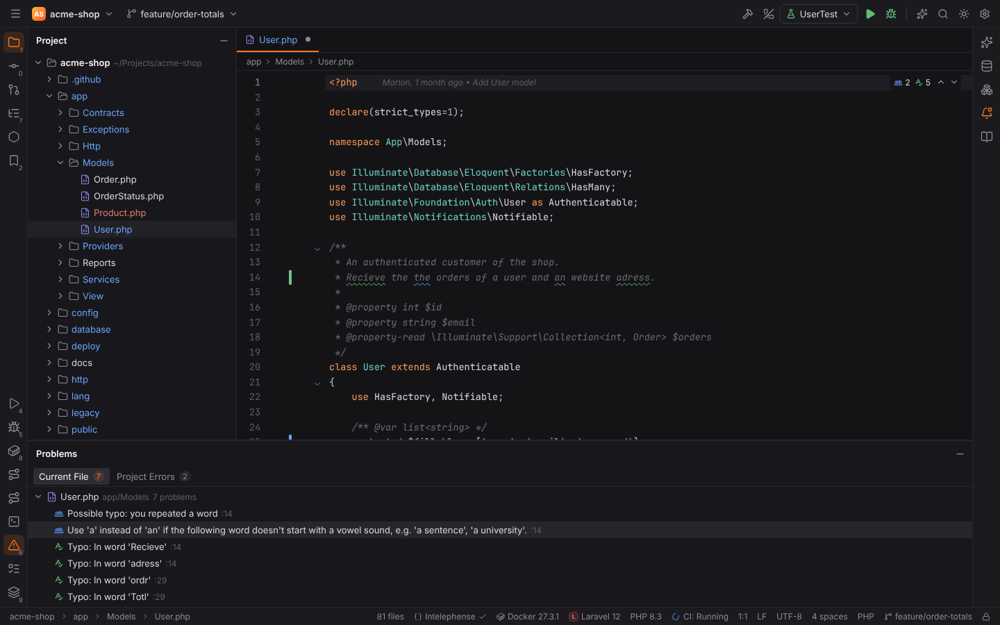
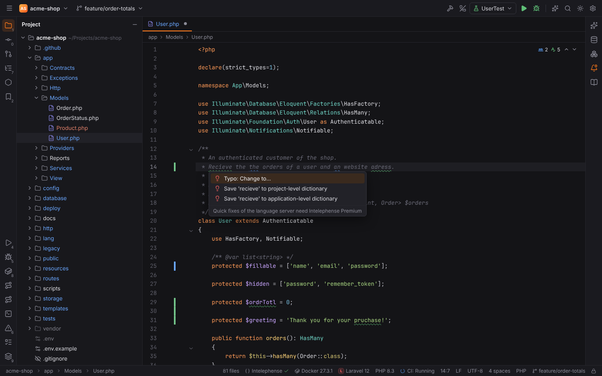
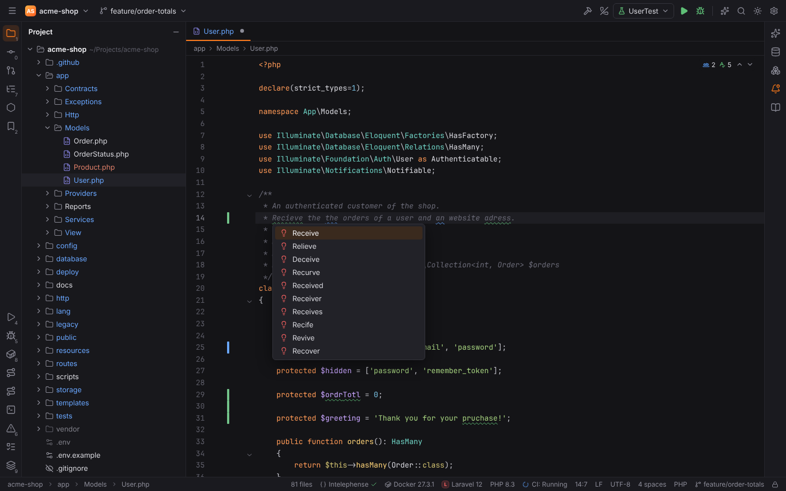
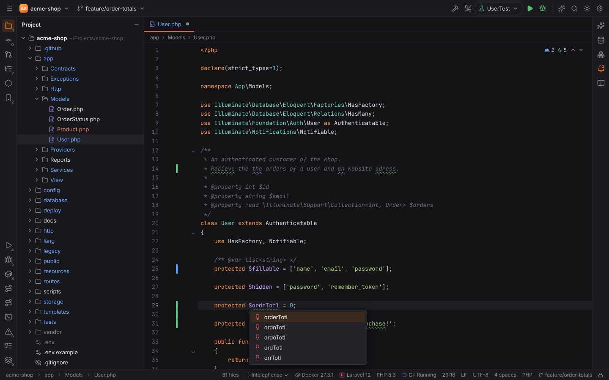
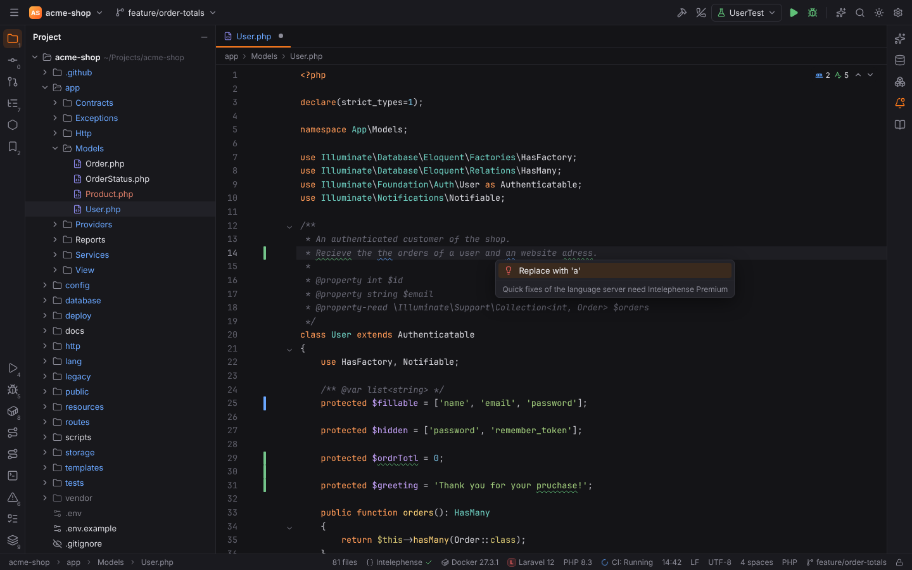
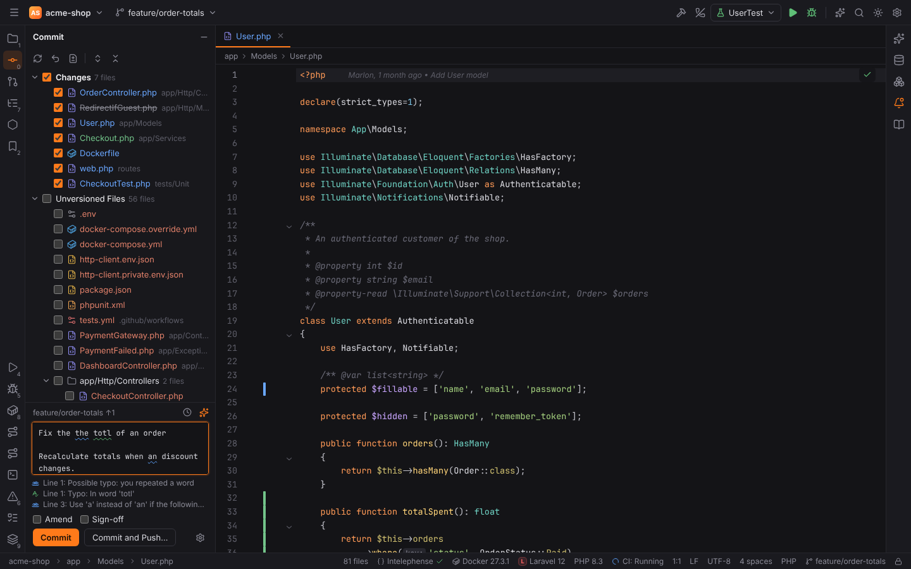
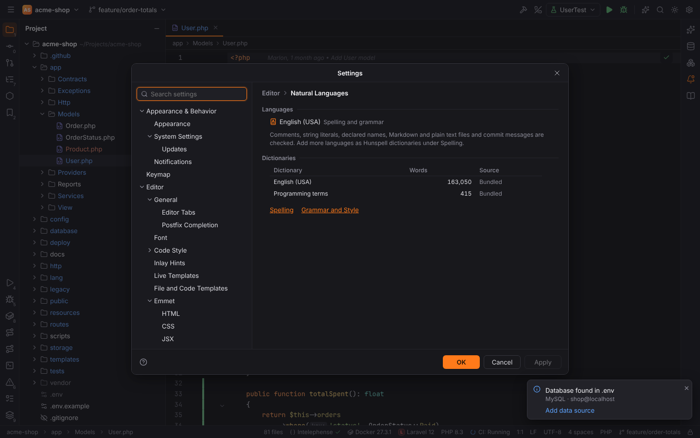
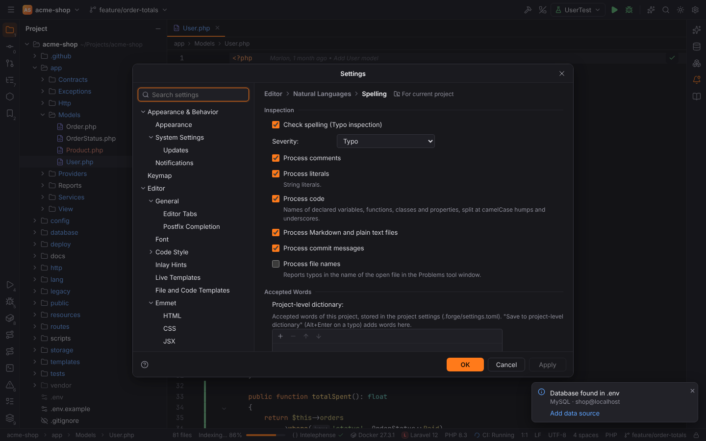

# Spelling and grammar

Forge checks spelling and a few grammar rules as you type, like PHPStorm's **Typo** and
**Grammar** inspections. Misspelled words get a green wavy underline, grammar problems a blue
one. `Alt+Enter` on a marked word offers the fixes.

Everything is computed in Rust (`crates/forge-spell`): the dictionaries, splitting text into
words, suggestions and the grammar rules. The desktop app and browser mode behave the same.

## What is checked

| Where | What |
| --- | --- |
| Comments and doc comments | every word; doc tags (`@param`), `$variables`, `inline code`, URLs, e-mail addresses, paths and code references such as `Order::find()` are skipped |
| String literals | every word; escape sequences (`\n`), format placeholders (`%s`) and regular expressions are skipped |
| Code | the names of declared variables, parameters, functions, methods, classes and properties (and PHP `$variables`), split into words: `getHTTPResponse` → get, HTTP, Response; `max_retry_count` → max, retry, count. Names you only use (library functions, framework classes) are not checked. |
| Markdown and plain text files | the prose, without code blocks, inline code, URLs and link targets |
| Commit messages | the message in the Commit tool window |
| File names | optional (off by default): typos in the name of the open file are listed in the Problems tool window |

Words shorter than three letters, words with digits (`utf8`, `base64`), hex numbers and colors,
UUIDs and acronyms in text (`HTML`, `PDFs`) are never reported. A built-in list of programming
terms (`args`, `config`, `json`, `middleware`, `Laravel`, `Symfony`, `Eloquent`, …) is accepted
everywhere. Upper and lower case do not matter.

The problems appear like any other inspection: the squiggles, the inspection widget in the
top-right corner of the editor (typos and grammar problems have their own counters), the
editor tooltip, `F2` / `Shift+F2` and the **Problems** tool window (`Alt+6`).

Large files are checked as they scroll into view; after an edit only the changed lines (and
the comment or string around them) are checked again, a moment after you stop typing.

## Fixing a typo (Alt+Enter)

Put the caret on a marked word and press **Show Context Actions** `Alt+Enter`
(macOS `Option+Enter`):

| Entry | What it does |
| --- | --- |
| **Typo: Change to...** | opens the list of suggestions; choose one to replace the word |
| **Typo: Rename to...** | for a word in a declared name: the suggested names, then the **Rename** refactoring renames every usage (as with `Shift+F6`) |
| **Save 'word' to project-level dictionary** | accepts the word in this project (shown when a project is open) |
| **Save 'word' to application-level dictionary** | accepts the word in all projects |

Suggestions are dictionary words close to what you typed, the most likely first: swapped
letters (`recieve` → `receive`), a missing or extra double letter (`adress` → `address`),
dropped vowels (`ordr` → `order`), neighbouring keys on the keyboard and similar-sounding
spellings rank before other edits. Suggestions keep the case of the word (`Recieve` →
`Receive`).

## Grammar and style

The grammar checker is a small set of Forge's own rules for English. It checks comments, doc
comments, Markdown and plain text files and commit messages (not string literals):

| Rule | Example | Fix |
| --- | --- | --- |
| Repeated words | "the the order" | Remove the repeated 'the' |
| Use of 'a' and 'an' | "a order", "an user"; acronyms are read letter by letter: "an HTML page", "a URL" | Replace with 'an' / 'a' |
| Sentences start with an uppercase letter | "/** returns the order. */" (doc comments only; tags and code such as `getName()` are skipped) | Replace with 'Returns' |
| Repeated whitespace | "the  order" (aligned columns and doc tag lines are skipped) | Replace with a single space |

`Alt+Enter` on a blue underline shows the fix.

## Commit messages

The commit message in the Commit tool window (`Alt+0`) is checked too: typos and grammar
problems are underlined in the message and listed below it with the commit message
inspections. Click an entry for its fixes (the suggestions, Save to dictionary or the grammar
fix).

## Dictionaries

| Dictionary | Where it is stored |
| --- | --- |
| English (USA) | bundled: the SCOWL-based en_US Hunspell dictionary (about 160,000 word forms), see [licences](#licences) |
| Programming terms | bundled with Forge |
| Project-level dictionary | the setting `spelling.projectWords` in the project settings (`<project>/.forge/settings.toml`), so it can be committed and shared with the team |
| Application-level dictionary | the setting `spelling.applicationWords` in the user settings (`<config dir>/forge/settings.toml`) |
| Custom dictionaries | Hunspell `.dic` files or plain word lists you add by path |

Both word lists can be edited in **Settings | Editor | Natural Languages | Spelling**
(`+` / `−` on the list). To check another language or a technical vocabulary, add a Hunspell
dictionary under **Custom dictionaries**: the path of its `.dic` file (absolute, or relative to
the project root); the `.aff` file with the same name next to it is read too, so prefixes and
suffixes are expanded. A file without an `.aff` file is read as a word list with one word per
line. Dictionaries of LibreOffice, Firefox and most Linux distributions (`/usr/share/hunspell`)
work. Words of every dictionary are accepted; Forge does not mark a word as wrong because one
dictionary lacks it.

**Settings | Editor | Natural Languages** lists the dictionaries in use with their word counts,
and a load error for a custom dictionary that cannot be read.

## Settings

**Settings | Editor | Natural Languages | Spelling**:

| Setting | Default | Meaning |
| --- | --- | --- |
| Check spelling (Typo inspection) | on | the whole spelling inspection |
| Severity | Typo | how typos are shown: Typo (green), Grammar Error, Weak Warning, Warning or Error |
| Process comments / literals / code | on | the contexts above |
| Process Markdown and plain text files | on | |
| Process commit messages | on | |
| Process file names | off | typos in the open file's name in the Problems tool window |
| Project-level dictionary | empty | accepted words of this project |
| Application-level dictionary | empty | accepted words of all projects |
| Custom dictionaries | empty | paths of Hunspell `.dic` files or word lists |

**Settings | Editor | Natural Languages | Grammar and Style**: **Check grammar and style
(Grammar inspection)**, its **Severity** (Grammar Error by default, blue) and one switch per
rule.

The inspections belong to the **Natural Languages** plugin (Settings | Plugins); disabling it
turns both off. All keys are listed in the [settings reference](../reference/settings.md#editor--natural-languages--spelling).

## Licences

The bundled English dictionary is the en_US Hunspell dictionary of SCOWL (Spell Checker
Oriented Word Lists) by Kevin Atkinson, release 2020.12.07. Its licence is permissive
(MIT/BSD-like, with public domain parts); the full text is in
`crates/forge-spell/data/en_US.LICENSE`. The programming terms list and the grammar rules are
Forge's own. Forge does not use LanguageTool or any other grammar service, and nothing leaves
your machine.
