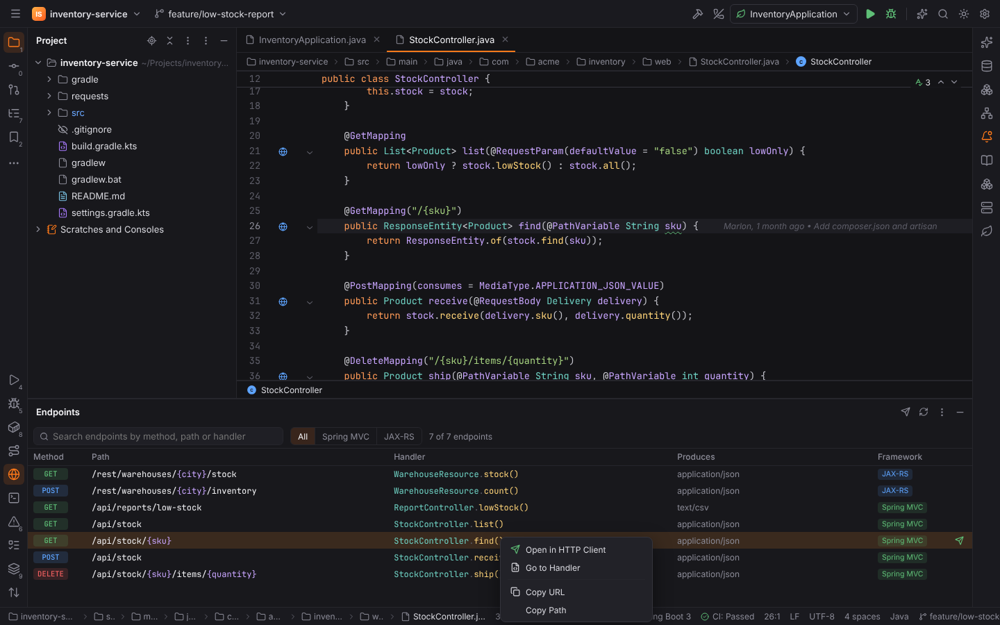
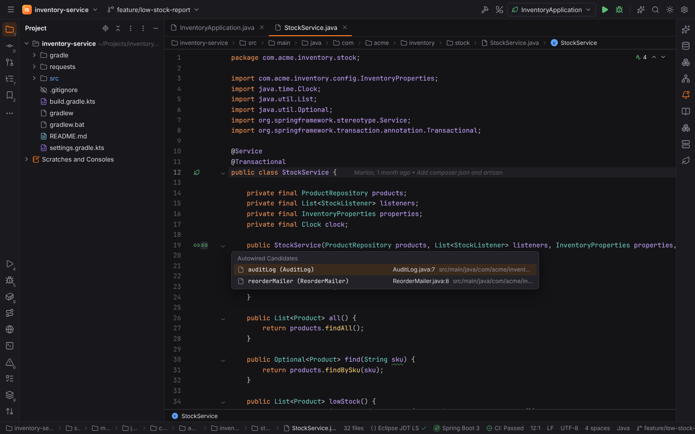
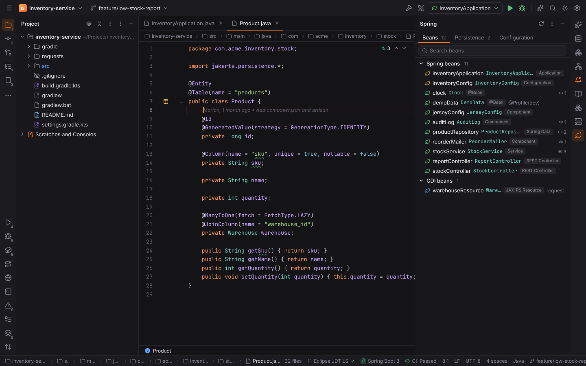
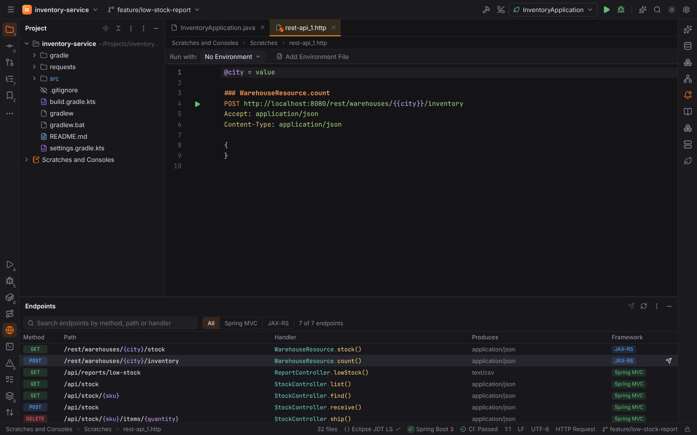
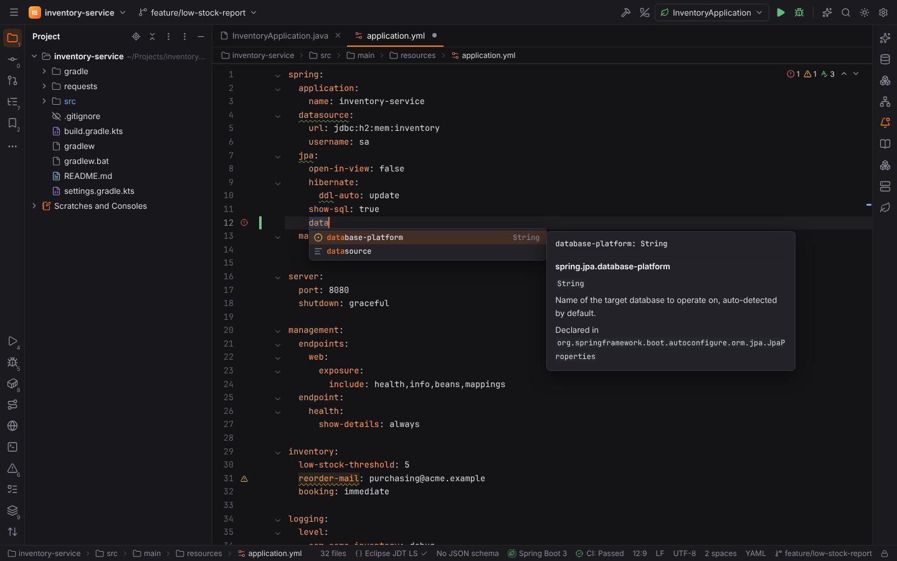
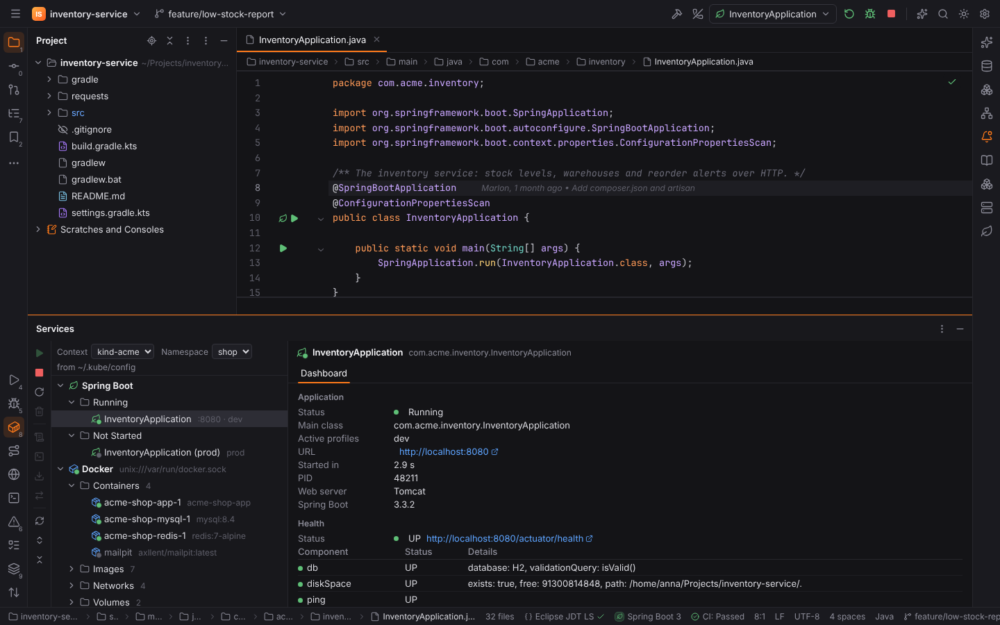

# Spring Boot and Jakarta EE

The plugin **Spring Boot and Jakarta EE** (`forge.spring`, JavaForge pack) adds the Spring
support of IntelliJ IDEA Ultimate to [JavaForge](java.md) and [KotlinForge](kotlin.md). It is
active when the [project detection](../getting-started/project-detection.md) finds:

- **Spring Boot**: the `org.springframework.boot` Gradle plugin, the
  `spring-boot-starter-parent` / `spring-boot-dependencies` Maven parent or BOM, or a
  `spring-boot-starter-*` dependency. The status bar shows "Spring Boot 3".
- **Jakarta EE**: the Jakarta EE / Java EE platform APIs (`jakarta.platform`,
  `javaee-api`), JAX-RS, CDI or MicroProfile in the build.

Everything below comes from reading the Java and Kotlin sources and the configuration files.
Forge never starts the application to find beans or endpoints; only the
[run dashboard](#run-dashboard) talks to an application you started.

## Beans and injection points

Forge finds the beans of the project:

- Spring stereotypes: `@Component`, `@Service`, `@Repository`, `@Controller`,
  `@RestController`, `@Configuration`, `@SpringBootApplication`, `@ControllerAdvice` and your
  own annotations that are meta-annotated with one of them;
- `@Bean` methods (in `@Configuration` classes or any bean), with `@Bean("name")`, `@Primary`,
  `@Qualifier`, `@Scope` and `@Profile`;
- Spring Data repository interfaces (`extends JpaRepository<Order, Long>`, also through your
  own base interfaces);
- `@ConfigurationProperties` classes (named `<prefix>-<class>` like Spring does);
- Jakarta EE / CDI: `@ApplicationScoped`, `@RequestScoped`, `@SessionScoped`, `@Dependent`,
  `@Singleton`, `@Named`, EJB `@Stateless` / `@Stateful`, JAX-RS resources and `@Produces`
  producer methods.

Injection points are constructor parameters (the only constructor, the Kotlin primary
constructor, or the `@Autowired` / `@Inject` one; Lombok's `@RequiredArgsConstructor` final
fields), `@Autowired` / `@Inject` / `@Resource` fields and setters, and the parameters of `@Bean`
methods. `Optional<T>`, `ObjectProvider<T>`, `Provider<T>`, `Instance<T>`, `List<T>`, `Set<T>` and
`Map<String, T>` inject `T`. A bean matches when its class or one of its supertypes is the
injected type; `@Qualifier` / `@Named` narrow the candidates, `@Primary` beans come first, and
without a qualifier Spring's fallback to the parameter name applies.

**Gutter icons** (Settings | Languages & Frameworks | Java | Spring Boot, `spring.gutterIcons`):

| Icon | On | Click |
| --- | --- | --- |
| Leaf | a bean class or `@Bean` method | the injection points it is a candidate for |
| Link | an injection point | the matching beans (**Autowired Candidates**) |
| Globe | a request handler | Open in HTTP Client, Show in Endpoints |
| Table | a JPA entity | its Spring Data repositories |
| Database | a repository | its entity |
| Sliders | a `@ConfigurationProperties` class | its values in the configuration files |
| ▶ | a `@SpringBootApplication` class | Run, Debug or modify its Spring Boot configuration |

With several targets the **Choose Declaration** popup lists them.

The **Spring** tool window (right stripe) lists the beans by Spring and CDI with their kind,
scope, profiles and how often they are injected. While an application runs with the actuator,
its beans are marked live and the beans that only exist at runtime (auto-configuration) are
listed too. **View | Tool Windows | Spring**, or **Tools | Spring | Show Beans**.

## Endpoints

The **Endpoints** tool window (bottom stripe) lists every HTTP endpoint with its method, path,
handler, produced media types and framework:

- **Spring MVC / WebFlux**: `@RequestMapping`, `@GetMapping`, `@PostMapping`, `@PutMapping`,
  `@DeleteMapping` and `@PatchMapping` on `@RestController` / `@Controller` methods, under the
  class-level `@RequestMapping` prefix. Paths may be constants (`ApiPaths.STOCK`, also
  `API + "/stock"`) and Kotlin templates (`"$BASE/{id}"`).
- **JAX-RS**: `@GET`, `@POST`, `@PUT`, `@DELETE`, `@PATCH`, `@HEAD` and `@OPTIONS` methods of
  `@Path` resources (`jakarta.ws.rs` or `javax.ws.rs`), below the `@ApplicationPath`.

Click a row to open the handler. The row's ✈ button, the toolbar and the context menu **Open in
HTTP Client**: a new `.http` scratch with the request, path variables as `{{variables}}`
declared above it, query parameters, `Accept` and, for request bodies, `Content-Type` and an
empty JSON object. Requests go to the running application, else to `server.port` and
`server.servlet.context-path` of the configuration files. Run them with the ▶ icon like any
[HTTP request](scratches-and-http.md). The context menu also copies the URL or the path.

While an application runs, endpoints it serves are marked with a green dot, and mappings that
only the application knows (actuator endpoints, `/error`, library controllers) are listed as
**Runtime**.

## application.properties and application.yml

`application.properties`, `application.yml` / `.yaml`, their profile variants
(`application-dev.yml`) and `bootstrap.*` get:

- **completion of keys** with type, default and description. YAML keys are inserted as nested
  mappings with the file's indentation (`servlet.context-path` under `server:` becomes
  `servlet:` / `context-path:`); keys of maps with known keys (`logging.level.root`) are offered
  too;
- **completion of values**: `true` / `false`, the constants of enum types (in Spring's lower
  case form: `banner-mode: off`), the values of the metadata's hints
  (`ddl-auto: create-drop`) and profile names for `spring.profiles.active`,
  `spring.profiles.include` and `spring.config.activate.on-profile`;
- **documentation** on hover and in the completion popup;
- **inspections**: unknown keys ("Cannot resolve configuration property", only reported when
  metadata was found; turn it off with `spring.inspections.unknownProperties`), deprecated keys
  (with **Alt+Enter → Replace with '…'**) and values that are not a boolean or a constant of
  the property's enum;
- **Go to Declaration** (`Ctrl+B`, `Ctrl+Click`) from a key to the field of its
  `@ConfigurationProperties` class, or to the class that declares it.

Relaxed binding applies: `spring.jpa.showSql`, `spring.jpa.show_sql` and `spring.jpa.show-sql`
are the same key, and keys below a `Map` property (`logging.level.com.acme`) are valid.

### Where the metadata comes from

The keys are those of `META-INF/spring-configuration-metadata.json` and
`additional-spring-configuration-metadata.json`:

1. in the dependency jars of the last **Gradle / Maven sync** (Reload All Gradle and Maven
   Projects in the [Gradle or Maven tool window](java.md)), looked up in the local Maven
   repository (`~/.m2/repository`) and Gradle's cache
   (`~/.gradle/caches/modules-2/files-2.1`);
2. without a sync, in Spring Boot's own jars (`spring-boot`, `spring-boot-autoconfigure`,
   `spring-boot-actuator-autoconfigure`, …) of the build's Spring Boot version, or the newest
   one in the caches;
3. in the project: `@ConfigurationProperties` classes (fields, record components and Kotlin
   constructor properties, nested classes, Javadoc as description, literal defaults) and
   `src/main/resources/META-INF/additional-spring-configuration-metadata.json`.

The jars are read as zip files; enum constants are read from their class files. Nothing is
downloaded: build the project once (or sync) so the jars are in the caches. The
**Configuration** tab of the Spring tool window shows how many properties were found and from
which jars, the configuration files with their profiles, the `@ConfigurationProperties`
classes, the profiles and the `jakarta.*` / `javax.*` / Spring APIs the sources import.

## Jakarta EE

Besides JAX-RS endpoints and CDI beans (see above), the **Persistence** tab of the Spring tool
window lists the JPA entities (`@Entity`, `@Embeddable`, `@MappedSuperclass` from
`jakarta.persistence` or `javax.persistence`) with their table, id and generated fields,
columns and relations (`@ManyToOne` → `Customer`), and their Spring Data repositories. Click an
entity or field to open it.

## Spring Boot run configuration

**Run | Edit Configurations… | + | Spring Boot** has:

| Field | Meaning |
| --- | --- |
| Main class | The `@SpringBootApplication` class; for a Kotlin application with a top-level `main`, the file facade (`ShopApplicationKt`). |
| Active profiles | Comma-separated, passed as `-Dspring.profiles.active`. |
| Override properties | One `key=value` per line, passed as `--key=value` (they win over the configuration files). |
| VM options, Program arguments, JDK, Module | As for [Application](java.md) configurations. |
| Run dashboard | Expose the actuator's `health`, `info`, `beans` and `mappings` endpoints (`--management.endpoints.web.exposure.include=…`, unless you override it) so the dashboard can read them, or leave the actuator as configured. |

The configuration runs as an Application configuration: through Gradle's `forgeRun` or with the
class path from Eclipse JDT LS, with the [Java debugger](java.md) for **Debug**, and the
console in color (`spring.output.ansi.enabled=always`). The ▶ icon on the
`@SpringBootApplication` class creates a temporary one. Starting an application runs project
code, so it is refused in [Safe Mode](project-trust.md).

## Run dashboard

Spring Boot configurations appear in the [Services](services.md) tool window (`Alt+8`) under **Spring
Boot**, grouped into **Running** and **Not Started**, with the port and the active profiles. The
toolbar starts, stops and restarts them.

For a running application the details show its status, main class, active profiles, URL (from
the console: "Tomcat started on port 8080 … with context path …"), startup time, PID, web
server and Spring Boot version. With
[Spring Boot Actuator](https://docs.spring.io/spring-boot/reference/actuator/) in the build,
Forge asks the application on `localhost` (`management.server.port` and
`management.endpoints.web.base-path` are respected) for:

- **Health**: the status and each component (database, disk space, …);
- **Request Mappings**: method, path and handler of every mapping;
- **Beans**: name, type, scope and dependencies.

The tree refreshes the health every few seconds while an application runs
(`spring.dashboard.refreshSeconds`); `spring.dashboard.actuator` turns the requests off.
Without the actuator the details say so.

## Settings

Settings | Languages & Frameworks | Java | Spring Boot:

| Setting | Default | Meaning |
| --- | --- | --- |
| `spring.metadata.fromJars` | on | Read the configuration metadata from the dependency jars. |
| `spring.inspections.unknownProperties` | on | Report keys the metadata does not know. |
| `spring.metadata.mavenRepository` | empty (`~/.m2/repository`) | The local Maven repository. |
| `spring.metadata.gradleUserHome` | empty (`GRADLE_USER_HOME` or `~/.gradle`) | Gradle's user home. |
| `spring.gutterIcons` | on | The gutter icons above. |
| `spring.dashboard.actuator` | on | Ask running applications' actuators. |
| `spring.dashboard.refreshSeconds` | 5 | How often the dashboard refreshes running applications. |

> **Note:** The analysis is structural (no type checking): beans are matched by their class
> and supertype names, conditional beans (`@ConditionalOn…`) are always listed, and functional
> routes (`RouterFunction`) and Spring's XML configuration are not read. The actuator data of
> the running application fills the gaps.

## Try it in the browser

`pnpm dev` and open `http://localhost:1420/?project=spring`: the Java demo
`inventory-service` as a Spring Boot application with REST controllers, a JAX-RS resource,
Spring Data JPA entities, `@ConfigurationProperties` and two Spring Boot configurations. The
metadata, the console and the actuator answers are canned.
