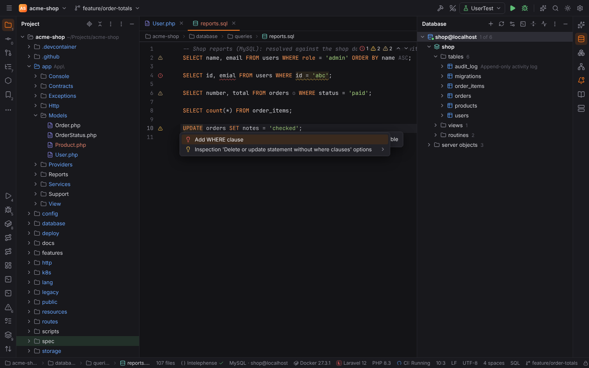
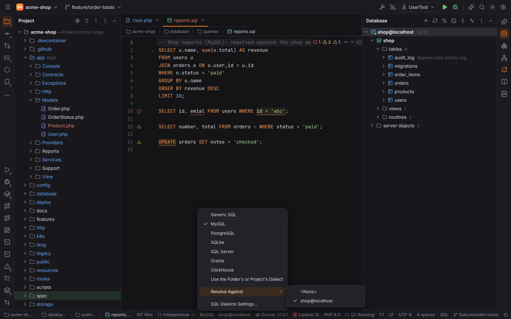
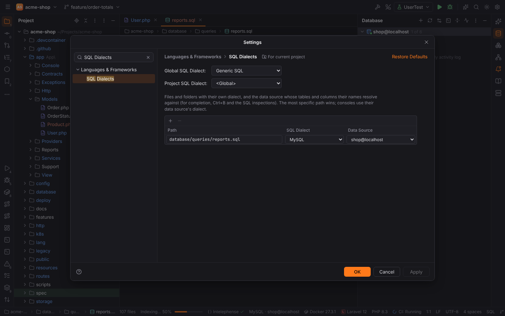
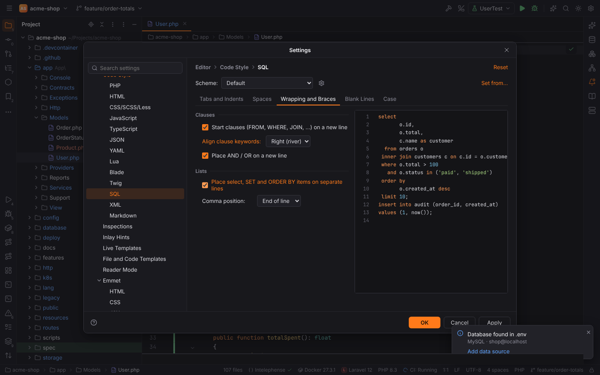
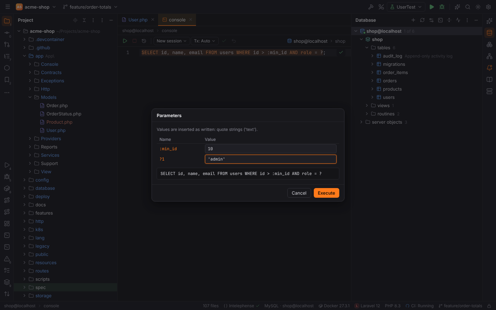
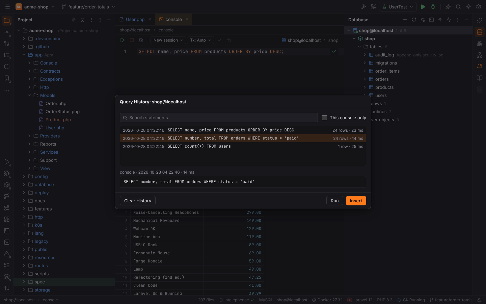
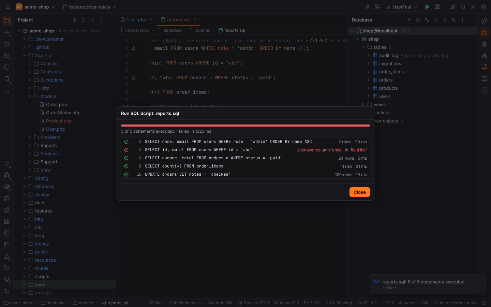

# SQL editor

`.sql` files and [query consoles](database.md#query-console) share one SQL editor, DataGrip's.
The work is done in Rust (`forge-sqlcode`); it never connects to a database while you type:
names resolve against the data source's **cached model** (the schemas the Database tool window
has loaded) or a [DDL data source](database.md#ddl-data-sources)'s files.

## Dialects

Every SQL file has a dialect: **Generic SQL**, **MySQL**, **PostgreSQL**, **SQLite**, **SQL
Server**, **Oracle** or **ClickHouse**. The dialect decides the highlighting and keywords, how
names are quoted (`` `name` ``, `"name"`, `[name]`), comments (`#` in MySQL), strings (`$$`
bodies in PostgreSQL, backslash escapes in MySQL), the statement separators (`GO`, `/`) and the
formatter's quirks.

- **Settings | Languages & Frameworks | SQL Dialects**: the **Global SQL Dialect**, the
  **Project SQL Dialect** and a table of mappings — a file or folder, its dialect and the
  **data source** its names resolve against. The most specific path wins, so a folder of
  migrations can be PostgreSQL while one file in it is SQLite.
- The **status bar widget** of the active SQL editor shows the dialect and the data source
  (`MySQL · shop@localhost`). Its popup switches both for the file (it writes a mapping) and
  opens the settings page.
- **Consoles** use their data source's dialect and resolve against their data source.

## Resolve and navigation

Names are mapped to the model: tables and views (with aliases, `schema.table`), columns
(qualified or not; an unqualified column is looked up in the query's tables, then in the
enclosing queries, so correlated subqueries work), CTEs and their columns (`WITH … AS`, also
`RECURSIVE` and explicit column lists), subqueries in `FROM` with their aliases, select-list
aliases in `ORDER BY`, `GROUP BY` and `HAVING`, schemas, and routines of the model. `INSERT`
column lists, `UPDATE … SET`, `DELETE … USING`, `ON CONFLICT` / `ON DUPLICATE KEY UPDATE`,
`RETURNING`, `CREATE VIEW … AS`, `ALTER TABLE`, `DROP`, `TRUNCATE` and `CREATE INDEX` resolve
too. Schemas that were not introspected and table functions resolve to "unknown" and are never
reported.

| Action | Shortcut | What it does |
| --- | --- | --- |
| Go to Declaration | `Ctrl+B`, `Ctrl+Click` | an alias or CTE: its definition; a table, view or column: the node in the Database tool window; with a DDL data source: the `CREATE TABLE` (or `ALTER TABLE … ADD`) in its files. On a definition it shows the usages |
| Find Usages | `Alt+F7` | the usages of the column, table, alias or CTE in the file |
| Rename | `Shift+F6` | renames an alias, CTE or select-list alias with all its usages in place |
| Show Context Actions | `Alt+Enter` | the quick fixes of the problem at the caret |

## SQL inspections

The inspections are part of the inspection profile (**Settings | Editor | Inspections**,
group **SQL**), so they can be turned off, get another severity or be suppressed like any other.

| Inspection | Id | Reports | Quick fix |
| --- | --- | --- | --- |
| Unresolved reference | `SqlResolve` | tables, columns, schemas and aliases that do not exist (red) | — |
| Ambiguous column reference | `SqlAmbiguousColumn` | an unqualified column that several tables of the query have | Qualify with `u.` (one per table) |
| Delete or update statement without where clauses | `SqlWithoutWhere` | `DELETE` / `UPDATE` without `WHERE` | Add WHERE clause (`WHERE FALSE`, selected to type over) |
| Unused table alias | `SqlUnusedAlias` | an alias no column uses (greyed out) | Remove alias |
| Unused common table expression | `SqlUnusedCte` | a CTE the statement never reads | Remove unused CTE |
| Types compatibility | `SqlType` | a column compared with a value of another type family (`id = 'abc'`, `name = 5`) when the model knows the column's type | Quote the value |
| Redundant ordering direction | `SqlRedundantOrderingDirection` | `ASC` | Remove redundant ASC |
| Redundant ELSE NULL clause | `SqlRedundantElseNull` | `ELSE NULL` in `CASE` | Remove ELSE NULL |
| Redundant alias expressions | `SqlRedundantAlias` | `users users`, `name AS name` | Remove redundant alias |

Without a data source, only the script's own names are checked (aliases, CTEs and their
columns). SQLite skips the type check (it compares values of any type).

## Formatter

**Code | Reformat Code** (`Ctrl+Alt+L`) and the **Reformat code** action of
[Actions on Save](actions-on-save.md) format SQL with **Settings | Editor | Code Style | SQL**:

| Tab | Options |
| --- | --- |
| Tabs and Indents | tab size, indent, tabs or spaces |
| Spaces | after comma, around operators, within parentheses |
| Wrapping and Braces | clauses on a new line, clause keywords aligned left or right ("river"), AND / OR on a new line, select / SET / ORDER BY items on separate lines, comma at the end or the start of the line |
| Blank Lines | blank lines kept between statements |
| Case | keywords and identifiers: as is, upper or lower case |

Subqueries and `CREATE TABLE` column lists are indented blocks. Comments and string contents
never change; routines and procedural blocks (`CREATE FUNCTION`, `BEGIN … END`) keep their
layout and only get the keyword case; `GO` batches and Oracle's `/` stay on their own lines.

## User parameters

Before a console runs a statement with placeholders, the **Parameters** dialog asks for their
values: `?` (positional), `:name`, `$1`, `${name}` and `#{name}`. Values are inserted as
written, so strings need quotes (`'admin'`). The console remembers the last values. Each
pattern can be turned off in **Settings | Tools | Database | User Parameters**; placeholders in
strings and comments are ignored, and PostgreSQL casts (`x::int`) are not parameters.

## Query history

Every statement a console or Run SQL Script executes is recorded per data source with its
time, duration and row count (`<data dir>/forge/sql-history/<data source>.json`, at most
**Query history entries per data source**, 1000). **Browse Query History** (`Ctrl+Alt+E`, or
the clock icon of the console toolbar) searches it by words, optionally only the current
console; **Insert** adds the statement to the console, **Run** adds and executes it.

## Run SQL Script

**Run 'file.sql'…** in the Project view's context menu, the editor's context menu or Find
Action (**Run SQL Script…**) runs a `.sql` file against a data source (the file's mapped data
source comes first). Statements run in order on a new session, with a progress bar and one row
per statement (rows, time or the error). **Stop at the first error** (on by default) or
continue; **Stop** cancels the running statement. Read-only data sources refuse the script and
production data sources ask first, like consoles.

## Live templates

The **SQL** live template group works in SQL files and consoles: `sel`, `selc`, `selw`, `ins`,
`upd`, `del`, `join`, `lj`, `rj`, `tab` (create table) and `col`. See
[Live templates](live-templates.md).

## For developers

See [forge-sqlcode](../developer/crates/forge-sqlcode.md) and
[Architecture](../developer/architecture.md).
