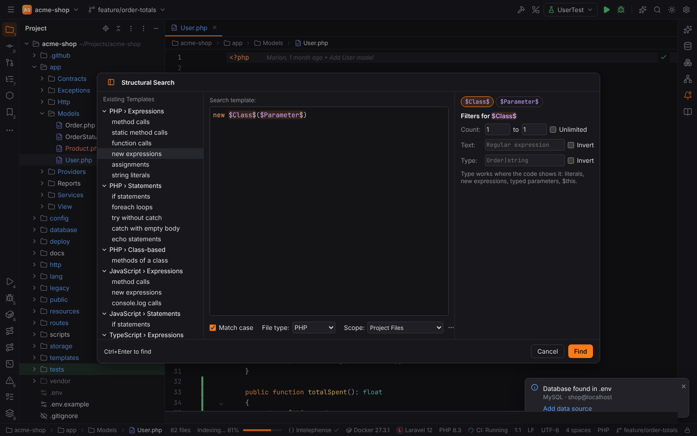
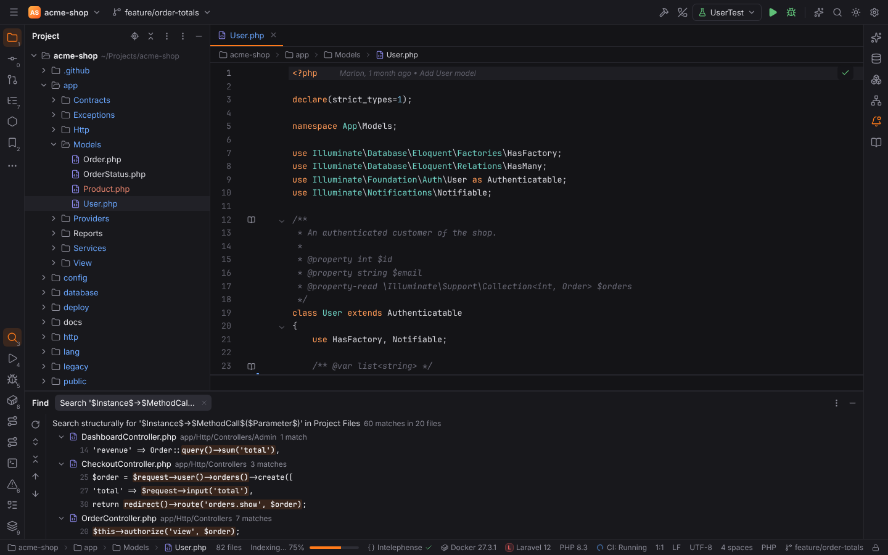
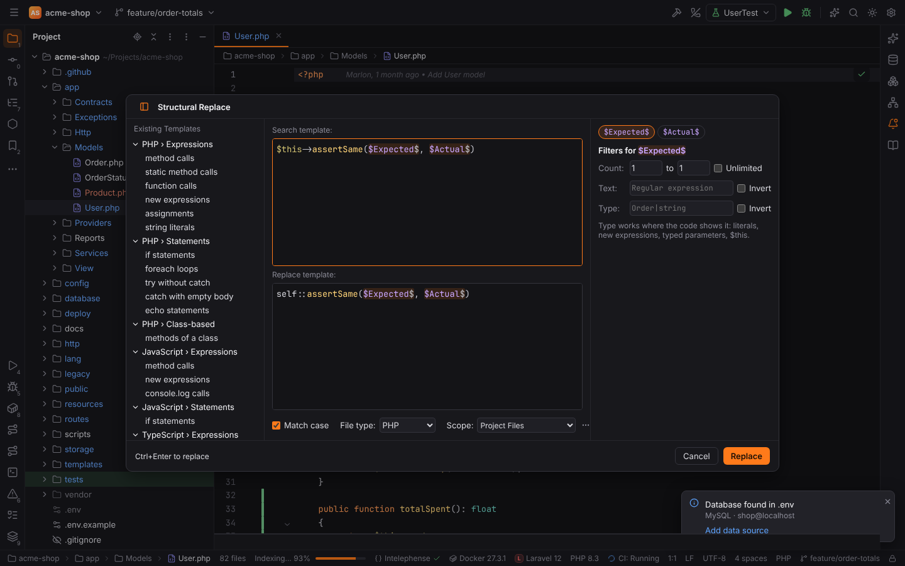
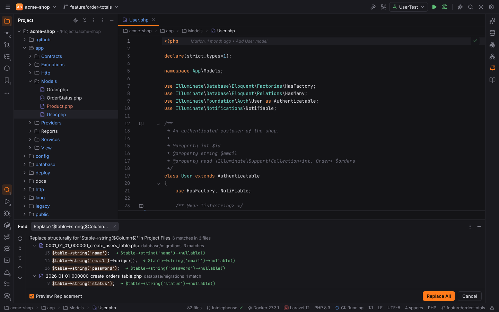

# Structural Search and Replace

Structural Search finds code by its syntax instead of its text: `$Instance$->save()` finds
every `save()` call, whatever the receiver, line breaks or comments in between. Structural
Replace rewrites every match with a replacement template. Both work like PHPStorm's.

| Action | Where | Action id |
| --- | --- | --- |
| Search Structurally… | Edit \| Find, Find Action | `StructuralSearchPlugin.StructuralSearchAction` |
| Replace Structurally… | Edit \| Find, Find Action | `StructuralSearchPlugin.StructuralReplaceAction` |

Neither action has a default shortcut in PHPStorm; assign one in Settings | Keymap if you use
them often. A selection in the editor becomes the template.

## Templates

A template is code of the chosen **File type** (PHP, JavaScript or TypeScript) where
`$Name$` stands for any code. The template may be an expression (`new $Class$($Args$)`), a
statement (`if ($Condition$) { $Statement$; }`), several statements, or a class member
(`public function $Method$($Params$) { $Body$; }`). What counts:

- Node types, names, literals, keywords and operators must match; whitespace, line breaks,
  comments and the kind of quotes around the code do not matter.
- A variable used twice must match the same code both times: `$a$ = $a$` finds
  self-assignments.
- In PHP, `$$name$` matches only variables (`$order`), while `$name$` matches any expression.
- A declaration in the template without a return type, attributes or `static` / `final` /
  `abstract` / `readonly` modifiers matches declarations with any of them.
- **Match case** compares names and literals case-sensitively.

The editor highlights the variables; a template that is not valid code is reported below it.

### Existing templates

The left panel (toggle it with the button in the title) lists the built-in templates:

| File type | Templates |
| --- | --- |
| PHP | method calls, static method calls, function calls, new expressions, assignments, string literals, if statements, foreach loops, try without catch, catch with empty body, echo statements, methods of a class |
| JavaScript | method calls, new expressions, console.log calls, if statements |
| TypeScript | method calls, variables with a type |

## Filters

Select a variable on the right to edit its filters:

| Filter | Meaning |
| --- | --- |
| Count | how many nodes the variable stands for. `0` to **Unlimited** lets `$Args$` match a whole argument list, `$Statements$;` any number of statements (also none). The default is exactly one. |
| Text | a regular expression the whole matched text must match (`get.*`, `(log\|flush)`); **Invert** keeps the other matches. For PHP variables the `$` is optional (`order` matches `$order`). |
| Type | a regular expression for the type of the expression, where the code shows it: literals (`string`, `int`, `float`, `bool`, `array`, `null`), `new Order()`, `$this`, parameters with a declared type and variables assigned with `new` in the same function. Class names match with or without namespace. **Invert** keeps the others. |

## Scope and results

The **Scope** chooser offers the predefined scopes and your [named scopes](scopes-and-file-colors.md).
**Find** (`Ctrl+Enter`) lists the matches in the Find tool window, grouped by file, with
Rerun and Next / Previous Occurrence:

Unsaved editor contents are searched as they are on screen. The search runs where the project
lives, so [remote projects](remote-development.md) are parsed on their host.

## Replace

Replace Structurally adds a **Replace template**. Its `$variables$` are filled with the code
each variable matched; line breaks in the template are indented like the matched code. A
variable that the search template does not define is reported. **Replace** shows the matches
in the Find tool window with **Preview Replacement** (the new code after each match) and
**Replace All**:

Replace All saves open editors, replaces every match (nested matches inside a replaced one are
left alone) and offers **Undo** in the notification, which restores the files unless they
changed since.

> **Note:** browser mode (`pnpm dev`) cannot run the tree-sitter grammars as WebAssembly; its
> demo answers searches with an approximation of the template. The desktop app always matches
> syntax trees.
