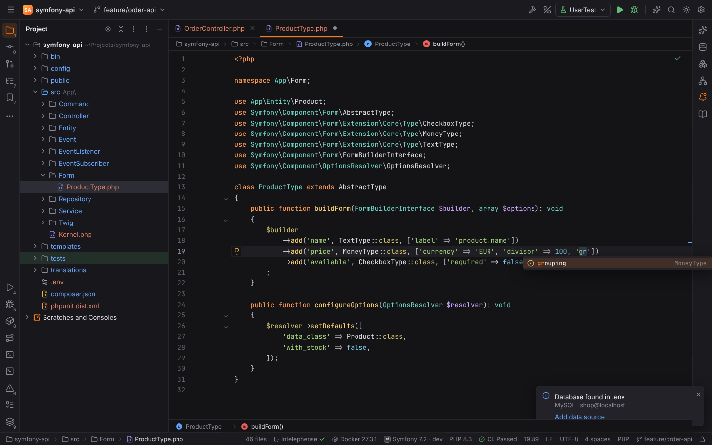
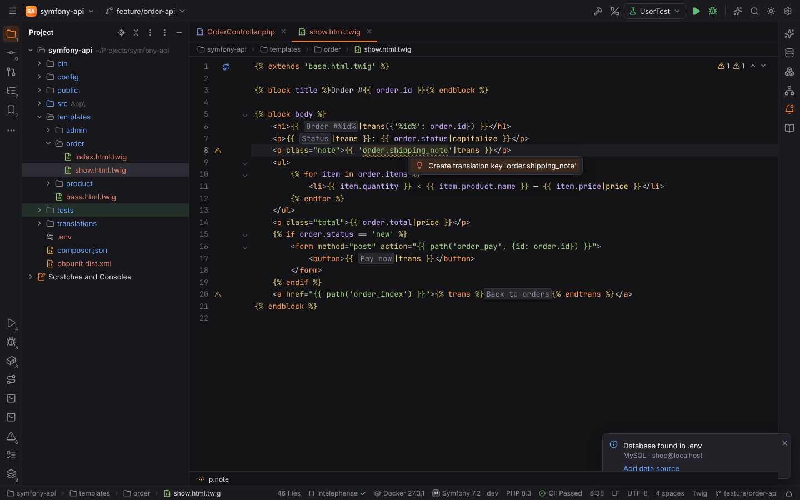
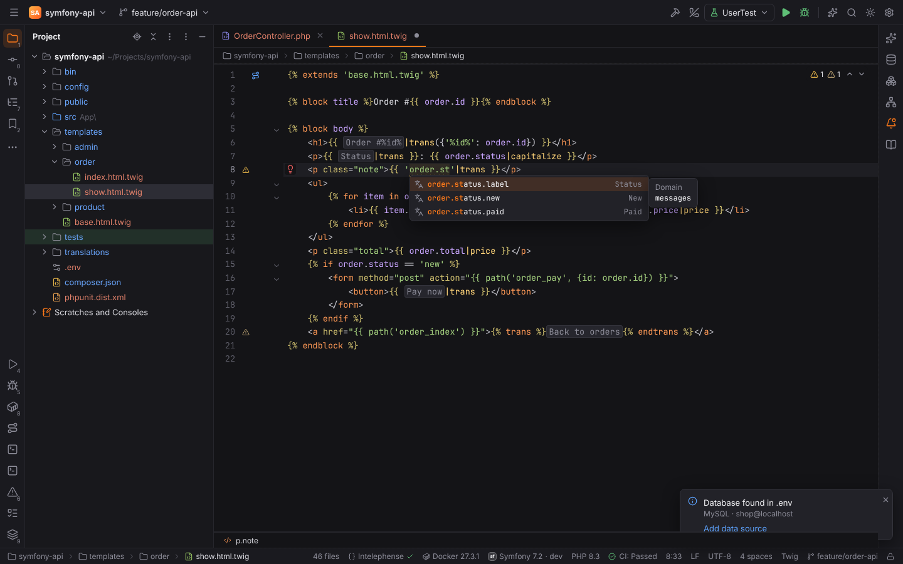
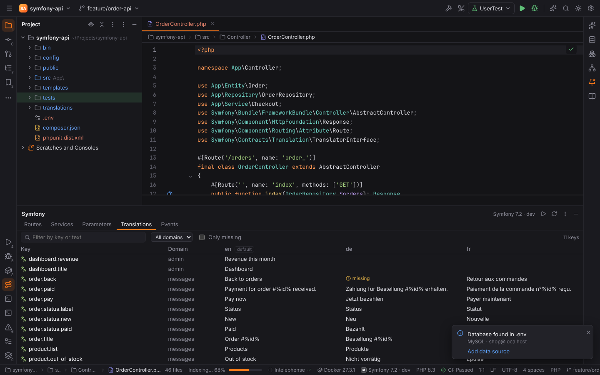
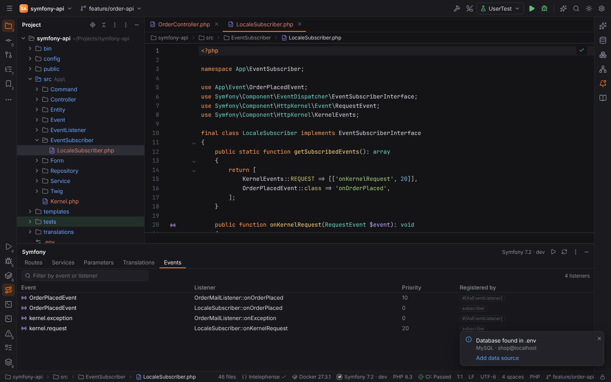

# Symfony

The Symfony plugin (`forge.symfony`, PHPForge pack) activates in projects that require
`symfony/framework-bundle` or have `bin/console` together with `config/bundles.php`. It reads
the project statically and, when present, the compiled container in
`var/cache/<env>/*Container.xml`, which also knows the services and parameters of every bundle.

The status bar shows **Symfony 7.2 · dev** (version and kernel environment). Its menu has
**Show Routes**, **Show Services**, **Run Console Command…**, **Refresh Symfony Index** and
**Symfony Settings…**.

## What Forge knows about the project

| Area | Read from |
| --- | --- |
| Services, aliases, `_defaults`, autowired `resource:` folders | `config/services*.yaml`, merged with the compiled container XML |
| Parameters | the same files |
| Routes | `#[Route]` attributes, legacy `@Route` annotations and YAML route files |
| Templates | `templates/` (setting `symfony.templatesDirectory`), and which controller renders which template |
| Twig tags, filters, functions and tests | Twig core, the Symfony bridge and the project's Twig extensions |
| Console commands | the project's commands (`src/`), then framework and bundle commands |
| Translations | `translations/<domain>.<locale>.{yaml,yml,xlf,xliff,php,json}` (also ICU files `<domain>+intl-icu.<locale>.*`); the folder, `default_locale` and `enabled_locales` come from `config/packages/{framework,translation}.yaml` |
| Form types | the core types and their options, plus the project's types: `configureOptions()` (`setDefaults`, `setDefined`, `setRequired`, `define`), `getParent()` and `data_class` |
| Event listeners | `getSubscribedEvents()` of event subscribers, `#[AsEventListener]` on classes and methods, `kernel.event_listener` tags in `config/services*.yaml`; the project's event classes and `*Events` constants |

The index is cached for a few seconds and rebuilt when files change; **Refresh Symfony Index**
rescans now.

## Completion and Go to Declaration

| Where | Completes and navigates to |
| --- | --- |
| `generateUrl('…')`, `redirectToRoute('…')`, `$router->generate('…')`, Twig `path('…')` / `url('…')` | route names |
| `render('…')`, `renderView`, Twig ``, ``, ``, ``, ``, `` | templates |
| `@service_id` in YAML, `#[Autowire(service: '…')]`, `$container->get('…')`, `service('…')` in PHP config | service ids |
| `%parameter%` in YAML, `getParameter('…')` | parameters |
| Twig files | tags, filters, functions, tests and variables |
| `->trans('…')`, `t('…')`, `new TranslatableMessage('…')`, Twig `{{ '…'\|trans }}`, `…`, Twig `t('…')` | translation keys of the domain (with the text of the default locale); `Ctrl+B` lists the key in every locale |
| the domain argument (`->trans('key', [], '…')`, `\|trans({}, '…')`, ``, ``) | translation domains |
| `->add('field', TextType::class, ['…' => …])` | the options of the form type, including inherited ones (`FormType`, `ChoiceType`, …) and the project type's own options |
| `->add('…')` in a form type with a `data_class` | the properties of the data class |
| `#[AsEventListener(event: '…')]`, `addListener('…')`, keys of `getSubscribedEvents()`, `event:` of a listener tag in YAML | event names (`kernel.*`, `console.*`, `form.*`, security events and the project's) |

`Ctrl+B` / `Ctrl+Click` on any of these opens the declaration (the controller action, the
template, the service definition or class, the parameter, the translation, the entity
property, the listeners of an event). `Ctrl+B` on `XType` in `createForm(XType::class)` or
`->add('field', XType::class)` opens the form type, and on a method name in
`getSubscribedEvents()` the listener method.

## Translations

- **Folding:** translation keys show the text of the default locale in place of the key, like
  PHPStorm (`'order.title'|trans` reads `Order #%id%`). Put the caret on the text (or click it)
  to see and edit the key. Setting: **Show translated text in place of translation keys**
  (`symfony.translations.folding`).
- **Inspection:** a key that no catalogue of its domain has is a warning, a key missing in some
  of the domain's locales a weak warning (for example "Translation 'order.back' is missing for
  locale de"). Setting: **Report missing translation keys and locales**
  (`symfony.translations.inspection`).
- **Create translation key** (`Alt+Enter` on the key) adds the key to the domain's catalogues
  of the missing locales: nested under the existing parent keys in YAML, as a `<trans-unit>` in
  XLIFF (1.2 and 2.0), as an array entry in PHP and as a property in JSON. A locale without a
  catalogue gets a new `translations/<domain>.<locale>.<ext>` in the format the project uses
  most. The key is used as the text until you translate it.

In `config/services*.yaml` (file type "Symfony Services"), service ids, parameters and tags are
completed, and `@service` and `%parameter%` references are highlighted.

## Line markers

With **Show line markers for routes, templates and commands** (`symfony.gutterIcons`):

- a **route** marker on controller actions (click: the route);
- **go to template** next to `render()` calls;
- **rendered by** on Twig templates (click: the controller);
- a **run** marker on console commands (click: run it);
- **listens to** on event listener methods (subscriber methods, `#[AsEventListener]`), with the
  priority (click: the event class);
- **N listeners** on the project's event classes, on event name constants and on
  `->dispatch(new XEvent(…))` calls (click: the listener, or a chooser when there are several).

## Symfony tool window

The **Symfony** tool window (bottom) has five tabs:

| Tab | Columns | Filter |
| --- | --- | --- |
| Routes | Name, Method, Path, Controller | name, path or controller |
| Services | Service ID, Class, Tags (public/private icon) | id, class or tag |
| Parameters | Name, Value | parameter |
| Translations | Key, Domain, one column per locale (missing texts are marked) | key or text, domain, **Only missing** |
| Events | Event, Listener, Priority, Registered by (subscriber, `#[AsEventListener]`, `services.yaml`) | event or listener |

Clicking a row opens its definition (in the Translations tab: double-click a locale's cell to
open the key in that catalogue).

## Run Console Command

**Run Console Command…** (Find Action, the status bar menu or the tool window) opens a popup:
type a command name, `Tab` completes it, arguments after the name are passed on, `Enter` runs
it with `bin/console` (setting `symfony.consolePath`) in the configured environment.

The output is shown in the Symfony tool window with **Rerun** and **Close**.

## Settings | Languages & Frameworks | PHP | Symfony

| Option | Setting | Default |
| --- | --- | --- |
| Environment (`dev`, `test`, `prod`) — kernel environment for the compiled container and console commands | `symfony.environment` | `dev` |
| App directory — scanned for controllers, commands and Twig extensions | `symfony.appDirectory` | `src` |
| Templates directory | `symfony.templatesDirectory` | `templates` |
| Console — path to the console script | `symfony.consolePath` | `bin/console` |
| Container XML — empty: `var/cache/<environment>/*Container.xml` | `symfony.containerXml` | empty |
| Show line markers for routes, templates and commands | `symfony.gutterIcons` | on |
| Complete Twig tags, filters and functions | `symfony.twigCompletion` | on |
| Show translated text in place of translation keys | `symfony.translations.folding` | on |
| Report missing translation keys and locales | `symfony.translations.inspection` | on |

The project settings (environment, folders, console, container) can be stored per project.

## Doctrine

Symfony projects usually use Doctrine; see [Doctrine and DQL](doctrine.md). Symfony's
`DATABASE_URL` in `.env` is offered as a data source in the [Database](database.md) tool window.

In [remote projects](remote-development.md) the analysis runs in the Forge agent on the host and
console commands run there as well.
