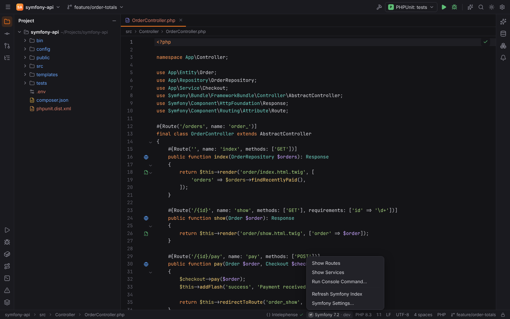
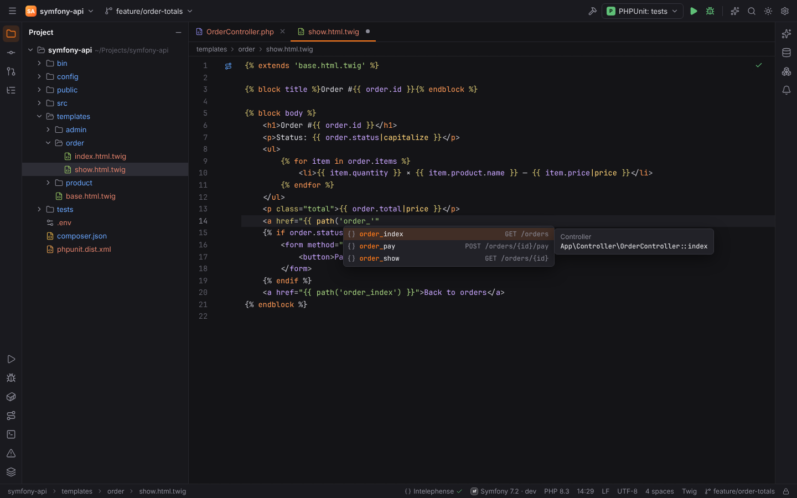
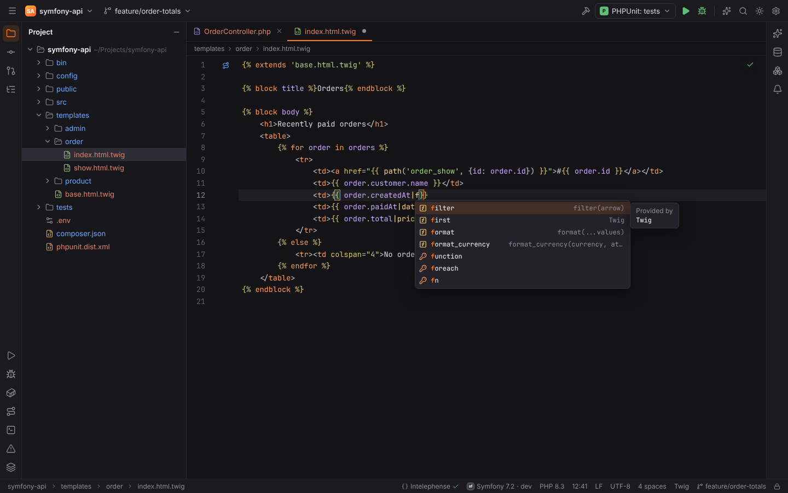
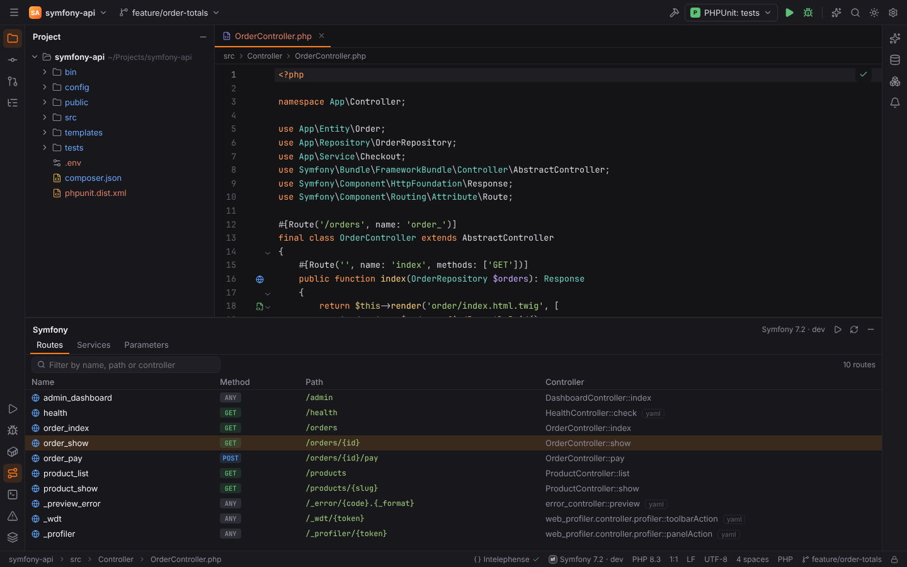
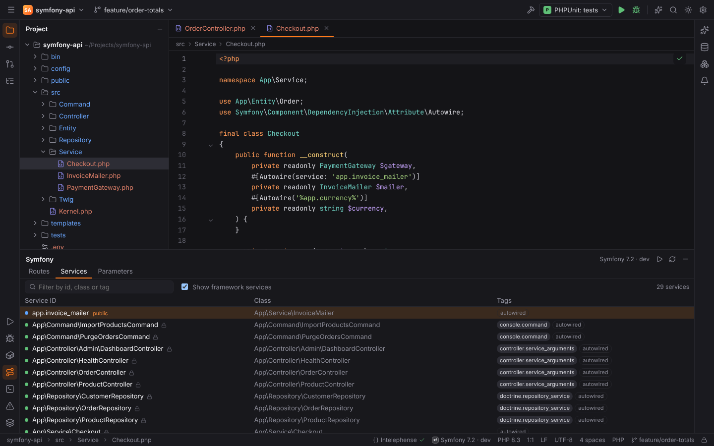
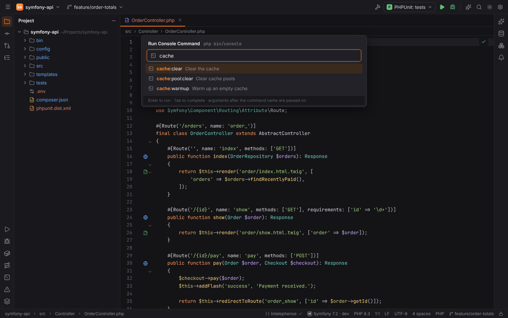
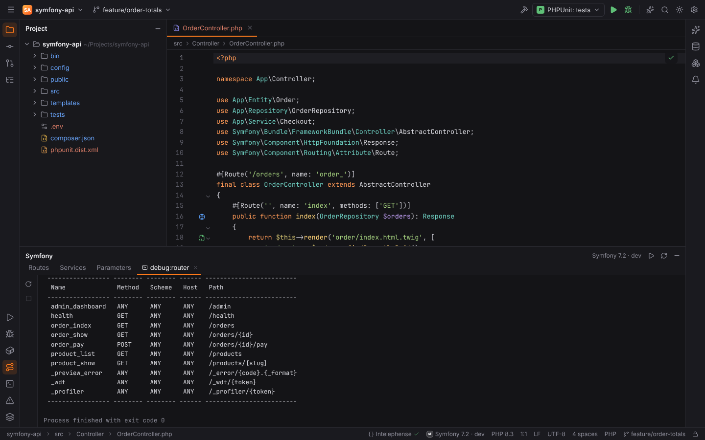
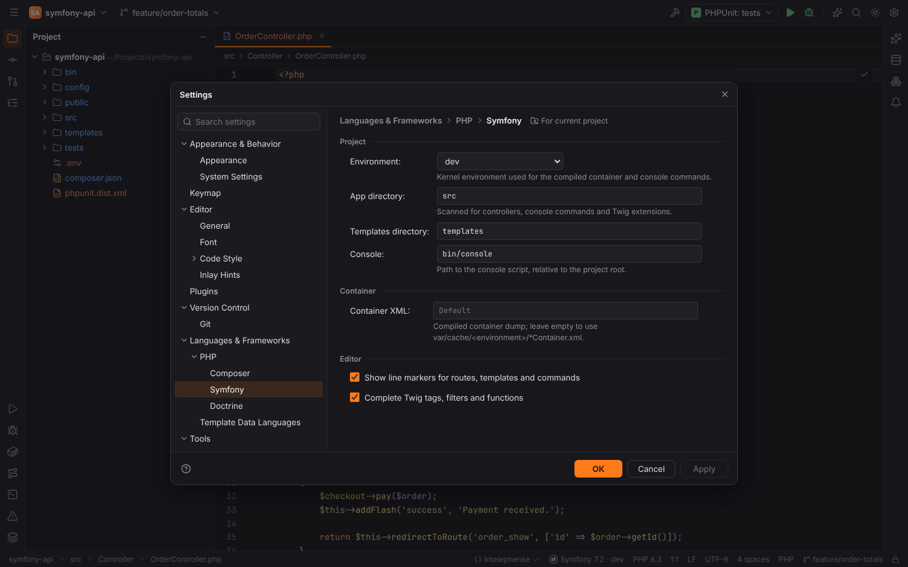

# Symfony

The Symfony plugin (`forge.symfony`, PHPForge pack) activates in projects that require
`symfony/framework-bundle` or have `bin/console` together with `config/bundles.php`. It reads
the project statically and, when present, the compiled container in
`var/cache/<env>/*Container.xml`, which also knows the services and parameters of every bundle.

The status bar shows **Symfony 7.2 · dev** (version and kernel environment). Its menu has
**Show Routes**, **Show Services**, **Run Console Command…**, **Refresh Symfony Index** and
**Symfony Settings…**.

## What Forge knows about the project

| Area | Read from |
| --- | --- |
| Services, aliases, `_defaults`, autowired `resource:` folders | `config/services*.yaml`, merged with the compiled container XML |
| Parameters | the same files |
| Routes | `#[Route]` attributes, legacy `@Route` annotations and YAML route files |
| Templates | `templates/` (setting `symfony.templatesDirectory`), and which controller renders which template |
| Twig tags, filters, functions and tests | Twig core, the Symfony bridge and the project's Twig extensions |
| Console commands | the project's commands (`src/`), then framework and bundle commands |

The index is cached for a few seconds and rebuilt when files change; **Refresh Symfony Index**
rescans now.

## Completion and Go to Declaration

| Where | Completes and navigates to |
| --- | --- |
| `generateUrl('…')`, `redirectToRoute('…')`, `$router->generate('…')`, Twig `path('…')` / `url('…')` | route names |
| `render('…')`, `renderView`, Twig ``, ``, ``, ``, ``, `` | templates |
| `@service_id` in YAML, `#[Autowire(service: '…')]`, `$container->get('…')`, `service('…')` in PHP config | service ids |
| `%parameter%` in YAML, `getParameter('…')` | parameters |
| Twig files | tags, filters, functions, tests and variables |

`Ctrl+B` / `Ctrl+Click` on any of these opens the declaration (the controller action, the
template, the service definition or class, the parameter).

In `config/services*.yaml` (file type "Symfony Services"), service ids, parameters and tags are
completed, and `@service` and `%parameter%` references are highlighted.

## Line markers

With **Show line markers for routes, templates and commands** (`symfony.gutterIcons`):

- a **route** marker on controller actions (click: the route);
- **go to template** next to `render()` calls;
- **rendered by** on Twig templates (click: the controller);
- a **run** marker on console commands (click: run it).

## Symfony tool window

The **Symfony** tool window (bottom) has three tabs:

| Tab | Columns | Filter |
| --- | --- | --- |
| Routes | Name, Method, Path, Controller | name, path or controller |
| Services | Service ID, Class, Tags (public/private icon) | id, class or tag |
| Parameters | Name, Value | parameter |

Clicking a row opens its definition.

## Run Console Command

**Run Console Command…** (Find Action, the status bar menu or the tool window) opens a popup:
type a command name, `Tab` completes it, arguments after the name are passed on, `Enter` runs
it with `bin/console` (setting `symfony.consolePath`) in the configured environment.

The output is shown in the Symfony tool window with **Rerun** and **Close**.

## Settings | Languages & Frameworks | PHP | Symfony

| Option | Setting | Default |
| --- | --- | --- |
| Environment (`dev`, `test`, `prod`) — kernel environment for the compiled container and console commands | `symfony.environment` | `dev` |
| App directory — scanned for controllers, commands and Twig extensions | `symfony.appDirectory` | `src` |
| Templates directory | `symfony.templatesDirectory` | `templates` |
| Console — path to the console script | `symfony.consolePath` | `bin/console` |
| Container XML — empty: `var/cache/<environment>/*Container.xml` | `symfony.containerXml` | empty |
| Show line markers for routes, templates and commands | `symfony.gutterIcons` | on |
| Complete Twig tags, filters and functions | `symfony.twigCompletion` | on |

The project settings (environment, folders, console, container) can be stored per project.

## Doctrine

Symfony projects usually use Doctrine; see [Doctrine and DQL](doctrine.md). Symfony's
`DATABASE_URL` in `.env` is offered as a data source in the [Database](database.md) tool window.

> **Note:** Symfony analysis is not available in [remote projects](remote-development.md) yet.
