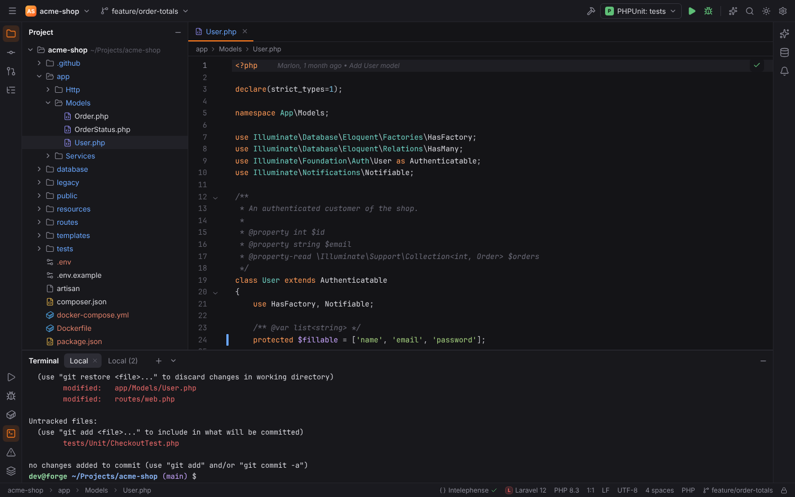
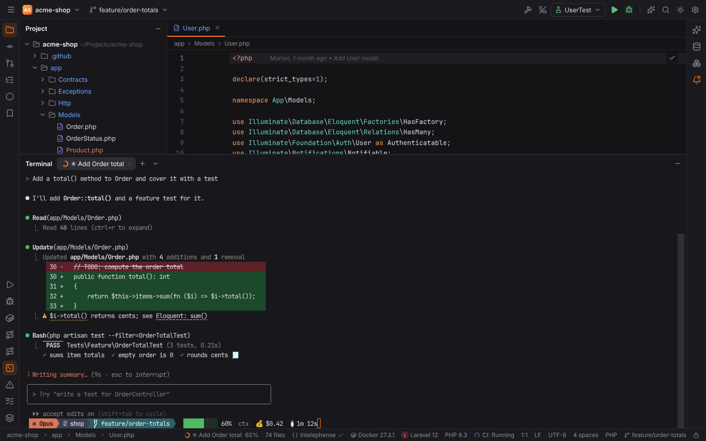
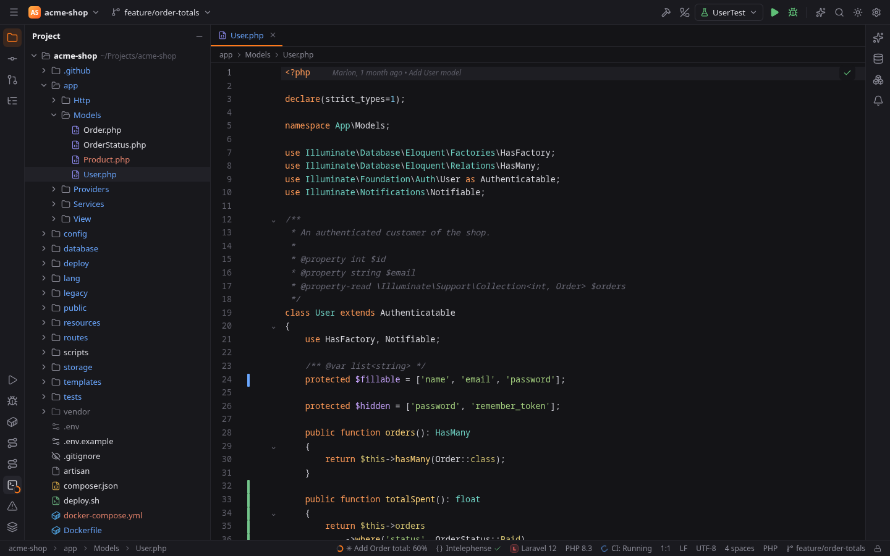
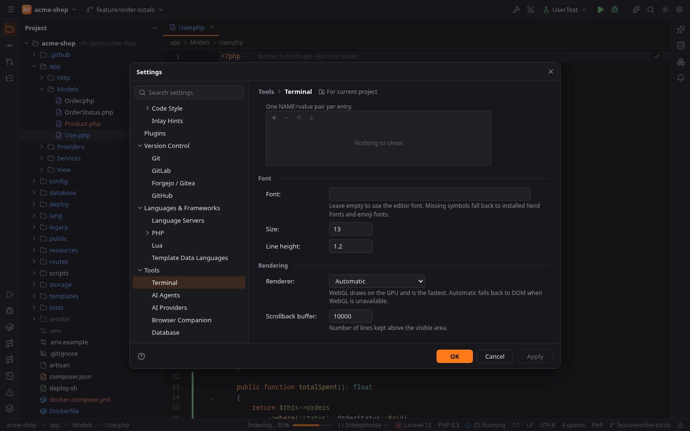
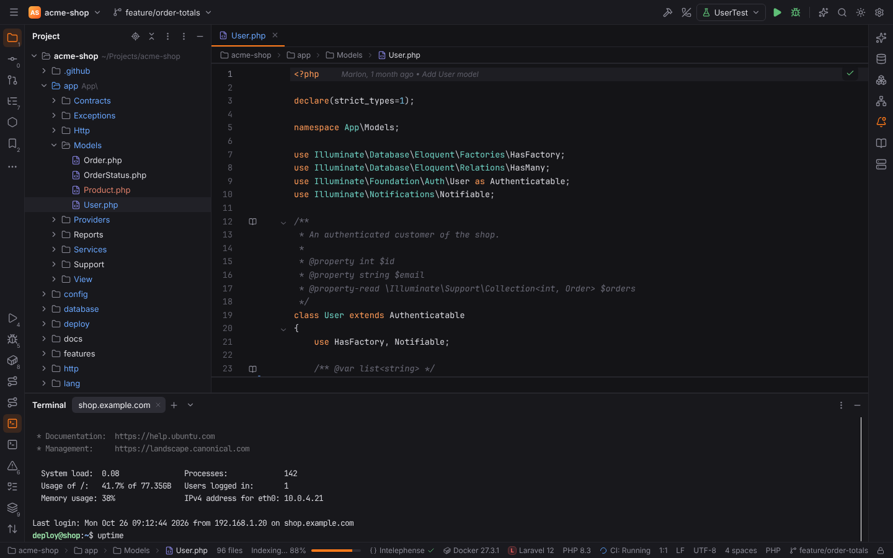
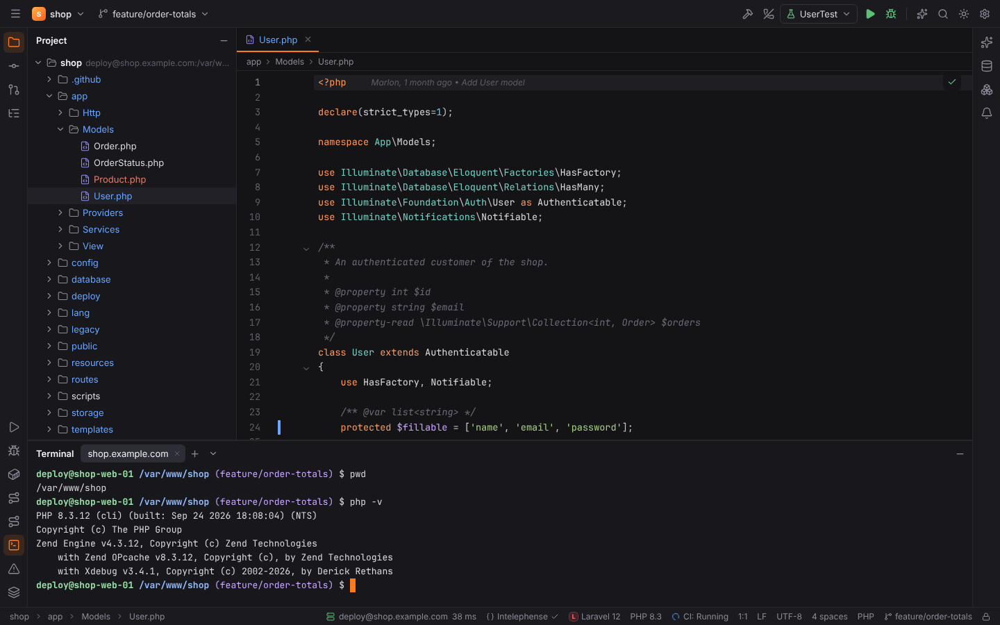

# Terminal

The **Terminal** tool window (`Alt+F12`, bottom stripe) runs your shell on a real pseudo
terminal (xterm.js in the UI, a PTY in Rust), so interactive programs such as `vim`, `htop`,
`git rebase -i`, `php artisan tinker` or Claude Code work.

## Tabs

| Action | Windows/Linux | macOS |
| --- | --- | --- |
| Show/hide the terminal | `Alt+F12` | `Alt+F12` |
| New tab | `Ctrl+Shift+T` | `Cmd+T` |
| Close tab | `Ctrl+Shift+F4` | `Cmd+Shift+F4` |

Tabs are named "Local", "Local (2)", …; while a program runs that sets a title (OSC 0 / OSC 2,
e.g. Claude Code's current task), the tab shows that title instead (**Show application title**).
Double-click a tab or use **Rename Session** to rename it; a renamed tab keeps its name. The arrow next to **+** has **New Tab**, **New Tab in Current Directory**, **SSH Session…**
(see [SSH sessions](#ssh-sessions)), **Rename Session** and **Clear Buffer**. A
tab's context menu has **New Tab**, **New Tab in Current Directory** (the directory the shell
reports, see below), **Rename Session**, **Close Tab** and **Close Other Tabs**. The terminal
area's context menu has **Copy** (`Ctrl+Shift+C`), **Paste** (`Ctrl+Shift+V`), **Select All**
and **Clear Buffer**.

## Program progress

Programs such as Claude Code, winget or systemd report their progress with the OSC 9;4
sequence. Forge shows it:

- on the **terminal tab**: a ring filled to the percentage, or a spinning arc while the
  program is busy without a percentage;
- in the **status bar** (**Show progress in the status bar**): the ring plus
  "&lt;tab title&gt;: 42%", "Working…", "Error 60%" or "Paused"; click it to show the tab;
- on the **Terminal stripe icon** while the tool window is hidden: the combined progress of
  all tabs (errors first, then paused, then the slowest).

Errors are drawn in the danger color, paused progress in the warning color. The progress
disappears when the program removes it, when the shell shows its next prompt (OSC 133) or
when the shell exits.

## Notifications and bell

OSC 9 (iTerm2) and OSC 777 (`notify;<title>;<body>`) notifications appear as balloons when
the tab is not visible or Forge is not focused; **Show** opens the tab. The bell flashes the
terminal when the tab is visible and otherwise puts a dot on the tab and on the stripe icon;
with **Audible bell** it also beeps.

## Keyboard

While the terminal has focus, plain `Ctrl`+letter, `Alt`+letter and `Escape` go to the shell
(so `Ctrl+C`, `Ctrl+R`, `Alt+B` behave as in any terminal). Function keys, `Alt`+digit,
`Ctrl+Shift` and `Ctrl+Alt` combinations still reach the IDE, so `Alt+1` or `Shift+Escape`
work from the terminal.

`Shift+Enter` sends ESC CR and `Ctrl+Enter` sends LF, so TUI programs such as Claude Code
insert a newline instead of submitting. On macOS, **Use Option as Meta key** makes `Option`
work as `Alt` in the shell.

## Links

URLs and OSC 8 hyperlinks in the output open with `Ctrl+Click` (`Cmd+Click` on macOS), so a
plain click still selects text; hovering one shows its target at the bottom of the terminal.
Only `http(s)` and `mailto` links open in the browser and `file://` links only open files of
the project; other links are refused. File references such as `app/Models/User.php:42` are
underlined and open in the editor at that line with a click.

## Rendering

The terminal draws with WebGL on the GPU and falls back to the DOM renderer when WebGL is not
available or its context is lost (**Renderer**). Emoji, East Asian characters, braille spinners
and Nerd Font glyphs take the widths modern terminals use (Unicode 15 and grapheme clusters),
and box drawing characters line up without gaps. The font is **Font** (empty: the editor font),
followed by common monospace fonts, Nerd Fonts, color emoji and symbol fonts for missing glyphs.
Settings changes apply to open terminals right away.

## Shell and start directory

The shell is, in this order: Settings | Tools | Terminal | **Shell path**
(`terminal.shellPath`), `$SHELL` on Linux/macOS (then bash, zsh, sh), on Windows PowerShell 7
(`pwsh.exe`), Windows PowerShell or `%ComSpec%`. bash, zsh and fish start as login shells.

New tabs start in the project root unless **Start directory** (`terminal.startDirectory`) is
set; **Environment variables** (`terminal.environment`, one `NAME=value` per entry) are added.

The shell also gets `TERM=xterm-256color`, `COLORTERM=truecolor`, `TERM_PROGRAM=Forge`,
`TERM_PROGRAM_VERSION=<Forge version>` and `FORGE_TERMINAL=1`, and a UTF-8 `LANG` when none is
set. Variables of the terminal Forge itself was started from (kitty, tmux, iTerm2, WezTerm,
Ghostty, …) are removed, so programs do not mistake Forge for that terminal.

Shells that report their directory (OSC 7, or ConEmu's OSC 9;9) let **New Tab in Current
Directory** open the new tab there. Closing a tab ends the shell; a shell that ignores the
hang-up signal is killed after 1.5 seconds.

## Settings | Tools | Terminal

| Option | Setting | Default | Scope |
| --- | --- | --- | --- |
| Shell path | `terminal.shellPath` | system default | user |
| Default tab name | `terminal.tabName` | `Local` | user |
| Audible bell (a short tone when a program rings the bell) | `terminal.audibleBell` | off | user |
| Copy to clipboard on selection | `terminal.copyOnSelection` | off | user |
| Shell integration | `terminal.shellIntegration` | on | user |
| Show application title | `terminal.showApplicationTitle` | on | user |
| Show progress in the status bar | `terminal.showProgressInStatusBar` | on | user |
| Use Option as Meta key (macOS) | `terminal.optionAsMeta` | on | user |
| Cursor shape | `terminal.cursorShape` | Block | user |
| Blinking cursor | `terminal.cursorBlink` | on | user |
| Start directory | `terminal.startDirectory` | project root | user, project |
| Environment variables | `terminal.environment` | empty | user, project |
| Font | `terminal.font.family` | editor font | user |
| Size | `terminal.font.size` | 13 | user |
| Line height | `terminal.font.lineHeight` | 1.2 | user |
| Renderer | `terminal.renderer` | Automatic | user |
| Scrollback buffer | `terminal.scrollback` | 10000 lines | user |

## Shell integration

With **Shell integration** on, bash and zsh tell the terminal their working directory (shown
in the tab's tooltip) and where each command starts and ends: finished commands get a mark in
the scrollbar, green when they succeeded and red when they failed. Your own startup files
still run: bash starts with an init file that sources `~/.bashrc` (or the profile files for a
login shell), zsh with a `ZDOTDIR` whose files source yours. The scripts live in
`<cache dir>/forge/shell-integration` of the machine the shell runs on (also on remote hosts).
fish, sh and PowerShell start without it; it applies to new sessions.

## SSH sessions

**Tools | Start SSH Session…** and **SSH Session…** in the new-tab dropdown (the arrow next
to **+**) open a terminal tab on another host over SSH: pick one of your SSH configurations, an
SFTP deployment server of the project or **Edit credentials…**. The tab is named after the
host and runs on a pseudo terminal on the SSH channel, so full-screen programs and resizing
work. See [Remote Host and SSH sessions](remote-host-and-ssh.md#ssh-sessions); in Safe Mode a
session to a deployment server asks first.

## Other terminals

The Services tool window opens terminals into Docker containers and Kubernetes pods
(`docker exec`, `kubectl exec`), and in a [remote project](remote-development.md) the terminal
runs on the remote host, with the same environment as a local one.

In browser mode (`pnpm dev`) the terminal is a small fake shell; `claude` replays a recorded
Claude Code session (`claude --thinking` and `claude --error` show the other progress states),
`Ctrl+C` ends it.
