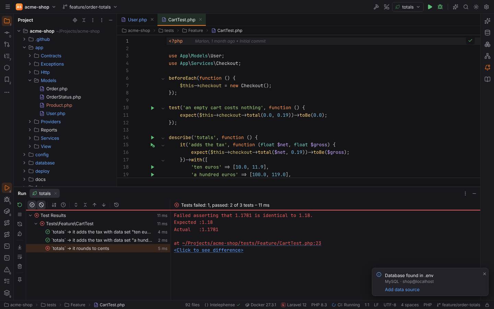
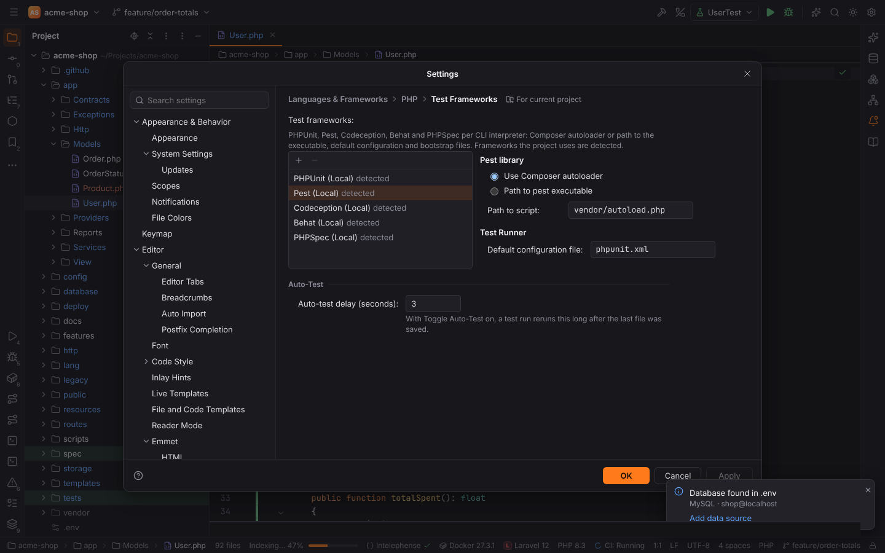
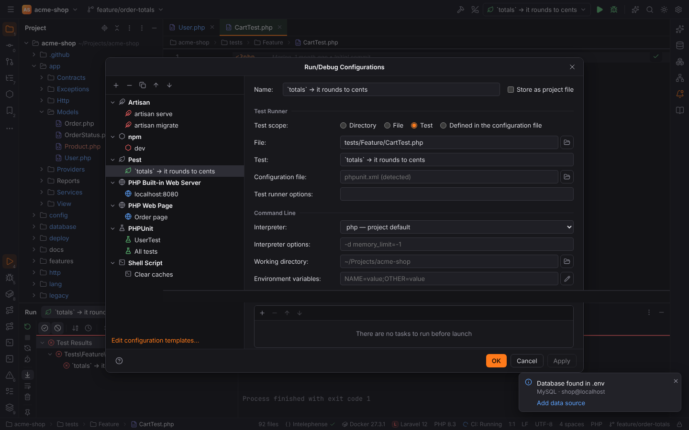
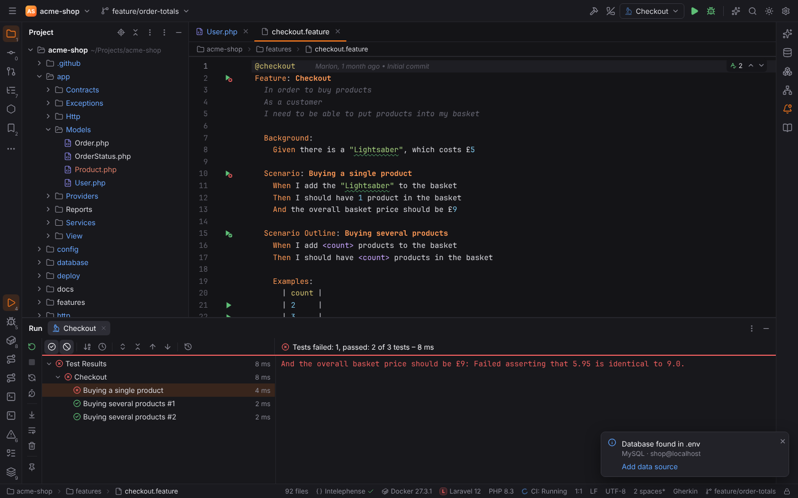
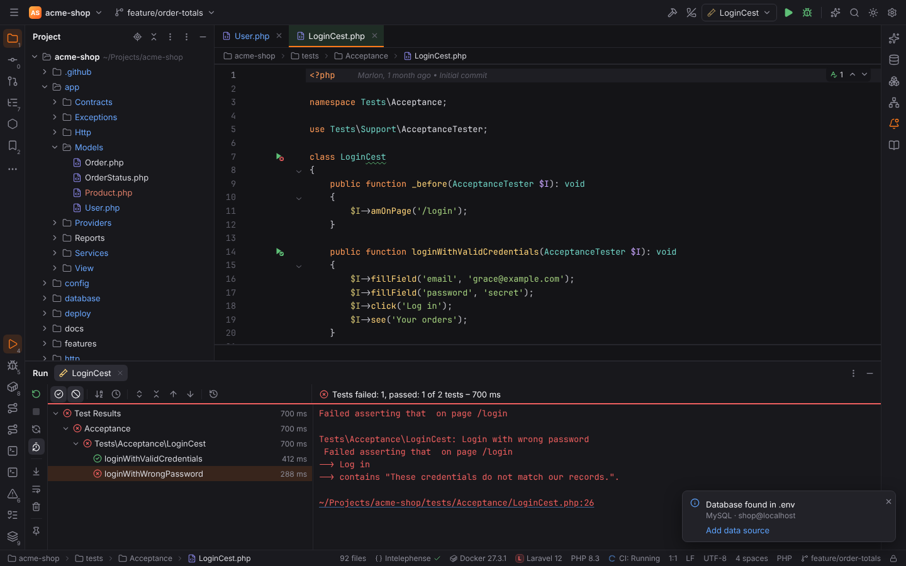
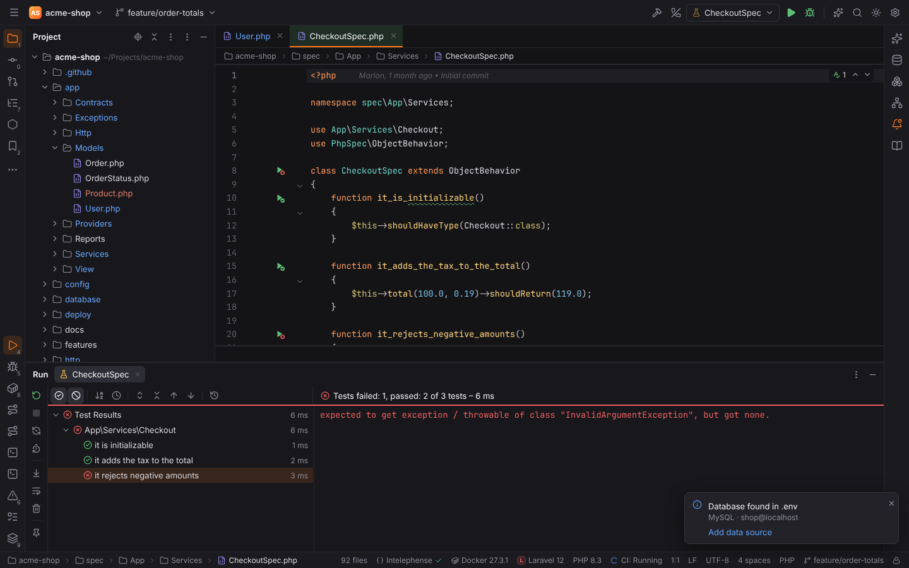
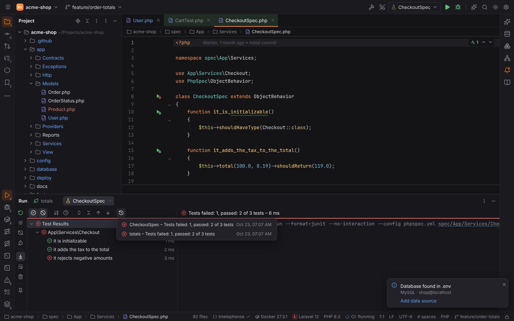
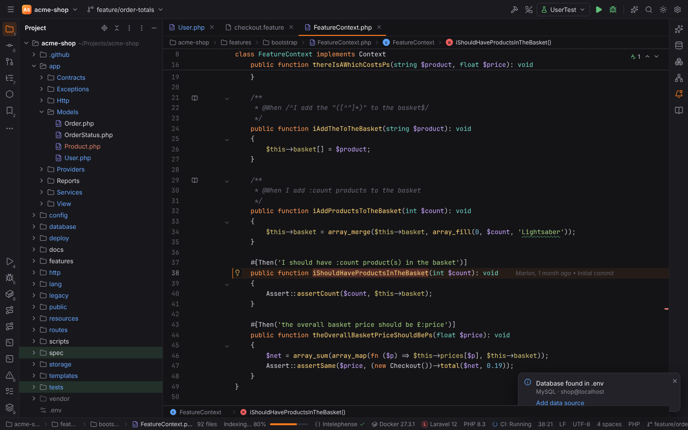

# PHP test frameworks

Forge runs the tests of PHPUnit, Pest, Codeception, Behat and PHPSpec projects the way
PHPStorm does: gutter ▶ icons on every test, a run configuration type per framework, the test
tree in the Run tool window with the results of each test, **Rerun Failed Tests**, the **Test
History** and **auto-test**. Every run goes through the project's
[CLI interpreter](php.md#cli-interpreters), so tests run locally, in Docker, Docker Compose,
over SSH or in WSL alike.

## Settings | PHP | Test Frameworks

**Settings | Languages & Frameworks | PHP | Test Frameworks** (`php.testFrameworks`, stored per
project) lists one configuration per framework and interpreter, like PHPStorm:

- **+** adds PHPUnit, Pest, Codeception, Behat or PHPSpec, **Local** or **by Remote
  Interpreter** (one of the [CLI interpreters](php.md#cli-interpreters)); **−** removes it.
- **<Framework> library**: **Use Composer autoloader** with the path to `vendor/autoload.php`
  (the framework's script in `vendor/bin` is run), or **Path to <executable>** (a script or a
  phar such as `phpunit.phar`).
- **Test Runner**: the **Default configuration file** (`phpunit.xml`, `codeception.yml`,
  `behat.yml`, `phpspec.yml`) and, for PHPUnit and PHPSpec, the **Default bootstrap file**.
  A run configuration's own configuration file wins.
- Frameworks the project uses but that are not configured are listed as **detected**: from
  `require-dev` of composer.json, the scripts in `vendor/bin` and the frameworks'
  configuration files (`tests/Pest.php` for Pest). Changing a detected entry adds it.
- A run uses the entry of its interpreter, else the Local one.

**Auto-test delay (seconds)** (`run.autoTest.delay`, default 3) is on the same page, see
[Auto-test](#auto-test).

## Run configurations

**Run | Edit Configurations…** has a type per framework (PHPUnit is described in
[Run/Debug configurations](run-debug.md#configuration-types)). The gutter icons and
**Run Context Configuration** (`Ctrl+Shift+F10`) create temporary configurations of these types.

| Type | Test scope | Runs | Results |
| --- | --- | --- | --- |
| Pest | Directory, File, Test (a `test()`, `it()` or `describe()` description), Defined in the configuration file | `pest --teamcity [--configuration f] [path] [--filter …]` | streamed TeamCity messages |
| Codeception | Type (suite), Directory, File, Method, Defined in the configuration file; Groups, Environments | `codecept run [suite \| file[:method]] [-g group] [--env env] [-c f] --xml <report>` | the JUnit report read when the run ends |
| Behat | Directory, File, Scenario (feature file and line), Defined in the configuration file; Profile | `behat [--config f] [--profile p] --format=progress --out=std --format=junit --out=<reports>` | progress in the console, the JUnit reports in the tree |
| PHPSpec | Directory, Spec, Example (spec file and line), Defined in the configuration file | `phpspec run --format=junit --no-interaction [--config f] [--bootstrap f] [file[:line]]` | the JUnit document on stdout |

Every type has **Configuration file** and **Test runner options**, plus the common fields
(interpreter, interpreter options, working directory, environment variables, Before launch).
**Debug** (`Shift+F9`) runs the tests with Xdebug.

Codeception and Behat write their JUnit reports into a folder that Forge reads and deletes
when the run ends: the system temp folder when the project and the interpreter are local,
otherwise `.forge/test-reports/` inside the project, which a container or remote host reaches
through the interpreter's path mappings.

## Gutter icons

A green ▶ in the gutter runs or debugs a test, or opens **Modify Run Configuration…**. After a
run the icon shows the test's last result (✓ passed, ✗ failed).

| File | Icons |
| --- | --- |
| PHPUnit test class (`*Test`, extends `…TestCase`) | the class, `test*` methods, `@test` and `#[Test]` methods |
| Pest file | every `test()`, `it()` and `describe()` call, every row of an inline `->with([...])` dataset |
| Codeception `*Cest.php`, `*Cept.php`, `extends \Codeception\Test\Unit` | the class or file, public Cest methods, `test*` methods |
| Behat `.feature` | the feature, every scenario and scenario outline, every example row |
| PHPSpec `*Spec.php` (`extends ObjectBehavior`) | the spec, every `it_*` and `its_*` example |

The tests of a file are found in Rust while you type.

## Test results

The test tree of the Run tool window works for every framework:

- Pass, fail and ignored state with durations, **Show Passed** / **Show Ignored**, sorting,
  **Previous/Next Failed Test** and double-click to open a test. Pest tests open at their
  `test()` / `it()` call, Behat scenarios at their `Scenario:` line, Codeception tests at the
  line of the report.
- A failed comparison shows **<Click to see difference>**.
- **Rerun Failed Tests** runs only the failed tests: PHPUnit and Pest with `--filter`,
  Codeception with `-g failed` (Codeception's list of the failed tests), Behat with `--rerun`,
  PHPSpec the failed spec file.

### Test History

The **Test History** button (clock with an arrow) in the test tree's toolbar lists the last
ten test runs of the project with their result and time. Picking one opens it in a Run tab
with its tree and failure details; **Rerun** runs its configuration again. Runs are kept in
Forge's data folder (`<data dir>/forge/test-history/<project>/`), never in the project. Find
Action: **Test History…**.

### Auto-test

**Toggle Auto-Test** in the Run tool window's toolbar (or Find Action) reruns that tab's
configuration automatically after files are saved, once the auto-test delay passed since the
last save (`run.autoTest.delay`, default 3 seconds). A run that is still going finishes first.

## Behat

`.feature` files are highlighted as Gherkin: `Feature`, `Background`, `Scenario`,
`Scenario Outline` and `Examples` headings, the step keywords `Given`, `When`, `Then`, `And`,
`But` and `*`, tags, comments, tables (with the header row of examples), doc strings, quoted
arguments, numbers and `<placeholders>`.

**Go to Declaration** (`Ctrl+B`, `Ctrl+Click`) on a step opens its step definition: the
context method whose pattern matches the step, from a doc comment (`@Given /^I have (\d+)
apples?$/`, `@When I add :product to the basket`) or an attribute (`#[Given('…')]`,
`#[\Behat\Step\Then("…")]`). Turnip patterns support `:placeholders` (a quoted string or a
word), optional parts such as `product(s)` and alternatives such as `buy/purchase`; steps of a
scenario outline match with the values of the first example row. Several matching
definitions open a chooser.

> **Note:** Gherkin keywords in other languages (`# language: de`) are not supported yet.
