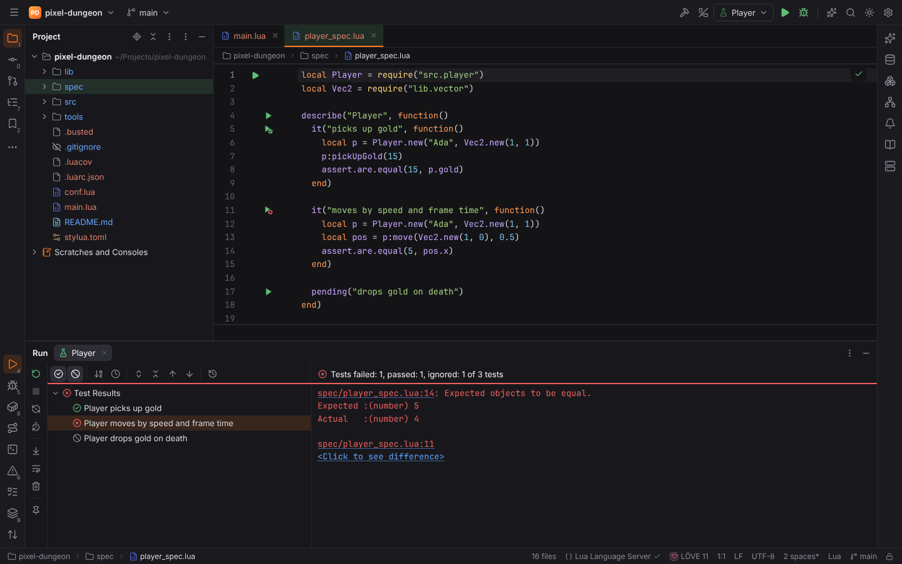
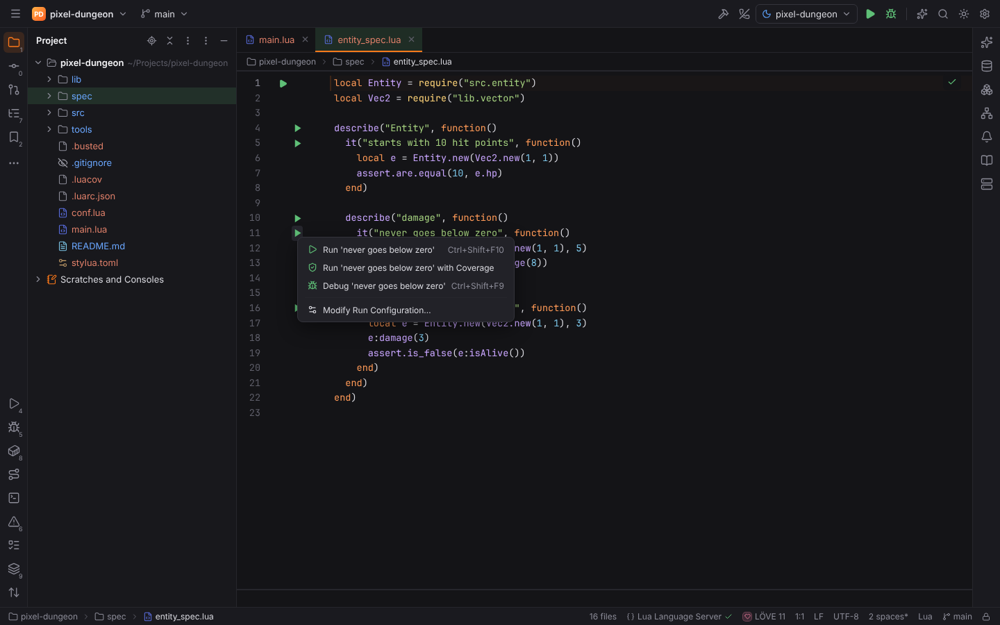

# Testing

Every pack runs its tests through the same test runner, so tests look and behave the same in
PHP, Lua and every language pack that follows:

- green ▶ **gutter icons** on test files, classes, `describe` blocks and single tests;
- a **run configuration type** per test framework (Run | Edit Configurations…);
- the **test tree** in the Run tool window with statuses, durations, output per test and
  **Click to see difference** for failed comparisons;
- **Rerun Failed Tests**, the **Test History**, **auto-test**;
- **Run with Coverage** ([Coverage](coverage.md)) and **Run on** a Docker image, a Docker
  Compose service, an SSH host, WSL or a Dev Container ([Run targets](run-targets.md)).

## Test frameworks

| Framework | Pack | Results | Coverage |
| --- | --- | --- | --- |
| PHPUnit, Pest, Codeception, Behat, PHPSpec | PHPForge ([PHP test frameworks](test-frameworks.md)) | TeamCity, JUnit XML | PHPUnit and Pest (Clover, Xdebug or PCOV) |
| busted | LuaForge ([LuaForge](luaforge.md#tests-with-busted)) | TAP | LCOV (luacov) |
| JUnit 5/4/3, TestNG | JavaForge ([JavaForge](java.md#tests)), through Gradle or Maven | JUnit XML of the build (`build/test-results/test`, `target/surefire-reports`) | JaCoCo XML |
| Jest, Vitest, Mocha, Playwright, Cypress, `node --test` | WebForge ([JavaScript test runners](javascript-debugging.md#test-runners)) | Jest / Vitest JSON, TAP, Playwright JSON, JUnit XML | LCOV (Jest, Vitest, c8 for Mocha, Node's reporter) |

Language packs declare their frameworks in their plugin manifest
(`[[contributions.testFrameworks]]`, see [Contribution points](../developer/contribution-points.md#test-frameworks));
the framework then appears everywhere on this page without further code.

A framework is used in a project when its files are there (`.busted`, `spec/*_spec.lua`) or a
project file names it (a rockspec that depends on busted). When several frameworks claim the
same files (Jest and Vitest both run `*.test.ts`), the gutter uses the one the project uses.

## Running tests

- **Gutter icons** — click the ▶ next to a test, a `describe` block, a class or the file:
  **Run '…'** (`Ctrl+Shift+F10`), **Run '…' with Coverage**, **Debug '…'** (`Shift+F9`) and
  **Modify Run Configuration…**. After a run the icon shows the test's last result (✓ or ✗).
- **Run Context Configuration** (`Ctrl+Shift+F10`) runs the test at the caret, else the whole
  test file.
- **Run configurations** — each framework is a configuration type. Manifest frameworks have a
  **Test scope**: *All tests*, *Directory*, *File*, *Test* (a test or a `describe` block by its
  full name) or *Pattern*, plus **Executable** (default: the framework's setting, e.g.
  `lua.busted.path`) and **Test runner options**.

## The test tree

The Run tool window (`Alt+4`) shows a test run as a tree next to the console, like PHPStorm:

- suites (files, classes, packages, `describe` blocks) with their tests; statuses (passed,
  failed, ignored, running) and durations; the status line "Tests failed: 1, passed: 3 of 4
  tests – 51 ms" with a progress bar;
- selecting a test shows its own output and failure; **Click to see difference** opens the
  expected and actual values in the diff viewer;
- double-click or `F4` jumps to the test (by line, else by its function, method, `it` / `test`
  call or scenario);
- **Show Passed** / **Show Ignored**, **Sort Alphabetically** / **by Duration**, **Expand /
  Collapse All**, **Previous / Next Failed Test**;
- **Rerun Failed Tests** runs only the failed tests (PHPUnit / Pest `--filter`, busted
  `--filter` per test, …), **Toggle Auto-Test** reruns the tab a few seconds after files are
  saved (`run.autoTest.delay`), the **Test History** reopens one of the last 10 runs.

## Result formats

Forge reads what the tools print; the parsers live in Rust (`forge-output`) and turn every
format into the same test events:

| Format | Tools | Arrives |
| --- | --- | --- |
| TeamCity service messages | PHPUnit `--teamcity`, Pest, Jest and Mocha TeamCity reporters | streamed on stdout |
| JUnit XML | Codeception, Behat, PHPSpec, PHPUnit `--log-junit`, pytest `--junitxml`, Gradle, Maven | a report file or a document on stdout |
| TAP 12–14 | busted `--output=TAP`, `node --test --test-reporter=tap`, prove, Bats, node-tap | streamed on stdout |
| Go `test2json` | `go test -json` | streamed on stdout |
| libtest JSON | `cargo test -- -Z unstable-options --format json`, nextest | streamed on stdout |
| pytest report log | `pytest --report-log=…` | streamed on stdout or a report file |
| Jest / Vitest JSON | `jest --json`, `vitest run --reporter=json` | a document on stdout or a report file |
| Playwright JSON | `playwright test --reporter=json` (`PLAYWRIGHT_JSON_OUTPUT_NAME`) | a report file |

Failures keep their message, the failure location (a stack frame) and, where the tool reports
them, the expected and actual values: `Expected` / `Received` (Jest, Vitest), `got … want …`
(Go), `left` / `right` (Rust), `assert a == b` (pytest), `Passed in` / `Expected` (busted).

## Safe Mode

Running tests runs the project's code: in [Safe Mode](project-trust.md) every test run,
coverage run and debug run is refused until the project is trusted.
