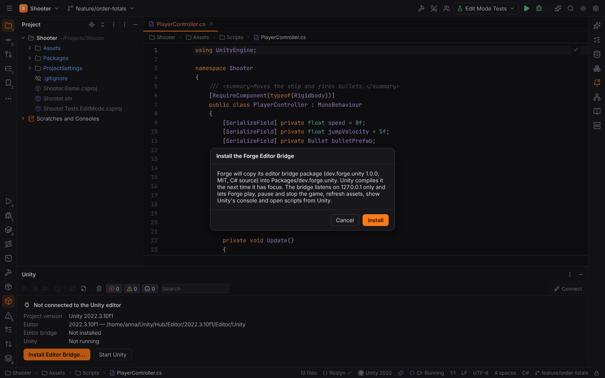
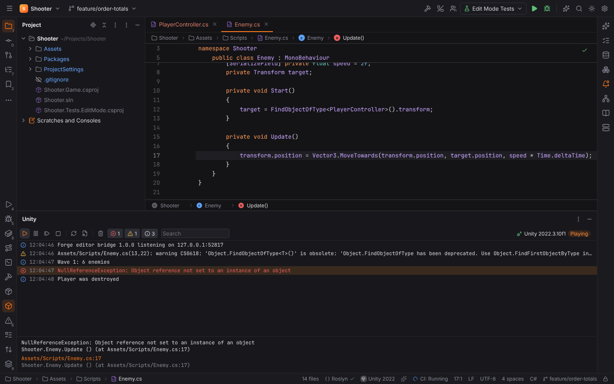
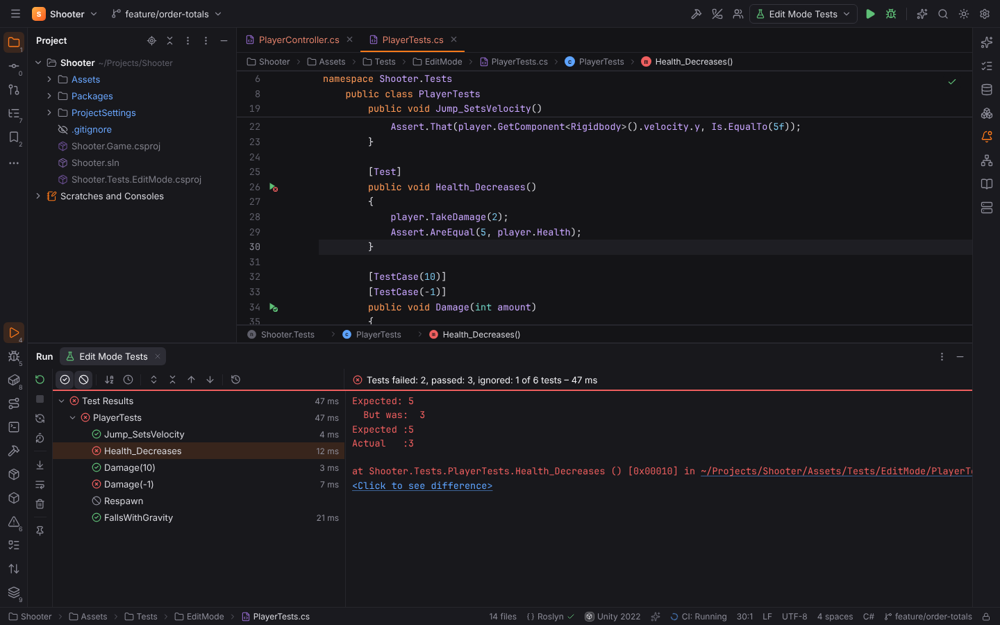
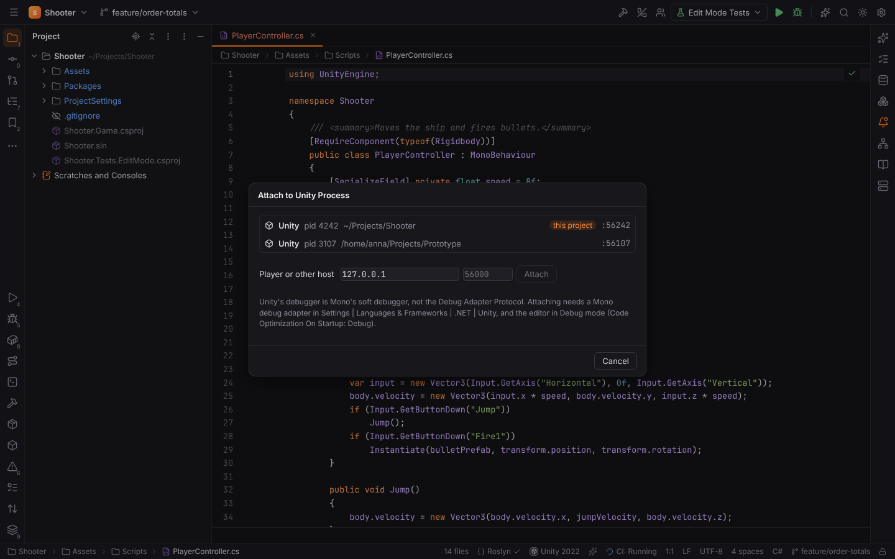
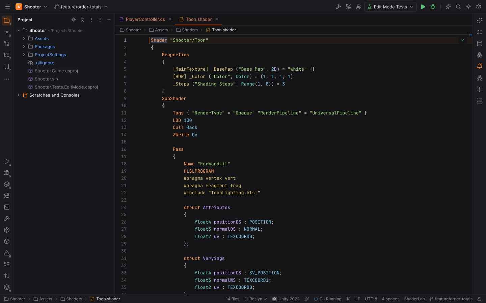
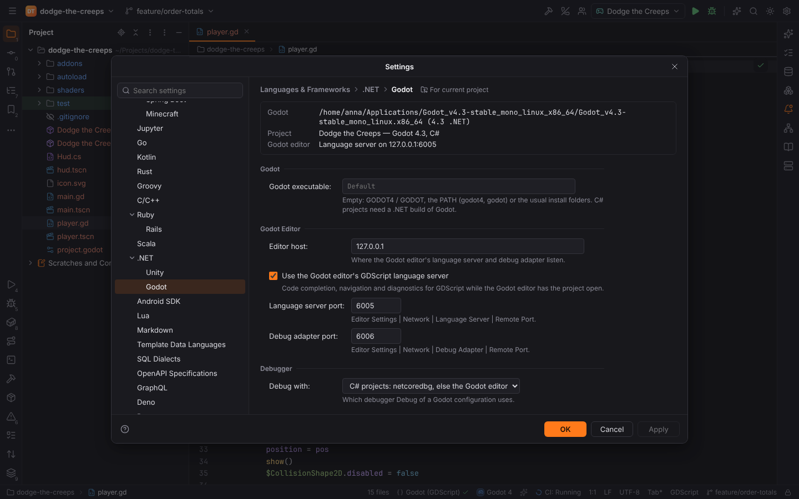
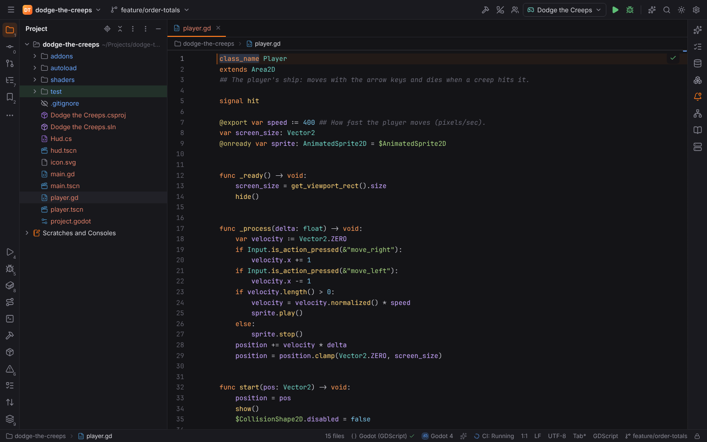
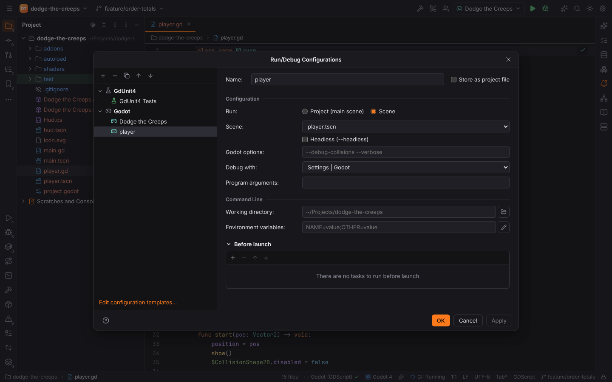
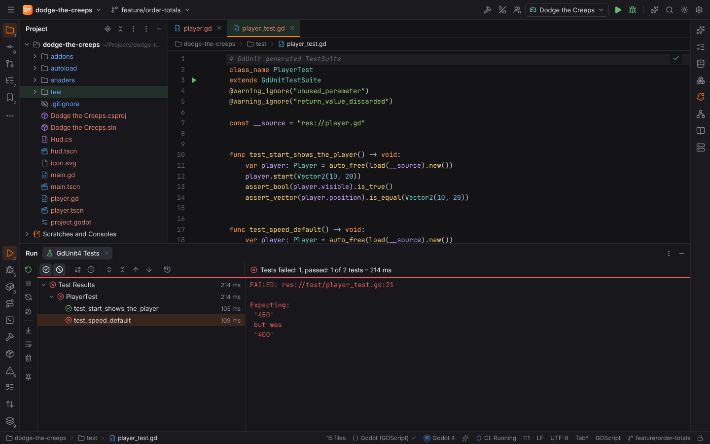

# Unity and Godot

DotNetForge supports the two game engines that use C#, in the style of Rider's Unity and Godot
support. Two plugins of the [.NET pack](dotnet.md) do this:

- **Unity** (`forge.unity`) is active in Unity projects: a folder with
  `ProjectSettings/ProjectVersion.txt` and `Assets/`. It needs the .NET plugin.
- **Godot** (`forge.godot`) is active in Godot projects: a folder with `project.godot`, with
  GDScript, C# or both.

Forge never bundles or downloads Unity or Godot. It uses the editors installed on your machine.
The logic is in Rust (`packs/dotnetforge/gamedev`); see
[dotnetforge-gamedev](../developer/crates/dotnetforge-gamedev.md).

## Unity

### The project and its editor

Forge reads the project's editor version from `ProjectSettings/ProjectVersion.txt` (for example
`2022.3.10f1`) and its packages from `Packages/manifest.json`. It looks for installed editors
where the Unity Hub puts them:

| OS | Unity Hub editors | Unity Hub settings |
| --- | --- | --- |
| Linux | `~/Unity/Hub/Editor/<version>/Editor/Unity` | `~/.config/UnityHub` |
| macOS | `/Applications/Unity/Hub/Editor/<version>/Unity.app` | `~/Library/Application Support/UnityHub` |
| Windows | `C:\Program Files\Unity\Hub\Editor\<version>\Editor\Unity.exe` | `%APPDATA%\UnityHub` |

It also reads the Hub's custom install folder (`secondaryInstallPath.json`) and the editors
you located manually in the Hub (`editors-v2.json`). The project uses the editor of its exact
version, else the newest one of the same `major.minor` (Unity upgrades the project when it
opens it). **Settings | Languages & Frameworks | .NET | Unity** shows the editors and lets you
choose another one (`unity.editorPath`).

**Tools | Unity | Start Unity** opens the project in its editor.

### Project files

C# code insight uses the `.sln` and `.csproj` files that Unity's IDE packages
(`com.unity.ide.visualstudio`, `com.unity.ide.rider`, `com.unity.ide.vscode`) write into the
project folder. Once they exist, the project is an ordinary [.NET solution](dotnet.md): the
Roslyn language server, the Build tool window and NuGet work with it.

**Tools | Unity | Regenerate Project Files** writes them:

- with Unity open and the editor bridge connected, Unity generates them right away;
- with Unity closed, Forge runs the editor in batch mode
  (`-batchmode -quit -executeMethod …`), with the editor bridge's method or the Rider
  package's `SyncSolution`.

### The Forge editor bridge

The editor bridge is a small Unity package (`dev.forge.unity`, MIT, C# source shipped with
Forge) that connects the Unity editor to Forge. **Tools | Unity | Install Editor Bridge…**
copies it into `Packages/dev.forge.unity` after you confirm; Forge never installs it on its
own. Unity compiles it the next time it has focus.

With the bridge, choose **Forge** in Unity's **Preferences | External Tools | External Script
Editor**:

- double-clicking a script (or a console message) in Unity opens it in Forge at its line;
- **Regenerate project files** in that preferences page, and new or moved scripts, write the
  project files through the installed IDE package's generator.

While Unity runs, the bridge listens on `127.0.0.1` only (a free port) and writes the port and a
random token into `Library/ForgeBridge.json`. Forge connects to it automatically
(`unity.bridge.autoConnect`) or with **Tools | Unity | Connect to Unity Editor**, and again
after every script reload. The protocol is described in
[Unity editor bridge protocol](../developer/unity-bridge-protocol.md).

### The Unity tool window

The **Unity** tool window (bottom) shows the connection and Unity's console:

- **Play**, **Pause**, **Step** and **Stop** control Play mode in the editor; the status shows
  Playing, Paused and Compiling.
- **Refresh Assets** (`AssetDatabase.Refresh`) and **Regenerate Project Files**.
- The console: errors, warnings and messages with their counts (click to filter), search,
  **Clear**. Select a message for its full text and stack trace; double-click it, or click its
  location, to open the source. Compiler messages (`Assets/Scripts/Enemy.cs(13,22): warning
  CS0618 …`) and stack frames (`(at Assets/Scripts/Enemy.cs:17)`) are read in Rust.
  `unity.console.maxEntries` limits the messages kept.

### Unity tests

The **Unity Tests** configuration type runs the Unity Test Framework in batch mode:
`Unity -batchmode -projectPath <project> -runTests -testPlatform EditMode|PlayMode
-testResults <file>`.

- Gutter icons on NUnit `[Test]` / `[TestCase]` and `[UnityTest]` methods and their classes in
  `Assets/` and `Packages/`.
- Scopes: all tests, a class, a method or a `-testFilter` expression; the test platform
  (Settings: `unity.tests.platform`), categories and assemblies.
- Results come from Unity's NUnit 3 report: suites per test class, data rows, durations,
  output, failure messages with **Click to see difference** and stack traces.
- **Rerun Failed Tests** runs the failed methods.

> **Note:** Unity refuses batch mode while an editor has the project open, so Forge refuses
> the run then and says so. Close Unity to run its tests from Forge. Running tests inside the
> open editor (through the bridge) is not supported yet.

### Debugging Unity

Unity's debugger is **Mono's soft debugger**, not the Debug Adapter Protocol that Forge's
debugger speaks. There is no permissively licensed, maintained debug adapter for Unity:
Microsoft's Unity extension for VS Code (`vstuc`) is under Microsoft's proprietary licence, and
Unity's own MIT adapter (`vscode-unity-debug`) is deprecated. So Forge does not ship one:

- **Run | Attach to Unity Process…** lists the running Unity editors (the project's first) with
  their debugger port, `56000 + pid % 1000`. A player's host and port can be entered too.
- Attaching needs a Mono soft-debugger debug adapter that you set in **Settings | Languages &
  Frameworks | .NET | Unity | Debugger** (`unity.debugger.adapterPath`). Forge starts it on
  stdio and sends `attach` with `address` and `port`. A build of the MIT
  [vscode-mono-debug](https://github.com/mono/vscode-mono-debug) adapter, started by a small
  script (`mono mono-debug.exe`), speaks this protocol.
- Unity must be in Debug mode (the status bar toggle, or **Code Optimization On Startup:
  Debug**).

> **Warning:** attaching through such an adapter is untested with Unity in Forge; only the
> process discovery, the port and the attach request are. Without an adapter, Forge says why it
> cannot attach.

### Unity file types

- **ShaderLab** (`.shader`): keywords, properties and their types, attributes (`[HDR]`) and
  render states; `HLSLPROGRAM` / `CGPROGRAM` blocks are highlighted as HLSL.
- **HLSL** (`.hlsl`, `.cginc`, `.hlslinc`, `.compute`): types, intrinsics, Unity's macros,
  semantics (`SV_Target`), preprocessor directives.
- **Assembly definitions** (`.asmdef`, `.asmref`) are JSON with a bundled
  [JSON schema](json-schema.md): completion, documentation and validation of `name`,
  `references`, `includePlatforms`, `defineConstraints`, `versionDefines` and the rest.
- **UI Toolkit**: `.uss` style sheets are CSS, `.uxml` documents are XML.

## Godot

### The project and the Godot executable

Forge reads `project.godot`: the name, the main scene, the engine version of
`config/features` (`4.3`), the `C#` feature or `[dotnet]` section, and the autoloads.
**Settings | Languages & Frameworks | .NET | Godot** shows them.

The Godot executable is the one of Settings (`godot.path`), else `GODOT4` / `GODOT`, else
`godot4`, `godot`, `godot-mono` on the `PATH`, the Flatpak, `/Applications/Godot*.app` on
macOS, or a downloaded `Godot_v4…` executable in `~/Applications`, `~/Downloads`,
`~/.local/bin` or `~/Godot`. C# projects need a .NET build of Godot, so those are preferred for
them.

### GDScript

GDScript (`.gd`) is highlighted: keywords, annotations (`@export`, `@onready`), built-in types,
node paths (`$Sprite2D`, `%Unique`), string names (`&"move_left"`), `class_name`, `func` and
`signal` declarations. Scenes and resources (`.tscn`, `.tres`, `project.godot`, `.import`,
`export_presets.cfg`) and Godot shaders (`.gdshader`) are highlighted too.

Code insight for GDScript (completion, navigation, hover, diagnostics) comes from **the Godot
editor's language server**, like in Rider and VS Code: Godot has no stand-alone server. While
the Godot editor has the project open, it listens on port 6005 (Editor Settings | Network |
Language Server), and Forge connects to it. When you open a GDScript file and the editor does
not run, a balloon offers **Open in Godot Editor** (**Tools | Godot | Open in Godot Editor**).
Settings: `godot.lsp.enabled`, `godot.lsp.port`, `godot.host`.

C# scripts use the Roslyn server with the project's `.csproj` like any [.NET project](dotnet.md).

### Running

The **Godot** configuration type runs the project (its main scene) or a scene, with Godot
options (`--debug-collisions`, **Headless**) and the program's arguments after `--`
(`OS.get_cmdline_user_args()`). **Tools | Godot | Run Current Scene** runs the scene open in
the editor; **Run Godot Project** runs the project.

### Debugging Godot

**Debug** on a Godot configuration uses (Settings: `godot.debugger`, or the configuration's
**Debug with**):

- **GDScript: the Godot editor's debug adapter.** The Godot editor listens for the Debug Adapter
  Protocol on port 6006 (Editor Settings | Network | Debug Adapter; `godot.dap.port`). Forge
  connects to it and asks the editor to run the project or the scene with its debugger, like
  pressing Play in the editor: breakpoints in `.gd` files, stepping, the call stack and
  variables come from Godot. The editor must have the project open.
- **C#: netcoredbg.** Forge builds the project's `.csproj` with `dotnet build` and starts Godot
  under [netcoredbg](dotnet.md#debugging) with the configuration's arguments, so breakpoints in
  C# scripts work.

With **Settings | Godot**, C# projects use netcoredbg and the others the Godot editor.

### GdUnit4 tests

The **GdUnit4** configuration type runs [GdUnit4](https://github.com/MikeSchulze/gdUnit4) test
suites headless with its command line tool (`-s -d
res://addons/gdUnit4/bin/GdUnitCmdTool.gd`): all suites in `test/`, a folder or a suite. Suites
(scripts that extend `GdUnitTestSuite`) get a gutter icon; the results come from GdUnit4's JUnit
report; **Rerun Failed Tests** runs the suites with failures. GdUnit4's command line runs whole
suites, so single test functions run with their suite. C# tests (gdUnit4Net) run with
[.NET Tests](dotnet.md#testing).

## Project trust

Starting Unity or Godot, generating project files in batch mode, running tests and running or
debugging the game run project code, so [Safe Mode](project-trust.md) refuses them. Reading the
project, finding editors, installing the bridge package (after you confirm), the bridge
connection and the Godot editor's language server stay available.

## Browser mode

`?project=unity` opens `Shooter`, a Unity 2022.3 project, with the bridge connected to a
simulated editor; `&bridge=none` starts without the bridge package and `&editor=closed`
without a running editor (tests run then). `?project=godot` opens `Dodge the Creeps`, a Godot
4.3 project with GDScript, C#, scenes, a shader and a GdUnit4 suite; `&editor=closed` starts
without the Godot editor.
