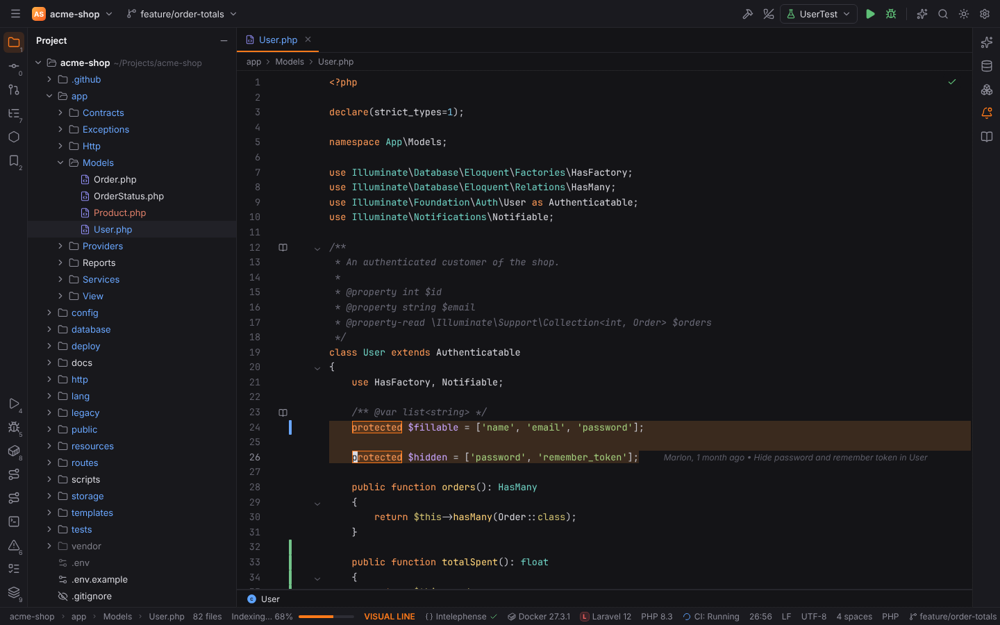
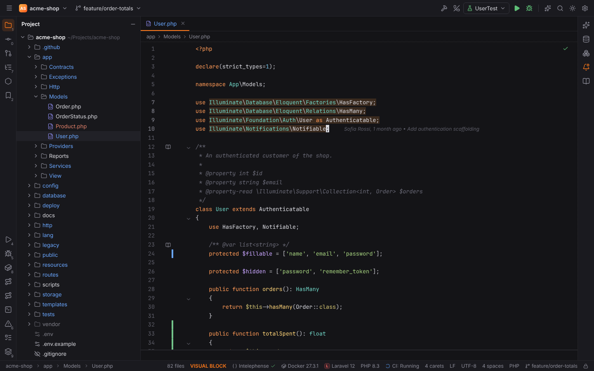
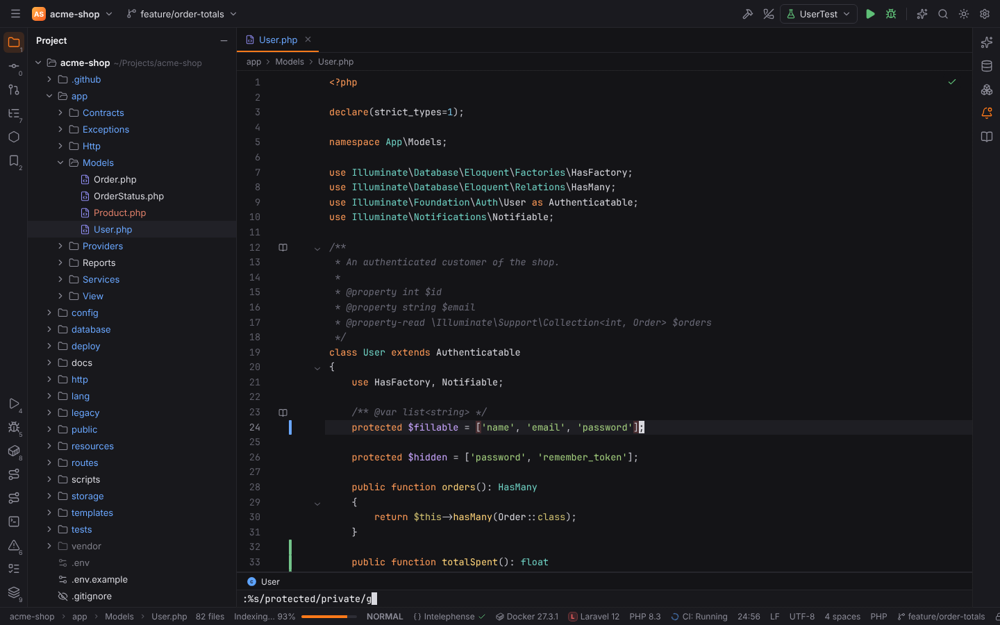
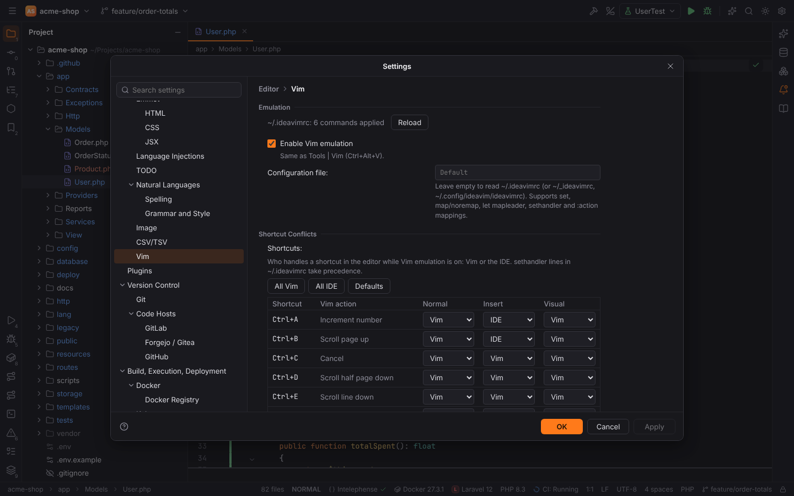

# Vim emulation

Forge emulates Vim in the editor the way PHPStorm's IdeaVim plugin does. The emulation is part
of the bundled **Vim** plugin (`forge.vim`) and is off until you turn it on with
**Tools | Vim** (`VimPluginToggle`, `Ctrl+Alt+V`, macOS `Cmd+Alt+V`), Find Action ("Vim") or
Settings | Editor | Vim. The choice is remembered in the setting `vim.enabled`.



While it is on, every editor tab starts in Normal mode and shows a block caret. The status bar
shows the mode (`NORMAL`, `INSERT`, `VISUAL`, `VISUAL LINE`, `VISUAL BLOCK`, `REPLACE`), the
keys of an unfinished command (`2d`, `"a`), `recording @q` while a macro is recorded, and
messages such as `E486: Pattern not found`. Click it to open Settings | Editor | Vim.

Tool windows, dialogs, the terminal and other text fields keep their normal keys; only the
editor goes through Vim. The engine is written in Rust (`crates/forge-vim`) and runs in-process
as WebAssembly, so every key is answered synchronously, in the desktop app and in browser mode.

> **Note:** `Ctrl+Alt+V` is also PHPStorm's Introduce Variable shortcut. In the editor the
> refactoring's binding wins (as in PHPStorm, where the conflict is shown in Settings |
> Keymap); use Tools | Vim, Find Action or the status bar there, or give `VimPluginToggle`
> another shortcut in Settings | Keymap.

## Modes

| Mode | Enter with | Leave with |
| --- | --- | --- |
| Normal | `Escape`, `Ctrl+[`, `Ctrl+C` | |
| Insert | `i` `a` `I` `A` `o` `O` `gi` `gI`, `c`/`s`/`C`/`S` commands | `Escape`, `Ctrl+[`, `Ctrl+C` |
| Replace | `R`, `Insert` in Insert mode | `Escape` |
| Visual (character, line, block) | `v`, `V`, `Ctrl+V`; selecting with the mouse | `Escape`, the same key again |
| Command line | `:`, `/`, `?` | `Enter` runs it, `Escape` cancels |

In Insert mode the editor types as usual: completion, auto-closing brackets, live templates
and Emmet keep working, and `Escape` also closes the completion popup. Vim handles `Ctrl+W`
(delete word), `Ctrl+U` (delete to line start), `Ctrl+H`, `Ctrl+R {register}`, `Ctrl+O`
(one Normal mode command), `Ctrl+T`/`Ctrl+D` (indent), `Ctrl+E`/`Ctrl+Y` (character below or
above) and `Ctrl+J`, as far as the shortcut handlers give these keys to Vim.

## Motions

Every motion takes a count (`3w`, `5j`, `2f,`).

| Keys | Motion |
| --- | --- |
| `h` `j` `k` `l`, arrow keys, `Space`, `Backspace` | left, down, up, right |
| `w` `b` `e` `ge`, `W` `B` `E` `gE` | words (letters, digits, `_`) and WORDs (non-blank runs) |
| `0` `^` `$` `g_` `\|` | line start, first non-blank, line end, last non-blank, column |
| `gg` `G`, `{count}G`, `{count}%` | first, last or numbered line, percentage of the file |
| `f` `t` `F` `T` + character, `;` `,` | find a character on the line and repeat |
| `%` | matching `(` `)` `[` `]` `{` `}` |
| `{` `}` | paragraphs |
| `H` `M` `L` | top, middle and bottom of the visible lines (with `scrolloff`) |
| `+` `-` `Enter` `_` | next, previous, current line (first non-blank) |
| `/pattern` `?pattern` `n` `N` `*` `#` `g*` `g#` | search |
| `` `a `` `'a`, ``` `` ``` `''` | marks |

## Operators and text objects

An operator is followed by a motion or a text object (`dw`, `c$`, `yi(`, `>ip`), or doubled
for whole lines (`dd`, `cc`, `yy`, `>>`, `<<`, `==`, `g~~`, `guu`, `gUU`).

| Operator | Meaning |
| --- | --- |
| `d` | delete |
| `c` | change (delete and enter Insert mode) |
| `y` | yank (copy into a register) |
| `>` `<` | shift lines right and left by `shiftwidth` (default: the editor's indent) |
| `=` | re-indent lines (Forge's Auto-Indent Lines, or Reformat Code) |
| `g~` `gu` `gU` `g?` | toggle case, lower case, upper case, ROT13 |

| Text object | Selects |
| --- | --- |
| `iw` `aw`, `iW` `aW` | word, WORD (`a…` with the following blanks) |
| `i"` `a"`, `i'` `a'`, `` i` `` `` a` `` | quoted string on the line |
| `i(` `a(` (`ib`), `i[` `a[`, `i{` `a{` (`iB`), `i<` `a<` | brackets; a count selects outer pairs (`2di(`) |
| `it` `at` | the content of an HTML/XML tag, or the whole element |
| `ip` `ap` | paragraph |

Other commands: `x` `X` `s` `S` `C` `D` `Y`, `p` `P` `gp` `gP`, `J` `gJ`, `r{char}`, `~`,
`Ctrl+A`/`Ctrl+X` (increment and decrement numbers, also hexadecimal), `.` (repeat the last
change, with a new count `3.`), `u` and `Ctrl+R` (undo and redo through the editor's
history), `zz` `zt` `zb` `z.` `z-` `z<CR>`, `Ctrl+D` `Ctrl+U` `Ctrl+F` `Ctrl+B` `Ctrl+E`
`Ctrl+Y` (scrolling), `zo` `zc` `za` `zR` `zM` (folding), `gd` and `Ctrl+]` (Go to
Declaration), `gt`/`gT` (next and previous tab), `Ctrl+O`/`Ctrl+I` (Back and Forward), `K`
(Quick Documentation), `ZZ` and `ZQ`.

`Ctrl+W` followed by `w`/`h`/`j`/`k`/`l`/`p`, `v`, `s`, `c`/`q` or `o` moves between split
editors, splits vertically or horizontally, unsplits, or closes the other splits.

## Visual mode

`v` selects characters, `V` whole lines and `Ctrl+V` a block (one caret per line, `$` extends
every line to its end). Motions and text objects (`viw`, `vi{`) extend the selection; `o`
jumps to the other end and `gv` selects the previous selection again.



Commands on the selection: `d` `x` `c` `s` `y`, `D` `X` `C` `S` `R` `Y` (whole lines), `>` `<`
(with a count), `=`, `~` `u` `U`, `J` `gJ`, `r{char}`, `p` `P` (replace the selection),
`Ctrl+A`/`Ctrl+X`, `:` (an ex command on the selected lines), and in block mode `I` and `A`,
which insert the typed text on every line when you press `Escape`.

## Registers, macros and marks

- `"{register}` before a command chooses the register: `"ayy`, `"ap`. `a`–`z` are named
  registers (`A`–`Z` append), `0` holds the last yank, `1`–`9` the last deleted lines, `-`
  the last small deletion, `_` discards, `.` is the last inserted text, `:` the last command
  line and `/` the last search.
- `"+` and `"*` are the system clipboard. Yanks into them are copied to the clipboard and to
  Paste from History; pasting from them uses the last text copied in Forge or pasted into an
  editor. With `set clipboard=unnamed` (or `unnamedplus`) every yank and delete goes to the
  clipboard.
- `q{register}` records a macro, `q` stops, `@{register}` plays it (`3@a`), `@@` repeats the
  last macro and `@:` the last command line.
- `m{a-z}` sets a mark; `'a` jumps to its line, `` `a `` to its position. `''` returns to
  the position before the last jump. Marks move with the text when lines are added or removed.

## Search and the command line

`/` and `?` search forward and backward with Vim's regular expressions (`\<word\>`, `\(…\)`,
`\|`, `\{n,m}`, `\v`, `\V`, `\c`), `n` and `N` repeat, `*` and `#` search the word under the
caret. `ignorecase` and `smartcase` decide case sensitivity; with `hlsearch` all matches stay
highlighted until `:noh`, with `incsearch` the caret moves to the match while you type. The
command line opens at the bottom of the editor.



| Command | Does |
| --- | --- |
| `:w`, `:wa`, `:update` | save (Save All) |
| `:q`, `:q!`, `:close`; `:qa` | close the tab; close all tabs |
| `:wq`, `:x`, `ZZ` | save and close |
| `:e {file}` | open a file (relative to the project) |
| `:{line}`, `:$` | go to a line |
| `:s/pattern/replacement/flags`, `:%s/…/…/g`, `:'<,'>s/…`, `:&&`, `&` | substitute (flags `g`, `i`, `I`, `n`, `e`; `\1`, `&`, `\r`, `\u`, `\U` in the replacement) |
| `:g/pattern/command`, `:v/pattern/command` | run a command on matching (or other) lines, e.g. `:g/^$/d` |
| `:normal {keys}`, `:%normal A;` | run Normal mode keys on each line |
| `:d [x]`, `:y [x]`, `:j`, `:>`, `:<`, `:m {line}`, `:t {line}`, `:sort [i] [n] [u]` | line commands with ranges (`.`, `$`, `%`, `'a`, `+n`, `/pattern/`) |
| `:noh` | hide search highlights |
| `:set {option}` | change an option (see below) |
| `:action {ActionId}` | run any Forge action by its PHPStorm id, e.g. `:action GotoClass` |
| `:registers`, `:marks`, `:map` | list registers, marks and mappings |
| `:bn` `:bp`, `:sp` `:vs`, `:only` | next and previous tab, split, unsplit |
| `:source ~/.ideavimrc` | read the configuration file again |

### Options

`:set` (and `~/.ideavimrc`) understands `number` (`nu`), `relativenumber` (`rnu`),
`ignorecase` (`ic`), `smartcase` (`scs`), `hlsearch` (`hls`), `incsearch` (`is`),
`wrapscan` (`ws`), `scrolloff` (`so`), `shiftwidth` (`sw`), `tabstop` (`ts`), `expandtab`
(`et`), `clipboard` (`cb`), `timeout`, `timeoutlen` (`tm`), `showmode`, `showcmd`, `ideajoin`
(`J` uses the IDE's Join Lines) and `visualbell`. `no…`, `inv…`, `…!`, `…?`, `…=`, `…+=` and
`…-=` work as in Vim. Common IdeaVim extension options (`set surround`, `set commentary`, …)
are accepted and ignored.

## ~/.ideavimrc

When the emulation is turned on, Forge reads `~/.ideavimrc` (or `~/_ideavimrc`, or
`~/.config/ideavim/ideavimrc`; another file can be set in Settings | Editor | Vim |
Configuration file). `source ~/.vimrc` lines are replaced by that file's text. Use **Reload**
on the settings page, the action **Reload .ideavimrc** (`IdeaVim.ReloadVimRc`) or `:source`
after editing it.

```vim
" ~/.ideavimrc
let mapleader = " "
set number relativenumber
set ignorecase smartcase hlsearch incsearch scrolloff=5
set clipboard+=unnamedplus

inoremap jk <Esc>
nnoremap Y y$
vnoremap < <gv
vnoremap > >gv

" IDE actions
nmap <leader>r <Action>(RenameElement)
nmap <leader>f :action ReformatCode<CR>
nmap <leader>e :action SearchEverywhere<CR>
nmap gi <Action>(GotoImplementation)

sethandler <C-V> n-v:vim i:ide
if has('ide')
  nnoremap <leader>b :action ToggleLineBreakpoint<CR>
endif
```

Supported: `set`, `let mapleader`, the mapping commands `map`, `nmap`, `vmap`/`xmap`, `omap`,
`imap`, `cmap`, `noremap`, `nnoremap`, `vnoremap`/`xnoremap`, `onoremap`, `inoremap`,
`cnoremap` with their `unmap` and `mapclear` forms (`<silent>` and the other `<…>` flags are
accepted), `sethandler`, `if has('ide')` / `else` / `endif` blocks and `"` comments. Mappings
use Vim's key notation (`<leader>`, `<CR>`, `<Esc>`, `<C-w>`, `<Space>`, `<lt>`, `<Bar>`,
`<Nop>`). A right-hand side can run IDE actions with `:action ActionId<CR>` or IdeaVim's
`<Action>(ActionId)`; the ids are PHPStorm's (see the [keymap reference](../reference/keymap.md)
or Find Action). Mappings wait `timeoutlen` milliseconds (default 1000) for the next key when
a longer mapping could still match (`jk` after `j`).

Lines Forge does not support are skipped and reported in a balloon with their line number
(for example `wincmd` or an unknown option); `syntax`, `filetype`, `colorscheme`, `autocmd`
and `Plug` lines are skipped silently.

## Shortcut conflicts

Many `Ctrl` shortcuts mean something in Vim and in the IDE: `Ctrl+R` is Redo in Vim and
Replace in PHPStorm, `Ctrl+W` window commands or Extend Selection, `Ctrl+V` Visual Block or
Paste. Settings | Editor | Vim | **Shortcut Conflicts** lists each of them with what Vim does,
and lets you choose **Vim** or **IDE** for Normal, Insert and Visual mode separately (the
setting `vim.shortcutHandlers`). By default Vim handles a shortcut in every mode where it has
a meaning, and the IDE keeps it elsewhere (for example `Ctrl+V` in Insert mode pastes).
**All Vim**, **All IDE** and **Defaults** change the whole table. `sethandler` lines in
`~/.ideavimrc` take precedence; such rows are marked `.ideavimrc` and cannot be changed in the
table.



Shortcuts that are not in the table (`Ctrl+S`, `Ctrl+Shift+…`, `Alt+…`, function keys) always
reach the IDE, also in Normal mode.

## Limitations

- Undo granularity follows the editor's history: a Normal mode command is one undo step,
  typing in Insert mode is grouped by the editor.
- Pasting from `"+` uses the clipboard text Forge knows about (copied in Forge or pasted into
  an editor); text copied in another application is pasted with `Ctrl+V` (IDE handler) or
  after pasting it once.
- Not supported yet: `:s` with the `c` flag, IdeaVim extensions (surround, commentary,
  easymotion, …), `:wincmd`, functions and `autocmd` in `~/.ideavimrc`, Select mode, the
  jump and change lists (`Ctrl+O`/`Ctrl+I` use the IDE's Back and Forward).
