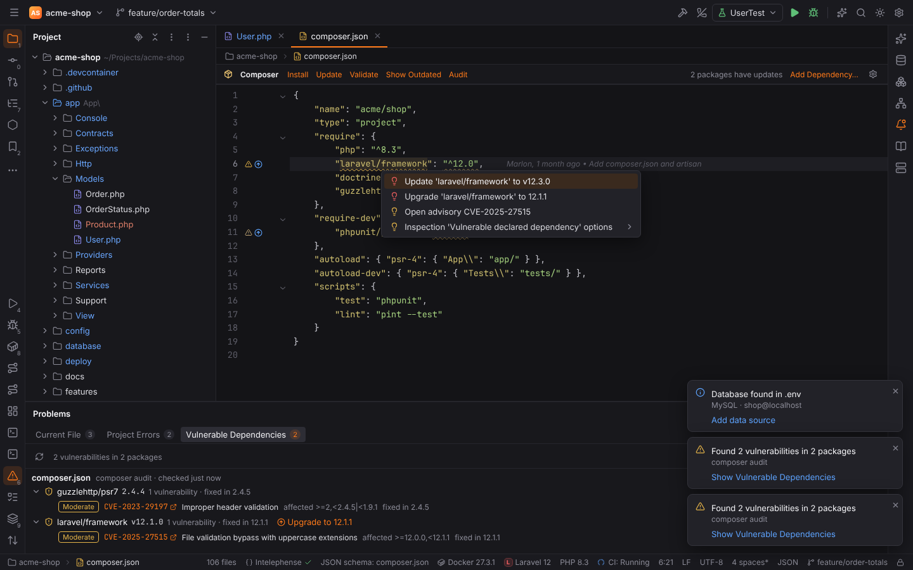
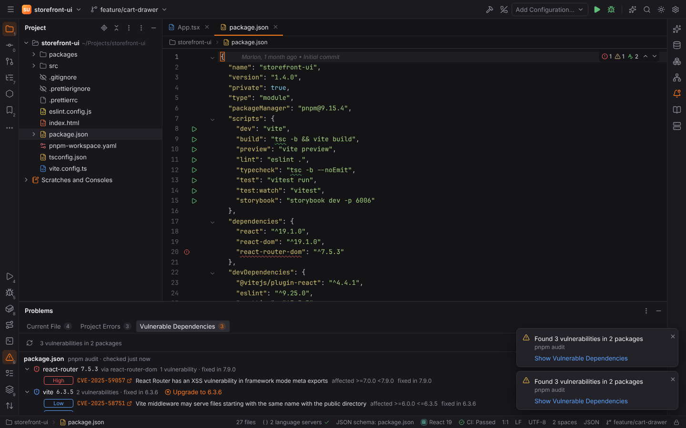
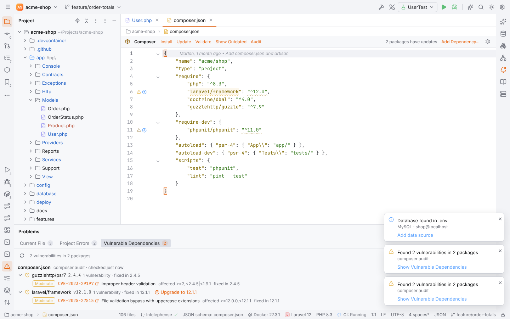

# Vulnerable dependencies

Forge checks the packages your project depends on for known vulnerabilities, like the Package
Checker of PHPStorm and IntelliJ IDEA. It does not keep its own advisory database: each
ecosystem's own audit tool does the lookup, on the project's machine, and Forge shows the
result in three places:

- as **Vulnerable Dependencies** problems on the declaration of the package in its manifest
  (composer.json, package.json, requirements files, pyproject.toml, Cargo.toml, go.mod, pom.xml,
  Gradle scripts), with the quick fix **Upgrade '<package>' to <version>** (`Alt+Enter`),
- in the **Vulnerable Dependencies** tab of the [Problems tool window](editor.md#problems)
  (`Alt+6`), grouped by package,
- in a balloon when something was found.

## Supported ecosystems

Forge looks at the project's root folder (and at the composer.json set in Settings | PHP |
Composer) and runs one audit per ecosystem it finds:

| Ecosystem | Found by | Tool Forge runs | Needs |
| --- | --- | --- | --- |
| Composer | composer.json | `composer audit --format=json --locked` (without `--locked` when there is no composer.lock) | Composer (Settings \| PHP \| Composer) |
| npm | package.json with package-lock.json (or no other lock file) | `npm audit --json` | npm and a lock file |
| pnpm | `packageManager: pnpm@…` or pnpm-lock.yaml | `pnpm audit --json` | pnpm and a lock file |
| Yarn 1 | yarn.lock (classic format) | `yarn audit --json` | Yarn and yarn.lock |
| Yarn 2+ | `packageManager: yarn@2…`, `.yarnrc.yml` or a Berry yarn.lock | `yarn npm audit --json --recursive` | Yarn and yarn.lock |
| Python | requirements\*.txt, pyproject.toml, setup.py or Pipfile | `python -m pip_audit -f json` in the project interpreter | pip-audit in that interpreter (Forge offers to install it) |
| Rust | Cargo.toml with Cargo.lock | `cargo audit --json` | `cargo install cargo-audit --locked` |
| Go | go.mod | `govulncheck -json ./...` | `go install golang.org/x/vuln/cmd/govulncheck@latest` |
| Maven / Gradle | pom.xml or build.gradle(.kts), and a report path in the settings | nothing: Forge reads the JSON report of OWASP dependency-check | dependency-check run by your build with the JSON format |

The package manager is chosen like the npm tool window does: the `packageManager` field of
package.json first, then the lock file. Bun projects are not audited (Bun writes no npm audit
report). A project without a lock file shows "There is no lock file yet: run `npm install`
first." in the tab.

pip-audit checks the packages installed in the [project interpreter](python.md), not the
requirement files themselves, so install the requirements first. When the interpreter has no
pip-audit, the tab offers **Install pip-audit…**; Forge asks before it installs it from PyPI
with the interpreter's package manager (pip, uv, Poetry or Pipenv), in the Run tool window.

Maven and Gradle are optional: Forge never runs dependency-check itself (it downloads the
whole NVD database). Run it in your build, for example
`mvn org.owasp:dependency-check-maven:check -Dformat=JSON` or the Gradle plugin with
`formats = ["JSON"]`, and set **OWASP dependency-check report** in Settings | Tools | Package
Checker to the report, e.g. `target/dependency-check-report.json` or
`build/reports/dependency-check-report.json`.

## When the check runs

- **When a project is opened**, a few seconds after the window appears. Results are cached in
  Forge's cache folder per manifest and lock file, so an unchanged project is not audited
  again until the cache is older than **Re-check unchanged projects after** (24 hours).
- **When a manifest or lock file changes** on disk (after `composer update`, `npm install`, a
  git checkout, …). Only the audits whose files changed run again; the others answer from the
  cache.
- **Code | Analyze Code | Check for Vulnerable Dependencies** (also in Find Action,
  `Ctrl+Shift+A`, and the refresh button of the tab) always runs every tool.
- **Tools | Composer | Audit** and the **Audit** link in the composer.json toolbar run
  `composer audit` only.

The audit tools run the project's tooling (Composer and Yarn load the project's plugins,
pip-audit runs the project's Python environment) and send the names and versions of the
installed packages to their advisory databases (Packagist, the npm registry, OSV / PyPI,
RustSec, vuln.go.dev). So:

- in [Safe Mode](project-trust.md) nothing runs: trust the project to check it,
- **Check dependencies for known vulnerabilities** in Settings | Tools | Package Checker
  turns the check off completely; Forge then never runs an audit.

## Problems in the manifest

Each vulnerable package gets one problem on its name in the manifest, rated by its worst
advisory:

| Advisory severity | Problem |
| --- | --- |
| Critical, High | error |
| Moderate, or no rating (PyPI, Go) | warning |
| Low | weak warning |

The message lists every advisory with its id (a CVE when there is one, else `GHSA-…`,
`PYSEC-…`, `RUSTSEC-…`, `GO-…`) and the version that fixes all of them: "laravel/framework
v12.1.0 is vulnerable: File validation bypass with uppercase extensions (CVE-2025-27515,
Moderate). Fixed in 12.1.1".

A vulnerable package that the manifest does not declare itself (a transitive dependency) is
reported on the direct dependency that pulls it in, when the tool says which one (npm, pnpm,
Yarn): "react-router 7.5.3 (a dependency of react-router-dom) is vulnerable: …". composer.lock
gets a problem on every affected package, so transitive Composer packages show up there.
Abandoned Composer packages and unmaintained or yanked crates are reported as warnings / weak
warnings.

The problems belong to the inspection **Security | Vulnerable declared dependency**
(`VulnerableDependencies`) in Settings | Editor | [Inspections](inspections.md): turn it off
or change its severity there, or suppress it per file.

### Upgrade quick fix

Press `Alt+Enter` on the package and choose **Upgrade '<package>' to <version>**. Forge
rewrites the constraint to require the fixed version, keeping its style:

| File | Before | After |
| --- | --- | --- |
| composer.json | `"laravel/framework": "^12.0"` | `"laravel/framework": "^12.1.1"` |
| package.json | `"vite": "^6.3.5"` / `"lodash": "4.17.20"` | `"vite": "^6.3.6"` / `"lodash": "4.17.21"` |
| requirements.txt | `Django==3.2.0` / `urllib3>=1.26` | `Django==3.2.4` / `urllib3>=1.26.17` |
| pyproject.toml (Poetry) | `aiohttp = "^3.8.0"` | `aiohttp = "^3.9.4"` |
| Cargo.toml | `mio = { version = "0.8.10" }` | `mio = { version = "0.8.11" }` |
| go.mod | `golang.org/x/net v0.17.0` | `golang.org/x/net v0.23.0` |
| pom.xml / Gradle | `<version>2.14.1</version>` / `"g:a:2.14.1"` | the fixed version |

The fix edits the file in the editor (undo with `Ctrl+Z`), or on disk when it is not open. A
balloon then offers to install the new version: `composer update <package>
--with-dependencies`, `npm install` / `pnpm install` / `yarn install`, `pip install
"<package>>=<version>"` with the interpreter's package manager, `cargo update -p <package>` or
`go mod tidy`. It runs in the Run tool window, and the check runs again afterwards. The fix is
not offered when an advisory has no fixed version yet, for transitive packages, for workspace,
file or git dependencies and for the Go standard library (update Go itself).

`Alt+Enter` also offers **Open advisory <id>**, which opens the advisory in the browser.

## Vulnerable Dependencies tab

The tab of the Problems tool window lists each audited manifest with its tool and when it was
checked ("checked 2 min ago (cached)"), and under it the vulnerable packages, worst first:

- the package with its installed version, the direct dependencies it comes through ("via
  react-router-dom"), the number of advisories and the version that fixes them,
- **Upgrade to <version>** when the manifest declares the package (the same fix as
  `Alt+Enter`),
- one row per advisory (expand with the arrow): severity, the id linking to the advisory,
  title, affected versions, fixed version and, for govulncheck, "called by the project" when
  your code reaches the vulnerable function.

Click a package to go to its declaration. Tools that could not run say why (not installed, no
lock file, the tool's error), and abandoned or unmaintained packages are listed after the
vulnerable ones. The refresh button runs Check for Vulnerable Dependencies; the tab's badge
counts the advisories.

## Settings

Settings | Tools | Package Checker:

| Option | Setting | Default | What it does |
| --- | --- | --- | --- |
| Check dependencies for known vulnerabilities | `vulnerabilities.enabled` | on | Off: no audit ever runs and no vulnerabilities are shown. |
| Check when a project is opened and when a lock file changes | `vulnerabilities.checkOnOpen` | on | Off: only Check for Vulnerable Dependencies and Composer \| Audit run the tools. |
| Re-check unchanged projects after (hours) | `vulnerabilities.cacheHours` | 24 | How long the cached result of an unchanged manifest and lock file is reused. |
| OWASP dependency-check report (Maven / Gradle) | `vulnerabilities.dependencyCheckReport` | empty | The JSON report your build writes (project setting). Empty: Maven and Gradle are not checked. |

The cache lives in `<cache dir>/forge/vulnerabilities/<project>/` (see
[File locations](../reference/file-locations.md)); deleting it only makes the next check run
the tools again.

## Remote projects

The tools run where the project lives: on the SSH host, in WSL or in the dev container, with
the executables found there. Install cargo-audit, govulncheck or pip-audit on that machine.

> **Note:** Forge audits the project root (plus the configured composer.json). Manifests in
> sub-folders of a monorepo are not checked separately yet; npm, pnpm and Yarn workspaces are
> covered by the root lock file.
