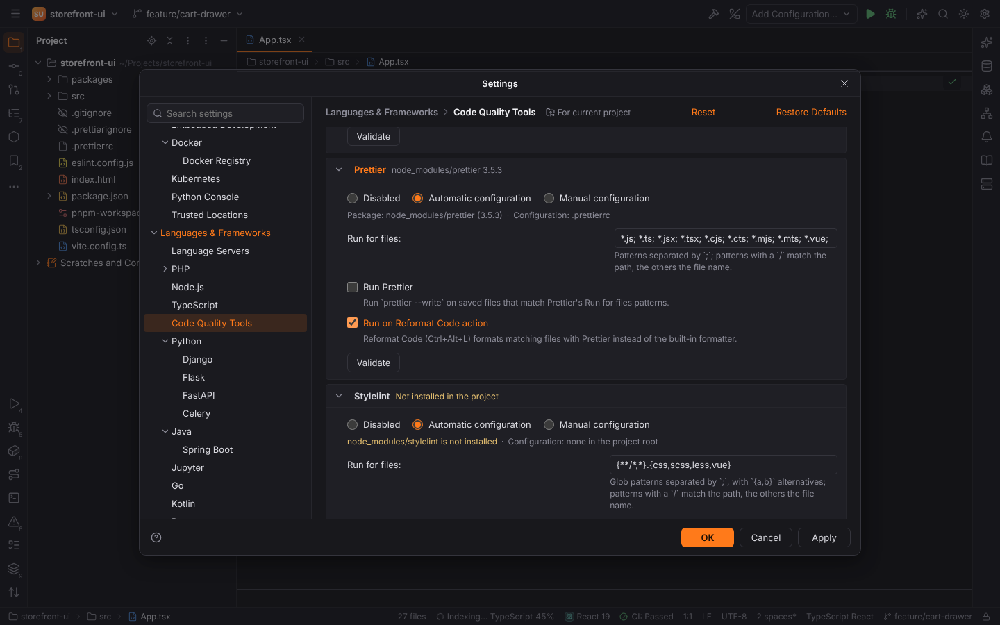
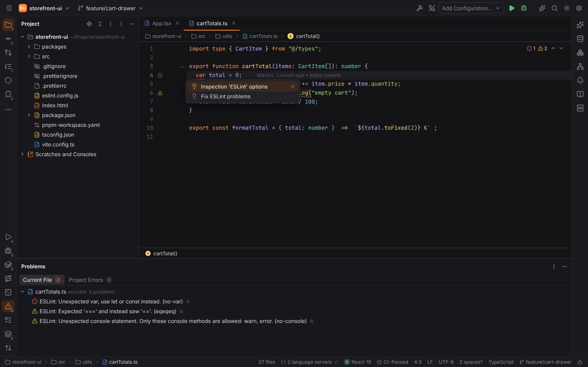
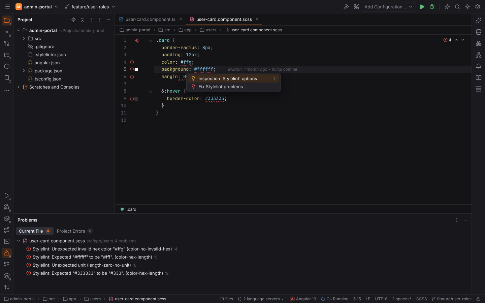
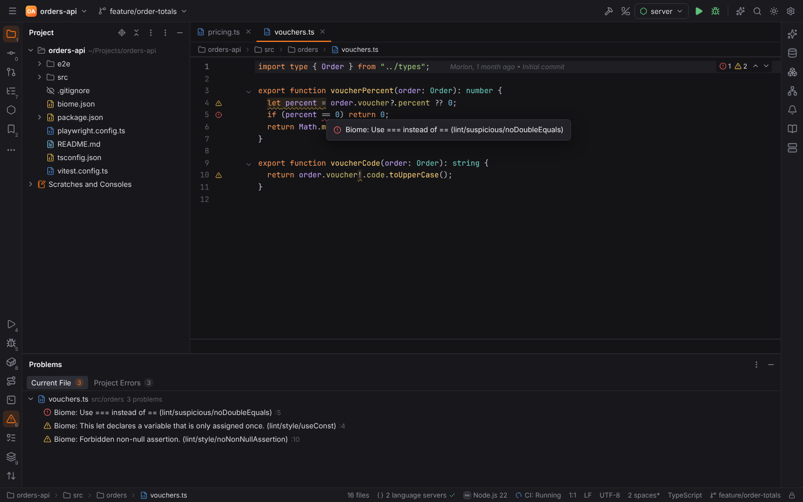
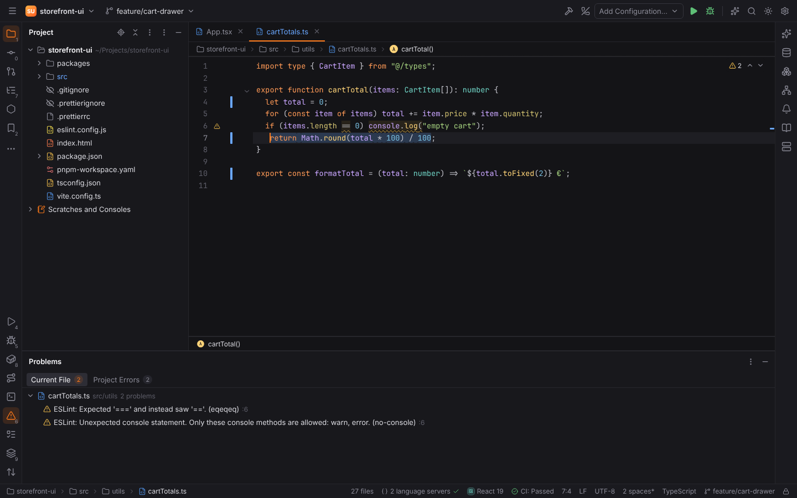

# Web Code Quality Tools

Forge runs the JavaScript, TypeScript and CSS quality tools of your project the way PHPStorm
does. Their problems appear in the editor while you type and in the Problems tool window,
`Alt+Enter` fixes them, and they can fix and format files on save and on Reformat Code.

| Tool | Checks | Fixes | Formats |
| --- | --- | --- | --- |
| **ESLint** | `eslint --format json --stdin --stdin-filename <file>` | `eslint --fix-dry-run` (editor), `eslint --fix` (on save) | |
| **Prettier** | | | `prettier --stdin-filepath <file>` (editor), `prettier --write` (on save) |
| **Stylelint** | `stylelint --formatter json --stdin-filename <file>` | `stylelint --fix --stdin-filename` (editor), `stylelint --fix` (on save) | |
| **Biome** | `biome lint --reporter=json --stdin-file-path=<file>` | `biome lint --write` (editor), `biome check --write` (on save) | `biome format --stdin-file-path=<file>` |

The tools are your project's own packages (`npm install -D eslint prettier stylelint
@biomejs/biome`): Forge never bundles or downloads them. Each runs with the Node.js
interpreter of Settings | Languages & Frameworks | [Node.js](webforge.md) (`web.node.interpreter`;
empty: `node` on the PATH, else the Node.js Forge downloaded): `node node_modules/eslint/bin/eslint.js …`,
using the script named in the package's `bin` field.

ESLint runs through its command line, like Stylelint and Biome, so one path serves all three
and their JSON reports are parsed by Forge. The ESLint language server
(`vscode-eslint-language-server`) in [Language Servers](language-servers.md) is separate and
optional; if you use both, turn one off to avoid seeing every problem twice.

## Settings

Settings | Languages & Frameworks | **Code Quality Tools** (`Ctrl+Alt+S`) lists the four tools.
The header of each shows the package found in the project (`node_modules/eslint 9.25.1`) or
"Not installed in the project". Expand a tool to configure it:

| Option | Meaning |
| --- | --- |
| **Disabled** | The tool never runs. |
| **Automatic configuration** (default) | For each file, the package from the nearest `node_modules` (walking up from the file to the project root, so monorepos with packages in sub-folders work) and the nearest configuration file. A tool runs only for files below a configuration file: `eslint.config.*` or `.eslintrc*` (or `eslintConfig` in package.json), `.prettierrc*` or `prettier.config.*` (or `prettier` in package.json), `stylelint.config.*` or `.stylelintrc*` (or `stylelint` in package.json), `biome.json` or `biome.jsonc`. The page shows what was found for the project root. |
| **Manual configuration** | The **package** (a package folder such as `node_modules/eslint`, or an executable such as `node_modules/.bin/eslint`), the **configuration file** (passed as `--config`, or `--config-path` for Biome), **extra options** (quoted like in a shell) and, for ESLint, the **working directories** (`;`-separated; ESLint runs in the deepest one that holds the file). The tool runs for every matching file. |
| **Run for files** | Glob patterns separated by `;`, with `{a,b}` alternatives (PHPStorm's syntax). Defaults: ESLint `{**/*,*}.{js,ts,jsx,tsx,cjs,mjs,vue,html}`, Stylelint `{**/*,*}.{css,scss,less,vue}`, Biome `{**/*,*}.{js,ts,jsx,tsx,cjs,cts,mjs,mts,json,jsonc,css}`, Prettier `*.js; *.ts; *.jsx; *.tsx; *.cjs; *.cts; *.mjs; *.mts; *.vue; *.astro`. |
| **Run … on save** | `eslint --fix`, `prettier --write`, `stylelint --fix` or `biome check --write` when the file is saved with `Ctrl+S`. The same checkboxes are on Settings \| Tools \| [Actions on Save](actions-on-save.md). |
| **Run on Reformat Code action** | Prettier, Biome: Reformat Code (`Ctrl+Alt+L`) formats matching files with the tool instead of the built-in formatter. |
| **Prefer Biome over ESLint and Prettier** | On by default: where Biome applies to a file, ESLint and Prettier do not run for it (problems, fixes, on save and Reformat Code). ESLint still handles the files Biome does not, such as `.html` or `.vue`. |

Each tool runs in the folder of its configuration file (ESLint's flat config lookup and
Prettier's `.prettierignore` start there). For ESLint, `ESLINT_USE_FLAT_CONFIG` is set to match
the configuration found, so ESLint 8 reads `eslint.config.*` and ESLint 9 reads `.eslintrc*`.

**Validate** runs the tool's `--version` with the options shown (before you apply them).
**Run inspections on the fly** (`web.tools.onTheFly`, on by default) checks the file you edit
after a short pause in typing; **Timeout** (`web.tools.timeout`, 30 seconds) stops runs that
take longer.

## Problems in the editor

When a file opens, after a pause in typing and after it is saved, ESLint, Stylelint and Biome
check the editor text (sent on stdin, so unsaved changes are checked without writing the
file). Their problems are underlined with the tool's severity, listed in the Problems tool
window (`Alt+6`) and named with the tool and rule (`ESLint: … (no-var)`); the rule links to its
documentation.

Stylelint checks CSS, SCSS and Less, and the `<style>` blocks of Vue files when the project's
Stylelint configuration sets a custom syntax for them (`postcss-html`, as
`stylelint-config-standard-vue` does):

Biome's problems carry its rule category (`lint/suspicious/noDoubleEquals`):

In Settings | Editor | Inspections the problems belong to the **ESLint**, **Stylelint** and
**Biome** inspections (JavaScript and TypeScript / CSS › Code quality tools): they keep the
tool's level until the profile sets a severity, and `Alt+Enter` › *Inspection '…' options*
suppresses or configures them.

A tool that is configured for a file but not installed, fails or times out is reported once
per session in a balloon with a **Configure…** link (notification group "Code Quality Tools").

## Fixing and formatting

- **Alt+Enter** on a fixable problem offers **Fix ESLint problems**, **Fix Stylelint problems**
  or **Fix Biome problems**: the tool fixes the whole editor text, applied as one edit
  (`Ctrl+Z` undoes it).
- **Code | Fix ESLint Problems**, **Fix Stylelint Problems** and **Fix Biome Problems** do the
  same for the current file.
- **Code | Reformat with Prettier** (`Ctrl+Alt+Shift+P`) formats the current file with Prettier.
- **Reformat Code** (`Ctrl+Alt+L`) uses Prettier or Biome when "Run on Reformat Code action" is
  on for the file (Biome first); otherwise the usual formatter runs.
- **On save**: with "Run … on save", the tools fix the saved file in this order: Biome,
  ESLint, Stylelint, Prettier. A failing tool leaves the file as it was.

## Inspect Code

**Code | Inspect Code with ESLint, Stylelint and Biome** checks the whole project
(`eslint .`, `stylelint "**/*.{css,scss,less,vue}"`, `biome lint .`) and lists every problem in
the Problems tool window; Inspect Code frameworks can call the same provider
(`inspectWithWebTools(paths)`) for a scope of files or folders.

## Safe Mode and remote projects

The tools run the project's own code (configuration files, plugins), so Forge never runs
them in [Safe Mode](project-trust.md): no problems, fixes or on-save runs until you trust the
project; Reformat Code falls back to the usual formatter.

In [remote projects](remote-development.md) the tools run on the remote host, where the
project and its `node_modules` are, with the configured Node.js interpreter or `node` on the
host's PATH.

## Settings keys

| Key | Default | Meaning |
| --- | --- | --- |
| `web.tools.onTheFly` | `true` | Check while typing |
| `web.tools.timeout` | `30` | Seconds per run |
| `web.<tool>.mode` | `automatic` | `disabled`, `automatic` or `manual` (`eslint`, `prettier`, `stylelint`, `biome`) |
| `web.<tool>.path` | `""` | Manual package folder or executable |
| `web.<tool>.config` | `""` | Manual configuration file |
| `web.<tool>.options` | `""` | Manual extra options |
| `web.eslint.workingDirectories` | `""` | Manual working directories |
| `web.eslint.files`, `web.stylelint.files`, `web.biome.files`, `actionsOnSave.prettier.files` | see above | Run for files |
| `actionsOnSave.eslint`, `actionsOnSave.prettier.enabled`, `actionsOnSave.stylelint`, `actionsOnSave.biome` | `false` | Run on save |
| `web.prettier.onReformat`, `web.biome.onReformat` | `false` | Run on Reformat Code action |
| `web.biome.priority` | `true` | Prefer Biome over ESLint and Prettier |

See the [settings reference](../reference/settings.md#languages--frameworks--code-quality-tools)
for all keys.
