# Web tooling

Tooling around the web languages of [WebForge](webforge.md), modelled on PHPStorm and
WebStorm. Everything works at a solid basic level; the notes at the end of each section say
what is not there yet. In browser mode the demo `?project=webtools` (an Nx workspace with a
Nuxt storefront, an OpenAPI document, GraphQL, Prisma, Sass and `.http` requests) shows all of
it.

## File Watchers

Settings | Tools | File Watchers runs a program whenever a file of some type changes, such as
`sass`, `lessc`, `tsc`, `babel` or `prettier`. Watchers belong to the project (setting
`tools.fileWatchers`).

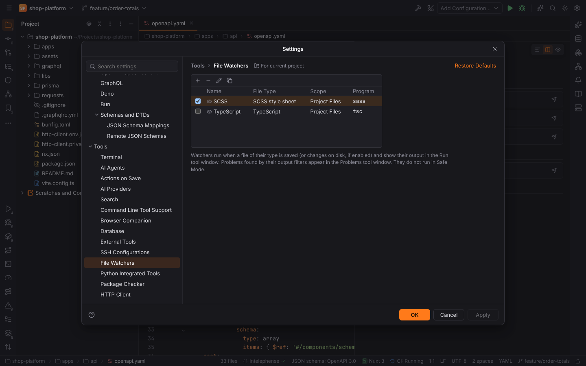

- **+** adds a watcher from a template: **SCSS**, **Sass**, **Less**, **TypeScript** (`tsc`),
  **Babel**, **Prettier** or **Custom**. The check box turns a watcher off.
- **Files to Watch**: the file type and the scope (Project Files or any scope from
  Settings | Appearance & Behavior | Scopes).
- **Tool to Run on Changes**: program, arguments, output paths to refresh and working
  directory, all with macros such as `$FileName$`, `$FileNameWithoutExtension$`,
  `$FileDir$`, `$FilePathRelativeToProjectRoot$` and `$ProjectFileDir$`, plus environment
  variables. A bare program name (`sass`) runs the project's `node_modules/.bin/sass` when
  there is one.
- **Advanced Options**:
  - **Auto-save edited files to trigger the watcher**: the file is saved after a short pause
    in typing, so the watcher runs while you type.
  - **Trigger the watcher on external changes**: also run for files changed outside Forge
    (git checkout, another editor).
  - **Track only root files**: a changed partial (`_variables.scss`) or imported module runs
    the files that import it (`app.scss`, `print.scss`) instead of itself. `@use`, `@import`
    and `@forward` (Sass, Less) and relative ES imports are followed.
  - **Show console**: Always, On error (default) or Never.
- **Output filters** (`$FILE_PATH$:$LINE$:$COLUMN$`, one regular expression per line, as for
  External Tools) turn the program's error messages into links in the console and into
  problems in the **File Watchers** tab of the Problems tool window.

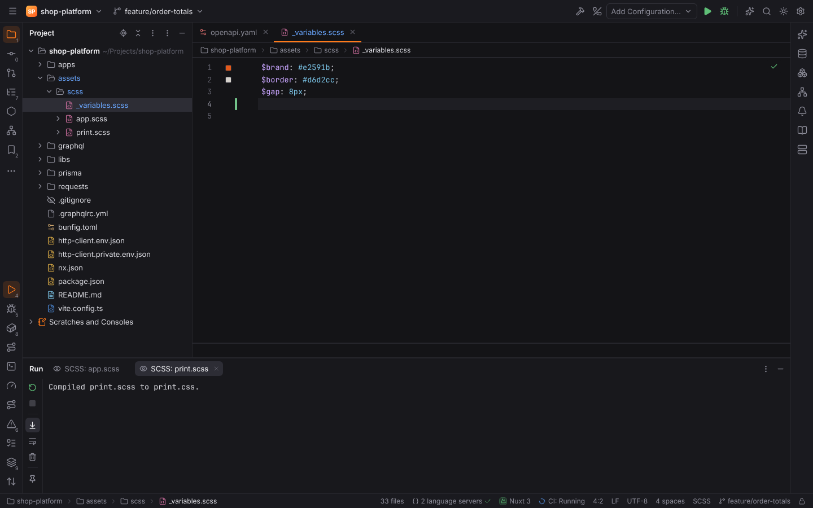

Watchers run in the Run tool window like any program, and never in
[Safe Mode](project-trust.md): an untrusted project shows "File Watchers did not run" instead.
Files a watcher writes (its output paths) never start it again.

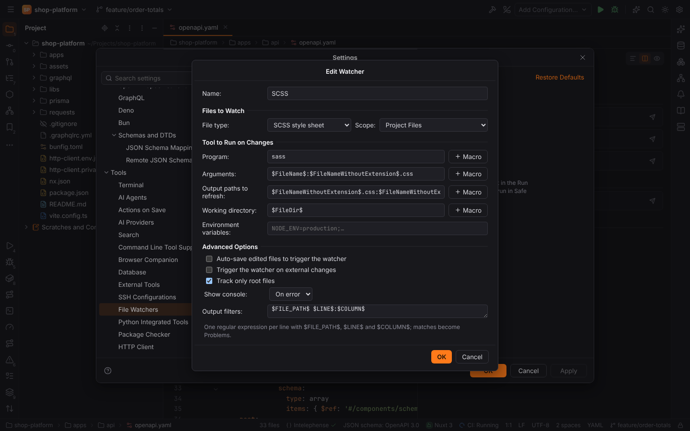

> **Note:** watchers run one file at a time; PHPStorm's "Create output file from stdout" and
> per-watcher "Level" (global watchers) are not available yet.

## Live Edit

With the [Browser Companion](browser-companion.md) extension paired, Forge updates the pages
open in the browser:

- **Style sheets** are swapped in place without a reload (CSS hot swap): while typing (after
  `liveEdit.delayMs`, setting `liveEdit.updateWhileTyping`) with the editor's text, and on save
  by reloading the `<link>`. CSS that a File Watcher writes (Sass, Less) is pushed when it
  changes on disk.
- **HTML, scripts, templates and images**: pages that loaded the saved file reload
  (`liveEdit.reloadOnSave`).

The extension matches changed files to what the page loaded by their path below the web root
(`public/css/app.css` is `/css/app.css`), so other tabs are left alone. Turn it off with
`liveEdit.enabled` (Settings | Tools | Browser Companion, section Live Edit).

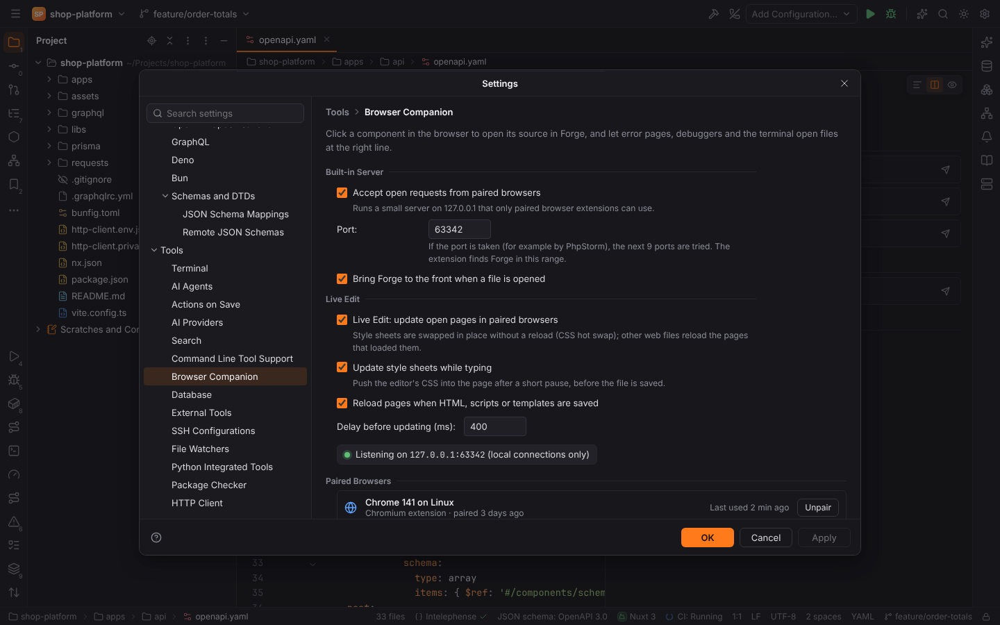

> **Note:** JavaScript is not hot-swapped (pages reload); use your dev server's HMR for that.
> Style sheets a bundler injects from JavaScript reload the page instead of being swapped.

## Vite and Webpack aliases

`resolve.alias` of `vite.config.*` and `webpack.config.*` (in the root or one folder below) is
read statically, together with `tsconfig.json` / `jsconfig.json` `paths`. Supported forms:
object and array aliases, `path.resolve(__dirname, …)`, `path.join`,
`fileURLToPath(new URL('./src', import.meta.url))`, `` `${__dirname}/src` ``, root-relative
strings (`'/src'`) and Webpack's exact `name$`. Aliases to packages and computed values are
skipped.

- **Go to Declaration** (`Ctrl+B`, `Ctrl+Click`) on an import string such as
  `'@ui/format'` opens the file, also where the TypeScript language server does not know the
  alias.
- **Completion** in import strings offers folders and modules through the aliases
  (`'@/compo…'`), and the alias names themselves.

## Svelte, Astro, Nuxt, Nx, Prisma, Deno and Bun

| Framework | Detected by | What Forge does |
| --- | --- | --- |
| Svelte | `svelte` dependency, `svelte.config.*` | `.svelte` highlighting (HTML with script and style), the Svelte language server (npm, installed by Forge with your consent) |
| Astro | `astro` dependency, `astro.config.*` | `.astro` highlighting, `@astrojs/language-server` |
| Nuxt | `nuxt` dependency, `nuxt.config.*` | the **Nuxt** view of the Endpoints tool window (pages as routes, `[id]` → `:id`, catch-all and optional parameters, route groups; auto-imported components), Go to Declaration on component tags (`<BaseButton>`, `<base-button>`, `<LazyBaseButton>`) |
| Nx | `nx.json` | the **Nx** tool window (projects, targets with their executors, dependencies, a project graph), double-click runs `nx run project:target` as an `Nx` run configuration, targets in Run Anything |
| Prisma | `prisma` / `@prisma/client` dependency, `schema.prisma` | `.prisma` highlighting, the Prisma language server, Tools \| Prisma \| Generate Client / Migrate Dev…, Prisma commands in Run Anything |
| Deno | `deno.json` / `deno.jsonc` | `deno lsp` replaces the TypeScript language server, `Deno` run configurations (`deno run`, `deno task`, `deno test`), tasks in Run Anything |
| Bun | `bun.lock` / `bun.lockb` / `bunfig.toml` | `Bun` run configurations (`bun run`, `bun test`), scripts in Run Anything, and Bun as the Node interpreter: enter `bun` in Settings \| Languages & Frameworks \| Node.js |

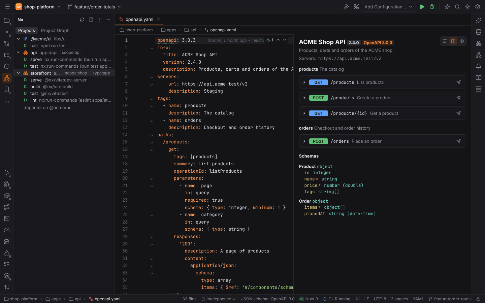

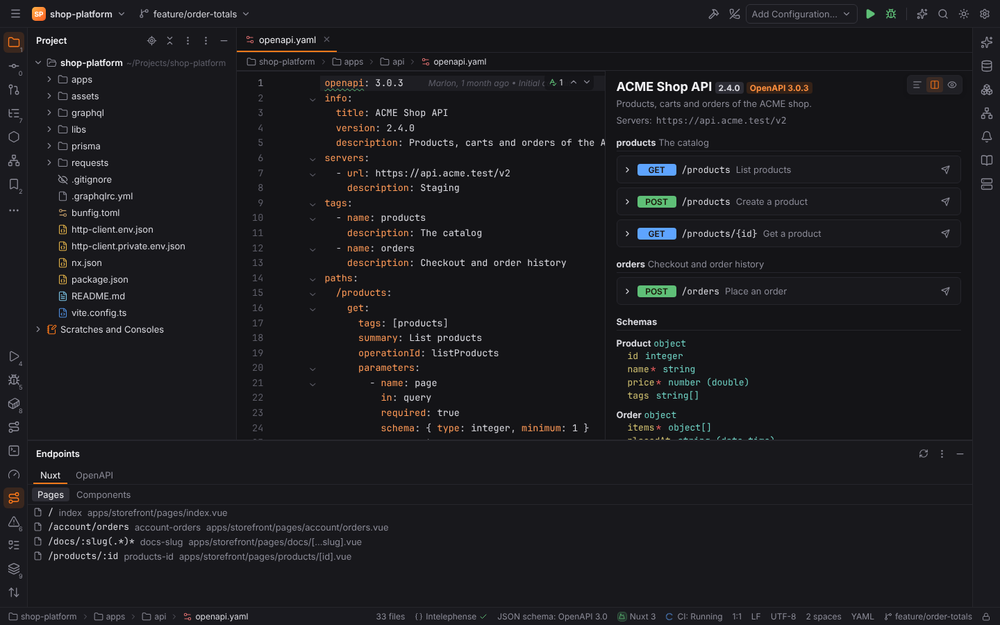

> **Note:** the Nx project graph lists dependencies as layers instead of drawing edges, and
> dependencies Nx infers from imports are not shown (only `implicitDependencies` and
> package.json dependencies between workspace packages).

## OpenAPI

YAML and JSON files with a top-level `openapi: 3.x` (or `swagger: "2.0"`) key are OpenAPI
documents, whatever their name.

- **Validation** uses the bundled official OpenAPI 3.0 and 3.1 JSON schemas (Apache-2.0, from
  the OpenAPI Initiative) through the [JSON Schema](json-schema.md) support; the status bar
  shows "JSON schema: OpenAPI 3.0".
- **Preview**: OpenAPI files open with a Swagger-UI-like preview next to the text, rendered by
  Forge itself (no remote JavaScript): title, version, servers, operations by tag with
  parameters, request body and responses with examples generated from the schemas, and the
  schemas. The layout buttons switch between editor, preview and both.
- **Endpoints**: the **OpenAPI** view of the Endpoints tool window lists every operation of
  the project's documents with speed search; a click opens it in the file.
- **Generate HTTP Request** (the send button of an operation, the endpoint's context menu, or
  the Generate HTTP Request action at the caret) opens a new HTTP scratch with the request: path
  parameters and required query parameters as `{{variables}}`, the server URL as
  `@baseUrl`, an `Accept` header and the example body.

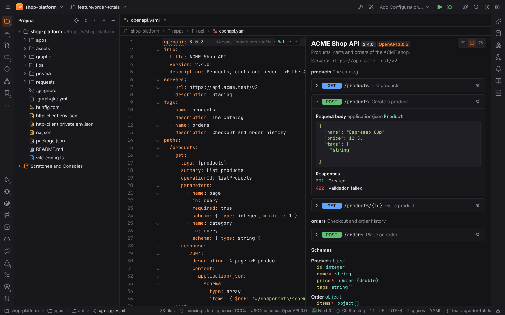

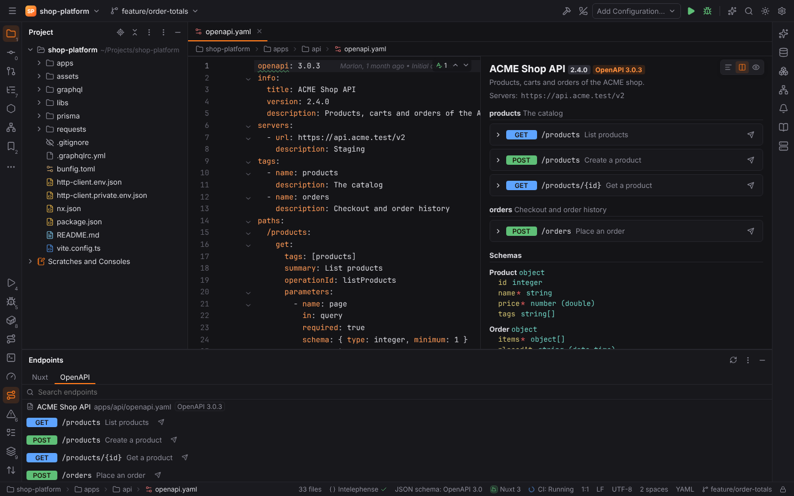

> **Note:** Swagger 2.0 documents get the preview and endpoints but no schema validation;
> external `$ref`s to other files are not followed.

## GraphQL

`.graphql`, `.gql` and `.graphqls` files are highlighted and checked against the project's
schema with apollo-compiler (MIT / Apache-2.0):

- **Schema**: the `schema` of `graphql.config.*` / `.graphqlrc*` (files or globs; an
  introspection result in JSON works too), else every `.graphql` file that defines types.
- **Validation**: unknown fields and types, missing required arguments, wrong variables and
  syntax errors are reported as you type. Schema files are checked against each other.
- **Completion** (`Ctrl+Space`): fields with their types and descriptions (deprecated ones
  struck through), arguments, types after `on` and in variable definitions, and the top-level
  keywords.
- **Get GraphQL Schema from Endpoint** (Tools menu) runs the introspection query against the
  endpoint of `graphql.config` (`extensions.endpoints`, with its headers) or one you enter, and
  saves the schema as SDL (`schema.graphql` by default).
- Queries run in the HTTP client as `GRAPHQL` requests (below).

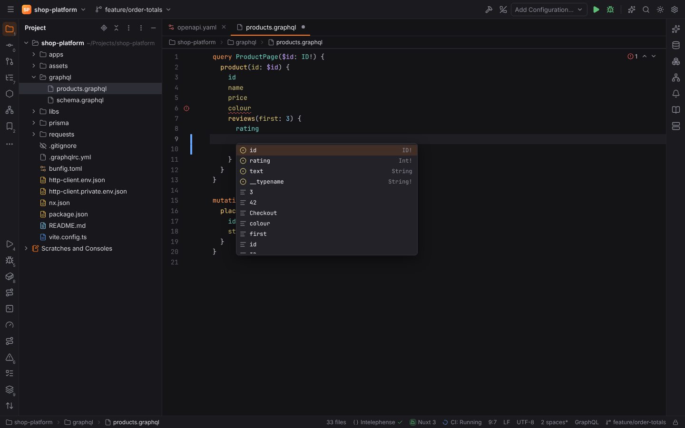

> **Note:** fragments are not resolved for completion inside spreads; `graphql-tag` strings in
> JavaScript are not checked yet.

## HTTP client extras

These extend [Scratches and the HTTP client](scratches-and-http.md).

### OAuth 2.0

Configure authorization in `http-client.env.json` (secrets in
`http-client.private.env.json`) under `Security.Auth`, like PHPStorm, and use the token with
`{{$auth.token("id")}}` (or `{{$auth.idToken("id")}}`):

```json
{
  "dev": {
    "Security": {
      "Auth": {
        "shop-api": {
          "Type": "OAuth2",
          "Grant Type": "Authorization Code",
          "Auth URL": "https://id.example.com/authorize",
          "Token URL": "https://id.example.com/token",
          "Redirect URL": "http://localhost:51234/callback",
          "Client ID": "storefront",
          "Scope": "openid products:read",
          "PKCE": true
        }
      }
    }
  }
}
```

```http
GET https://api.example.com/products
Authorization: Bearer {{$auth.token("shop-api")}}
```

- Grant types: **Client Credentials**, **Password** and **Authorization Code** (with PKCE,
  S256). The Authorization Code grant opens the login page in your browser and receives the
  code on a loopback port (the `Redirect URL`'s, else a free one).
- `Client Credentials: "in body"` sends the client secret in the form instead of
  `Authorization: Basic`.
- Tokens are kept in memory for the IDE session and refreshed with their refresh token when
  they expire. Tools | HTTP Client | Clear OAuth Tokens forgets them.

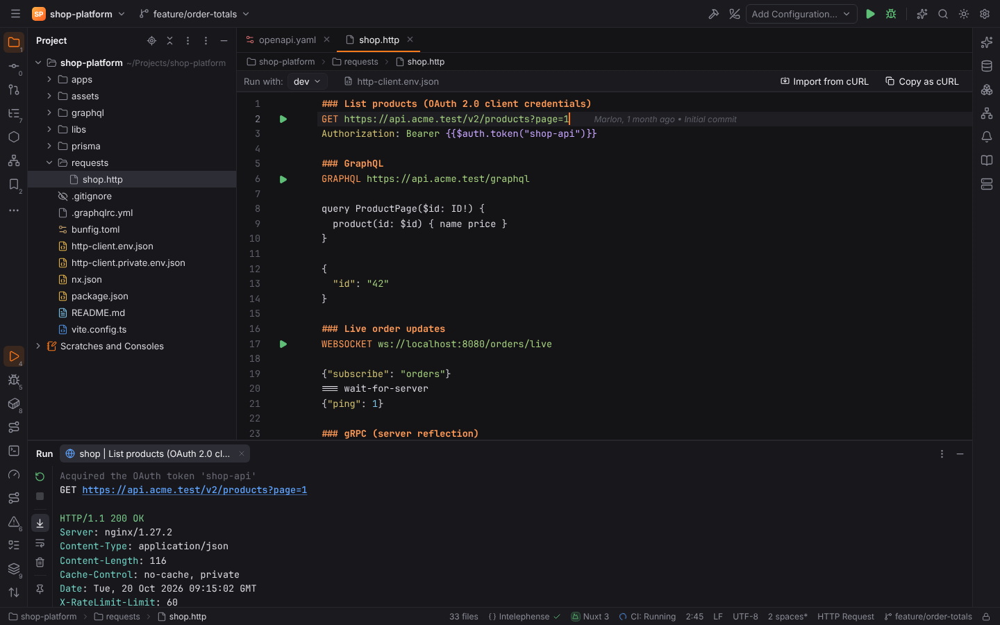

### cURL

- **Import from cURL** (toolbar of `.http` editors, Tools | HTTP Client): paste a `curl`
  command, for example from the browser's dev tools; it becomes a request (method, headers,
  `-d`/`--data-*`/`--json` bodies, `-F` multipart forms, `-u` basic auth, cookies, `-G`).
- **Copy as cURL**: the request at the caret, resolved with the environment, as a `curl`
  command line in the clipboard.

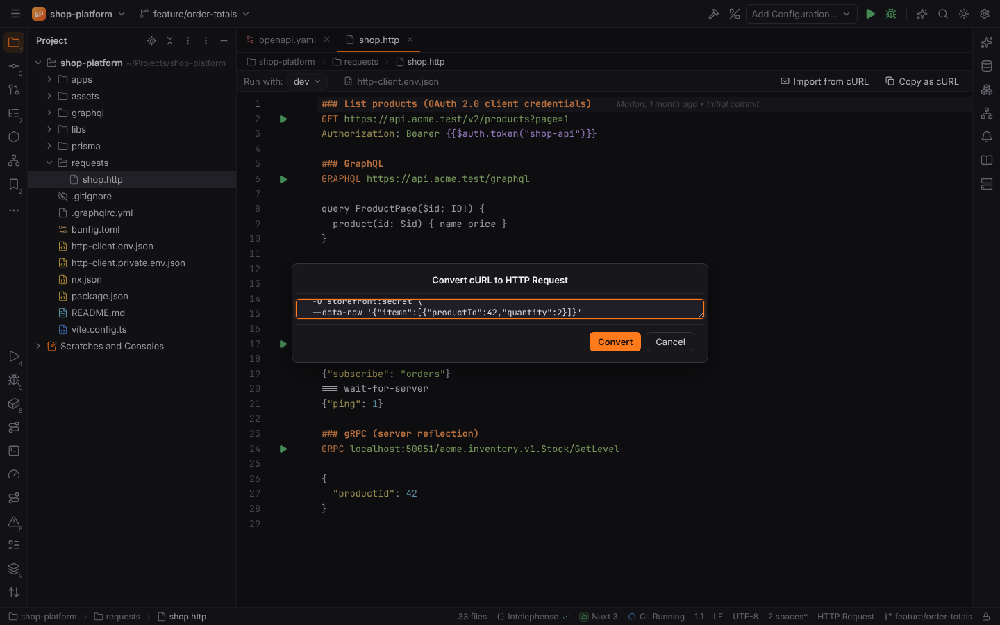

### GraphQL, WebSocket and gRPC requests

```http
GRAPHQL https://api.example.com/graphql

query Product($id: ID!) {
  product(id: $id) { name price }
}

{ "id": "42" }

###
WEBSOCKET ws://localhost:8080/orders/live

{"subscribe": "orders"}
=== wait-for-server
{"ping": 1}

###
GRPC localhost:50051/acme.inventory.v1.Stock/GetLevel

{ "productId": 42 }
```

- **`GRAPHQL`** sends the query (and the JSON variables block after it) as a GraphQL-over-HTTP
  `POST`.
- **`WEBSOCKET`** connects, sends the messages (separated by `===`; `=== wait-for-server` waits
  for a message from the server first) and keeps a live message log in the Run tool window
  (`▶` sent, `◀` received). Text typed into the console is sent as a message; Stop closes the
  connection.
- **`GRPC`** makes a unary call with the JSON body. The message types come from the server's
  reflection service (`grpc.reflection.v1`, then `v1alpha`); servers without reflection need
  their `.proto` files in Settings | Tools | HTTP Client (`httpClient.grpc.protoFiles`, files or
  import folders). `grpcs://` and `https://` use TLS.

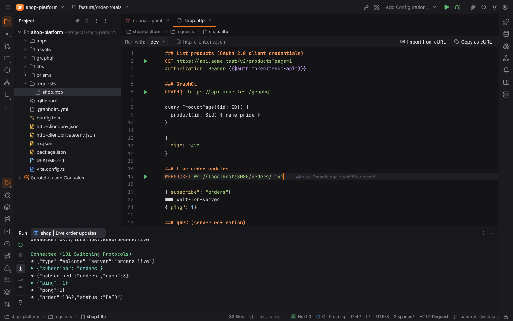

> **Note:** streaming gRPC methods, GraphQL subscriptions over WebSocket and sending WebSocket
> or gRPC requests from a remote project's host are not supported yet; they connect from this
> machine.
