# WebForge

The **WebForge** pack brings web development to Forge. Its plugins activate per project:

| Plugin | Id | Active for |
| --- | --- | --- |
| HTML, CSS & JavaScript | `forge.web` | projects with JavaScript, TypeScript, HTML or CSS |
| React | `forge.react` | `react` or `next` in `package.json` |
| Vue.js | `forge.vue` | `vue` or `nuxt` |
| Angular | `forge.angular` | `@angular/core` or `angular.json` |

Editing intelligence comes from the web language servers of the catalog: TypeScript
(`typescript-language-server` or `vtsls`), Vue (Volar), the Angular Language Service, HTML,
CSS, ESLint and Tailwind CSS. Install them from Settings | Languages & Frameworks |
**TypeScript** (the "Language Services" list) or the Language Servers page. See
[Language servers](language-servers.md).

## npm scripts

### npm tool window

The **npm** tool window (left stripe) lists every `package.json` of the project (also in
workspaces and sub-folders) with its scripts and the package manager it uses.

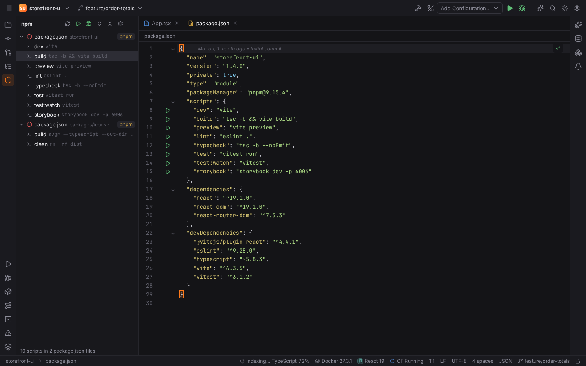

- **Double-click** a script to run it. It runs as a temporary **npm** run configuration in the
  Run tool window.
- The toolbar has **Reload Scripts**, **Run**, **Debug**, **Expand All**, **Collapse All** and
  **Settings**; the context menu has **Jump to Source**.
- **Install Dependencies** (Find Action) runs the package manager's install in the root
  package.

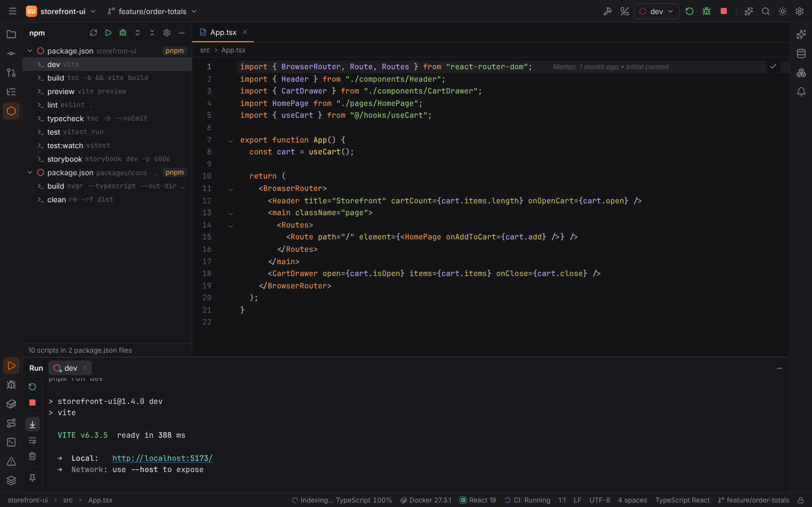

### Run icons in package.json

Every script in `package.json` gets a ▶ icon in the gutter (setting
`web.npm.gutterIcons`). Click it for **Run** and **Debug**.

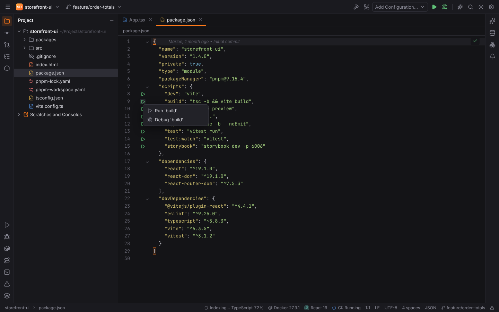

### Package managers

The package manager of a package is chosen from, in this order:

1. Settings | Languages & Frameworks | Node.js | **Package manager** (`web.packageManager`)
   when it is not `auto`;
2. the `packageManager` field of `package.json` (e.g. `pnpm@9.15.4`);
3. a lock file in the package's folder or a parent: `pnpm-lock.yaml`, `yarn.lock`,
   `bun.lock`/`bun.lockb`, `package-lock.json`;
4. npm.

npm, pnpm, yarn and bun are supported. Script arguments are passed after `--` for npm only.

### Debugging scripts

**Debug** on an npm script runs it under the JavaScript debugger (js-debug): breakpoints in
your JavaScript and TypeScript files stop every Node.js process the script starts. See
[JavaScript debugging and testing](javascript-debugging.md), which also covers the Node.js,
JavaScript Debug and Attach run configurations and the Jest, Vitest, Mocha, Playwright and
Cypress test runners.

Without js-debug (the download was declined, or the JavaScript Debugger plugin is disabled),
Debug sets `NODE_OPTIONS` to the value of **Node options when debugging scripts**
(`web.npm.debugArguments`, default `--inspect`); attach Chrome DevTools (`chrome://inspect`)
or another inspector client to the printed port.

### Settings | Languages & Frameworks | Node.js

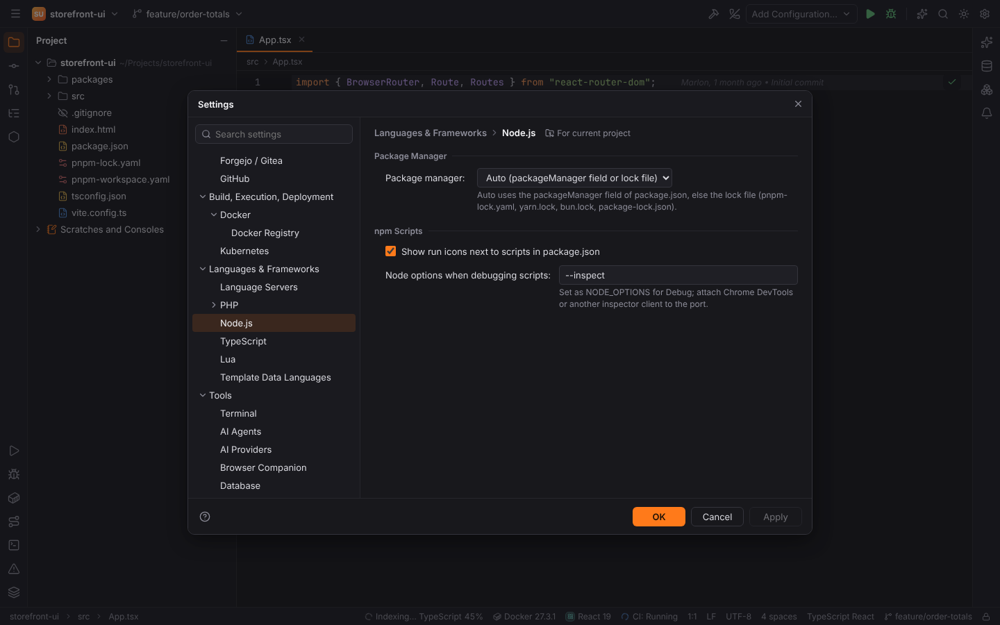

| Option | Setting | Default |
| --- | --- | --- |
| Package manager (`auto`, `npm`, `pnpm`, `yarn`, `bun`) | `web.packageManager` | `auto` |
| Show run icons next to scripts in package.json | `web.npm.gutterIcons` | on |
| Node options when debugging scripts | `web.npm.debugArguments` | `--inspect` |

## Component navigation

`Ctrl+B` / `Ctrl+Click` resolves components through your imports (relative paths,
`tsconfig`/`jsconfig` `paths` aliases, index files, barrel re-exports and **workspace
packages** imported by name — resolved through their `package.json` `exports`, `module`, `main`
or `types`, falling back to the sources when `dist/` is not built) before the language server
is asked. Several targets open the **Choose Declaration** popup. Turn it off with Settings | Languages & Frameworks | TypeScript | **Navigate
from JSX and template tags to components, props and events** (`web.navigation.components`).

### React

- On `<UserCard` in JSX: opens the component (function or class component, also anonymous
  default exports such as `export default () => …`, which are named after their file).
- On a prop (`title=`): opens the prop's declaration.
- On a component's own name: lists the JSX tags that use it (**Usages of …**).

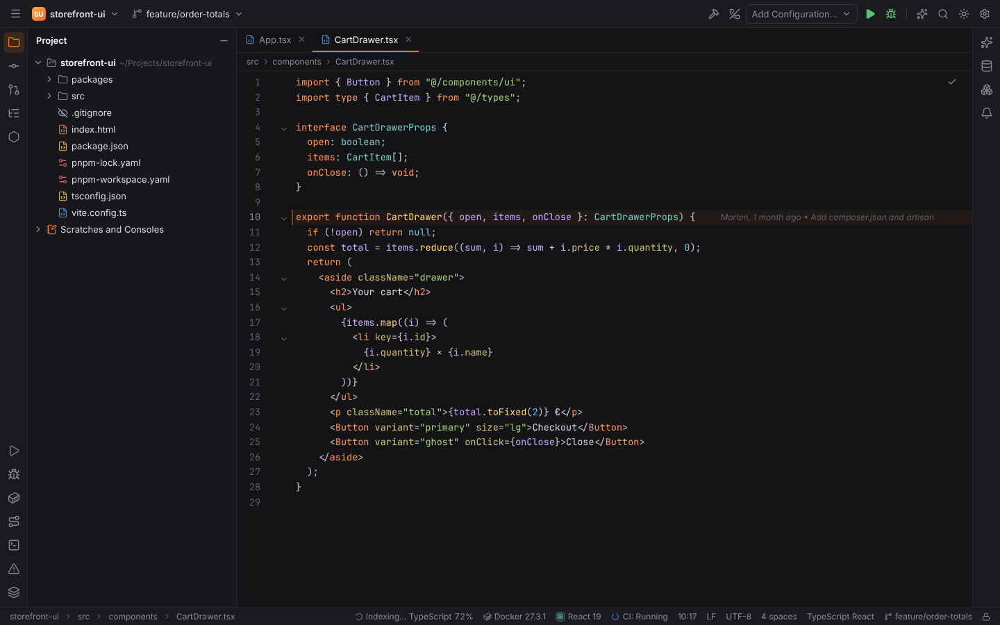

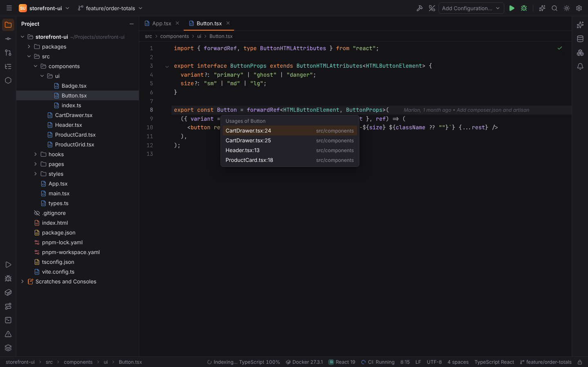

### Vue.js

Single-file components with `<script setup>` or the Options API:

- `<UserCard>` and `<user-card>` resolve through the script's imports, barrel files, or
  project-wide (global registration, Nuxt auto-imports);
- `:title` and `@select` go to the prop or emit;
- on a component's own name or block tag: its usages.

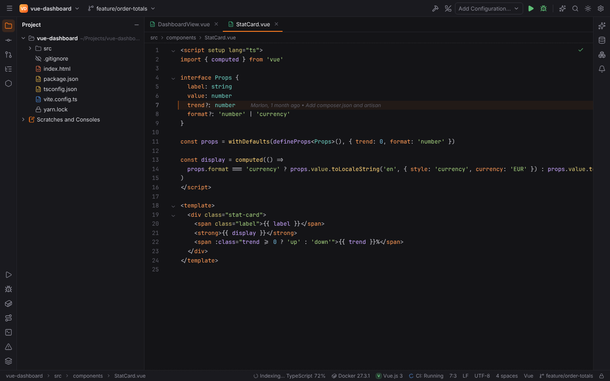

### Angular

- Element and attribute selectors in templates go to the component or directive.
- `[input]` and `(output)` bindings go to the input or output (decorators or signal
  functions).
- `| pipe` goes to the pipe.
- `templateUrl` and `styleUrls`/`styleUrl` strings open the files (**Choose Stylesheet** when
  there are several).
- **Line markers** link a component class with its template and styles, and a template back
  to its component (setting **Show line markers between components, templates and styles**,
  `angular.gutterIcons`).

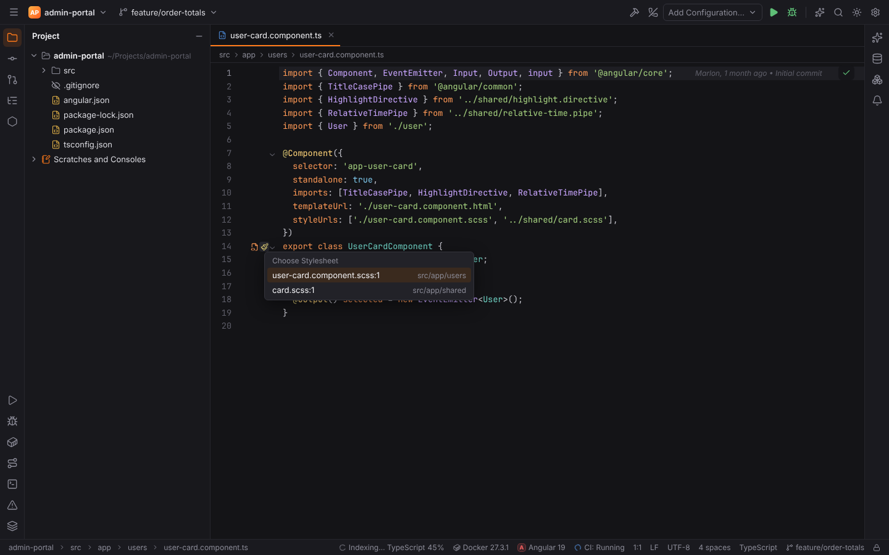

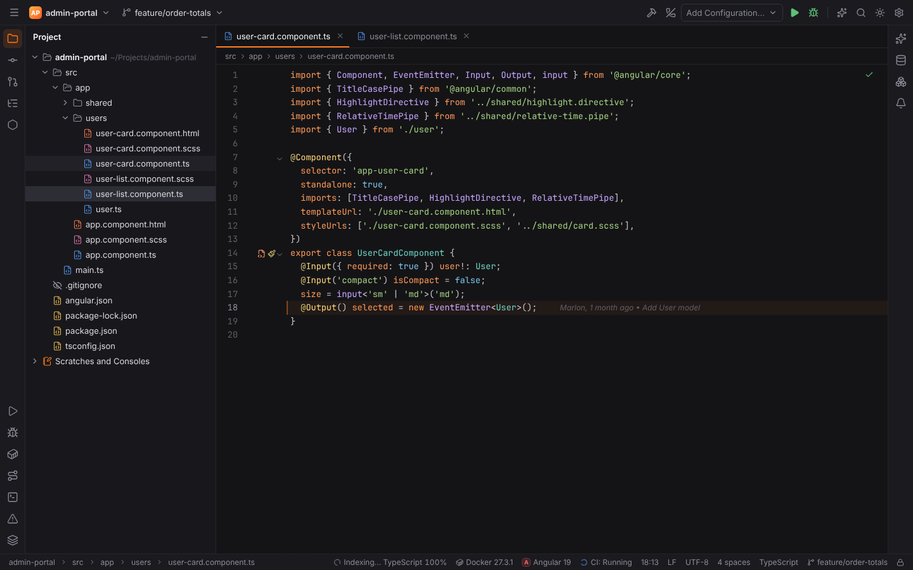

When several targets match, a **Choose Declaration** popup lists them.

## Refactoring

### Extract Component

Select whole elements of a Vue `<template>` or JSX elements in a React component and choose
Refactor | Extract/Introduce | **Component…** (also in Refactor This, `Ctrl+Alt+Shift+T`, and
`Alt+Enter`). The dialog asks for the component name (PascalCase) and the directory and shows
the props the new component gets: every name the markup takes from its parent (`{{ total }}`,
`:user="user"`, `@click="save"`, `{items.map(...)}`, `onClick={() => remove(item)}`). Names
bound inside the selection (`v-for` aliases, slot props, arrow function parameters) are not
props, and components and helpers the parent imports are imported by the new component
(relative imports are rewritten for its folder).

- **Vue**: a new `.vue` file with the markup in its `<template>` and `defineProps([...])` in a
  `<script setup>` (the `lang` of the parent's script), or `props` / `components` for the
  Options API. The parent renders `<NewComponent :total="total" />` and imports it (Options API:
  also registers it in `components`).
- **React**: a new `.jsx` / `.tsx` file with `export default function NewComponent({ ... })`
  returning the markup (several elements are wrapped in `<>…</>`, TypeScript gets a props
  interface). The parent renders `<NewComponent total={total} />` and imports it in its own
  import style.

The new file and the parent's changes are one undo step; **Preview** shows them first. The
analysis is Forge's own (Rust), so it needs no language server and works in remote projects.

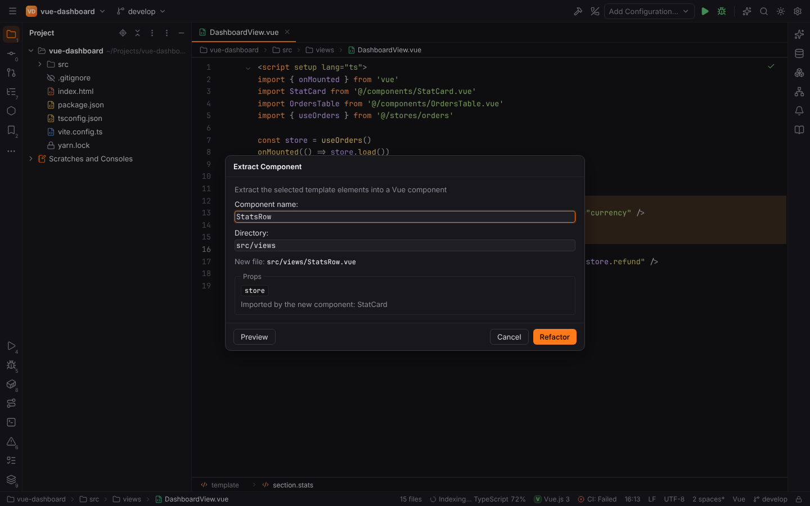

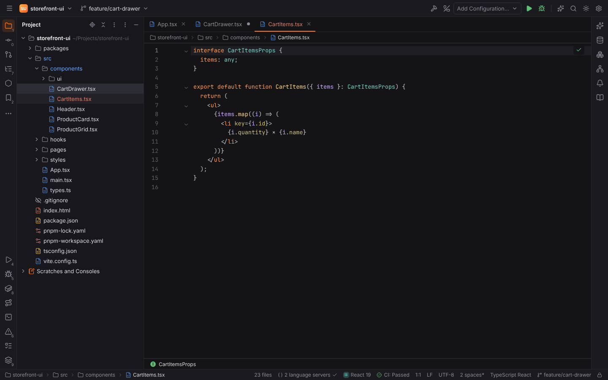

### Language server refactorings

In JavaScript and TypeScript files Refactor This adds the refactorings of the TypeScript
language server for the caret or selection, worded like PHPStorm where it has its own name:
**Extract Method** (function in module scope, method in class), **Introduce Constant**,
**Extract Type Alias** / **Extract Interface**, **Inline Variable**, **Move to New File**,
**Convert to function declaration** / **expression**, and the conversions the server offers as
they are (convert to arrow function, async function, template string, destructured parameters
or object, named / namespace imports, optional chain). `Alt+Enter` shows them with the same
wording. Introduce Variable, Extract Method and Inline (`Ctrl+Alt+V`, `Ctrl+Alt+M`,
`Ctrl+Alt+N`) use the server's refactorings directly.

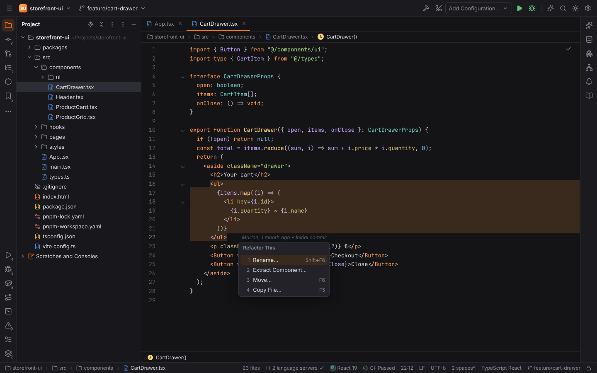

## Settings | Languages & Frameworks | TypeScript

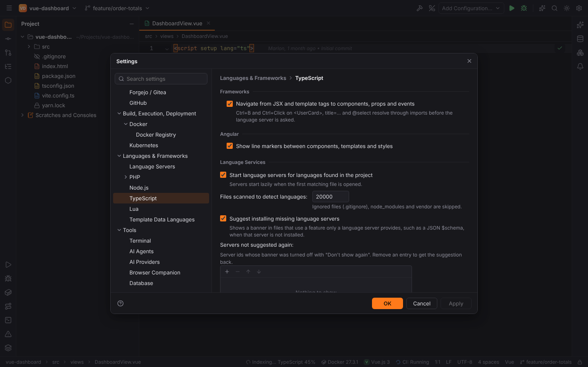

| Option | Setting | Default |
| --- | --- | --- |
| Navigate from JSX and template tags to components, props and events | `web.navigation.components` | on |
| Show line markers between components, templates and styles (Angular) | `angular.gutterIcons` | on |

Below these options, **Language Services** shows the web language servers (JavaScript &
TypeScript, Vue, Angular, HTML & CSS) with the same controls as the Language Servers page.

## ESLint, Prettier, Stylelint and Biome

Settings | Languages & Frameworks | Code Quality Tools configures the project's ESLint,
Prettier, Stylelint and Biome: problems on the fly, Fix … problems with `Alt+Enter`, Reformat
with Prettier, Prettier or Biome on Reformat Code and fix on save. See
[Web Code Quality Tools](web-quality-tools.md).

## Browser Companion

Click a React, Vue, Angular or Svelte component in your running app and its source opens in
Forge: see [Browser Companion](browser-companion.md).

## New web projects

The New Project wizard creates Vite, React, Vue.js, Angular, Svelte and static HTML projects,
see [Opening and creating projects](../getting-started/projects.md).

In [remote projects](remote-development.md) the npm tool window, package manager detection,
component navigation and gutter icons are computed by the Forge agent on the host, and scripts
run there like every run configuration.
