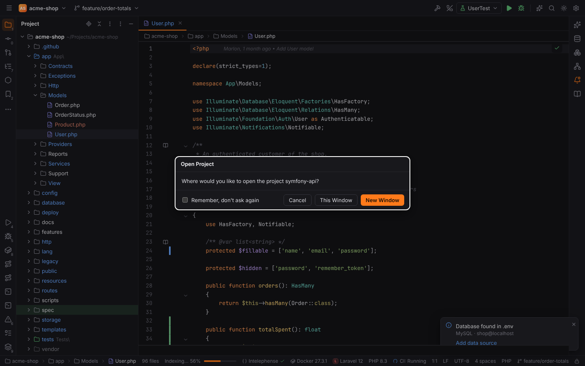
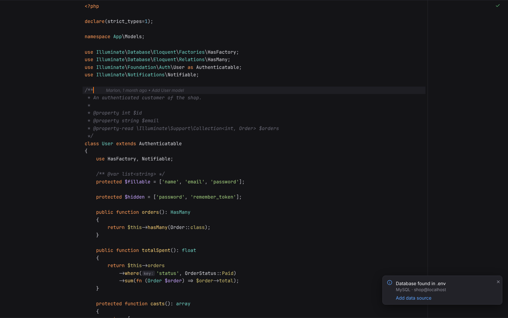
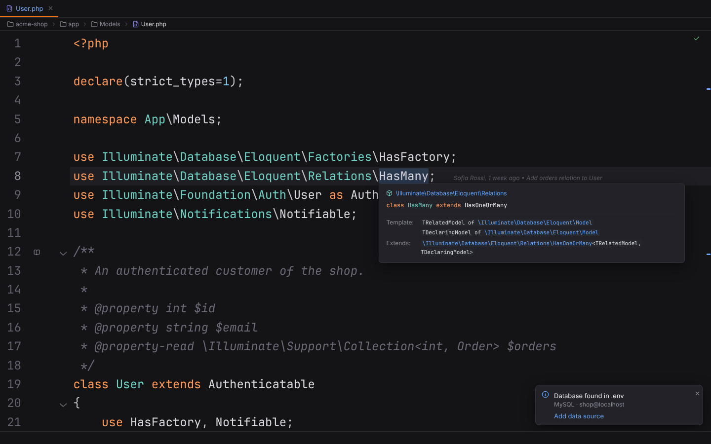
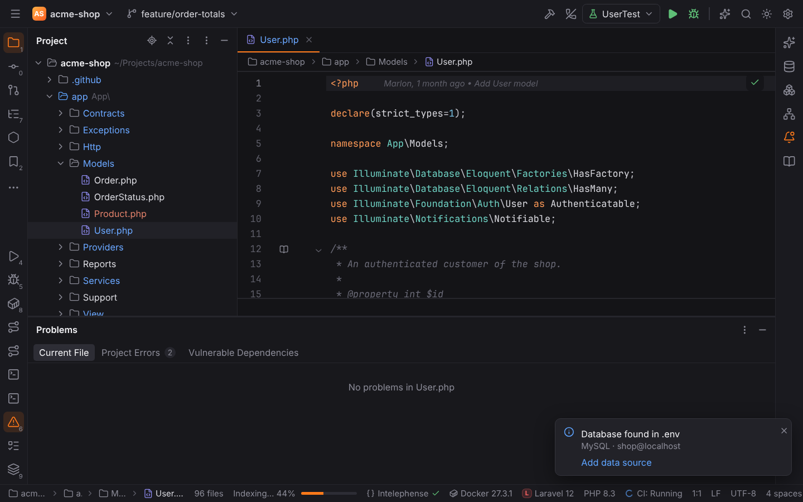
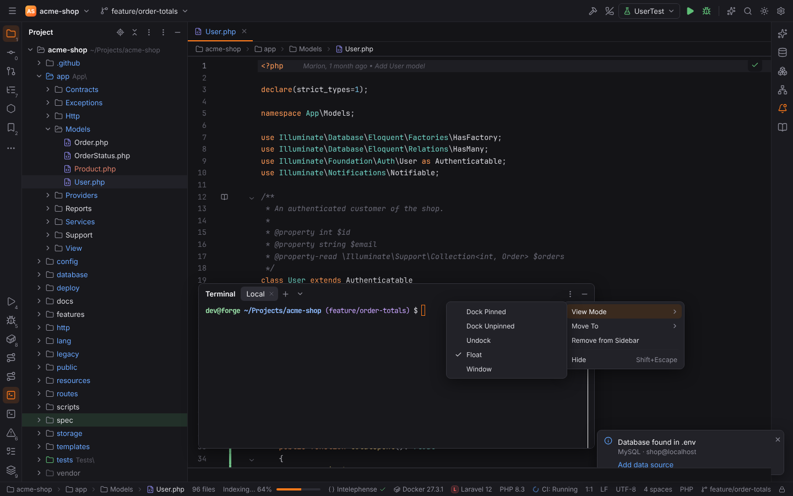
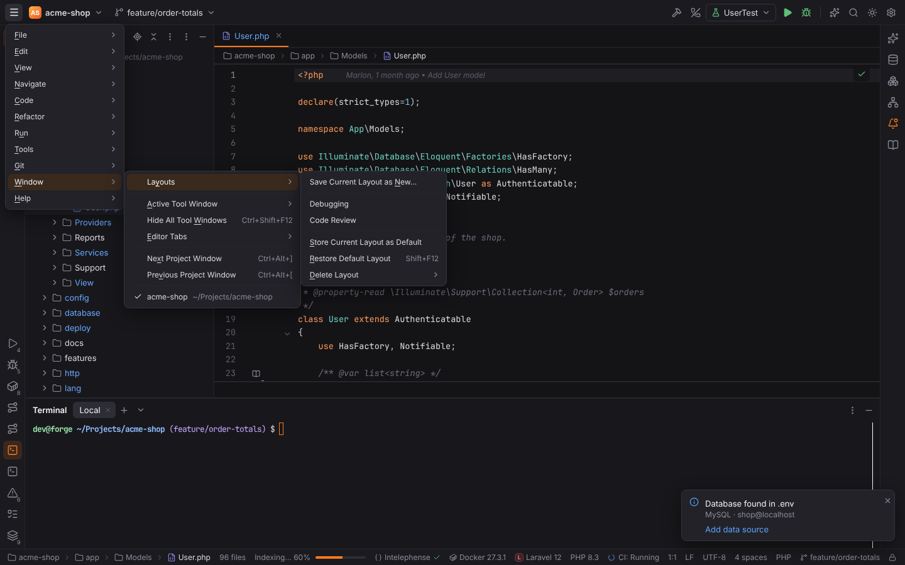
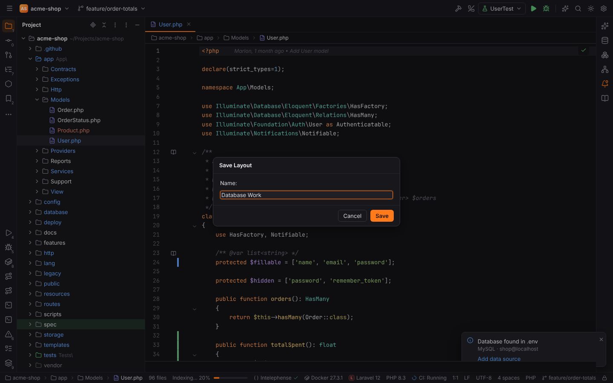

# Windows, modes and layouts

Forge arranges its windows like PHPStorm: every project has its own window, the workbench has
modes that leave only the editor, tool windows can float or get their own window, editor tabs
can move into a window of their own, layouts can be saved under a name, and the whole IDE can
be zoomed.

## Several project windows

Opening a project while another one is open (File | Open…, File | Recent Projects, a cloned
repository, a new project or a Git worktree) asks where to open it, as in PHPStorm:

- **New Window** opens the project in a window of its own; the current project stays open.
- **This Window** closes the current project and opens the new one in its place.
- **Remember, don't ask again** stores the answer in Settings | Appearance & Behavior |
  System Settings | Project | **Open project in** (`system.openProjectIn`: `newWindow`,
  `thisWindow` or `ask`). Change it there to be asked again.

A project that is already open in another window is not opened twice: that window comes to
the front. An untrusted folder asks "Trust and Open Project?" first, and the new window opens
it trusted or in Safe Mode as you decide (see [Project trust and Safe Mode](project-trust.md)). The Welcome screen always opens the project in its own window.

Every project window keeps its own project state: settings, language servers, terminals,
run configurations, the file watcher and the search index. Technically each project window is
a Forge process of its own; the windows find each other through a small registry in Forge's
cache directory (see [File locations](../reference/file-locations.md)).

| Action | Shortcut | What it does |
| --- | --- | --- |
| Window \| Next Project Window | `Ctrl+Alt+]` (macOS ``Cmd+` ``) | brings the next project window to the front |
| Window \| Previous Project Window | `Ctrl+Alt+[` (macOS ``Cmd+Shift+` ``) | the previous one |
| Window \| *project name* | — | the end of the Window menu lists every project window; the current one is checked |

Additional project windows open without the splash screen and do not check for updates; the
first window keeps the [Browser Companion](browser-companion.md) server and `forge://` links.
Remote projects (over SSH) open in the current window.

> **Note:** in browser mode (`pnpm dev`) the page is the only project window. **New Window**
> opens the demo project in a new browser tab with its own in-memory backend.

## Presentation, Distraction-Free, Zen and Full Screen

View | Appearance has PHPStorm's four modes. Each entry turns into **Exit …** while its mode is
on; running it again (or Find Action, `Ctrl+Shift+A`) leaves the mode.

| Mode | What you see |
| --- | --- |
| **Enter Presentation Mode** | full screen, no tool windows, toolbar or status bar, and a large editor font (Settings \| Appearance \| Presentation Mode \| **Font size**, `appearance.presentationFontSize`, default 24) |
| **Enter Distraction-Free Mode** | only the text: no tool windows, toolbar, tool window bars, status bar, editor tabs, breadcrumbs or gutter; the text is centered |
| **Enter Zen Mode** | Distraction-Free Mode in full screen |
| **Enter Full Screen** | the window covers the screen, everything else stays |

Entering a mode remembers which tool windows were open and whether the window was full
screen; leaving it restores both. Tool windows still open with their shortcuts inside a mode,
and **Hide All Tool Windows** (`Ctrl+Shift+F12`) hides them again. Leaving full screen while
Presentation or Zen Mode is on leaves the mode too. When Forge draws its own title bar, a
window that is not full screen keeps a slim title bar in these modes so you can still move it.

## Zoom IDE

View | Appearance | **Zoom IDE** scales the whole user interface: menus, tool windows, dialogs
and the editor.

| Action | Shortcut |
| --- | --- |
| Zoom In | `Ctrl+Alt+Shift+=` |
| Zoom Out | `Ctrl+Alt+Shift+-` |
| Reset | `Ctrl+Alt+Shift+0` |

The steps are 50, 67, 75, 80, 90, 100, 110, 125, 150, 175, 200, 250 and 300 %. The zoom is a
setting, Settings | Appearance & Behavior | Appearance | **Zoom** (`appearance.zoom`), so it
is kept for the next start and applies to every window, dialogs included. The editor font
size (Settings | Editor | Font) is independent of it.

> **Note:** the desktop app zooms the window's web view. Browser mode uses CSS `zoom`, where
> the terminal's text is not scaled.

## Tool window view modes

The **View Mode** submenu of a tool window (the **⋮** menu in its header, or a right click on
its stripe button) decides how the tool window shows when it is open:

| View mode | Behaviour |
| --- | --- |
| **Dock Pinned** (default) | docked at its place; the editor makes room for it |
| **Dock Unpinned** | docked, but it hides as soon as you click or focus another part of the IDE |
| **Undock** | slides over the editor at its place instead of making room, and hides when it loses the focus |
| **Float** | a panel over the IDE window: drag its header to move it, drag its bottom-right corner to resize it |
| **Window** | a separate window; closing that window hides the tool window |

The view mode, the place and the floating position are saved with the project's layout (and
with [named layouts](#layouts)). The stripe button and the tool window shortcut show and hide
the window in every mode. Choosing another view mode brings a tool window in **Window** mode
back into the IDE window.

A tool window in its own window shows its own content: files you open there (for example by
double-clicking a file in the Project tool window) open in the project window's editor. Tool
windows that follow the editor (Structure, Documentation) are most useful docked or floating.

> **Note:** in browser mode, **Window** shows the tool window as a framed panel inside the
> page, since the browser has no separate windows for it.

## Editor tabs in their own window

**Open in New Window** (`Shift+F4` in the editor, the tab's context menu, or Window | Editor
Tabs) moves the tab into a window of its own, with its own tabs and splits. Dragging a tab out
of the IDE window and releasing it outside does the same.

Closing that window docks its tabs back: every file it shows opens again as a tab of the
project window, with unsaved changes kept. The window belongs to its project window and closes
with it. Only project files move into their own window; SQL consoles, table editors,
scratches and other views stay in the project window.

> **Note:** an editor window edits, highlights and saves files; code insight popups such as
> Show Usages, refactorings and the language-server-driven inspections run in the project
> window. In browser mode the editor window opens as a browser popup with its own demo
> backend, so its edits do not reach the page.

## Layouts

Window | Layouts keeps tool window arrangements under a name, like PHPStorm:

| Entry | What it does |
| --- | --- |
| **Save Current Layout as New…** | asks for a name and saves which tool windows are open, where each one sits, its view mode, the floating positions and the sizes of the areas |
| *layout name* | restores that layout: its tool windows open, the others close |
| **Store Current Layout as Default** | the default layout for every project |
| **Restore Default Layout** (`Shift+F12`) | goes back to the stored default, or to Forge's own layout when you never stored one |
| **Delete Layout** › *layout name* | deletes a saved layout |

Names are compared without case and may be up to 64 characters long. Layouts are a user
setting (`workbench.layouts`, in `settings.toml`), so they are available in every project;
editor tabs are not part of a layout.
