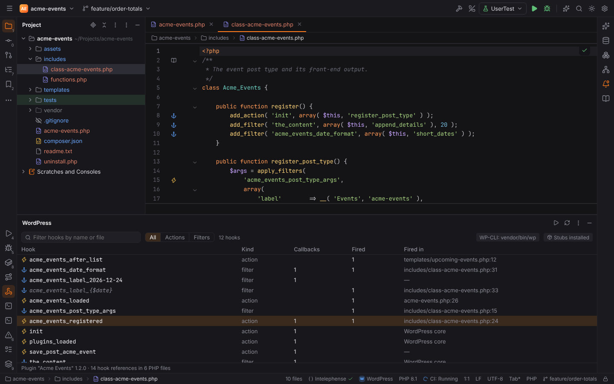
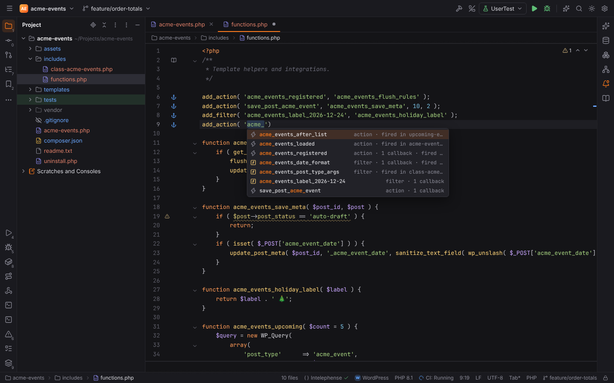
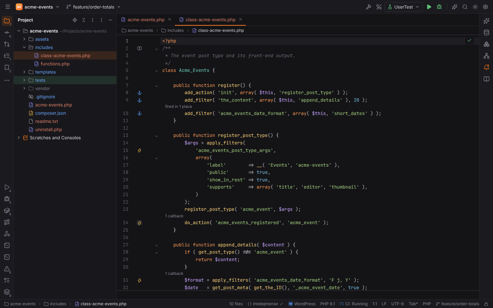
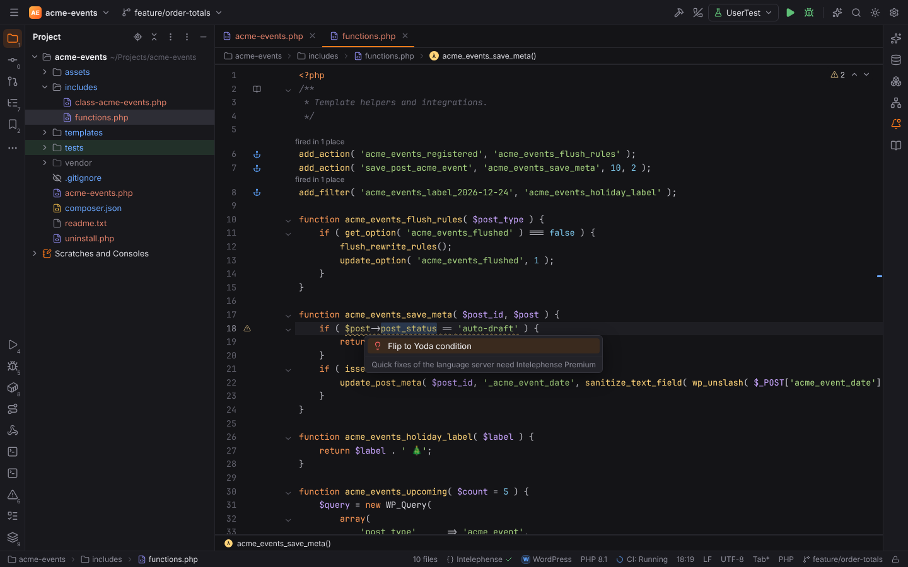

# WordPress

The WordPress plugin (`forge.wordpress`, PHPForge pack) activates in projects that use
WordPress:

| Project | Recognised by |
| --- | --- |
| A WordPress site | `wp-config.php`, `wp-config-sample.php` or `wp-includes/` (the version comes from `wp-includes/version.php`) |
| A Composer install (Bedrock and similar) | a `composer.json` that requires `johnpbloch/wordpress…` or any `roots/*` package |
| A content folder | `wp-content/` |
| A plugin | a PHP file in the project root with a `Plugin Name:` header |
| A theme | a `style.css` with a `Theme Name:` header |

The status bar shows the WordPress icon. Settings live in **Settings | Languages & Frameworks |
PHP | WordPress**.

## Hooks

Forge indexes every `add_action`, `add_filter`, `do_action`, `apply_filters` (plus the
`_ref_array` and `_deprecated` variants), `remove_action` / `remove_filter` /
`remove_all_*`, `has_action` / `has_filter`, `did_action` and `doing_action` call of the
project's PHP files (`vendor/` and `node_modules/` excluded). When the project contains
WordPress itself, the core hooks are indexed too.

Hook names built from variables are kept as patterns: `do_action( "save_post_{$post->post_type}" )`
fires for `add_action( 'save_post_book', … )`, and `'manage_' . $screen . '_columns'`
becomes `manage_{$screen}_columns`.

| Where | What Forge does |
| --- | --- |
| The hook name in `add_action( '…' )`, `do_action( '…' )`, … | **Completion** of hook names: the project's hooks first (actions in action functions, filters in filter functions; for registrations the hooks that fire), then frequently used WordPress core hooks with a short summary |
| `Ctrl+B` / `Ctrl+Click` on a registered hook name | the `do_action` / `apply_filters` calls that fire it |
| `Ctrl+B` on a fired hook name | the registered callbacks (`add_action`, `add_filter`) |
| `Ctrl+B` on a callback name (`'acme_boot'`, `[ $this, 'register' ]`) | the function or method |
| `Ctrl+B` on a WordPress function (`add_action`, `get_option`) | its declaration in the WordPress stubs, when they are installed |
| `Alt+F7` / `Ctrl+Alt+F7` on a hook name | **Find Usages**: every registration, invocation, removal and check, grouped as *Hook registration*, *Hook invocation* and *Function call* in the Find tool window |

### Gutter icons

With **Show gutter icons for hooks** (`wordpress.gutterIcons`):

- an **anchor** next to each `add_action` / `add_filter`: "Action 'init' is fired in 2
  places" (click: go there), "WordPress core action 'init': …" for core hooks the project
  does not contain, or "… is not fired in the project";
- a **lightning bolt** next to each `do_action` / `apply_filters`: "3 callbacks for
  'save_post'" (click: the callbacks; several open a chooser).

### WordPress tool window

**View | Tool Windows | WordPress** (or **Tools | WordPress | Show Hooks**) lists the project's
hooks with their kind, the number of registered callbacks and invocations and where they fire.
Filter by name or file and by **All / Actions / Filters**; double-click opens where the hook
fires. The toolbar shows how WP-CLI is run and whether the stubs are installed; the footer
says what was detected (site, plugin, theme) and how many files were indexed.
**Refresh** rescans (the index is otherwise reused for a few seconds).

## WordPress stubs

Go to Declaration on WordPress functions uses
[`php-stubs/wordpress-stubs`](https://packagist.org/packages/php-stubs/wordpress-stubs) when it
is installed in `vendor/`. Forge never ships the stubs. When they are missing, a notification
offers **Install with Composer** (`composer require --dev php-stubs/wordpress-stubs`, run
through the Run tool window, so you see what happens) or **Don't ask again**
(`wordpress.offerStubs`). **Tools | WordPress | Install WordPress Stubs…** does the same later.

## WP-CLI

**Tools | WP-CLI…** opens the [Command Line Tools Console](command-line-tools.md) with `wp `
typed in: commands, subcommands, options and their values complete from `wp cli cmd-dump`,
which Forge caches in its cache folder until `composer.lock` changes. Forge finds WP-CLI as
`vendor/bin/wp` or `wp-cli.phar` in the project, else `wp` on `PATH`; configure another path in
**Settings | Tools | Command Line Tool Support**.

WP-CLI runs project code, so it is refused while the project is in
[Safe Mode](project-trust.md).

## Code style

**Settings | Editor | Code Style | PHP › Set from… › WordPress** applies the WordPress Coding
Standards layout: tabs, spaces inside parentheses (`foo( $bar )`), long array syntax, braces
at the end of the line and spaces around concatenation.

The Yoda condition rule is an inspection: with **Suggest Yoda conditions**
(`wordpress.yodaConditions`) a comparison like `$status === 'publish'` gets a weak warning
"Use Yoda condition", and `Alt+Enter` › **Flip to Yoda condition** turns it into
`'publish' === $status`. Only simple comparisons are reported: a variable (with property and
array access) against a string, a number, `true`, `false` or `null` with `==`, `!=`, `===`
or `!==`.

## File templates

**File | New** offers two WordPress templates in WordPress projects (see
[File templates](file-templates.md)):

| Template | Creates |
| --- | --- |
| **WordPress Plugin** | `<name>.php` with the plugin header (`Plugin Name`, `Version`, `Requires at least`, `Requires PHP`, `Author`, `License`, `Text Domain`), the `ABSPATH` guard and an `init` callback |
| **WordPress Theme Stylesheet** | `style.css` with the theme header (`Theme Name` from the project name, `Text Domain`, …) |

## Settings

| Setting | Default | Meaning |
| --- | --- | --- |
| `wordpress.hookCompletion` | on | Complete hook names in hook functions |
| `wordpress.gutterIcons` | on | Gutter icons on registrations and invocations |
| `wordpress.yodaConditions` | on | The "Use Yoda condition" weak warning |
| `wordpress.offerStubs` | on | Offer to install the WordPress stubs (per project) |

See also: [Drupal, Joomla and Shopware](cms.md), [PHP](php.md),
[Code style](editor.md), [Command Line Tool Support](command-line-tools.md).
