# Workbench and tool windows

The workbench is the main window of an open project. It follows PHPStorm's New UI.

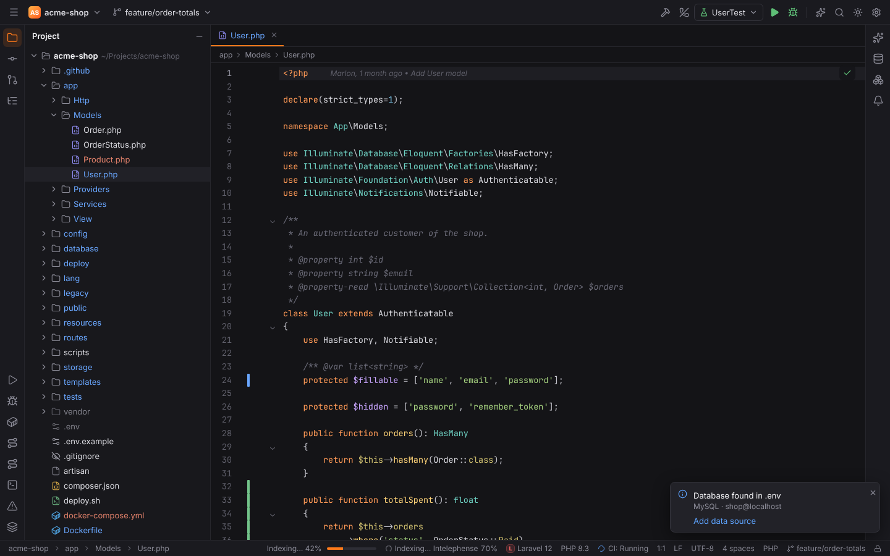

| Area | Where | What it holds |
| --- | --- | --- |
| Main toolbar | top | ☰ main menu, project widget, Git branch widget, run widget, AI Chat, Search Everywhere, theme toggle, Settings; it is also the window's title bar |
| Tool window stripes | left, right and bottom edges | buttons that show and hide tool windows |
| Editor | center | tabs, breadcrumbs and the code editor |
| Status bar | bottom | path of the current file, background tasks, project information, caret position, file type, Git branch |

## Main toolbar

From left to right:

- **☰ Main Menu** (`Alt+\`), see [Main menu](#main-menu) below.

- **Project widget**: the badge and name of the open project; click it to open another
  project.
- **Branch widget**: the current Git branch; click it for the [Branches popup](git.md#branches).
- Toolbar items of plugins, for example Xdebug's **Start Listening for PHP Debug Connections**
  button (see [Xdebug debugging](debugging.md)).
- **Run widget**: the selected run configuration with **Run** and **Debug** buttons, see
  [Run/Debug configurations](run-debug.md).
- **AI Chat**, **Search Everywhere** (`Double Shift`), the **theme toggle** (dark/light) and
  **Settings** (`Ctrl+Alt+S`).

Empty parts of the toolbar move the window; a double click maximizes it. The window buttons
sit at the toolbar's ends, styled for your desktop (see
[Window controls](settings-and-themes.md#window-controls)).

## Main menu

The main menu has PHPStorm's menus: **File, Edit, View, Navigate, Code, Refactor, Run, Tools,
Git** (**VCS** in projects without Git), **Window** and **Help**. Every entry shows its shortcut;
actions Forge has not implemented yet stay visible but disabled. Plugins add their own entries,
for example Tools | Laravel (Run Artisan Command…, Show Routes), Tools | Symfony and
Run | Start Listening for PHP Debug Connections. File | Open Recent and View | Tool Windows are
filled with your recent projects and the available tool windows.
File | New | **File** and **Directory** create the entry in the folder selected in the Project
view, else in the folder of the active editor, else in the project root (nested paths such as
`Jobs/SendMail.php` create the folders too).

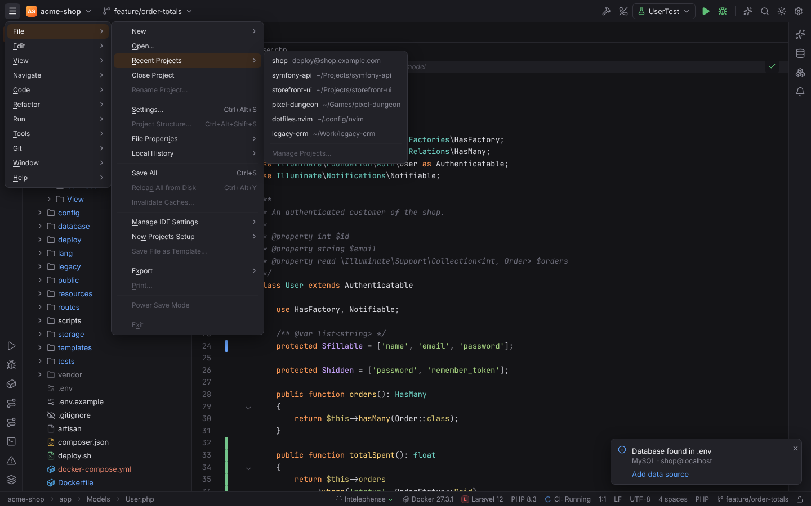

Where the menu appears is chosen with Settings | Appearance & Behavior | Appearance | UI
Options | **Main menu** (`appearance.mainMenu`), as in PHPStorm's New UI:

| Value | Look |
| --- | --- |
| `hamburger` (default) — Hamburger menu | behind the ☰ button at the left of the main toolbar |
| `merged` — Merged with main toolbar | the menu names (File, Edit, …) directly in the main toolbar |
| `toolbar` — Show in separate toolbar | a classic menu bar above the main toolbar |

View | Appearance | **Show Main Menu in Separate Toolbar** switches to the last mode from the
menu itself; **Compact Mode** and **Tool Window Bars** are toggles in the same submenu.

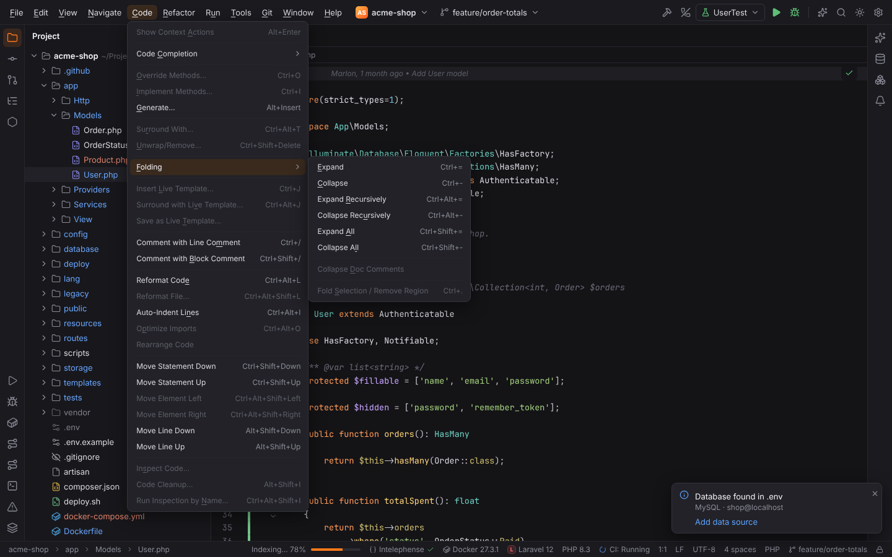

Keyboard: `Alt+\` opens the menu; the underlined letter (mnemonic) picks an entry, alone or with
`Alt`; arrow keys move, `Right`/`Left` open and close submenus and switch between the menus of
the menu bar; `Escape` closes. **Help | About** shows the version; **Help | Keymap Reference**
opens Settings | Keymap; **Help | Check for Updates…** checks for a new version (see
[Updates](../getting-started/first-start.md#updates)).

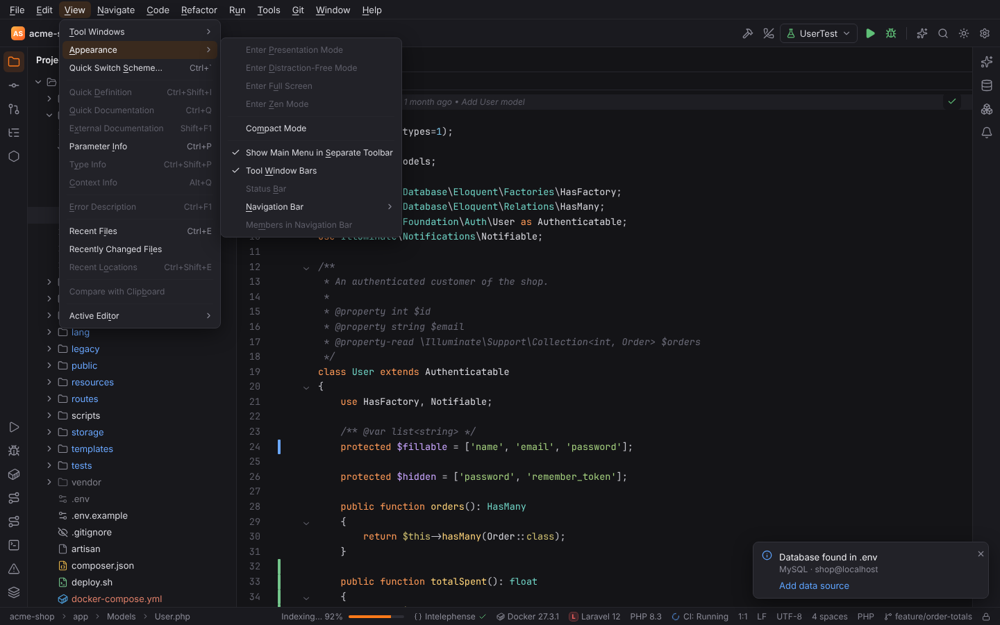

## Tool windows

Tool windows are the panels along the edges. Click a stripe button, or press the tool window's
shortcut, to show it; pressing the shortcut again hides it, as in PHPStorm.

| Tool window | Stripe | Shortcut | Page |
| --- | --- | --- | --- |
| Project | left | `Alt+1` (macOS `Cmd+1`) | below |
| Bookmarks | left | `Alt+2` (macOS `Cmd+2`) | [below](#bookmarks) |
| Commit | left | `Alt+0` (macOS `Cmd+0`) | [Git](git.md) |
| Pull Requests | left | — | [Code hosts](code-hosts.md) |
| Structure | left | `Alt+7` (macOS `Cmd+7`) | [PHP](php.md#structure), [LuaForge](luaforge.md) |
| npm | left | — | [WebForge](webforge.md) |
| Find | bottom | `Alt+3` (macOS `Cmd+3`) | [below](#find-tool-window) |
| Run | bottom | `Alt+4` (macOS `Cmd+4`) | [Run/Debug configurations](run-debug.md) |
| Debug | bottom | `Alt+5` (macOS `Cmd+5`) | [Xdebug debugging](debugging.md) |
| Services | bottom | `Alt+8` (macOS `Cmd+8`) | [Services](services.md) |
| Routes (Laravel) | bottom | — | [Laravel](laravel.md) |
| Symfony | bottom | — | [Symfony](symfony.md) |
| Terminal | bottom | `Alt+F12` | [Terminal](terminal.md) |
| Problems | bottom | `Alt+6` (macOS `Cmd+6`) | [Editor](editor.md#problems) |
| TODO | bottom | — | [below](#todo) |
| Git | bottom | `Alt+9` (macOS `Cmd+9`) | [Git](git.md#log) |
| AI Chat | right | — | [AI](ai.md) |
| Database | right | — | [Database tools](database.md) |
| Documentation | right | — | [Editor](editor.md#documentation-tool-window) |
| Doctrine | right | — | [Doctrine](doctrine.md) |
| Notifications | right | — | [below](#notifications) |

Framework tool windows (Routes, Symfony, Doctrine, npm) only appear in projects that use the
framework. The Find tool window appears once a search put results into it.

### Managing tool windows

| Action | Shortcut (Windows/Linux) | macOS |
| --- | --- | --- |
| Hide the active tool window | `Shift+Escape` | `Shift+Escape` |
| Hide all tool windows (again: restore) | `Ctrl+Shift+F12` | `Cmd+Shift+F12` |
| Jump to the last tool window | `F12` | `F12` |
| Stretch the focused tool window | `Ctrl+Shift+Left/Right/Up/Down` | `Ctrl+Alt+Shift+Left/Right/Up/Down` |
| Close the active tab of a tool window (Run, Terminal) | `Ctrl+Shift+F4` | `Cmd+Shift+F4` |

**Hide Side Tool Windows** has no default shortcut; run it from Find Action. Drag the border
between a tool window and the editor to resize it.

The stripes can be hidden with Settings | Appearance & Behavior | Appearance | **Show tool
window bars**; **Show tool window numbers** puts the `Alt+<n>` digit on their buttons.
**Compact mode** on the same page makes toolbars and tool window headers smaller, **Smooth
scrolling** animates scrolling in lists and trees.

### Layout per project

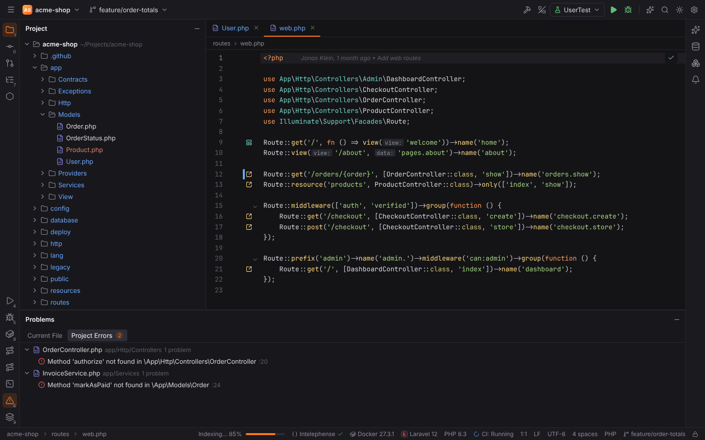

Forge remembers the layout of each project and restores it when the project opens again: which
tool window is open on each side, their sizes, the selected tab of tool windows with tabs
(Problems, Pull Requests) and the open editor tabs with the active one. It is kept in Forge's
state directory (`~/.local/state/forge/layouts` on Linux, see
[File locations](../reference/file-locations.md)), never in the project.

> **Note:** "Restore Default Layout" and "Maximize Tool Window" are not available yet.

## Project view

The Project tool window (`Alt+1`) shows the project folder as a tree.

- **Single click opens** a file and expands a folder by default. To work like PHPStorm (single
  click selects, double click opens), turn off Settings | Appearance & Behavior | Appearance |
  Project View | **Open files with single click** (`projectView.openFilesWithSingleClick`).
- **Keyboard**: `Up`/`Down` move the selection, `Right` expands, `Left` collapses or goes to
  the parent, `Home`/`End` jump to the first/last row, `Enter` or `F4` opens.
- Files and folders ignored by Git (`.gitignore`, `.git/info/exclude`, the global excludes
  file) are grayed out.
- **Scratches and Consoles** appear at the bottom of the tree, see
  [Scratches, consoles and HTTP client](scratches-and-http.md).

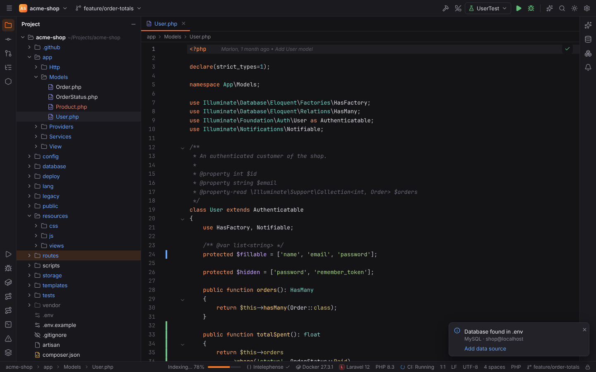

### Context menu

Right-click a file, a folder or the empty area below the tree:

| Entry | What it does |
| --- | --- |
| New > File / Directory | Creates a file or folder in the selected folder (or the file's folder). The name may contain `/` to create nested folders, e.g. `app/Models/Order.php`. A new file opens in the editor. |
| Copy Path/Reference > Absolute Path (`Ctrl+Shift+C`), Path From Project Root, File Name | Copies to the clipboard |
| Find in Files… | searches the folder (or the project), see [Find in Files](search-everywhere.md#find-in-files) |
| Rename… | Renames the file or folder. Unsaved changes in open tabs are saved first and the tabs follow the new name. |
| Delete… | Deletes after a confirmation; folders with all their content. This cannot be undone. |
| Reload from Disk | Re-reads the folder |

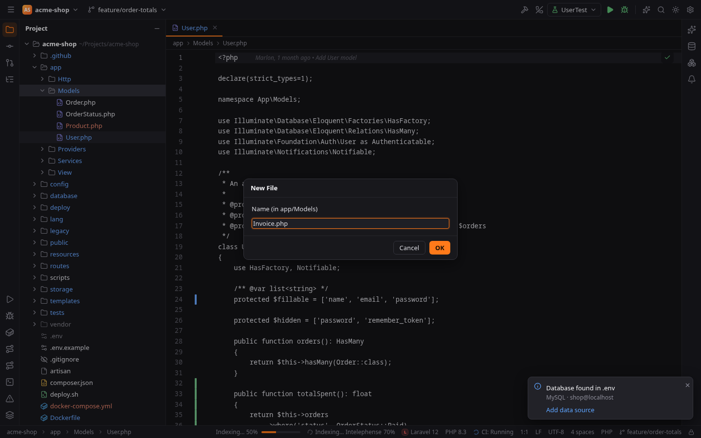

## Editor tabs

- Each open file has a tab. The active one is highlighted; a modified file is marked until it
  is saved.
- Close a tab with its × button, a middle click, or `Ctrl+F4` (macOS `Cmd+W`).
- `Alt+Right` / `Alt+Left` (macOS `Ctrl+Right` / `Ctrl+Left`) select the next/previous tab.
- `Ctrl+S` (macOS `Cmd+S`) saves all files (**Save All**).
- Some tabs are not files: merge requests, issues, database consoles and table editors open as
  tabs as well.

Breadcrumbs above the editor show the file's folder path.

### Tab context menu

Right-click a tab for PHPStorm's tab menu. The same actions are in Window | Editor Tabs and in
Find Action (`Ctrl+Shift+A`), where you can also give them shortcuts (Settings | Keymap).

| Entry | What it does |
| --- | --- |
| Close (`Ctrl+F4`) | closes the tab |
| Close Other Tabs | closes every other tab of the group; pinned tabs stay |
| Close All Tabs | closes every tab of the group except pinned ones |
| Close Unmodified Tabs | closes the tabs without unsaved changes |
| Close Tabs to the Left / to the Right | closes the unpinned tabs on that side |
| Pin Tab / Unpin Tab | pins the tab, see [Pinned tabs](#pinned-tabs) |
| Split Right / Split Down | opens the file in a new editor group next to or below this one |
| Split and Move Right / Down | the same, and closes the tab here |
| Move to Opposite Group | moves the tab to the neighbouring group (only while split) |
| Change Splitter Orientation, Unsplit, Unsplit All | only while the editor is split |
| Copy Path/Reference… | Absolute Path, Path From Project Root, File Name |
| Select in Project View | reveals the file in the Project tool window |

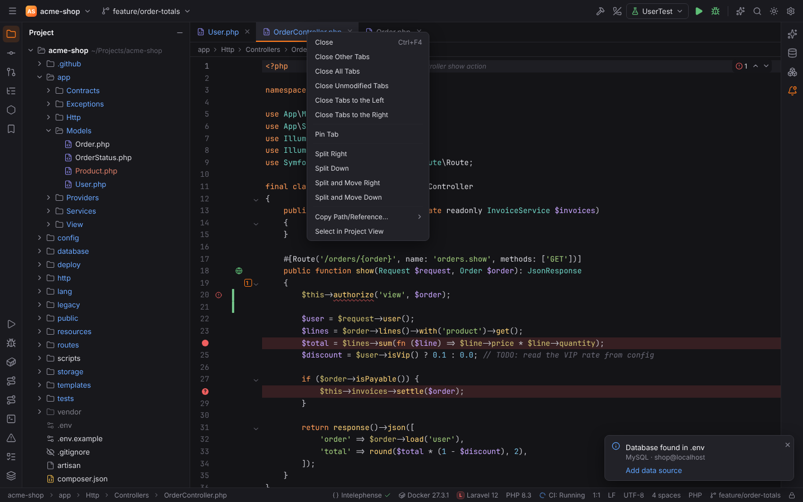

### Split editors

**Split Right** (`SplitVertically`) and **Split Down** (`SplitHorizontally`) show a file in a
second editor group. Both groups edit the same document: typing in one shows up in the other
at once, undo in a group undoes what you typed there, and the file is saved once. Each group has its own tabs and its
own active tab; the group you click is the active one, and actions such as **Close** or
**Find Usages** apply to it.

- **Goto Next Splitter** / **Goto Previous Splitter** move the focus between groups.
- **Move to Opposite Group** moves the active tab to the other group.
- **Change Splitter Orientation** toggles side by side and stacked.
- **Unsplit** merges the active group into its neighbour; **Unsplit All** merges all groups.
  A group whose last tab is closed disappears.

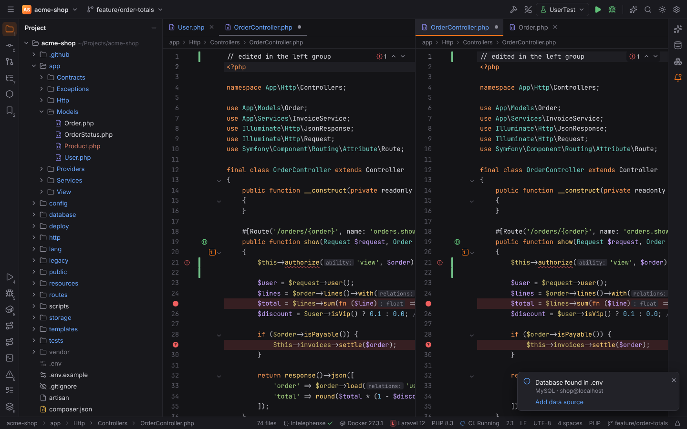

### Pinned tabs

**Pin Tab** (tab context menu or Window | Editor Tabs) keeps a tab at the front of its group
with a pin icon. Close Other Tabs, Close All Tabs, Close Tabs to the Left/Right and the tab
limit never close pinned tabs; close them with **Close** or unpin them first.

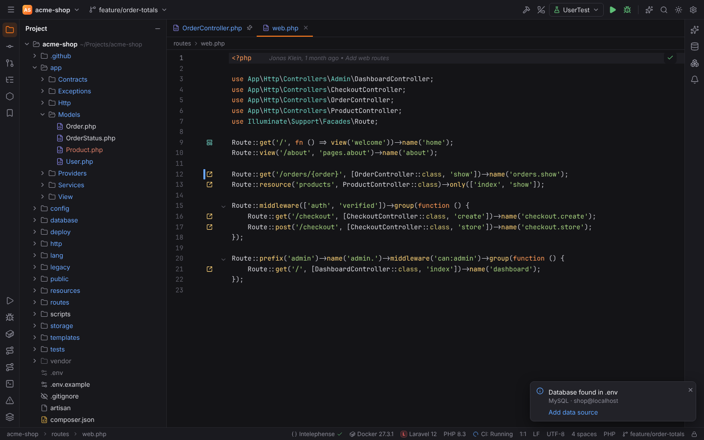

### Tab limit and closing policy

Settings | Editor | General | Editor Tabs:

| Setting | Default | Meaning |
| --- | --- | --- |
| Tab limit (`editor.tabs.limit`) | 10 | Maximum tabs per editor group; `0` keeps every tab. When a new tab goes over the limit, the least recently used tab is closed. |
| When the tab limit is reached, close non-modified tabs first (`editor.tabs.closeUnmodifiedFirst`) | on | Tabs with unsaved changes are closed last. |
| When the current tab is closed, activate (`editor.tabs.activateOnClose`) | Most recently opened tab | Or the tab on the left / on the right. |
| Show pin icon on pinned tabs (`editor.tabs.showPinnedIcon`) | on | |

**Reopen Closed Tab** brings back the last closed tab.

## Recent Files and Switcher

**Recent Files** (`Ctrl+E`, macOS `Cmd+E`) lists tool windows on the left and recently opened
files on the right. Type to filter (speed search). Press `Ctrl+E` again to show only
recently **edited** files; **Recently Changed Files** opens that view directly.

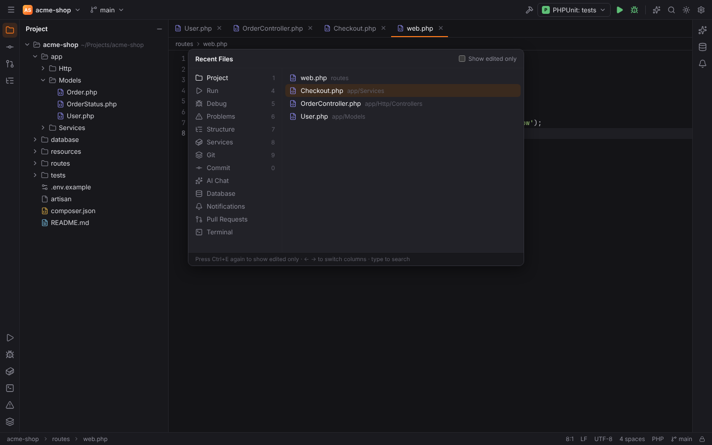

The **Switcher** (`Ctrl+Tab`, `Ctrl+Shift+Tab`) is the same popup for quick switching: keep
`Ctrl` pressed, press `Tab` to move, release to open.

**Back** and **Forward** (`Ctrl+Alt+Left` / `Ctrl+Alt+Right`, macOS `Cmd+[` / `Cmd+]`) move
through your navigation history.

## Recent Locations

**Recent Locations** (`Ctrl+Shift+E`, macOS `Cmd+Shift+E`, View | Recent Locations) lists the
places you recently looked at or edited, newest first, each with its file and a few lines of
code around the caret. Type to filter by file name or code. Press `Ctrl+Shift+E` again, or tick
**Show changed only**, to see only places you edited. `Enter` or a click jumps there. The
places follow edits (inserted lines above move them down) and file renames.

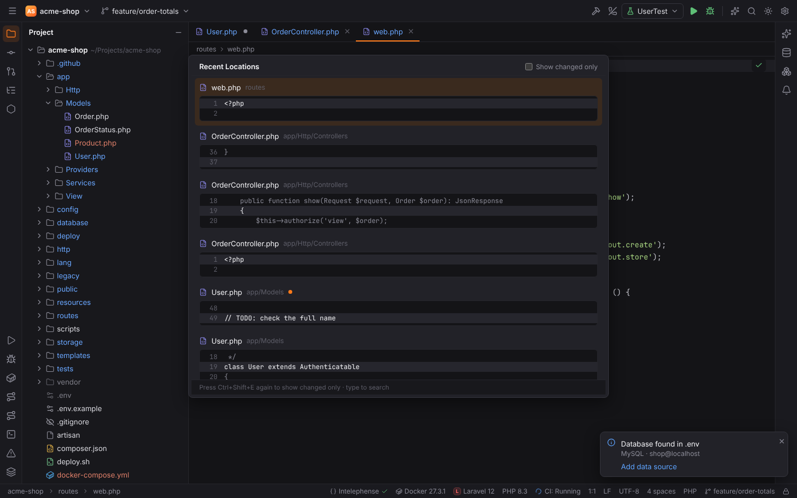

## Bookmarks

Bookmarks mark lines you want to come back to. They are stored per project in Forge's data
directory (see [File locations](../reference/file-locations.md)), never in the project, and
their lines follow your edits: lines inserted or removed above a bookmark move it.

| Action | Windows/Linux | macOS |
| --- | --- | --- |
| Toggle Bookmark on the caret line | `F11` | `F3` |
| Toggle Bookmark with Mnemonic (pick `0`–`9` or `A`–`Z`) | `Ctrl+F11` | `Alt+F3` |
| Toggle numbered bookmark 0–9 | `Ctrl+Shift+0` … `Ctrl+Shift+9` | `Ctrl+Shift+0` … `Ctrl+Shift+9` |
| Go to numbered bookmark 0–9 | `Ctrl+0` … `Ctrl+9` | `Ctrl+0` … `Ctrl+9` |
| Show All Bookmarks (Bookmarks tool window) | `Shift+F11`, `Alt+2` | `Cmd+F3`, `Cmd+2` |

Bookmarked lines show a bookmark icon (or the mnemonic) in the gutter. Navigate | Bookmarks
also has **Edit Bookmark Description…**, **Next Bookmark** and **Previous Bookmark** (in the
current file).

The **Bookmarks** tool window (`Alt+2`) shows bookmark lists with their files and lines.
Double click or `Enter` jumps to a line. The header has **New List…**, **Edit
Description…** and **Delete**. The context menu of a bookmark jumps to it, edits its
description, moves it to another list or deletes it; the context menu of a list renames,
clears or deletes it, or makes it the default list (new bookmarks go there).

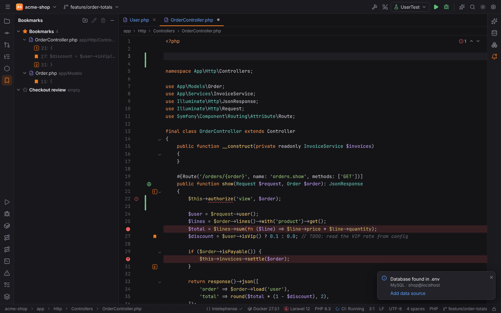

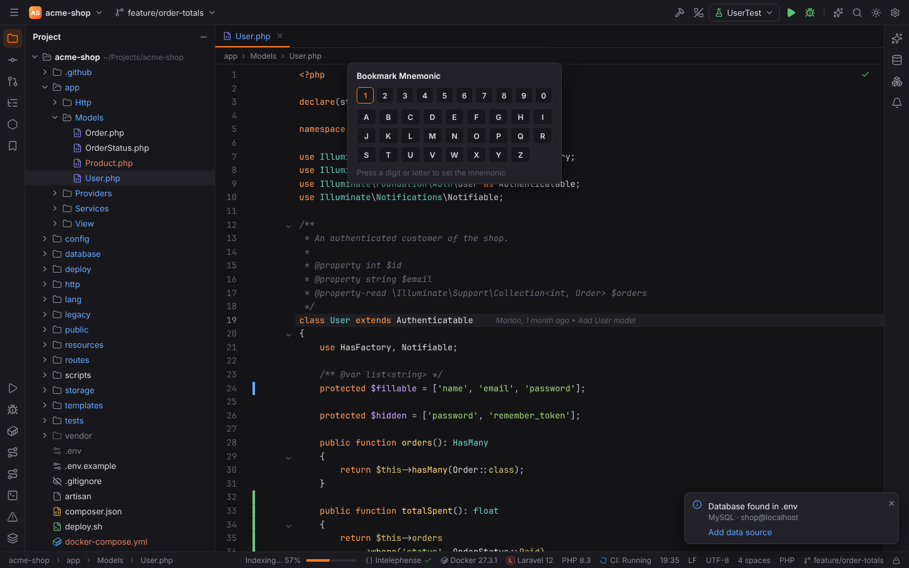

## Find tool window

The **Find** tool window (`Alt+3`) keeps search results, one tab per search:

- **Find Usages** (`Alt+F7`) and the pin button of **Show Usages** put usages there, grouped
  by usage type and file (see [Find Usages](editor.md#find-usages-and-show-usages)).
- **Open in Find Window** in [Find in Files](search-everywhere.md#find-in-files)
  (`Ctrl+Enter` in the popup) pins the text matches there, grouped by file.

The toolbar on the left has **Rerun** (text searches), **Group by Usage Type**, **Expand All**,
**Collapse All** and **Previous/Next Occurrence**. A click on a line opens it in the editor.
**Next Occurrence** / **Previous Occurrence** (`Ctrl+Alt+Down` / `Ctrl+Alt+Up`, macOS
`Cmd+Alt+Down` / `Cmd+Alt+Up`, Navigate menu) walk through the results of the active tab
without leaving the editor.

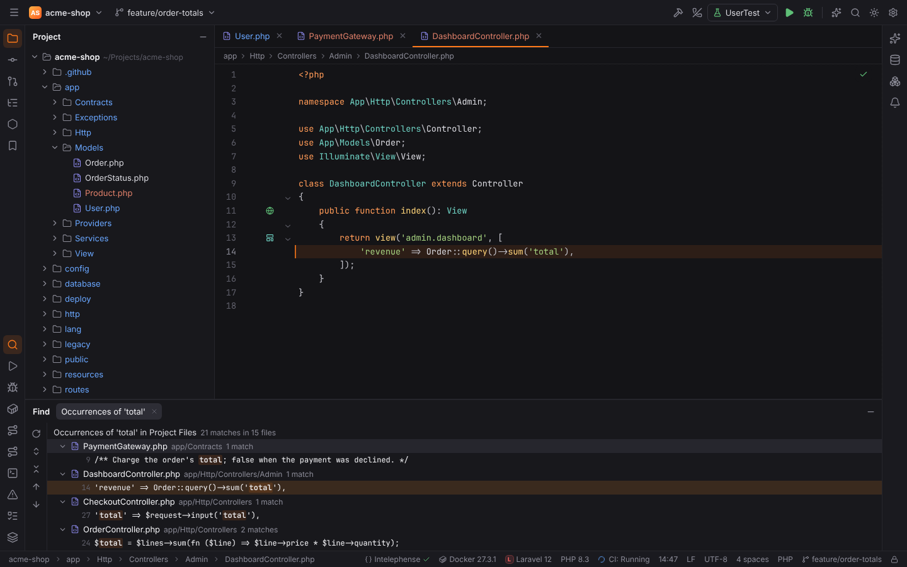

## TODO

The **TODO** tool window (View | Tool Windows | TODO) lists `TODO` and `FIXME` comments of
the project, grouped by file: `(line, column)` and the comment text. Only comments count, in
every file type whose comment syntax Forge knows (PHP, Blade, Twig, JavaScript/TypeScript,
CSS, HTML, SQL, Lua, YAML, shell, …); plain text and Markdown files are scanned as a whole.
Files ignored by `.gitignore` are skipped. In remote projects the scan runs on the remote host.

- **Project** shows the whole project, **Current File** only the file of the active editor.
- The list updates while you type (unsaved changes count) and when files change on disk.
- Toolbar: **Refresh**, **Filter TODO Items** (show only some patterns), **Group by
  Directory**, **Expand All**, **Collapse All**.
- A click on an item shows it in the editor; a double click moves the focus there.

The patterns are regular expressions in Settings | Editor | TODO (`todo.patterns`); the
defaults are PHPStorm's `\btodo\b.*` and `\bfixme\b.*`, case-insensitive. Add a tab and `case`
after a pattern to make it case-sensitive.

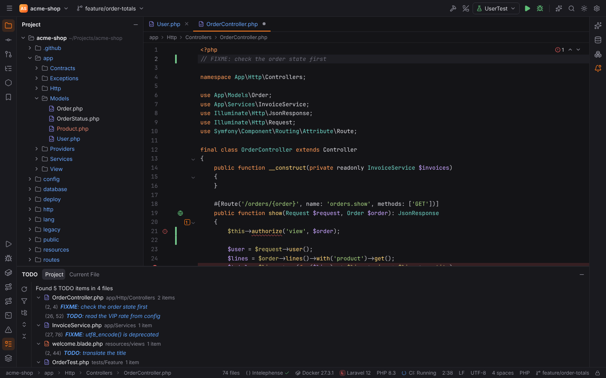

## Notifications

Every balloon that appears at the bottom right is also kept in the **Notifications** tool
window (right stripe), newest first, with its time, group and actions (for example **Add data
source**). The stripe icon shows a dot while there are unread notifications.

- A click marks a notification as read; **Mark All as Read** and **Clear All** are in the
  header (also in Find Action).
- The context menu of a notification removes it or sets how its group is displayed:
  **Balloon** (closes by itself), **Sticky Balloon** (stays until closed) or **No Popup (Tool
  Window Only)**.
- Settings | Appearance & Behavior | Notifications: **Display balloon notifications**
  (`notifications.balloons`; off shows nothing but the tool window) and the display mode per
  group (`notifications.groups`).

Groups are named after the feature: Forge, Database, Debugger, Language Servers, Remote
Development, Run, Services and Version Control.

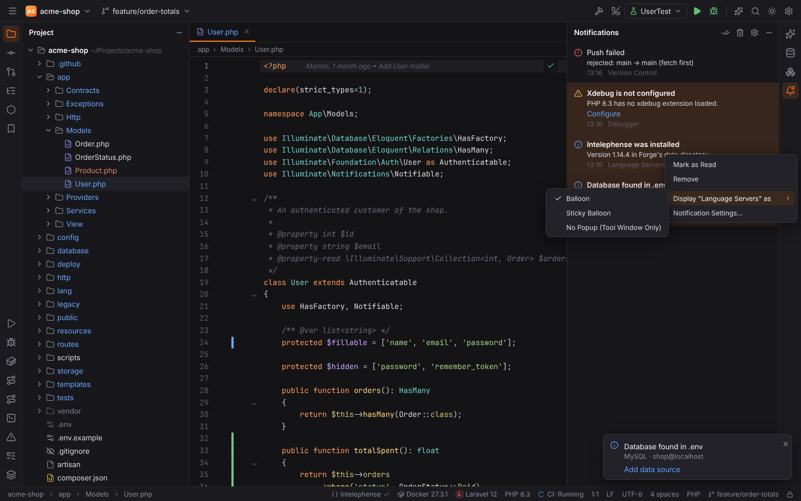

> **Note:** the history is kept until Forge is closed; it is not saved between sessions.

## Status bar

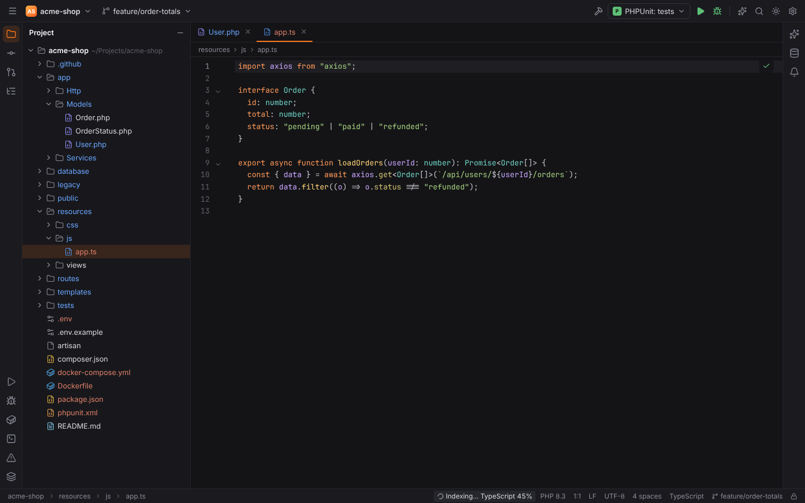

Left: the project name and the path of the current file. Right, depending on the project:

| Widget | Shows | Click |
| --- | --- | --- |
| Remote connection | host and latency of a remote project | connection popup, see [Remote development](remote-development.md) |
| Xdebug | listening state and port | [Xdebug debugging](debugging.md) |
| PHP indexing | "Indexing… 45%" while the PHP index is built | — |
| Language servers | "Indexing… TypeScript 45%" or the running servers | opens Settings | Languages & Frameworks | Language Servers |
| Docker | connection to the Docker daemon | [Services](services.md) |
| Project type | "Laravel 12", "Symfony 7.2 · dev", "React 19" | Settings | Plugins, or the framework's popup |
| PHP version | the PHP language level, e.g. "PHP 8.3" | PHP settings |
| CI status | pipeline status of the current branch | [Code hosts](code-hosts.md) |
| Caret | `line:column` | — |
| `LF`, `UTF-8`, `4 spaces` | line separator, encoding and indentation of the file | change the separator, reload or convert the encoding, configure indents, see [Editor](editor.md#line-separator-encoding-and-indent) |
| File type | e.g. "PHP", "Blade", "TypeScript" | — |
| Branch | the current Git branch | — |
